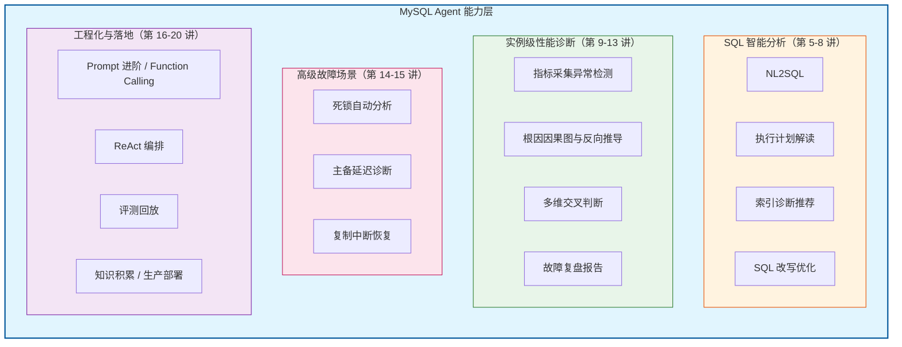
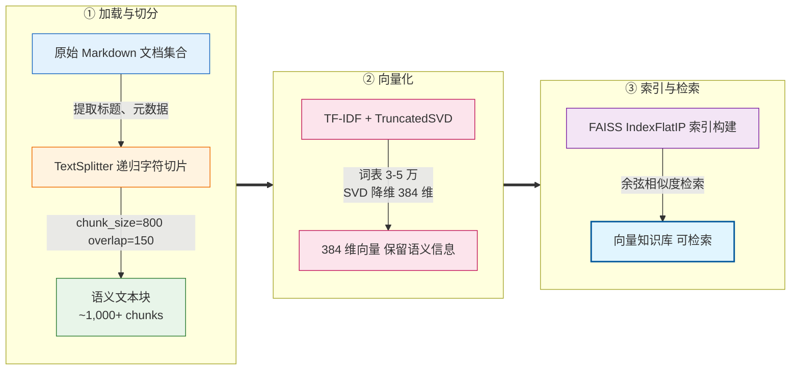
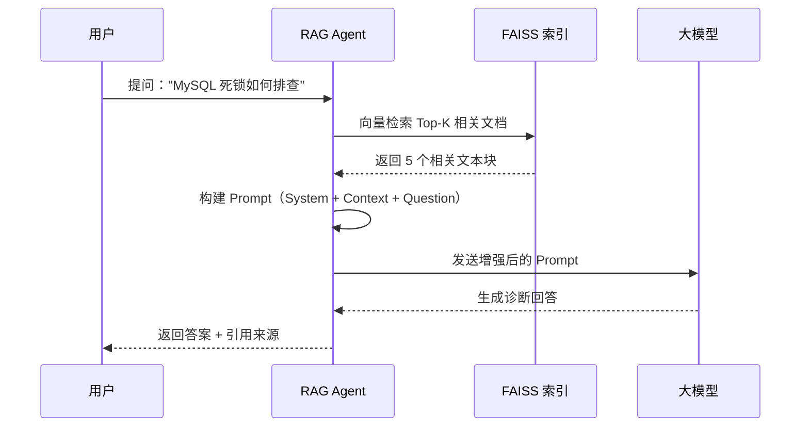
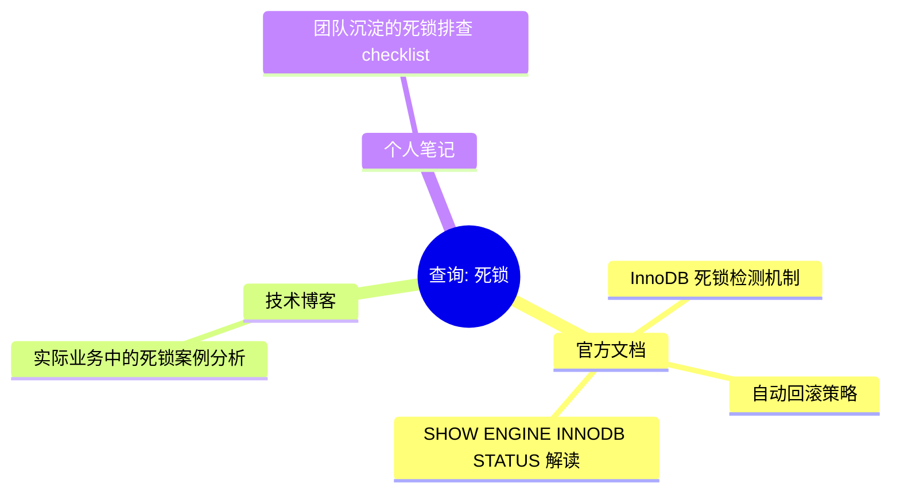
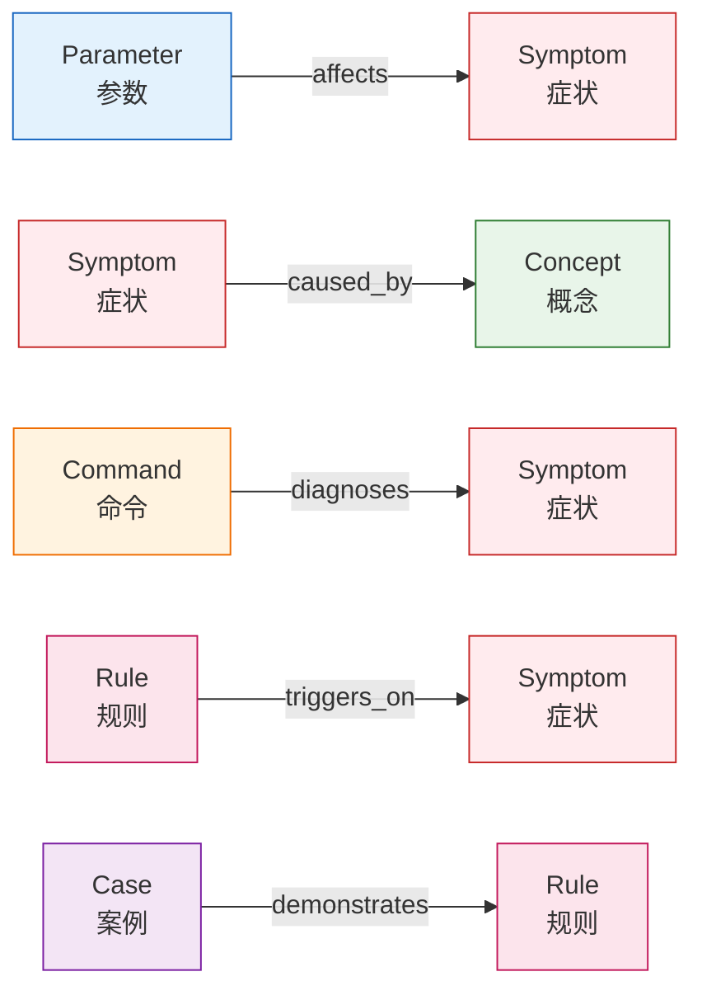

# 专栏第 1 讲：MySQL Agent 专栏概览与知识库构建

> **本文属于《大模型驱动的 MySQL 性能分析与自动化运维实战》专栏第 1 讲**
>
> 作者：**李文**
>
> 代码仓库：`mysql-agent-engine/` | 数据目录：`data/`
>
> **本讲定位**：专栏入口 + **向量知识库**构建（文档切片 / TF-IDF / FAISS）。轻量知识图谱为 Phase 1 JSON（§6），Neo4j 为可选 Phase 2，勿与「已上图数据库」混淆。

---

> 你好，欢迎开启《大模型驱动的 MySQL 性能分析与自动化运维实战》专栏的学习之旅。
> 本文是整套专栏的入口，将带你了解专栏全貌，并手把手教你构建第一个核心组件——**MySQL 向量知识库**。
> 即使你是第一次接触 LLM Agent，也能跟着本文完成环境搭建和知识库构建。

---

## 1. 专栏定位与目标

### 1.1 为什么要做 MySQL Agent？

传统 MySQL 性能分析面临三大痛点：

| 痛点 | 传统模式 | Agent 模式 |
|------|---------|-----------|
| **知识碎片化** | 靠经验、搜索、翻文档 | 结构化知识（向量库 + 轻量图谱）+ 检索 |
| **诊断依赖人** | 资深 DBA 手工排查 | 算法信号 + LLM 推理自动化 |
| **经验难沉淀** | 口口相传、文档过时 | 可版本化、可回放、可评测 |

**本专栏目标**：构建一个**可落地、可评测、可迭代**的 MySQL 智能诊断 Agent，覆盖从 SQL 级优化到实例级诊断的全链路。

### 1.2 专栏内容概览

本专栏共 **20 讲 + 导读**，按四模块推进（与 [目录](../目录.md)、[全书导读](../00-全书导读与架构总览.md) 一致）：

| 模块 | 讲次 | 内容 | 目标 |
|------|------|------|------|
| 模块一：知识与 Agent 基础 | 1–4 | 知识库、Hybrid Search、Prompt、RAG | 搭好检索与 Prompt 底座 |
| 模块二：SQL 智能分析 | 5–8 | NL2SQL、EXPLAIN、索引、改写 | 单条 SQL 诊断闭环 |
| 模块三：实例级诊断 | 9–13 | 路由、指标、根因、交叉、复盘 | 实例故障定位与报告 |
| 模块四：高级场景与工程化 | 14–20 | 死锁/复制、Prompt 进阶、编排、评测、知识运维、部署 | 生产可用与持续迭代 |

### 1.3 读者画像与前置要求

| 读者类型 | 需要的基础 | 能收获什么 |
|---------|-----------|-----------|
| DBA / SRE | MySQL 日常运维经验 | Agent 化诊断思路、可落地的工具链 |
| 后端开发 | SQL 编写与调优经验 | 系统性性能分析方法论、自动化工具 |
| AI 应用开发 | Python 基础 + LLM 概念 | 垂直领域 RAG 工程化完整实践 |

> 本专栏代码基于 Python 3.10+，核心依赖：`faiss-cpu`、`scikit-learn`、`numpy`。无需 GPU，普通笔记本即可运行。

### 1.4 核心能力矩阵

**图示：专栏能力四层 — SQL / 实例 / 高级场景 / 工程化**



> 「备份恢复指导」等能力可作为后续扩展，本专栏 20 讲未单独成章。

---

## 2. 知识库构建方法论

本节讲解如何将 MySQL 技术文档构建为向量知识库。本方法适用于任何结构化文本数据，包括官方文档、技术博客、个人笔记等。

### 2.1 核心术语速查

| 术语 | 含义 | 本文出现位置 |
|-----|------|-------------|
| **RAG** | Retrieval-Augmented Generation，检索增强生成 | §4.4（预览）；完整设计见第 4 讲 |
| **Embedding** | 将文本转换为数值向量的过程 | §3.1 |
| **TF-IDF** | 词频-逆文档频率，一种经典文本向量化方法 | §3.1 |
| **FAISS** | Facebook AI Similarity Search，高效向量检索库 | §3.1 |
| **Chunk** | 将长文档切分后的文本块 | §3.1 |
| **知识图谱** | 结构化实体关系网络，本文 Phase 1 用 JSON 简化实现 | §6 |

### 2.2 数据来源类型

你可以使用以下类型的文档构建知识库：

| 来源类型 | 示例 | 授权说明 |
|---------|------|---------|
| **官方文档** | MySQL Reference Manual、PostgreSQL Docs | 公开可自由使用 |
| **开放授权文章** | CC-BY/CC0 技术博客、Wiki 内容 | 遵守相应协议即可 |
| **个人笔记** | 你自己的学习整理、团队技术沉淀 | 拥有完整使用权 |
| **购买的内容** | 付费专栏、技术书籍（电子版） | **仅限个人本地使用，禁止分发** |

> ⚠️ **合规提示**：本教程仅提供技术处理方法。请确保你拥有输入数据的使用权，不要将无授权的付费内容上传至公开仓库。

### 2.3 示例数据准备

本教程使用 **MySQL 8.0 官方参考手册** 作为演示数据（公开免费）：

```bash
# 下载官方文档（HTML 格式）
wget -r -l2 -np https://dev.mysql.com/doc/refman/8.0/en/

# 转换为 Markdown 后放置于 data/raw/ 目录
# 或使用你自己的 Markdown 文档
```

实际应用中，你可以将 `data/raw/` 中的内容替换为任何你拥有使用权的资料。

---

## 3. 数据处理管线架构

### 3.1 处理流程

**图示：文档 → 切片 → 向量化 → FAISS 索引的处理管线**



> 以仓库现有语料为例：3 个专栏（`mysql45` / `mysql_ops` / `sql_master`）共 **1,303 个文本块**，词表 **37,328**，SVD 降到 384 维。若换用 MySQL 官方文档，块数与词表都会不同，以 `build_index.py` 实际输出为准。

### 3.2 代码结构

```
mysql-agent-engine/
├── src/mysql_agent/
│   ├── vectorstore/
│   │   ├── document_loader.py   # 文档加载与切片
│   │   ├── text_splitter.py     # 纯 Python 切片器(无依赖)
│   │   ├── tfidf_embedder.py    # TF-IDF + SVD 向量化
│   │   ├── embedder.py          # 统一接口(支持 ST/TF-IDF)
│   │   └── faiss_index.py       # FAISS 索引管理
│   ├── agents/
│   │   └── rag_agent.py         # RAG 问答 Agent
│   └── ...
├── scripts/
│   └── build_index.py           # 一键构建索引
└── notebooks/                   # 实验记录
```

---

## 4. 快速开始

### 4.1 环境准备

```bash
cd mysql-agent-engine
pip install -e ".[dev]"
```

### 4.2 一键构建索引

```bash
# 默认使用 TF-IDF (离线，无需下载模型)
python scripts/build_index.py

# 或指定参数（--columns 取内置三列语料：mysql45 / mysql_ops / sql_master）
python scripts/build_index.py \
  --output ./data/vector_index \
  --tfidf-dim 384 \
  --chunk-size 800 \
  --columns mysql45 mysql_ops sql_master
```

### 4.3 交互式问答

```bash
# 交互模式
python -m mysql_agent.agents.rag_agent ./data/vector_index

# 单次提问
python -m mysql_agent.agents.rag_agent ./data/vector_index \
  -q "MySQL 死锁如何排查"
```

### 4.4 RAG 交互流程（预览）

> 本节仅演示「检索 + 问答」最小闭环，完整 RAG 上下文构建、注入策略与评测见**第 4 讲**。

**图示：用户提问 → FAISS 检索 → Prompt → LLM 的预览链路**



---

## 5. 检索效果演示

### 5.1 典型查询效果（实跑数据）

> 下表基于 `data/vector_index` 的 1,303 个 chunk 实测，检索走 `HybridSearcher`（稠密 TF-IDF 0.6 + 稀疏 BM25 0.4，`alpha=0.6`）。分数为**融合得分**——两路各自归一化后加权，不是原始余弦相似度，因此不可与向量库里的 `score` 直接比大小。

| 查询 | Top-1 来源 | 融合得分 | 来源列 |
|------|-----------|--------|--------|
| `MySQL 死锁如何排查` | `MySQL实战45讲`（整本聚合块） | 0.73 | mysql45 |
| `慢查询优化步骤` | `33丨如何使用性能分析工具定位 SQL 执行慢的原因？` | 0.40 | sql_master |
| `Buffer Pool 配置` | `33 - 我查这么多数据，会不会把数据库内存打爆？` | 0.99 | mysql45 |
| `索引设计原则` | `29丨为什么没有理想的索引？` | 0.40 | sql_master |
| `主从复制延迟` | `36-备库有延迟怎么办？` | 0.40 | mysql_ops |

这张表有三处值得注意：

1. **`Buffer Pool 配置` 得 0.99**：`Buffer` / `Pool` / `配置` 三个 token 与《我查这么多数据，会不会把数据库内存打爆？》高度重合，第 2 名正是 `27-InnoDB Buffer Pool 如何提高数据库性能？`——说明混合检索在「术语明确」的问题上很稳
2. **`死锁` 只落到整本聚合块**：语料里死锁专题被切进 `MySQL实战45讲` 的合并 chunk，没有独立小节标题，所以 Top-1 是书名而非篇名。要更精准，需按讲次细分切分（切分策略见第 2 讲）
3. **0.40 一档是并列**：`sql_master` 这列按小节切得较碎，Top-3 常来自同一篇的不同片段，分数相同属正常，不代表检索失败

复现命令见 §4.3。语料换成你自己的文档后，来源与分数都会变，结论「能不能指到对的那篇」比具体数值更重要。

### 5.2 多来源交叉验证

当知识库包含多类文档时，同一问题可获得互补视角：

**图示：同一查询下官方文档 / 运维笔记等来源的互补视角**



> 💡 **提示**：检索效果取决于你的知识库内容质量。建议混合官方文档（准确性）和个人笔记（实践经验）构建知识库。

---

## 6. MySQL 知识库与图谱设计（轻量实现）

专栏标题含「知识图谱」，但 MVP 阶段**不强制上 Neo4j**。推荐两阶段路线：

| 阶段 | 实现 | 适用 |
|------|------|------|
| Phase 1（当前） | JSON 实体关系 + 向量检索 | 快速落地 RAG |
| Phase 2（可选） | Neo4j / NetworkX 图查询 | 多跳推理、可视化 |

### 6.1 实体类型

从专业知识与经验中提出 6 类核心实体（目标模型；当前 `data/kg/mysql_kg.json` 的 13 个节点只覆盖 Rule / Symptom / Command / Concept 四类，Parameter 与 Case 待补）：

| 实体类型 | 示例 |
|---------|------|
| Concept | Buffer Pool、redo log、MVCC |
| Parameter | innodb_buffer_pool_size |
| Symptom | 慢查询、连接满、复制延迟 |
| Command | EXPLAIN、SHOW SLAVE STATUS |
| Rule | R001、RC07、CC01 |
| Case | 知识积累的典型故障案例 |

### 6.2 关系类型

**图示：知识实体之间的主要关系类型（Phase 1 JSON）**



### 6.3 JSON 图谱示例

```json
{
  "nodes": [
    {"id": "RC07", "type": "Rule", "name": "大事务"},
    {"id": "sym_lock_wait", "type": "Symptom", "name": "锁等待"},
    {"id": "innodb_trx", "type": "Command", "name": "SELECT FROM information_schema.innodb_trx"}
  ],
  "edges": [
    {"source": "RC07", "target": "sym_lock_wait", "relation": "causes", "weight": 0.9},
    {"source": "innodb_trx", "target": "RC07", "relation": "verifies", "weight": 1.0}
  ]
}
```

该 JSON 与第 11 讲**共用同一套规则 ID**（RC01–RC18），避免「图谱」与「推理引擎」两套口径；但第 11 讲当前用的是 `reasoning/root_cause_rules.py` 规则表，`MySQLCausalGraph` 属 Phase 2 设计稿，尚未并入主链路。完整图谱见 `mysql-agent-engine/data/kg/mysql_kg.json`（130 节点 / 153 关系），本讲示例只取 3 个节点做最小演示。

### 6.4 从文档自动抽取（可选脚本）

```python
# scripts/extract_kg_entities.py（示例代码：仓库未收录，可自行保存后运行）
import re, json
from pathlib import Path

ENTITY_PATTERNS = {
    "Parameter": r"`(innodb_[a-z_]+)`",
    "Command": r"(SHOW\s+\w+|EXPLAIN|ANALYZE\s+TABLE)",
    "Symptom": r"(慢查询|死锁|复制延迟|连接.*满)",
}

def extract_from_markdown(md_path: str) -> list:
    text = Path(md_path).read_text(encoding="utf-8")
    entities = []
    for etype, pattern in ENTITY_PATTERNS.items():
        for match in re.finditer(pattern, text, re.IGNORECASE):
            entities.append({"type": etype, "name": match.group(1), "source": md_path})
    return entities
```

> Phase 1 用向量检索 + JSON 因果图已足够支撑专栏 MVP；Neo4j 可在第 11 讲因果图稳定后再迁移。

---

## 7. 后续规划

| 讲次 | 主题 | 核心交付物 |
|------|------|------------|
| 02 | 向量化检索优化 | Hybrid Search（BM25 + Dense，可选 Cross-Encoder） |
| 03 | Prompt 基础与模板设计 | System Role、Task Template、四层结构 |
| 04 | RAG 集成与上下文构建 | 检索结果注入、上下文质量优化 |
| 05 | NL2SQL / Text-to-SQL 落地 | Schema Linking、少样本、自修正 |
| 06 | 执行计划自动解读 Agent | EXPLAIN 诊断、18 个风险规则 |
| 07 | 索引诊断与推荐 Agent | 索引选择成本模型、DDL 生成 |
| 08 | SQL 改写优化 Agent | 规则引擎 + LLM 改写 |
| 09 | 从 SQL 级到实例级诊断 | 诊断层级模型、Agent 路由决策 |
| 10 | 指标采集与异常检测 | Prometheus + MK/CUSUM/MAD |
| 11 | 根因因果图与反向推导 | 18 个根因场景、因果图、反向链 |
| 12 | 多维度关联诊断 | 14 种交叉判断模式 |
| 13 | 故障复盘报告自动生成 | 结构化输出、知识沉淀 |
| 14 | 死锁自动分析与解锁建议 | SHOW ENGINE INNODB STATUS 解析 |
| 15 | 主备复制延迟智能诊断 | 复制状态分析、延迟根因 |
| 16 | Prompt 高级技巧与动态优化 | 动态 Few-shot、ReAct、A/B 测试 |
| 17 | Agent 编排与工程化落地 | Function Calling、ReAct、工具链 |
| 18 | 评测体系与持续迭代 | Golden Set、回放评测、人工对齐 |
| 19 | 智能化运维与知识积累 | 故障经验库、自学习闭环 |
| 20 | 部署与生产落地 | Docker / Compose / 运维手册 |

---

## 8. 关键代码片段

### 8.1 文档加载与切片

```python
from mysql_agent.vectorstore import DocumentLoader

loader = DocumentLoader(chunk_size=800, chunk_overlap=150)
chunks = loader.load_all()  # 1,303 chunks（三专栏语料合并）
stats = loader.get_stats(chunks)
```

### 8.2 向量化与索引构建

```python
from mysql_agent.vectorstore import Embedder, FAISSIndex

# TF-IDF 离线向量化
embedder = Embedder(use_tfidf=True, tfidf_config={"n_components": 384})
embedder.fit([c.content for c in chunks])
embeddings = embedder.encode([c.content for c in chunks])

# FAISS 索引
index = FAISSIndex(dimension=embedder.dimension)
index.add(chunks, embeddings)
index.save("./data/vector_index")
embedder.save("./data/vector_index")
```

### 8.3 RAG 问答

```python
from mysql_agent.agents.rag_agent import MySQLRAGAgent

agent = MySQLRAGAgent("./data/vector_index")
result = agent.query("MySQL 死锁如何排查")
print(result.answer)
print(result.sources)
```

---

### 8.4 端到端完整示例（5 分钟上手）

将以下代码保存为 `quickstart.py`，一键运行即可体验完整流程：

```python
# quickstart.py —— 从构建到查询的完整示例
from mysql_agent.vectorstore import DocumentLoader, Embedder, FAISSIndex
from mysql_agent.agents.rag_agent import MySQLRAGAgent

# 1. 加载并切片文档
print("📚 正在加载文档...")
loader = DocumentLoader(chunk_size=800, chunk_overlap=150)
chunks = loader.load_all()
print(f"   共生成 {len(chunks)} 个文本块")

# 2. TF-IDF 向量化
print("🔢 正在向量化...")
embedder = Embedder(use_tfidf=True, tfidf_config={"n_components": 384})
embedder.fit([c.content for c in chunks])
embeddings = embedder.encode([c.content for c in chunks])

# 3. 构建 FAISS 索引
print("🗂️  正在构建索引...")
index = FAISSIndex(dimension=embedder.dimension)
index.add(chunks, embeddings)
index.save("./data/vector_index")
embedder.save("./data/vector_index")
print("   索引已保存至 ./data/vector_index")

# 4. 交互式问答
print("🤖 RAG Agent 就绪，开始问答\n")
agent = MySQLRAGAgent("./data/vector_index")
result = agent.query("MySQL 死锁如何排查")
print(f"💡 答案：{result.answer}\n")
print(f"📎 来源：{result.sources}")
```

---

## 9. 总结

本讲完成了：
1. ✅ **专栏定位**：明确 MySQL Agent 的三大核心能力与差异化价值
2. ✅ **知识库构建方法论**：文档加载 → 语义切片 → TF-IDF 向量化 → FAISS 索引的完整管线
3. ✅ **工程化实现**：纯 Python 无外部依赖切片器、TF-IDF 离线向量化、FAISS 检索
4. ✅ **可用的 RAG Agent**：支持交互式问答，可直接集成 LLM

> 📌 **使用建议**：本教程提供完整的知识库构建工具链。你可以使用 MySQL 官方文档（免费）快速体验，也可以导入自己的技术资料构建私有知识库。请始终确保你拥有输入数据的使用权。

**下一讲预告**：向量化检索优化 —— 引入 BM25 稀疏检索、Cross-Encoder 重排序、Hybrid Search 融合策略，进一步提升检索召回率。

---

### 学习路径建议

| 你的背景 | 建议阅读重点 | 可跳过 |
|---------|------------|--------|
| DBA / SRE | §1、§3、§5、§6、§8 | §2.1 术语速查 |
| 后端开发 | §1、§2、§3、§5、§8 | §6 知识图谱 |
| AI 应用开发 | 全文通读 | 无 |

---

## 版本记录

| 版本 | 日期 | 更新内容 |
|-----|------|---------|
| v1.0 | 2026-11-13 | 初稿发布 |

> 如发现内容错误或希望参与共建，欢迎提交 Issue 或 PR。

---

## 附录：目录结构

```

├── 01-知识库构建/
│   ├── 01-项目概览与数据准备.md    ← 本文
│   └── assets/                     # 架构图、流程图（本文采用 Mermaid 内嵌，无需额外图片）
├── 02-向量化检索/
├── 03-Prompt基础/
├── 04-RAG集成/
├── 05-NL2SQL/
├── 06-执行计划解读/
├── 07-索引诊断/
├── 08-SQL改写优化/
├── 09-从SQL级到实例级诊断/
├── 10-指标采集与异常检测/
├── 11-根因因果图与反向推导/
├── 12-多维度关联诊断/
├── 13-故障复盘报告/
├── 14-死锁分析/
├── 15-主备复制诊断/
├── 16-Prompt高级技巧/
├── 17-Agent编排/
├── 18-评测体系/
├── 19-智能化运维/
├── 20-部署与生产落地/
├── data/
│   ├── kg/                         # Phase 1 知识图谱 JSON
│   └── vector_index/               # FAISS 索引 + TF-IDF 模型
├── notebooks/                      # Jupyter 实验
└── prompts/                        # 提示词模板
```
