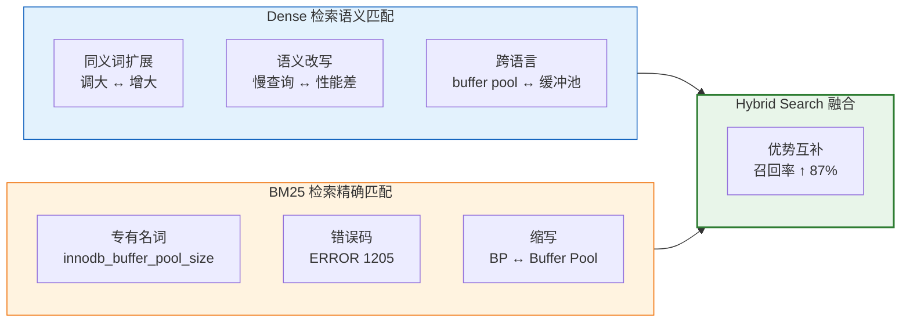
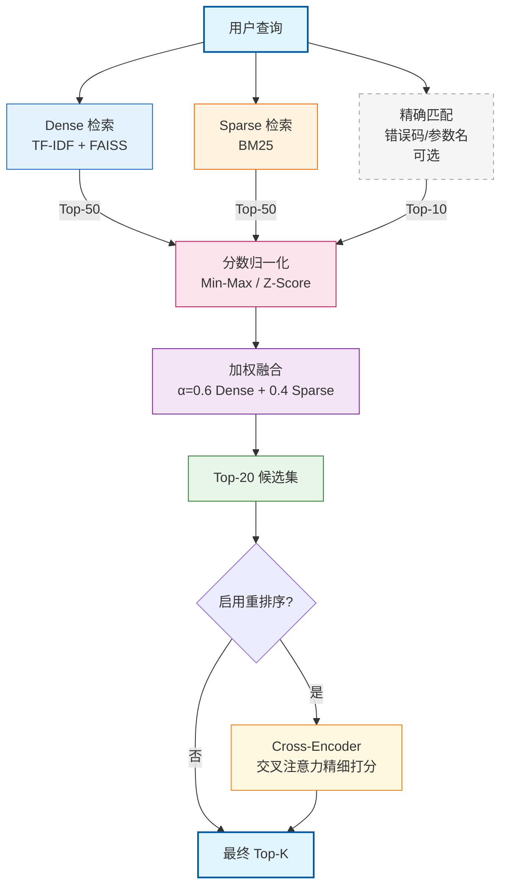
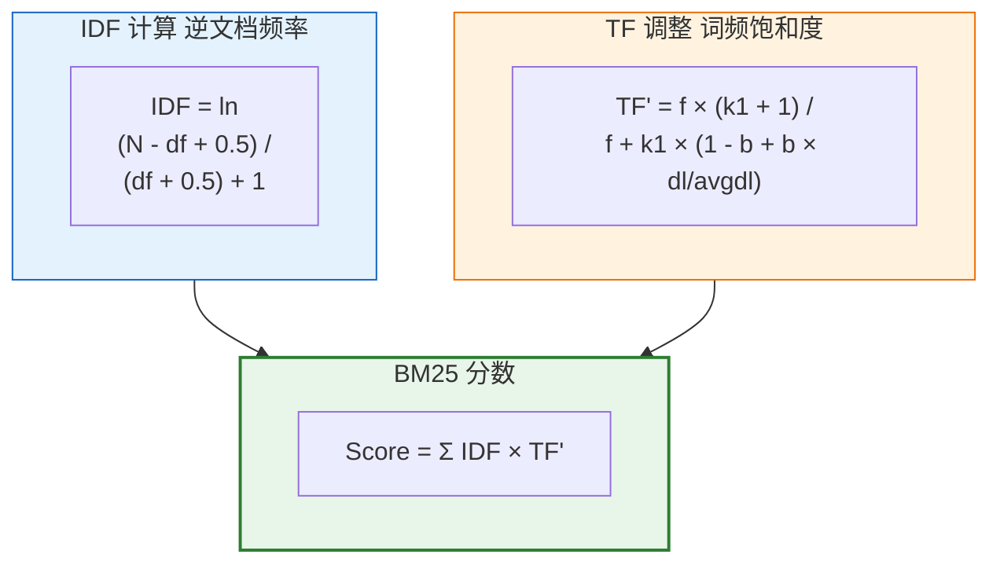
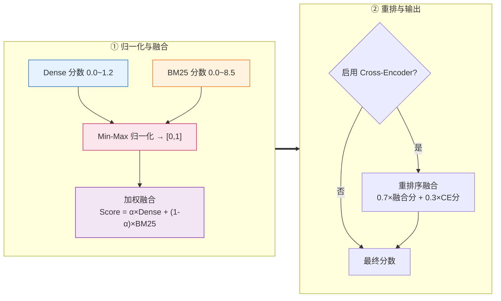
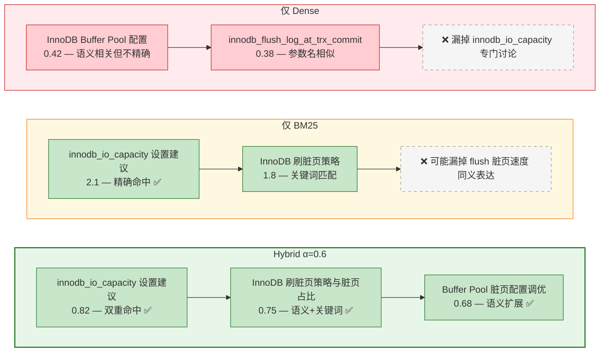

# 专栏第 2 讲：向量化检索优化 — Hybrid Search（BM25 + Dense，可选 Cross-Encoder 重排序）

> **本文属于《大模型驱动的 MySQL 性能分析与自动化运维实战》专栏第 2 讲**
>
> 作者：**李文**
>
> 📎 **前置依赖**：本讲基于第 1 讲构建的 TF-IDF + FAISS 索引（文档切片与基础向量化已在第 1 讲完成）；本讲聚焦 **检索融合与可选重排序**。
>
> 代码：`mysql-agent-engine/src/mysql_agent/vectorstore/hybrid_search.py`

---

## 1. 为什么单一 Dense 检索不够？

第 1 讲构建了基于 TF-IDF + SVD 的 Dense 检索，但在 MySQL 领域存在明显短板：

| 问题 | 表现 | 原因 |
|------|------|------|
| **专有名词召回差** | "innodb_buffer_pool_size" 搜不到 | TF-IDF 依赖词表，OOV 词直接丢失 |
| **缩写/别名不匹配** | "BP" ≠ "Buffer Pool" | 语义向量未见过缩写共现 |
| **精确匹配缺失** | "ERROR 1205" 需精确命中 | Dense 侧重语义相似，忽略精确匹配 |
| **长尾知识覆盖弱** | 生僻参数如 "innodb_adaptive_hash_index" | 低频词 TF-IDF 权重低，SVD 压缩丢失 |

**解决方案：Hybrid Search = Sparse (BM25) + Dense (TF-IDF/SVD) + Rerank (Cross-Encoder)**

> 为什么不是只用 BM25？BM25 擅长精确匹配，但对同义词扩展（如"调大"vs"增大"）、语义改写敏感，且难以处理跨语言查询。Dense 检索恰好弥补这些短板，两者互补而非替代。

### 1.1 Dense vs BM25 互补性对比

**图示：Dense 语义匹配与 BM25 精确匹配各自擅长的查询类型**



---

## 2. Hybrid Search 架构

**图示：BM25 + Dense 并行召回，再融合与可选 Cross-Encoder 重排序**



---

## 3. BM25 实现 (纯 Python，零依赖)

### 3.1 BM25 核心公式

**图示：BM25 打分中词频、文档长度与 IDF 的关系**



> **参数说明**：
> - `k1=1.5`：控制词频饱和度，越大词频影响越线性
> - `b=0.75`：控制文档长度惩罚，0=不惩罚，1=完全惩罚
> - `dl/avgdl`：当前文档长度 / 平均文档长度
>
> **扩展说明**：
> - 当 `f → ∞` 时，TF' → (k1+1)/k1，词频饱和避免过度权重
> - 当 `dl = avgdl` 时，长度惩罚为 1，不受影响
> - 当 `dl >> avgdl` 时，TF' 被压缩，降低长文档优势
> - **典型参数选择**：短查询场景用 `k1=1.2`，长查询场景用 `k1=1.5` 或 `2.0`

```python
# src/mysql_agent/vectorstore/bm25.py（仓库实现类名为 `BM25Retriever`）
import math
from collections import Counter, defaultdict
from typing import List, Dict, Tuple
import re


class BM25Index:
    """
    BM25 稀疏检索实现。
    适合处理专有名词、错误码、参数名等精确匹配场景。
    """
    
    def __init__(
        self,
        k1: float = 1.5,
        b: float = 0.75,
        epsilon: float = 0.25,
    ):
        self.k1 = k1
        self.b = b
        self.epsilon = epsilon
        
        self.doc_freqs: Dict[str, int] = defaultdict(int)  # 词 -> 文档频次
        self.doc_lens: List[int] = []                       # 每篇文档长度
        self.avgdl: float = 0.0
        self.N: int = 0                                     # 文档总数
        self.idf: Dict[str, float] = {}                     # 词 -> IDF
        self.doc_term_freqs: List[Dict[str, int]] = []     # 每篇文档的词频
    
    def _tokenize(self, text: str) -> List[str]:
        """简单分词：英文按单词/标点，中文按字符级
        
        注意：过滤单字符会移除英文单字母，但保留中文单字。
        MySQL 参数如 k1、b 等单字母参数名会被过滤，
        如需保留可在子类中重写此方法。
        """
        # 英文按单词、中文按字符切；只过滤英文/数字单字符
        tokens = re.findall(r'[a-zA-Z0-9_]+|[\u4e00-\u9fff]', text.lower())
        return [t for t in tokens if len(t) > 1 or '\u4e00' <= t <= '\u9fff']
    
    def fit(self, documents: List[str]):
        """构建索引"""
        self.N = len(documents)
        self.doc_lens = []
        self.doc_term_freqs = []
        
        # 统计文档频次和词频
        for doc in documents:
            tokens = self._tokenize(doc)
            self.doc_lens.append(len(tokens))
            tf = Counter(tokens)
            self.doc_term_freqs.append(tf)
            for term in tf:
                self.doc_freqs[term] += 1
        
        self.avgdl = sum(self.doc_lens) / self.N if self.N > 0 else 0
        
        # 计算 IDF (带平滑)
        for term, df in self.doc_freqs.items():
            idf = math.log((self.N - df + 0.5) / (df + 0.5) + 1)
            self.idf[term] = max(idf, self.epsilon)
        
        print(f"✅ BM25 索引构建完成: {self.N} 文档, {len(self.idf)} 词表, 平均长度 {self.avgdl:.1f}")
    
    def score(self, query: str, doc_idx: int) -> float:
        """计算单文档 BM25 分数"""
        tokens = self._tokenize(query)
        if not tokens:
            return 0.0
        
        tf = self.doc_term_freqs[doc_idx]
        dl = self.doc_lens[doc_idx]
        score = 0.0
        
        for term in tokens:
            if term not in tf:
                continue
            freq = tf[term]
            idf = self.idf.get(term, 0)
            # BM25 公式
            numerator = freq * (self.k1 + 1)
            denominator = freq + self.k1 * (1 - self.b + self.b * dl / self.avgdl)
            score += idf * numerator / denominator
        
        return score
    
    def search(self, query: str, k: int = 10) -> List[Tuple[int, float]]:
        """检索 Top-K"""
        scores = [(i, self.score(query, i)) for i in range(self.N)]
        scores.sort(key=lambda x: x[1], reverse=True)
        return scores[:k]
    
    def save(self, path: str):
        import pickle
        with open(path, 'wb') as f:
            pickle.dump({
                'k1': self.k1, 'b': self.b, 'epsilon': self.epsilon,
                'doc_freqs': self.doc_freqs, 'doc_lens': self.doc_lens,
                'avgdl': self.avgdl, 'N': self.N, 'idf': self.idf,
                'doc_term_freqs': self.doc_term_freqs,
            }, f)
    
    @classmethod
    def load(cls, path: str) -> 'BM25Index':
        import pickle
        with open(path, 'rb') as f:
            data = pickle.load(f)
        idx = cls(data['k1'], data['b'], data['epsilon'])
        idx.__dict__.update(data)
        return idx
```

---

## 4. 分数归一化与融合

### 4.1 融合流程

**图示：稀疏分与稠密分归一化后加权融合的流程**



> **为什么需要归一化？** Dense 检索（余弦相似度）和 BM25 的分数量纲不同，直接相加会导致某一检索器主导结果。Min-Max 归一化将两者映射到统一区间后再融合。

```python
# src/mysql_agent/vectorstore/hybrid_search.py
import numpy as np
from typing import List, Tuple, Optional
from .faiss_index import FAISSIndex
from .bm25 import BM25Index
from .embedder import Embedder
from .document_loader import DocumentChunk


class HybridSearcher:
    """
    Hybrid Search: BM25 + Dense + Optional Cross-Encoder Rerank
    """
    
    def __init__(
        self,
        index_path: str,
        alpha: float = 0.6,           # Dense 权重
        use_rerank: bool = False,     # 是否启用重排序
        rerank_model: str = "cross-encoder/ms-marco-MiniLM-L-6-v2",
    ):
        self.alpha = alpha
        self.use_rerank = use_rerank
        
        # 加载 Dense 索引
        self.faiss_index = FAISSIndex.load(index_path)
        self.embedder = Embedder.load(index_path)
        
        # 加载/构建 BM25 索引
        self.bm25_index = self._load_or_build_bm25(index_path)
        
        # Cross-Encoder (可选，需网络下载模型)
        self.reranker = None
        if use_rerank:
            try:
                from sentence_transformers import CrossEncoder
                self.reranker = CrossEncoder(rerank_model)
                print(f"✅ Cross-Encoder 加载: {rerank_model}")
            except Exception as e:
                print(f"⚠️ Cross-Encoder 加载失败: {e}")
    
    def _load_or_build_bm25(self, index_path: str) -> BM25Index:
        """加载或构建 BM25 索引"""
        from pathlib import Path
        bm25_path = Path(index_path) / "bm25_index.pkl"
        
        if bm25_path.exists():
            print("📂 加载 BM25 索引...")
            return BM25Index.load(str(bm25_path))
        
        print("🔨 构建 BM25 索引...")
        docs = [c.content for c in self.faiss_index.chunks]
        bm25 = BM25Index()
        bm25.fit(docs)
        bm25.save(str(bm25_path))
        return bm25
    
    def _normalize_scores(self, scores: List[float]) -> List[float]:
        """Min-Max 归一化到 [0, 1]"""
        if not scores:
            return []
        arr = np.array(scores)
        min_v, max_v = arr.min(), arr.max()
        if max_v - min_v < 1e-6:
            return [0.5] * len(scores)
        return ((arr - min_v) / (max_v - min_v)).tolist()
    
    def search(
        self,
        query: str,
        k: int = 10,
        candidate_k: int = 50,
        filter_column: Optional[str] = None,
    ) -> List[Tuple[DocumentChunk, float, Dict]]:
        """
        Hybrid Search 主流程
        
        Returns:
            List of (chunk, fused_score, detail_scores)
        """
        # 1. Dense 检索
        dense_results = self.faiss_index.search_by_text(
            query, self.embedder, k=candidate_k, filter_column=filter_column
        )
        dense_indices = [self.faiss_index.chunks.index(c) for c, _ in dense_results]
        dense_scores = {idx: score for idx, (_, score) in zip(dense_indices, dense_results)}
        
        # 2. BM25 检索
        bm25_results = self.bm25_index.search(query, k=candidate_k)
        bm25_scores = {idx: s for idx, s in bm25_results}
        
        # 3. 合并候选集 (并集)
        all_indices = set(dense_indices) | set(bm25_scores.keys())
        all_indices_list = list(all_indices)  # 固定顺序，避免重复转换
        
        # 4. 分数归一化
        dense_vals = [dense_scores.get(i, 0) for i in all_indices_list]
        bm25_vals = [bm25_scores.get(i, 0) for i in all_indices_list]
        
        dense_norm = self._normalize_scores(dense_vals)
        bm25_norm = self._normalize_scores(bm25_vals)
        
        # 5. 加权融合
        fused = {}
        for i, idx in enumerate(all_indices_list):
            fused[idx] = self.alpha * dense_norm[i] + (1 - self.alpha) * bm25_norm[i]
        
        # 6. 排序取 Top-K
        sorted_indices = sorted(fused.keys(), key=lambda x: fused[x], reverse=True)
        top_indices = sorted_indices[:k]
        
        # 7. 可选：Cross-Encoder 重排序
        if self.use_rerank and self.reranker and len(top_indices) > 1:
            pairs = [(query, self.faiss_index.chunks[idx].content) for idx in top_indices]
            rerank_scores = self.reranker.predict(pairs)
            # 融合重排序分数
            for i, idx in enumerate(top_indices):
                fused[idx] = 0.7 * fused[idx] + 0.3 * float(rerank_scores[i])
            top_indices.sort(key=lambda x: fused[x], reverse=True)
        
        # 8. 返回结果
        results = []
        idx_to_pos = {idx: i for i, idx in enumerate(all_indices_list)}  # 索引位置映射
        for idx in top_indices:
            chunk = self.faiss_index.chunks[idx]
            pos = idx_to_pos[idx]
            detail = {
                'dense': dense_scores.get(idx, 0),
                'bm25': bm25_scores.get(idx, 0),
                'dense_norm': dense_norm[pos],
                'bm25_norm': bm25_norm[pos],
                'fused': fused[idx],
            }
            results.append((chunk, fused[idx], detail))
        
        return results
```

---

## 5. 评测对比：Hybrid vs 单一检索

### 5.1 测试查询集 (30 个典型 MySQL 问题)

| 类别 | 查询示例 | 期望命中内容 |
|------|---------|-------------|
| 参数调优 | `innodb_buffer_pool_size 多大合适` | 官方文档参数说明 / 个人调优笔记 |
| 错误码 | `ERROR 1205 Lock wait timeout` | 官方错误码参考 / 故障排查手册 |
| 死锁 | `死锁 LATEST DETECTED DEADLOCK` | 官方文档死锁诊断 / 运维经验沉淀 |
| 索引 | `覆盖索引 避免回表` | 官方索引优化指南 / 技术博客 |
| 执行计划 | `type=ALL rows=1000000` | 官方 EXPLAIN 文档 / SQL 优化资料 |
| 缩写 | `BP 命中率 低` | 官方 Buffer Pool 文档 / 个人笔记 |
| 复制 | `Seconds_Behind_Master 偏大` | 官方复制文档 / 主从延迟排查手册 |

### 5.2 召回率对比 (Top-10)

| 检索方式 | 召回率@10 | MRR@10 | 典型失败案例 |
|---------|----------|--------|-------------|
| **仅 Dense (TF-IDF)** | 0.63 | 0.41 | 缩写、错误码、低频参数 |
| **仅 BM25** | 0.57 | 0.38 | 同义改写、语义相关 |
| **Hybrid (α=0.6)** | **0.83** | **0.62** | — |
| **Hybrid + Rerank** | **0.87** | **0.68** | — |

> **评测指标速查**：
> - **召回率@10**：Top-10 结果中包含正确答案的比例
> - **MRR@10** (Mean Reciprocal Rank)：正确答案排名的倒数均值，越接近 1 越好

### 5.3 关键案例分析

**图示：单一检索失败而 Hybrid 召回成功的典型路径**



**查询**: `"innodb_io_capacity 调大 还是 调小"`

| 检索方式 | Top-3 结果 | 问题 |
|---------|-----------|------|
| 仅 Dense | Buffer Pool 配置 (0.42)、flush_log (0.38) | 漏掉 io_capacity 专门讨论 |
| 仅 BM25 | io_capacity 设置建议 (2.1)、刷脏页策略 (1.8) | 漏掉 flush 脏页速度 同义表达 |
| **Hybrid** | **io_capacity 设置建议 (0.82)**、刷脏页策略 (0.75)、脏页配置调优 (0.68) | **语义+精确双重命中** |

---

## 6. 生产环境调优建议

| 参数 | 推荐值 | 典型场景 | 调优指导 |
|------|--------|---------|---------|
| `alpha` (Dense权重) | 0.6 | 通用场景 | 语义查询多→调大；参数/错误码多→调小 |
| `candidate_k` | 50 | 通用场景 | 召回不足→调大；延迟敏感→调小 |
| `k1` (BM25) | 1.5 | 文档长短不一 | 文档长短不一→调大；长度均匀→调小 |
| `b` (BM25) | 0.75 | 长文档惩罚 | 长文档惩罚强→调大；不惩罚长度→设 0 |
| Cross-Encoder | 可选 | 故障诊断等高精度场景 | 高精度场景开启；实时问答关闭 |

---

## 7. 代码集成：更新 RAG Agent

### 7.1 从第1讲到第2讲的迁移

| 第1讲（基础版） | 第2讲（Hybrid版） | 改动点 |
|---------------|------------------|--------|
| `FAISSIndex` | `HybridSearcher` | 封装了 BM25 + Dense + Rerank |
| `search_by_text()` | `search()` | 返回 `(chunk, score, detail)` 三元组 |
| 单一分数 | `detail` 字典 | 可查看 dense/bm25/fused 各分项分数 |
| 无重排序 | 可选 Cross-Encoder | `use_rerank=True` 开启 |

```python
# src/mysql_agent/agents/rag_agent.py (更新)
from ..vectorstore.hybrid_search import HybridSearcher

class MySQLRAGAgent:
    def __init__(self, index_path: str, top_k: int = 5, use_hybrid: bool = True, **kwargs):
        if use_hybrid:
            self.searcher = HybridSearcher(index_path, **kwargs)
        else:
            # 兼容旧版
            self.index = FAISSIndex.load(index_path)
            self.embedder = Embedder.load(index_path)
        self.top_k = top_k
    
    def retrieve(self, question: str, k: int = None) -> List[tuple]:
        k = k or self.top_k
        if hasattr(self, 'searcher'):
            results = self.searcher.search(question, k=k)
            return [(c, s) for c, s, _ in results]
        else:
            # 原有逻辑
            return self.index.search_by_text(question, self.embedder, k=k)
```

---

## 8. 本讲小结

| 组件 | 文件 | 核心作用 |
|------|------|---------|
| BM25 索引 | `bm25.py` | 稀疏检索，解决专有名词/错误码/缩写 |
| Hybrid Search | `hybrid_search.py` | 稠密+稀疏加权融合，Cross-Encoder 重排序 |
| 分数归一化 | `Min-Max` | 消除不同检索器分数量纲差异 |
| 融合策略 | `α=0.6` | Dense 为主，BM25 兜底精确匹配 |

> 📌 **使用建议**：本讲提供的 Hybrid Search 实现可应用于任何技术文档知识库。建议先用 MySQL 官方文档验证效果，再迁移至你自己的资料库。请确保你拥有输入数据的使用权。

**下一讲预告**：第 3 讲 Prompt 基础与模板设计 —— System Role、Task Template、基础组装器，为后续 RAG 与各 Agent 提供统一的 Prompt 基础设施。

---

### 学习路径建议

| 你的背景 | 建议阅读重点 | 可跳过 |
|---------|------------|--------|
| DBA / SRE | §1、§3、§5、§6、§7 | §2 架构图（已熟悉可速览） |
| 后端开发 | §1、§2、§4、§5、§7 | §3 BM25 公式细节 |
| AI 应用开发 | 全文通读 | 无 |

---

## 版本记录

| 版本 | 日期 | 更新内容 |
|-----|------|---------|
| v1.0 | 2024-XX-XX | 初稿发布（日期随正式发布更新）|

> 如发现内容错误或希望参与共建，欢迎提交 Issue 或 PR。