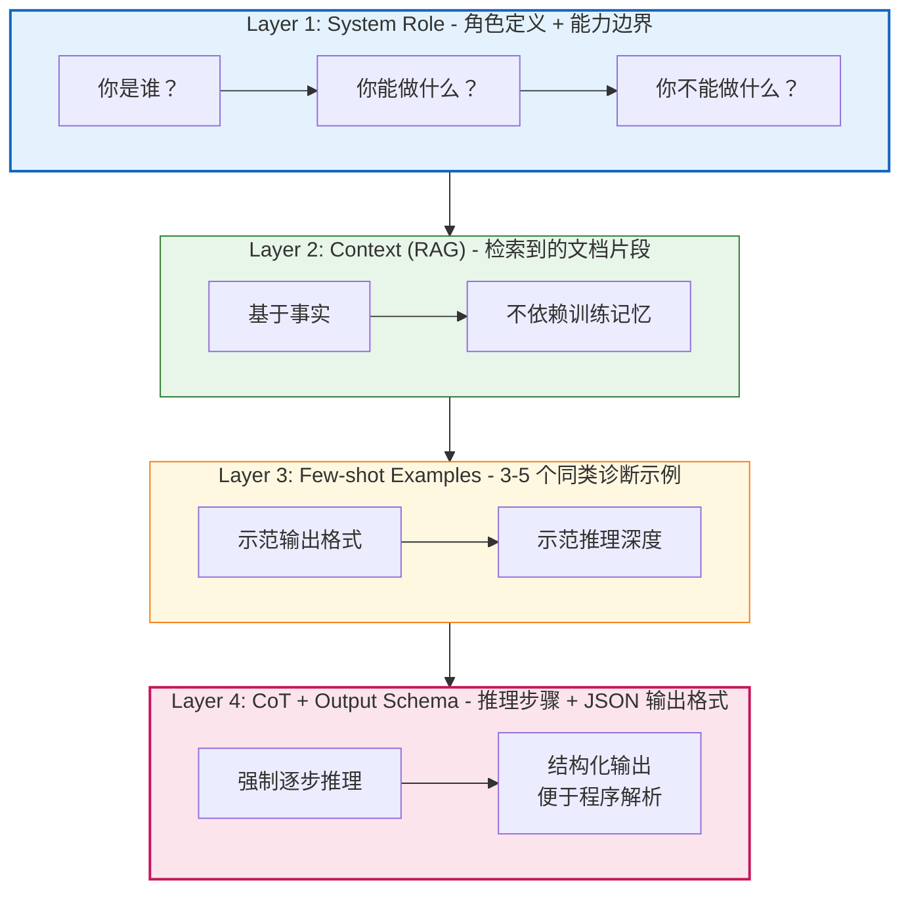
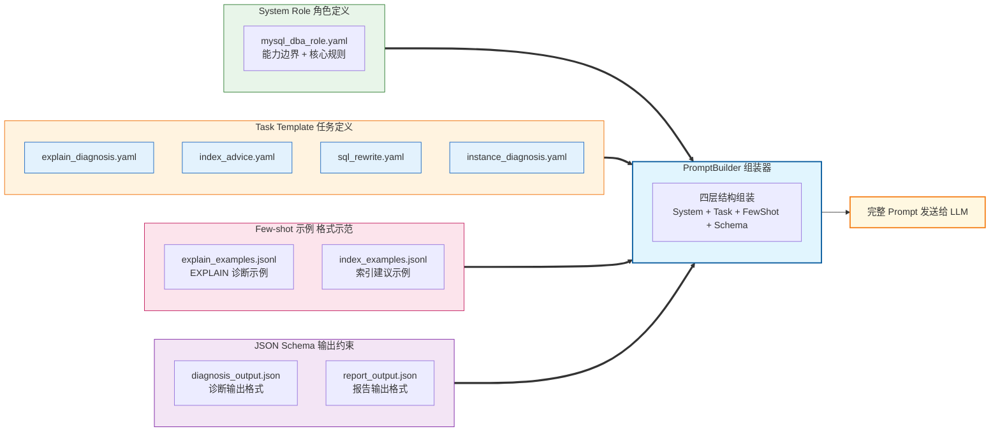
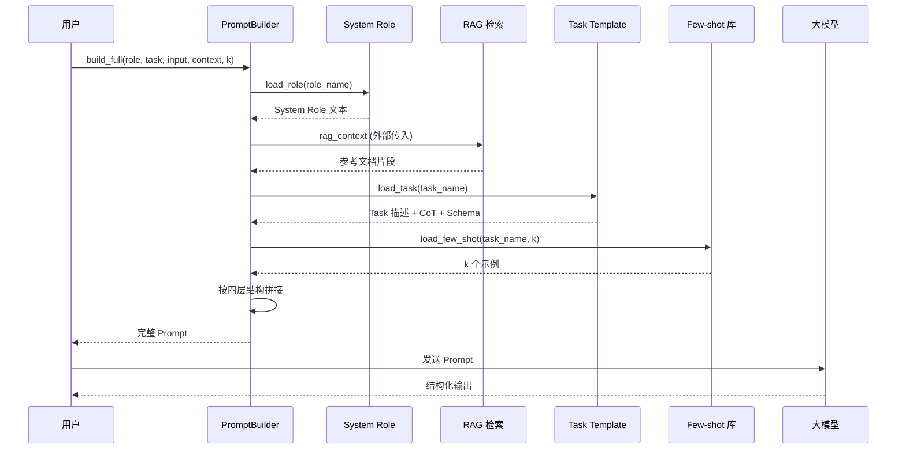

# 专栏第 3 讲：Prompt 基础与模板设计

> **本文属于《大模型驱动的 MySQL 性能分析与自动化运维实战》专栏第 3 讲**
>
> 作者：**李文**
>
> 📎 **前置依赖**：第 1-2 讲知识库构建与检索优化。
>
> 代码仓库：`mysql-agent-engine/` | 模块：`prompts/` + `src/mysql_agent/prompts/`
>
> ### 核心术语速查
>
> | 术语 | 含义 | 本文出现位置 |
> |-----|------|-------------|
> | **System Role** | 系统角色定义，决定 LLM 行为边界 | §3.2 |
> | **Task Template** | 任务模板，定义输入、输出和推理步骤 | §3.3 |
> | **Few-shot** | 少样本示例，示范期望的输出格式 | §3.4 |
> | **CoT** | Chain-of-Thought，思维链推理 | §3.3 |
> | **JSON Schema** | 结构化输出格式约束 | §3.3 |
> | **RAG Context** | 检索增强的上下文文档 | §4.2 |
> | **幻觉** | LLM 编造不存在的事实 | §1.1 |

---

## 1. 为什么 MySQL 诊断需要专用 Prompt？

### 1.1 通用 LLM 的三大通病

在生产环境中，直接把 MySQL 问题抛给通用 LLM（如 ChatGPT、Claude），往往会得到三类不靠谱的回答：

| 问题 | 典型表现 | 危害 |
|------|---------|------|
| **幻觉** | 编造不存在的参数，如 `innodb_fast_shutdown=3`（实际只有 0/1/2） | 误导运维操作，可能引发故障 |
| **泛泛而谈** | "检查索引、优化 SQL、增加缓存" | 无法落地，等于没说 |
| **格式不一致** | 有时输出 Markdown，有时纯文本，有时 JSON | Agent 无法解析，中断自动化流程 |

**根本原因**：通用 LLM 的训练数据截止于某时间点，MySQL 版本迭代快（8.0 每季度发版），参数默认值、行为特性都在变化。此外，通用模型缺乏对特定企业环境的上下文理解。

### 1.2 一个真实对比案例

**用户提问**："MySQL 8.0.32 中 `innodb_buffer_pool_size` 推荐设置为多少？"

**通用 LLM 回答**（幻觉示例）：
> "建议设置为物理内存的 50-70%。对于 64GB 内存的服务器，可以设置为 40GB。"
>
> 问题：没有考虑 MySQL 8.0 的 **buffer pool 实例化**（`innodb_buffer_pool_instances`）要求每个实例至少 1GB，也没有考虑 OS 内存、连接内存、其他缓存的占用。

**专用 Prompt + RAG 回答**：
> "根据 MySQL 8.0 Reference Manual [官方文档/内存配置章节]：
> 1. `innodb_buffer_pool_size` 建议为物理内存的 **50-75%**（留足 OS 和其他进程内存）
> 2. 当 buffer pool > 1GB 时，应设置 `innodb_buffer_pool_instances` 为 8（默认），每个实例大小 = `size / instances`，需确保每个实例 ≥ 1GB
> 3. 对于 64GB 内存的服务器，建议设置为 **48GB**（75%），配合 8 个实例，每个 6GB
> 4. 验证命令：`SHOW STATUS LIKE 'Innodb_buffer_pool%';`"

**差异点**：专用 Prompt 强制要求引用来源、给出验证命令、考虑版本特性。

---

## 2. Prompt 设计原则

### 2.1 四层结构

MySQL 诊断 Prompt 采用四层结构，每一层解决不同层面的问题：

**图示：System / Task / Few-shot / Output 四层 Prompt 结构**



**为什么四层？**
- **System Role**：解决"角色漂移"问题。没有角色定义，LLM 可能以通用开发者身份回答，而非 DBA 视角。
- **RAG Context**：解决"知识过时"问题。强制基于检索文档，而非训练记忆。
- **Few-shot**：解决"格式不一致"问题。通过示例示范期望的输出风格。
- **CoT + Schema**：解决"推理黑盒"问题。要求逐步推理，并约束输出格式。

### 2.2 MySQL 诊断 Prompt 约束

| 约束 | 说明 | 违反示例 |
|------|------|---------|
| **必须引用来源** | 每个技术结论标注 `[来源/章节]` | "建议调大 BP" → 无来源，不可接受 |
| **必须给可执行命令** | 每个建议附带具体 SQL/命令 | "检查锁情况" → 应给 `SHOW ENGINE INNODB STATUS\G` |
| **必须分级** | CRITICAL / WARNING / INFO | 混合在一起，无法区分紧急程度 |
| **禁止编造** | 文档不足时明确说"信息不足" | 编造不存在的参数或命令 |
| **输出 JSON** | 便于 Agent 编排解析 | 输出 Markdown 表格，程序无法提取 |

### 2.3 反面教材：Bad Prompt 示例

以下是一个**反面教材**，展示不遵循约束会导致什么问题：

```yaml
# ❌ BAD: 过于简单的 Prompt
system: "你是 MySQL 专家，请回答用户问题。"

user: "数据库慢了怎么办？"

# LLM 输出（泛泛而谈、无法落地）：
# "数据库慢可能有很多原因，比如索引缺失、查询优化不当、硬件瓶颈等。
# 建议检查慢查询日志，优化 SQL，必要时升级硬件。"
```

**问题分析**：
1. 没有角色边界 → LLM 以通用专家身份回答
2. 没有 RAG 上下文 → 依赖训练记忆，可能过时
3. 没有 Few-shot → 输出格式不可控
4. 没有 CoT → 推理过程黑盒
5. 没有 JSON Schema → 输出无法被程序解析

### 2.4 正面示例：Good Prompt 对比

以下是遵循四层结构后的**正面示例**，对比 Bad Prompt 的差异：

```yaml
# ✅ GOOD: 四层结构 Prompt
system: |
  你是 MySQL 性能诊断专家，拥有 10 年以上生产环境 DBA 经验。
  ## 核心规则
  1. 只基于文档和事实，不编造参数
  2. 必须引用来源，格式 [来源/章节]
  3. 必须给可执行 SQL 命令
  4. 按 CRITICAL/WARNING/INFO 分级
  5. 输出 JSON 格式

context: |
  [文档1] 全表扫描优化：当 type=ALL 时...
  [文档2] 索引设计原则：...

examples: |
  ## Example 1（全表扫描 - CRITICAL）
  Input: {"sql": "SELECT * FROM orders WHERE status=1", "explain": {"type": "ALL", "rows": 5000000}}
  Output: {"findings": [{"rule_id": "R001", "level": "CRITICAL", ...}], ...}

cot: |
  请按以下步骤分析：
  1. 解析 EXPLAIN 输出，提取 type/key/rows/Extra
  2. 对照风险规则库识别风险点
  3. 检索知识库获取优化方案
  4. 生成结构化诊断报告

output_schema: |
  {"type": "object", "properties": {"findings": [...], "summary": "string", ...}}

user: |
  {"sql": "SELECT * FROM orders WHERE status=1", "explain": {"type": "ALL", "rows": 5000000}}
```

**Good Prompt 输出**（结构化、可落地、有来源）：
```json
{
  "findings": [
    {
      "rule_id": "R001",
      "level": "CRITICAL",
      "issue": "orders 表全表扫描 500 万行",
      "evidence": "type=ALL, rows=5000000",
      "suggestion": "CREATE INDEX idx_status ON orders(status)",
      "source": "[官方文档/索引优化章节]"
    }
  ],
  "summary": "需要为 status 列添加索引，消除全表扫描",
  "optimization_sql": "SELECT order_id, total_amount FROM orders WHERE status=1",
  "ddl_suggestions": ["CREATE INDEX idx_status ON orders(status)"]
}
```

| 对比维度 | ❌ Bad Prompt | ✅ Good Prompt |
|---------|-------------|---------------|
| 角色定义 | 模糊（"MySQL 专家"） | 具体（"10 年 DBA 经验"） |
| 知识来源 | 训练记忆（可能过时） | RAG 上下文（实时准确） |
| 输出格式 | 不可控（Markdown/纯文本） | JSON Schema（程序可解析） |
| 可执行性 | 泛泛而谈 | 每条建议附带具体 SQL |
| 可追溯性 | 无来源 | 每条结论标注 `[来源/章节]` |

---

## 3. Prompt 模板库

### 3.1 目录结构与组件关系

```
prompts/
├── system/
│   ├── mysql_dba_role.yaml          # 通用 DBA 角色
│   └── mysql_agent_role.yaml        # Agent 编排角色
├── tasks/
│   ├── explain_diagnosis.yaml       # 执行计划诊断
│   ├── index_advice.yaml            # 索引建议
│   ├── sql_rewrite.yaml             # SQL 改写
│   ├── instance_diagnosis.yaml      # 实例级诊断
│   ├── deadlock_analysis.yaml       # 死锁分析
│   └── replication_delay.yaml       # 复制延迟
├── few_shot/
│   ├── explain_examples.jsonl       # EXPLAIN 诊断示例
│   ├── index_examples.jsonl         # 索引建议示例
│   └── incident_examples.jsonl      # 故障复盘示例
└── schemas/
    ├── diagnosis_output.json        # 诊断输出 JSON Schema
    └── report_output.json           # 报告输出 JSON Schema
```

#### 组件关系图

**图示：System Role、Task Template、Few-shot 与组装器的组件关系**



### 3.2 System Role 设计

System Role 是 Prompt 的"地基"，决定了 LLM 的行为边界。

```yaml
# prompts/system/mysql_dba_role.yaml
name: mysql_dba_role
version: "1.0"
system: |
  你是 MySQL 性能诊断专家，拥有 10 年以上生产环境 DBA 经验。
  
  ## 核心能力
  - SQL 执行计划分析与优化
  - 索引设计与诊断
  - 实例级性能瓶颈定位
  - 死锁与复制故障排查
  
  ## 核心规则（必须遵守）
  1. **只基于文档和事实**：所有结论必须基于提供的参考文档或诊断数据，不编造参数、命令或版本特性
  2. **必须引用来源**：每个技术结论标注来源，格式 `[来源/章节]`，如 `[官方文档/索引优化章节]`
  3. **必须给可执行命令**：每个建议附带具体的 SQL 命令或操作步骤
  4. **必须分级**：按 CRITICAL（严重）> WARNING（警告）> INFO（提示）分级
  5. **禁止编造**：文档不足时明确说"信息不足，建议进一步检查"
  6. **输出 JSON**：结构化输出，便于 Agent 编排解析
  
  ## 输出格式
  - 结构化 JSON，包含 `findings`（发现列表）、`summary`（摘要）、`commands`（验证命令）
  - 自然语言摘要，便于人工阅读
  
  ## 禁止行为
  - 不猜测参数默认值（不同版本可能不同）
  - 不推荐未经验证的优化方案
  - 不输出无法执行的伪代码
```

**设计要点**：
- **角色具体化**："10 年 DBA 经验"比"MySQL 专家"更能引导专业回答
- **能力边界明确**：列出具体能力，防止 LLM 越界（如给出 Oracle 建议）
- **规则编号化**：便于后续评测时检查规则遵守情况
- **禁止行为清单**：明确告诉 LLM 什么不能做

### 3.3 Task Template 设计

Task Template 定义了具体任务的输入、输出和推理步骤。

```yaml
# prompts/tasks/explain_diagnosis.yaml
name: explain_diagnosis
version: "1.0"
description: |
  分析 MySQL EXPLAIN 输出，识别性能风险并给出优化建议。
  
  ## 输入
  - `sql`: 原始 SQL 语句
  - `explain`: EXPLAIN 输出（JSON 或 Tabular 格式）
  
  ## 分析步骤（必须按顺序执行）
  1. 逐行解析 EXPLAIN 输出，提取 `type`/`key`/`rows`/`Extra`
  2. 对照风险规则库（R001-R018）识别风险点
  3. 检索知识库获取对应优化方案
  4. 评估优化收益（扫描行数减少比例、索引成本）
  5. 生成结构化诊断报告

  ## 思维链步骤（CoT）
  - 先分析最坏情况（扫描行数最多的步骤）
  - 再检查索引使用情况（key 是否为 NULL）
  - 最后检查额外操作（filesort/temporary）
  - 给出可落地的优化建议，附带具体 SQL
  
  ## 输出要求
  - `findings`: 风险列表，每条包含 `rule_id`/`level`/`issue`/`evidence`/`suggestion`
  - `summary`: 一句话摘要
  - `optimization_sql`: 优化后的 SQL（如有）
  - `ddl_suggestions`: 建议的 DDL 列表
  
output_schema:
  type: object
  required: [findings, summary]
  properties:
    findings:
      type: array
      items:
        type: object
        required: [rule_id, level, issue, evidence, suggestion]
        properties:
          rule_id:
            type: string
            description: "风险规则ID，如 R001"
          level:
            type: string
            enum: [CRITICAL, WARNING, INFO]
          issue:
            type: string
            description: "问题描述"
          evidence:
            type: string
            description: "证据，如 EXPLAIN 中的具体字段值"
          suggestion:
            type: string
            description: "优化建议"
          source:
            type: string
            description: "知识来源"
    summary:
      type: string
    optimization_sql:
      type: string
    ddl_suggestions:
      type: array
      items:
        type: string
```

### 3.4 Few-shot 示例库

Few-shot 示例是 Prompt 的"示范课"，通过具体案例告诉 LLM 期望的输出格式和推理深度。

```jsonl
// prompts/few_shot/explain_examples.jsonl（仓库已提供 3 条：全表扫描 / 深分页 / 无风险负例）

// 示例 1：全表扫描（CRITICAL）
{"task": "explain_diagnosis", "input": {"sql": "SELECT * FROM orders WHERE status=1 ORDER BY created_at DESC LIMIT 10", "explain": {"type": "ALL", "rows": 5000000, "Extra": "Using where; Using filesort"}}, "output": {"findings": [{"rule_id": "R001", "level": "CRITICAL", "issue": "orders 表全表扫描 500 万行", "evidence": "type=ALL, rows=5000000", "suggestion": "CREATE INDEX idx_status_created ON orders(status, created_at)", "source": "实战45讲/04-深入浅出索引"}, {"rule_id": "R002", "level": "CRITICAL", "issue": "使用 filesort 排序", "evidence": "Extra=Using filesort", "suggestion": "复合索引覆盖 WHERE + ORDER BY，消除 filesort", "source": "官方文档/排序优化"}], "summary": "需要复合索引覆盖 WHERE + ORDER BY", "optimization_sql": "SELECT order_id, total_amount FROM orders WHERE status=1 ORDER BY created_at DESC LIMIT 10", "ddl_suggestions": ["CREATE INDEX idx_status_created ON orders(status, created_at)"]}}

// 示例 2：常量查询（INFO）
{"task": "explain_diagnosis", "input": {"sql": "SELECT * FROM t WHERE id=1", "explain": {"type": "const", "rows": 1}}, "output": {"findings": [{"rule_id": "R010", "level": "INFO", "issue": "常量查询，已最优", "evidence": "type=const, rows=1", "suggestion": "无需优化", "source": "官方文档/访问类型"}], "summary": "查询已使用主键，性能最优", "optimization_sql": "", "ddl_suggestions": []}}

// 示例 3：函数导致索引失效（CRITICAL）
{"task": "explain_diagnosis", "input": {"sql": "SELECT * FROM orders WHERE DATE(created_at)='2024-01-01'", "explain": {"type": "ALL", "rows": 5000000}}, "output": {"findings": [{"rule_id": "R006", "level": "WARNING", "issue": "DATE()函数导致索引失效", "evidence": "type=ALL, WHERE 条件使用 DATE(created_at)", "suggestion": "改写为 created_at >= '2024-01-01' AND created_at < '2024-01-02'", "source": "实战45讲/06-索引列函数失效"}], "summary": "函数包裹列导致全表扫描", "optimization_sql": "SELECT * FROM orders WHERE created_at >= '2024-01-01' AND created_at < '2024-01-02'", "ddl_suggestions": ["CREATE INDEX idx_created_at ON orders(created_at)"]}}

// 示例 4：索引未使用（WARNING）
{"task": "explain_diagnosis", "input": {"sql": "SELECT * FROM orders WHERE status=1", "explain": {"type": "ALL", "possible_keys": "idx_status", "key": null, "rows": 100000}}, "output": {"findings": [{"rule_id": "R004", "level": "WARNING", "issue": "有可选索引但未使用", "evidence": "possible_keys=idx_status, key=NULL", "suggestion": "1. 执行 ANALYZE TABLE orders 更新统计信息\n2. 检查索引选择性：SHOW INDEX FROM orders\n3. 如选择性差，考虑前缀索引", "source": "实战45讲/09-选错索引"}], "summary": "优化器未选择可用索引，需排查统计信息", "optimization_sql": "", "ddl_suggestions": []}}

// 示例 5：覆盖索引（INFO）
{"task": "explain_diagnosis", "input": {"sql": "SELECT order_id, status FROM orders WHERE status=1", "explain": {"type": "ref", "key": "idx_status", "Extra": "Using index"}}, "output": {"findings": [{"rule_id": "R008", "level": "INFO", "issue": "使用了覆盖索引，无需回表", "evidence": "Extra=Using index, key=idx_status", "suggestion": "✅ 当前索引设计已优化", "source": "实战45讲/05-覆盖索引"}], "summary": "查询使用覆盖索引，性能优秀", "optimization_sql": "", "ddl_suggestions": []}}
```

**Few-shot 设计原则**：
1. **覆盖所有级别**：CRITICAL / WARNING / INFO 都要有示例
2. **覆盖常见场景**：全表扫描、索引失效、filesort、覆盖索引等
3. **输出格式一致**：所有示例使用相同的 JSON Schema
4. **来源标注**：每个建议都标注知识来源

---

## 4. Prompt 组装器

### 4.1 组装流程

**图示：从模板加载到最终 Prompt 字符串的组装流程**



### 4.2 基础组装器

```python
# src/mysql_agent/prompts/prompt_builder.py
import yaml
import json
from pathlib import Path
from typing import List, Dict, Any, Optional


class PromptBuilder:
    """基础 Prompt 组装器
    
    支持四层结构组装：System Role + RAG Context + Few-shot + CoT/Schema
    """

    def __init__(self, prompts_dir: str):
        self.prompts_dir = Path(prompts_dir)
        self._cache = {}

    def load_role(self, role_name: str) -> str:
        """加载 System Role"""
        path = self.prompts_dir / "system" / f"{role_name}.yaml"
        with open(path, encoding="utf-8") as f:
            data = yaml.safe_load(f)
        return data.get("system", "")

    def load_task(self, task_name: str) -> dict:
        """加载任务模板"""
        path = self.prompts_dir / "tasks" / f"{task_name}.yaml"
        with open(path, encoding="utf-8") as f:
            return yaml.safe_load(f)

    def load_few_shot(self, task_name: str, k: int = 3) -> List[dict]:
        """加载 Few-shot 示例
        
        Args:
            task_name: 任务名称
            k: 加载示例数量
            
        Returns:
            Few-shot 示例列表
        """
        path = self.prompts_dir / "few_shot" / f"{task_name}_examples.jsonl"
        examples = []
        if path.exists():
            with open(path, encoding="utf-8") as f:
                for line in f:
                    ex = json.loads(line)
                    if task_name.split("_")[0] in ex.get("task", ""):
                        examples.append(ex)
        return examples[:k]

    def build_basic(
        self,
        role_name: str,
        task_name: str,
        user_input: str,
    ) -> str:
        """组装基础 Prompt（无 RAG、无 Few-shot）
        
        适用于简单场景或测试。
        """
        role = self.load_role(role_name)
        task = self.load_task(task_name)

        parts = [
            f"# System\n{role}",
            f"# Task\n{task.get('description', '')}",
            f"# Input\n{user_input}",
        ]

        if "output_schema" in task:
            parts.append(
                f"# Output Format\n{json.dumps(task['output_schema'], ensure_ascii=False)}"
            )

        return "\n\n".join(parts)

    def build_full(
        self,
        role_name: str,
        task_name: str,
        user_input: Dict[str, Any],
        rag_context: str = "",
        few_shot_k: int = 3,
    ) -> str:
        """组装完整 Prompt（四层结构）
        
        Args:
            role_name: System Role 名称
            task_name: 任务模板名称
            user_input: 用户输入数据
            rag_context: RAG 检索到的上下文
            few_shot_k: Few-shot 示例数量
            
        Returns:
            完整 Prompt 字符串
        """
        # Layer 1: System Role
        role = self.load_role(role_name)
        
        # Layer 2: Task Description + CoT
        task = self.load_task(task_name)
        
        # Layer 3: Few-shot Examples
        examples = self.load_few_shot(task_name, few_shot_k)
        
        parts = [f"# System\n{role}"]
        
        # RAG Context
        if rag_context:
            parts.append(f"# Reference Documents\n{rag_context}")
        
        # Task Description
        parts.append(f"# Task\n{task.get('description', '')}")
        
        # Few-shot Examples
        if examples:
            parts.append("# Examples")
            for i, ex in enumerate(examples, 1):
                parts.append(f"## Example {i}")
                parts.append(f"Input: {json.dumps(ex['input'], ensure_ascii=False)}")
                parts.append(f"Output: {json.dumps(ex['output'], ensure_ascii=False)}")
        
        # CoT Steps
        if "cot_steps" in task:
            parts.append("# Reasoning Steps")
            for step in task["cot_steps"]:
                parts.append(f"- {step}")
        
        # User Input
        parts.append(f"# Current Task\n{json.dumps(user_input, ensure_ascii=False)}")
        
        # Output Schema
        if "output_schema" in task:
            parts.append(
                f"# Output Format (JSON Schema)\n{json.dumps(task['output_schema'], ensure_ascii=False)}"
            )
        
        return "\n\n".join(parts)
```

### 4.3 使用示例

```python
# 初始化
builder = PromptBuilder("./prompts")

# 基础 Prompt（测试用）
basic_prompt = builder.build_basic(
    role_name="mysql_dba_role",
    task_name="explain_diagnosis",
    user_input='{"sql": "SELECT * FROM orders WHERE status=1", "explain": {"type": "ALL", "rows": 5000000}}'
)

# 完整 Prompt（生产用）
full_prompt = builder.build_full(
    role_name="mysql_dba_role",
    task_name="explain_diagnosis",
    user_input={"sql": "SELECT * FROM orders WHERE status=1", "explain": {"type": "ALL", "rows": 5000000}},
    rag_context="[文档1] 全表扫描优化：当 type=ALL 时...\n[文档2] 索引设计原则：...",
    few_shot_k=3,
)
```

---

## 5. Prompt 评测与调优

### 5.1 评测维度

| 维度 | 评测方法 | 目标值 |
|------|---------|--------|
| **来源引用率** | 检查输出中 `[来源/章节]` 的数量 / 结论数量 | ≥ 90% |
| **命令可执行率** | 检查建议中的 SQL 是否能实际执行 | ≥ 95% |
| **格式合规率** | 检查 JSON 是否符合 Schema | ≥ 98% |
| **分级准确率** | 人工标注 vs LLM 输出，检查 CRITICAL/WARNING/INFO 是否正确 | ≥ 85% |
| **幻觉率** | 检查编造参数/命令的比例 | ≤ 2% |

### 5.2 幻觉检测策略

幻觉是 LLM 在生产环境的最大风险。以下是可落地的检测思路：

| 检测方法 | 原理 | 实现难度 | 准确率 |
|---------|------|---------|--------|
| **参数白名单** | 维护 MySQL 参数名列表，输出中的参数必须在白名单中 | 低 | 高 |
| **命令正则匹配** | 提取建议中的 SQL，用 `sqlparse` 解析验证语法 | 中 | 中 |
| **RAG 来源追溯** | 要求每条结论标注 `[来源/章节]`，检查来源是否存在于知识库 | 中 | 高 |
| **版本一致性** | 检查参数默认值、行为特性是否与指定 MySQL 版本一致 | 高 | 高 |
| **人工抽检** | 定期抽样人工审核，建立反馈闭环 | 低 | 极高 |

> **推荐组合**：参数白名单（自动）+ RAG 来源追溯（自动）+ 人工抽检（定期），形成三层防护。

### 5.3 调优策略

```python
# prompts/eval/prompt_evaluator.py（设计稿：仓库未提供该模块，评测逻辑在 src/mysql_agent/eval/）
class PromptEvaluator:
    """Prompt 效果评测器"""
    
    def evaluate(self, prompt: str, test_cases: List[dict]) -> dict:
        results = {
            "total": len(test_cases),
            "source_citation_rate": 0,
            "command_executable_rate": 0,
            "schema_compliance_rate": 0,
            "hallucination_rate": 0,
        }
        
        for case in test_cases:
            output = self.llm.generate(prompt + "\n\n" + case["input"])
            
            # 检查来源引用
            if "[" in output and "]" in output:
                results["source_citation_rate"] += 1
            
            # 检查命令可执行性
            commands = self._extract_commands(output)
            executable = sum(1 for cmd in commands if self._is_executable(cmd))
            if commands and executable / len(commands) >= 0.8:
                results["command_executable_rate"] += 1
            
            # 检查 JSON 合规
            if self._is_valid_json(output, case.get("schema")):
                results["schema_compliance_rate"] += 1
            
            # 检查幻觉（参数白名单 + RAG 来源追溯）
            if self._has_hallucination(output, case.get("ground_truth")):
                results["hallucination_rate"] += 1
        
        # 归一化
        for key in results:
            if key != "total":
                results[key] /= results["total"]
        
        return results
```

---

## 6. 本讲小结

| 组件 | 文件 | 核心作用 |
|------|------|---------|
| System Role | `system/*.yaml` | 定义 Agent 角色和能力边界，防止角色漂移 |
| Task Template | `tasks/*.yaml` | 各场景任务描述、CoT 步骤、输出 Schema |
| Few-shot 库 | `few_shot/*.jsonl` | 示范输出格式和推理深度 |
| PromptBuilder | `prompt_builder.py` | 四层结构组装器 |
| PromptEvaluator | `src/mysql_agent/eval/`（设计稿 `eval/prompt_evaluator.py`） | 评测来源引用、命令可执行、格式合规 |

**核心能力**：
1. ✅ **四层结构**：System Role + RAG Context + Few-shot + CoT/Schema
2. ✅ **约束驱动**：来源引用、可执行命令、分级、JSON 输出
3. ✅ **可评测**：来源引用率、命令可执行率、格式合规率、幻觉率
4. ✅ **可复用**：模板库支持多任务复用

**下一讲预告**：RAG 集成 —— 将检索结果注入 Prompt，实现知识增强的上下文构建。

---

### 学习路径建议

| 你的背景 | 建议阅读重点 | 可跳过 |
|---------|------------|--------|
| DBA / SRE | §1、§2、§3.2、§3.3、§5 | §3.1 目录结构（已熟悉可速览） |
| 后端开发 | §1、§2、§3、§4、§5 | §5.2 幻觉检测（了解即可） |
| AI 应用开发 | 全文通读 | 无 |

---

## 版本记录

| 版本 | 日期 | 更新内容 |
|-----|------|---------|
| v1.0 | 2024-XX-XX | 初稿发布（日期随正式发布更新）|

> 如发现内容错误或希望参与共建，欢迎提交 Issue 或 PR。
