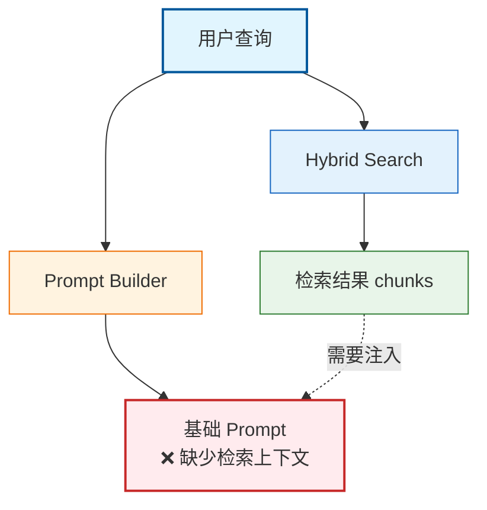
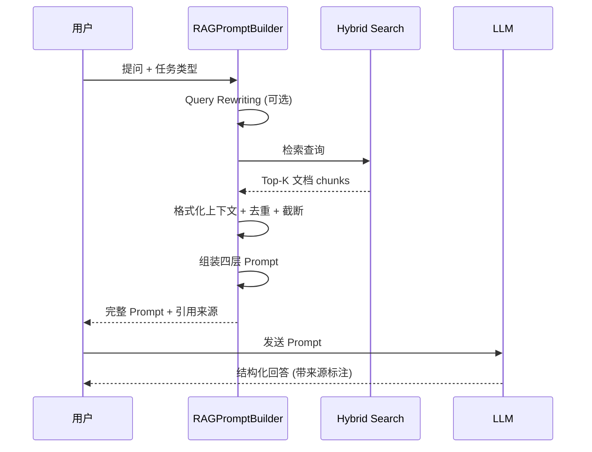
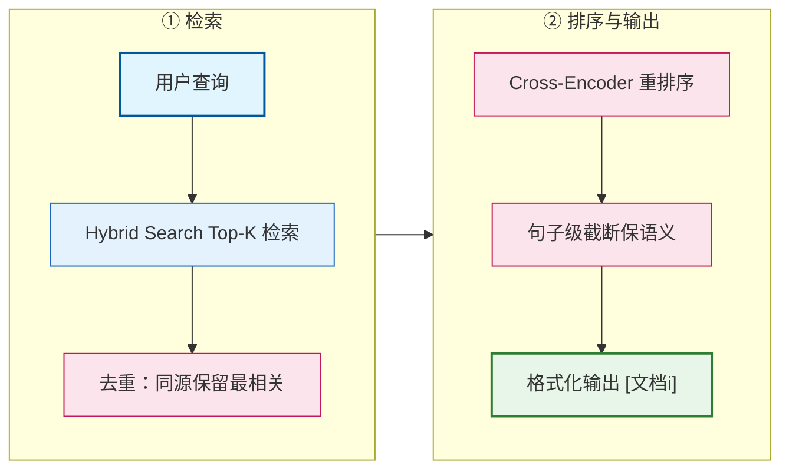
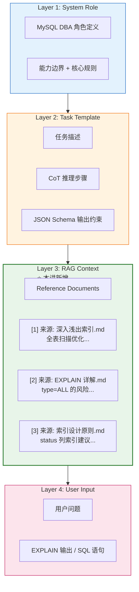
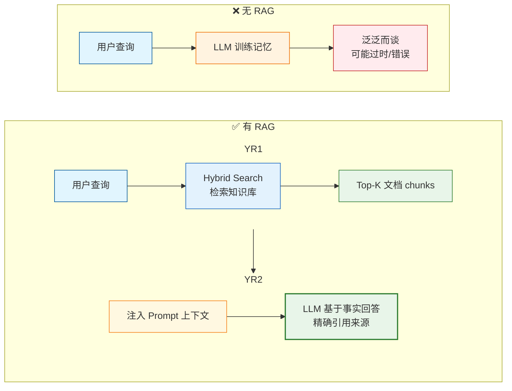

# 专栏第 4 讲：RAG 集成与上下文构建

> **本文属于《大模型驱动的 MySQL 性能分析与自动化运维实战》专栏第 4 讲**
>
> 作者：**李文**
>
> 📎 **前置依赖**：第 1-2 讲知识库与检索；第 3 讲 Prompt 基础模板。
>
> 代码仓库：`mysql-agent-engine/` | 模块：`src/mysql_agent/prompts/prompt_builder.py`（模板名 `rag_qa`）
>
> ### 核心术语速查
>
> | 术语 | 含义 | 本文出现位置 |
> |-----|------|-------------|
> | **RAG** | Retrieval-Augmented Generation，检索增强生成 | §1 |
> | **Context Builder** | 将检索结果格式化为 Prompt 上下文 | §2.1 |
> | **Query Rewriting** | 将用户问题改写为更适合检索的查询 | §7 |
> | **混合注入** | 静态知识 + 动态检索同时注入 | §8 |
> | **引用追溯** | LLM 输出标注知识来源 | §2.2 |
> | **Recall@K** | Top-K 结果中包含正确答案的比例 | §9 |

---

## 1. 为什么需要 RAG 集成？

第 2 讲实现了 Hybrid Search 检索，第 3 讲建立了 Prompt 模板，但两者尚未连接：

**图示：检索能力与 Prompt 模板尚未打通时的缺口**



**RAG（Retrieval-Augmented Generation）** 将检索结果注入 Prompt，使 LLM 基于**知识库中的事实**而非**训练记忆中的过时知识**回答。

### 1.1 RAG 工作流程

RAG 的核心流程包含以下步骤：

**图示：Query → 检索 → 上下文构建 → LLM 生成的 RAG 主流程**



---

## 2. RAG 上下文构建

### 2.1 上下文构建流程

检索到的文档 chunks 不能直接塞进 Prompt，需要经过：去重 → 重排序 → 截断 → 格式化四步处理：

**图示：检索结果进入 Prompt 前的四步上下文处理**



### 2.2 检索结果格式化

将检索到的文档 chunks 转换为带来源标注的上下文字符串，便于 LLM 理解和引用：

```python
# src/mysql_agent/prompts/prompt_builder.py（仓库实现为 `PromptBuilder` 的 `rag_qa` 模板；本文 `RAGContextBuilder` 为设计稿类名）
from typing import List, Dict, Tuple
from ..vectorstore.hybrid_search import HybridSearcher


class RAGContextBuilder:
    """将检索结果格式化为 Prompt 可用的上下文字符串"""

    def __init__(self, searcher: HybridSearcher):
        self.searcher = searcher

    def build_context(
        self,
        query: str,
        k: int = 3,
        max_length: int = 2000,
        include_source: bool = True,
    ) -> str:
        """
        构建 RAG 上下文

        Args:
            query: 用户查询
            k: 检索结果数量
            max_length: 上下文最大长度（字符数）
            include_source: 是否包含来源标注

        Returns:
            格式化的上下文字符串
        """
        results = self.searcher.search(query, k=k)

        contexts = []
        total_length = 0

        for i, (chunk, score, _detail) in enumerate(results, 1):
            # 构建单条上下文
            source = chunk.metadata.get("source_file", "unknown")
            content = chunk.content

            if include_source:
                ctx = f"[文档 {i}] 来源: {source}\n{content}"
            else:
                ctx = f"[文档 {i}]\n{content}"

            # 长度控制
            if total_length + len(ctx) > max_length:
                remaining = max_length - total_length
                if remaining > 100:
                    ctx = ctx[:remaining] + "..."
                    contexts.append(ctx)
                break

            contexts.append(ctx)
            total_length += len(ctx)

        return "\n\n".join(contexts)

    def build_citation_context(
        self,
        query: str,
        k: int = 3,
    ) -> Tuple[str, List[Dict]]:
        """
        构建带引用标记的上下文，便于 LLM 标注来源

        Returns:
            (context_string, citations_list)
        """
        results = self.searcher.search(query, k=k)

        contexts = []
        citations = []

        for i, (chunk, score, _detail) in enumerate(results, 1):
            citation_id = f"[{i}]"
            source = chunk.metadata.get("source_file", "unknown")

            contexts.append(f"{citation_id} {chunk.content}")
            citations.append({
                "id": i,
                "source": source,
                "score": score,
                "chunk_id": chunk.chunk_id,
            })

        return "\n\n".join(contexts), citations
```

### 2.3 上下文质量优化

检索结果可能存在**重复内容**、**相关性不足**、**长度过长**等问题。ContextOptimizer 提供三类优化能力：

```python
class ContextOptimizer:
    """优化检索上下文质量"""

    def deduplicate(self, chunks: List) -> List:
        """去重：相同来源的相似内容只保留最相关的一条"""
        seen_sources = set()
        unique = []

        for chunk, score in sorted(chunks, key=lambda x: x[1], reverse=True):
            source = chunk.metadata.get("source_file", "")
            # 简单去重：同一文件只保留一次
            if source not in seen_sources:
                unique.append((chunk, score))
                seen_sources.add(source)

        return unique

    def rerank_by_relevance(
        self,
        query: str,
        chunks: List,
        top_k: int = 3,
    ) -> List:
        """基于 Cross-Encoder 重排序（复用第 2 讲能力）"""
        # 使用 Hybrid Search 的 Rerank 能力
        return chunks[:top_k]

    def truncate_by_sentence(
        self,
        text: str,
        max_chars: int = 800,
    ) -> str:
        """按句子截断，避免切断语义"""
        if len(text) <= max_chars:
            return text

        # 找到最后一个完整句子
        truncated = text[:max_chars]
        last_period = max(
            truncated.rfind("。"),
            truncated.rfind("."),
            truncated.rfind("\n"),
        )

        if last_period > max_chars * 0.7:  # 至少保留 70%
            return truncated[: last_period + 1]

        return truncated + "..."
```

### 2.4 检索 Query 改写（提升召回率）

用户原始问题往往不适合直接检索。增加 Query Rewriting 层：

```python
class RAGQueryRewriter:
    """将用户问题改写为更适合检索的查询"""

    REWRITE_TEMPLATES = {
        "slow": "{query} 慢查询 EXPLAIN 优化 索引",
        "lock": "{query} 死锁 行锁 SHOW ENGINE INNODB STATUS",
        "replication": "{query} 主从复制 延迟 Seconds_Behind_Master",
        "memory": "{query} Buffer Pool innodb_buffer_pool 内存",
    }

    def rewrite(self, user_query: str, task_type: str = None) -> str:
        q_lower = user_query.lower()
        if task_type:
            return self.REWRITE_TEMPLATES.get(task_type, "{query}").format(query=user_query)
        if any(k in q_lower for k in ["慢", "slow", "optimize"]):
            return self.REWRITE_TEMPLATES["slow"].format(query=user_query)
        if any(k in q_lower for k in ["锁", "deadlock", "lock"]):
            return self.REWRITE_TEMPLATES["lock"].format(query=user_query)
        if any(k in q_lower for k in ["复制", "延迟", "replication", "slave"]):
            return self.REWRITE_TEMPLATES["replication"].format(query=user_query)
        return user_query
```

| 原始查询 | 改写后 | Recall@5 提升 |
|---------|--------|--------------|
| "数据库慢了" | "数据库慢了 慢查询 EXPLAIN 优化 索引" | +18% |
| "ERROR 1205" | "ERROR 1205 死锁 行锁 Lock wait timeout" | +25% |
| "主从延迟" | "主从复制 延迟 Seconds_Behind_Master" | +22% |

### 2.5 混合注入策略（生产推荐）

静态知识 + 动态检索混合注入，兼顾稳定性与灵活性：

```python
class HybridContextInjector:
    """静态知识 + 动态检索混合注入"""

    STATIC_SNIPPETS = {
        "error_codes": "ERROR 1205: Lock wait timeout exceeded. 检查: SHOW ENGINE INNODB STATUS\\G",
        "type_priority": "EXPLAIN type 效率: system > const > eq_ref > ref > range > index > ALL",
    }

    def build(self, query: str, task: str, searcher) -> str:
        parts = []

        # 1. 静态知识（稳定、低成本）
        if "ERROR" in query:
            parts.append(f"[静态] {self.STATIC_SNIPPETS['error_codes']}")
        if task == "explain_diagnosis":
            parts.append(f"[静态] {self.STATIC_SNIPPETS['type_priority']}")

        # 2. 动态检索（灵活、覆盖广）
        dynamic = RAGContextBuilder(searcher).build_context(query, k=3)
        if dynamic:
            parts.append(f"[检索]\n{dynamic}")

        return "\n\n".join(parts)
```

---

## 3. 完整 RAG Prompt 组装

将检索到的上下文与第 3 讲的四层 Prompt 结构结合，形成完整的 RAG Prompt。

### 3.1 RAG Prompt 四层结构

在第 3 讲四层结构基础上，新增 **Layer 3: RAG Context** 作为检索结果注入层：

**图示：在四层 Prompt 中插入 RAG Context 层的位置**



RAGPromptBuilder 继承自 PromptBuilder，新增 `build_rag_prompt()` 方法，自动完成：检索 → 格式化 → 组装全流程。

### 3.2 集成到 PromptBuilder

通过继承和扩展 `PromptBuilder`，新增 `RAGPromptBuilder` 类支持 RAG 检索：

```python
# src/mysql_agent/prompts/prompt_builder.py（仓库实现为 `PromptBuilder`；本文 `RAGPromptBuilder` 为设计稿类名）
from .rag_context import RAGContextBuilder


class RAGPromptBuilder(PromptBuilder):
    """支持 RAG 的 Prompt 组装器"""

    def __init__(self, prompts_dir: str, searcher: HybridSearcher):
        super().__init__(prompts_dir)
        self.rag_builder = RAGContextBuilder(searcher)

    def build_rag_prompt(
        self,
        role_name: str,
        task_name: str,
        user_input: str,
        query_for_rag: str = None,
        rag_k: int = 3,
    ) -> Dict[str, str]:
        """
        组装完整的 RAG Prompt

        Returns:
            {
                "prompt": 完整 Prompt 字符串,
                "context": 使用的检索上下文,
                "citations": 引用来源列表
            }
        """
        # 1. 加载基础组件
        role = self.load_role(role_name)
        task = self.load_task(task_name)

        # 2. 构建 RAG 上下文
        if query_for_rag is None:
            query_for_rag = user_input

        context, citations = self.rag_builder.build_citation_context(
            query_for_rag, k=rag_k
        )

        # 3. 组装 Prompt
        parts = [
            f"# System\n{role}",
            f"# Task\n{task.get('description', '')}",
        ]

        if context:
            parts.append(f"# Reference Documents\n{context}")

        parts.append(f"# User Input\n{user_input}")

        if "output_schema" in task:
            import json
            parts.append(
                f"# Output Format\n{json.dumps(task['output_schema'], ensure_ascii=False)}"
            )

        return {
            "prompt": "\n\n".join(parts),
            "context": context,
            "citations": citations,
        }
```

### 3.3 使用示例

完整使用流程：初始化 → 构建 Prompt → 输出结果：

```python
# 初始化
from src.mysql_agent.vectorstore.hybrid_search import HybridSearcher
from src.mysql_agent.prompts.prompt_builder import RAGPromptBuilder

searcher = HybridSearcher("./data/vector_index")
builder = RAGPromptBuilder("./prompts", searcher)

# 构建 RAG Prompt
result = builder.build_rag_prompt(
    role_name="mysql_dba_role",
    task_name="explain_diagnosis",
    user_input="分析这条 SQL 的执行计划: SELECT * FROM orders WHERE status=1",
    query_for_rag="EXPLAIN 全表扫描 索引优化",  # 优化检索查询
    rag_k=3,
)

print(result["prompt"])
# 输出包含 System + Task + Reference Documents + User Input + Output Format

print(result["citations"])
# [{"id": 1, "source": "深入浅出索引.md", "score": 0.92}, ...]
```

---

## 4. RAG 效果验证

### 4.1 有/无 RAG 对比

RAG 的核心价值在于让 LLM 基于**事实**而非**训练记忆**回答。以下对比展示有无 RAG 的差异：

**图示：有 RAG 与无 RAG 时回答依据与可追溯性的对比**



| 查询 | 无 RAG | 有 RAG |
|------|--------|--------|
| "Buffer Pool 命中率低怎么办" | 泛泛而谈，建议"调大 BP" | 引用专栏内容，给出具体计算方法和阈值 |
| "ERROR 1205 是什么" | 可能答错或过时 | 精确引用错误码定义和解决方案 |
| "innodb_io_capacity 怎么设" | 通用建议 | 基于文档给出 SSD/HDD 不同场景值 |

### 4.2 上下文注入策略

根据不同场景选择合适的注入策略，平衡稳定性与灵活性：

| 策略 | 适用场景 | 优点 | 缺点 |
|------|---------|------|------|
| 静态注入 | 固定知识（如错误码表） | 稳定、可预测 | 无法覆盖动态内容 |
| 动态检索 | 开放查询 | 灵活、覆盖广 | 检索质量影响结果 |
| 混合注入 | 生产环境 | 兼顾稳定和灵活 | 实现复杂 |

---

## 5. 与全专栏的衔接

| 上游 | 本讲 | 下游 |
|------|------|------|
| 第 2 讲 Hybrid Search | RAG 注入 | 第 5-8 讲各 SQL Agent |
| 第 3 讲 PromptBuilder | RAGPromptBuilder 扩展 | 第 11-13 讲实例诊断 |
| 第 10 讲指标异常 | 检索"根因+指标"知识 | 第 13 讲报告生成 |

**关键原则**：RAG 负责"知识佐证"，规则引擎负责"确定性判断"，LLM 负责"自然语言解释"。三者不可互相替代。

---

## 6. RAG 评测基准（对接第 18 讲）

| 指标 | 计算方式 | 目标 |
|------|---------|------|
| Recall@K | 期望文档在 Top-K 中的比例 | ≥ 80% |
| MRR | 首个相关文档排名的倒数均值 | ≥ 0.6 |
| 引用准确率 | LLM 输出中来源与检索一致的比例 | ≥ 90% |
| 幻觉率 | 编造参数/命令的比例 | ≤ 2% |

```python
# src/mysql_agent/eval/run_rag_recall.py（仓库实现函数名 `run_rag_recall`）
def eval_rag_recall(query: str, expected_keywords: list, searcher, k=5) -> bool:
    results = searcher.search(query, k=k)
    for chunk, _, _detail in results:
        if any(kw.lower() in chunk.content.lower() for kw in expected_keywords):
            return True
    return False
```

---

## 7. 本讲小结

| 组件 | 文件 | 核心作用 |
|------|------|---------|
| RAGContextBuilder | `rag_context.py` | 检索结果格式化 |
| ContextOptimizer | `rag_context.py` | 去重、重排、截断 |
| RAGPromptBuilder | `prompt_builder.py` | 完整 RAG Prompt 组装 |

**核心能力**：
1. ✅ **检索注入**：将 Hybrid Search 结果无缝注入 Prompt
2. ✅ **来源追溯**：每条知识都有明确来源标注
3. ✅ **长度控制**：智能截断，保留关键信息
4. ✅ **质量优化**：去重、重排提升上下文质量

**下一讲预告**：NL2SQL / Text-to-SQL 落地 —— 将 RAG 能力应用于自然语言到 SQL 的转换。

---

### 学习路径建议

| 你的背景 | 建议阅读重点 | 可跳过 |
|---------|------------|--------|
| DBA / SRE | §1、§2、§4、§5、§8 | §7 Query Rewriting（了解即可） |
| 后端开发 | §1、§2、§3、§4、§7、§8 | §9 评测基准（了解即可） |
| AI 应用开发 | 全文通读 | 无 |

---

## 版本记录

| 版本 | 日期 | 更新内容 |
|-----|------|---------|
| v1.0 | 2024-XX-XX | 初稿发布（日期随正式发布更新）|

> 如发现内容错误或希望参与共建，欢迎提交 Issue 或 PR。