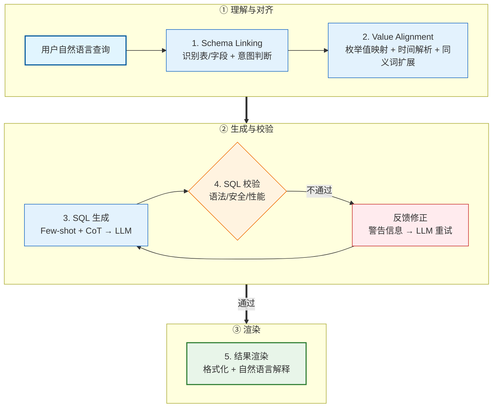
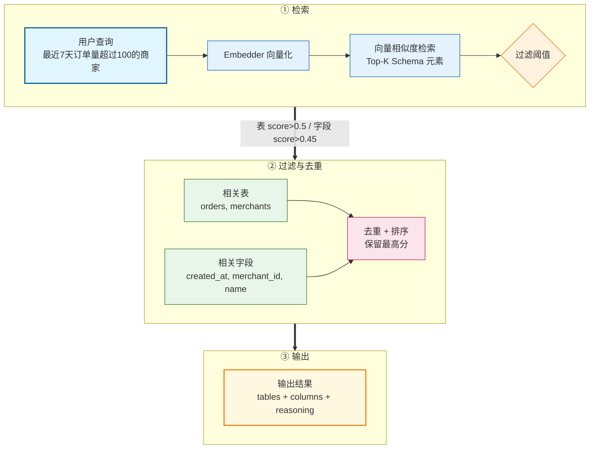
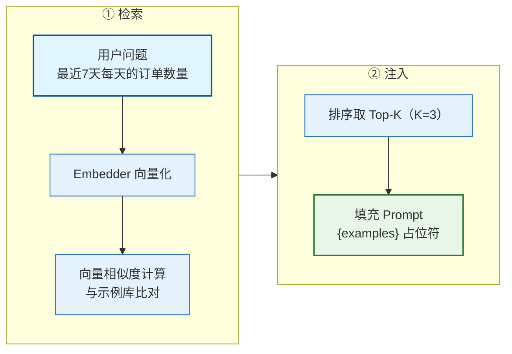
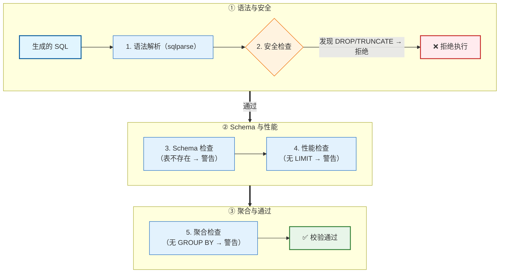
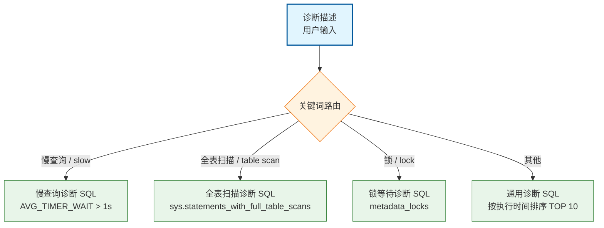

# 专栏第 5 讲：NL2SQL / Text-to-SQL 落地

> **本文属于《大模型驱动的 MySQL 性能分析与自动化运维实战》专栏第 5 讲**
>
> 作者：**李文**
>
> 📎 **前置依赖**：本讲基于第 1-2 讲的知识库构建与检索能力，以及第 3-4 讲的 Prompt 基础与 RAG 集成。
>
> 代码仓库：`mysql-agent-engine/` | 模块：`src/mysql_agent/agents/nl2sql_agent.py`
>
> ### 核心术语速查
>
> | 术语 | 含义 | 本文出现位置 |
> |-----|------|-------------|
> | **NL2SQL** | Natural Language to SQL，自然语言转 SQL | §1 |
> | **Schema Linking** | 将自然语言映射到数据库表/字段 | §3 |
> | **Value Alignment** | 值对齐，将自然语言值映射为数据库值 | §2 |
> | **Self-correction** | 自修正，基于校验反馈迭代优化 SQL | §5.2 |
> | **Few-shot** | 少样本示例，指导 LLM 生成格式 | §4 |
> | **CoT** | Chain-of-Thought，思维链推理 | §4.1 |
> | **Schema** | 数据库结构定义（表、字段、关系） | §3.3 |

---

## 1. 为什么 MySQL 场景需要 NL2SQL？

### 1.1 业务痛点

| 场景 | 传统方式 | NL2SQL 方式 |
|------|---------|------------|
| 运营查数据 | 提工单给 DBA/开发 | 自然语言直接查询 |
| 故障排查 | 手写复杂诊断 SQL | 描述现象自动生成 |
| 报表需求 | 依赖 BI 工具配置 | 口语化描述即出结果 |
| 临时分析 | 翻文档找表结构 | 自动 Schema Linking |

### 1.2 MySQL 场景的特殊挑战

相比 Spider/Bird 等通用基准，MySQL 生产环境有更复杂的约束：

- **Schema 规模大**：单实例数百表、数千字段
- **值域隐含知识**：`status=1` 代表什么含义？
- **权限敏感**：不能暴露敏感字段（密码、手机号）
- **性能约束**：生成的 SQL 不能是全表扫描
- **方言特性**：MySQL 特有的 `LIMIT`、`GROUP_CONCAT`、`FIND_IN_SET` 等

---

## 2. NL2SQL 架构设计

**图示：Schema Linking → Few-shot 生成 → 校验自修正的 NL2SQL 流水线**



---

## 3. Schema Linking：从自然语言到表/字段映射

### 3.1 问题定义

输入：`"查询最近7天订单量超过100的商家"`

输出：
```json
{
  "tables": ["orders", "merchants"],
  "columns": ["orders.created_at", "orders.merchant_id", "merchants.name"],
  "conditions": ["created_at >= DATE_SUB(NOW(), INTERVAL 7 DAY)"],
  "aggregation": "COUNT(*) > 100"
}
```

### 3.2 Schema Linking 流程

将用户自然语言问题映射到数据库 Schema 元素（表、字段），包括向量化检索和阈值过滤：

**图示：自然语言到表/字段的 Schema Linking 流程**



### 3.3 基于向量检索的 Schema Linking

通过预建的 Schema 向量库，实现语义级 Schema 匹配：

```python
# src/mysql_agent/nl2sql/schema_linker.py
from dataclasses import dataclass
from typing import List, Dict, Optional
import json
import numpy as np  # 修复：补充 numpy 导入


@dataclass
class SchemaElement:
    """数据库 schema 元素"""
    name: str           # 表名/字段名
    type: str           # table / column
    table: Optional[str]  # 字段所属表
    comment: str        # 注释/说明
    sample_values: List[str]  # 采样值
    synonyms: List[str]  # 同义词


class SchemaLinker:
    """
    Schema Linking：将自然语言映射到数据库表和字段。
    使用向量检索 + 规则匹配双路召回。
    """
    
    def __init__(self, schema_path: str, embedder):
        self.schema = self._load_schema(schema_path)
        self.embedder = embedder
        self._build_index()
    
    def _load_schema(self, path: str) -> Dict:
        """加载 schema 定义（JSON 格式）"""
        with open(path, 'r', encoding='utf-8') as f:
            return json.load(f)
    
    def _build_index(self):
        """构建 schema 元素的向量索引"""
        self.elements: List[SchemaElement] = []
        texts = []
        
        for table in self.schema.get('tables', []):
            # 表级元素
            table_elem = SchemaElement(
                name=table['name'],
                type='table',
                table=None,
                comment=table.get('comment', ''),
                sample_values=[],
                synonyms=table.get('synonyms', [])
            )
            self.elements.append(table_elem)
            texts.append(f"{table['name']} {table.get('comment', '')}")
            
            # 字段级元素
            for col in table.get('columns', []):
                col_elem = SchemaElement(
                    name=col['name'],
                    type='column',
                    table=table['name'],
                    comment=col.get('comment', ''),
                    sample_values=col.get('sample_values', [])[:5],
                    synonyms=col.get('synonyms', [])
                )
                self.elements.append(col_elem)
                texts.append(
                    f"{table['name']}.{col['name']} {col.get('comment', '')} "
                    f"{' '.join(col.get('synonyms', []))}"
                )
        
        # 构建向量索引
        self.vectors = self.embedder.encode(texts)
    
    def link(self, query: str, top_k: int = 10) -> Dict:
        """
        将自然语言查询链接到相关 schema 元素。
        
        Returns:
            {
                'tables': [{'name': str, 'score': float}],
                'columns': [{'name': str, 'table': str, 'score': float}],
                'reasoning': str
            }
        """
        query_vec = self.embedder.encode([query])
        
        # 向量相似度检索
        from sklearn.metrics.pairwise import cosine_similarity
        similarities = cosine_similarity(query_vec, self.vectors)[0]
        top_indices = np.argsort(similarities)[::-1][:top_k]
        
        tables = []
        columns = []
        
        for idx in top_indices:
            elem = self.elements[idx]
            score = float(similarities[idx])
            
            if elem.type == 'table' and score > 0.5:
                tables.append({'name': elem.name, 'score': score})
            elif elem.type == 'column' and score > 0.45:
                columns.append({
                    'name': elem.name,
                    'table': elem.table,
                    'score': score
                })
        
        # 去重并排序
        tables = self._dedup(tables, key='name')
        columns = self._dedup(columns, key=lambda x: f"{x['table']}.{x['name']}")
        
        return {
            'tables': tables[:5],
            'columns': columns[:10],
            'reasoning': f"基于语义相似度，识别到 {len(tables)} 个相关表，{len(columns)} 个相关字段"
        }
    
    def _dedup(self, items, key):
        """去重保留最高分"""
        seen = {}
        for item in items:
            k = key(item) if callable(key) else item[key]
            if k not in seen or item['score'] > seen[k]['score']:
                seen[k] = item
        return sorted(seen.values(), key=lambda x: x['score'], reverse=True)
```

### 3.4 Schema 定义示例

完整的 Schema 定义包含表名、注释、同义词、字段类型等，便于向量化和语义匹配：

```json
{
  "database": "ecommerce",
  "tables": [
    {
      "name": "orders",
      "comment": "订单主表",
      "synonyms": ["订单", "order"],
      "columns": [
        {
          "name": "order_id",
          "type": "BIGINT",
          "comment": "订单ID",
          "is_primary": true
        },
        {
          "name": "merchant_id",
          "type": "BIGINT",
          "comment": "商家ID",
          "foreign_key": "merchants.merchant_id"
        },
        {
          "name": "created_at",
          "type": "DATETIME",
          "comment": "创建时间",
          "synonyms": ["下单时间", "订单时间"]
        },
        {
          "name": "status",
          "type": "TINYINT",
          "comment": "订单状态",
          "sample_values": ["1=待支付", "2=已支付", "3=已发货", "4=已完成", "5=已取消"]
        },
        {
          "name": "total_amount",
          "type": "DECIMAL(10,2)",
          "comment": "订单总金额",
          "synonyms": ["销售额", "金额", "order amount"]
        }
      ]
    }
  ]
}
```

---

## 4. Few-shot Prompt 设计

### 4.1 Prompt 模板结构

````python
NL2SQL_PROMPT = """你是一个 MySQL 专家。根据给定的数据库 Schema 和示例，将自然语言问题转换为正确的 SQL 查询。

## 数据库 Schema

{schema_description}

## 示例

{examples}

## 当前问题

{question}

## 思考过程

请按以下步骤思考：
1. 识别问题中涉及的表和字段
2. 确定查询类型（SELECT/AGGREGATE/COMPARISON）
3. 处理时间、状态等特殊条件
4. 考虑是否需要 JOIN
5. 写出最终 SQL

## SQL 查询

请仅输出最终 SQL，使用 markdown 代码块包裹：

```sql
-- 在此输出一条可执行的 SELECT 语句
```
"""
````

**模型输出示例**（对应上文「查询最近7天每天的订单数量」）：

```sql
SELECT
    DATE(created_at) AS day,
    COUNT(*) AS order_count
FROM orders
WHERE created_at >= DATE_SUB(CURDATE(), INTERVAL 7 DAY)
GROUP BY DATE(created_at)
ORDER BY day;
```

### 4.2 动态示例选择流程

根据用户问题动态选择最相关的示例，提升 SQL 生成准确性：

**图示：按相似度动态挑选 Few-shot 示例的流程**



```python
class FewShotExampleSelector:
    """基于问题相似度的动态示例选择器"""
    
    def __init__(self, examples: List[Dict], embedder):
        self.examples = examples
        self.embedder = embedder
        self.vectors = embedder.encode([ex['question'] for ex in examples])
    
    def select(self, query: str, k: int = 3) -> List[Dict]:
        """选择最相似的 k 个示例"""
        query_vec = self.embedder.encode([query])
        similarities = cosine_similarity(query_vec, self.vectors)[0]
        top_indices = np.argsort(similarities)[::-1][:k]
        return [self.examples[i] for i in top_indices]
```

### 4.3 示例库

```python
NL2SQL_EXAMPLES = [
    {
        "question": "查询最近7天每天的订单数量",
        "schema": "orders(created_at, order_id)",
        "thought": """
1. 涉及表：orders
2. 查询类型：聚合查询（按天分组计数）
3. 时间条件：created_at >= DATE_SUB(CURDATE(), INTERVAL 7 DAY)
4. 不需要 JOIN
5. 使用 DATE(created_at) 按天分组
""",
        "sql": """SELECT 
    DATE(created_at) as day, 
    COUNT(*) as order_count 
FROM orders 
WHERE created_at >= DATE_SUB(CURDATE(), INTERVAL 7 DAY) 
GROUP BY DATE(created_at) 
ORDER BY day"""
    },
    {
        "question": "找出订单量排名前10的商家名称和订单数",
        "schema": "orders(merchant_id), merchants(merchant_id, name)",
        "thought": """
1. 涉及表：orders, merchants
2. 查询类型：聚合 + JOIN
3. 需要 JOIN orders.merchant_id = merchants.merchant_id
4. 按 merchant_id 分组计数
5. 取 TOP 10
""",
        "sql": """SELECT 
    m.name, 
    COUNT(o.order_id) as order_count 
FROM orders o 
JOIN merchants m ON o.merchant_id = m.merchant_id 
GROUP BY o.merchant_id, m.name 
ORDER BY order_count DESC 
LIMIT 10"""
    },
    {
        "question": "统计各状态订单的数量和占比",
        "schema": "orders(status)",
        "thought": """
1. 涉及表：orders
2. 查询类型：聚合查询
3. 状态映射：1=待支付, 2=已支付, 3=已发货, 4=已完成, 5=已取消
4. 使用 CASE WHEN 转换状态为中文
5. 计算占比需要子查询或窗口函数
""",
        "sql": """SELECT 
    CASE status 
        WHEN 1 THEN '待支付' 
        WHEN 2 THEN '已支付' 
        WHEN 3 THEN '已发货' 
        WHEN 4 THEN '已完成' 
        WHEN 5 THEN '已取消' 
    END as status_name,
    COUNT(*) as count,
    ROUND(COUNT(*) * 100.0 / SUM(COUNT(*)) OVER(), 2) as percentage
FROM orders 
GROUP BY status"""
    }
]
```

---

## 5. SQL 校验与自修正

### 5.1 校验流水线

生成的 SQL 需经过五层校验，确保语法正确、安全可靠：

**图示：语法 / 安全 / Schema / 执行等五层 SQL 校验流水线**



参考代码:
```python
# src/mysql_agent/nl2sql/sql_validator.py
import sqlparse
from typing import Tuple, Optional, List


class SQLValidator:
    """SQL 校验与修正器"""
    
    def __init__(self, schema_linker):
        self.schema_linker = schema_linker
        # 危险操作关键字（基于语法树检查，非字符串匹配）
        self.dangerous_operations = {
            'DROP': "删除表/数据库",
            'TRUNCATE': "清空表",
            'ALTER': "修改表结构",
            'GRANT': "授权操作",
            'REVOKE': "撤销授权"
        }
    
    def validate(self, sql: str, original_query: str) -> Tuple[bool, str, List[str]]:
        """
        校验 SQL 的合法性。
        
        Returns:
            (is_valid, corrected_sql, warnings)
        """
        warnings = []
        upper_sql = sql.upper()  # 修复：补充 upper_sql 定义
        
        # 1. 语法解析
        try:
            parsed = sqlparse.parse(sql)
            if not parsed:
                return False, sql, ["SQL 解析失败"]
        except Exception as e:
            return False, sql, [f"语法错误: {e}"]
        
        # 2. 安全检查：禁止危险 DDL/DCL
        dangerous_found = self._check_dangerous_operations(parsed)
        if dangerous_found:
            return False, sql, [f"检测到危险操作: {dangerous_found}"]
        
        # 3. 检查表和字段是否存在
        tables, columns = self._extract_tables_columns(parsed)
        schema_tables = {t['name'] for t in self.schema_linker.schema.get('tables', [])}
        
        for table in tables:
            if table not in schema_tables:
                warnings.append(f"表 '{table}' 可能不存在于 schema 中")
        
        # 4. 检查 LIMIT（防止全表扫描）
        if 'LIMIT' not in upper_sql and 'COUNT' not in upper_sql:
            warnings.append("建议添加 LIMIT 限制结果集大小")
        
        # 5. 检查聚合函数与 GROUP BY
        has_group_by = 'GROUP BY' in upper_sql
        has_aggregate = any(fn in upper_sql for fn in ['COUNT(', 'SUM(', 'AVG(', 'MAX(', 'MIN('])
        
        if has_aggregate and not has_group_by:
            # 检查 SELECT 中是否有非聚合列
            warnings.append("聚合查询建议添加 GROUP BY")
        
        return len(warnings) == 0, sql, warnings
    
    def _check_dangerous_operations(self, parsed) -> str:
        """基于语法树检查危险操作，避免字符串误匹配"""
        for token in parsed[0].flatten():
            if token.value.upper() in self.dangerous_operations:
                return self.dangerous_operations[token.value.upper()]
        return ""
    
    def _extract_tables_columns(self, parsed) -> Tuple[set, set]:
        """从解析后的 SQL 中提取表名和字段名"""
        tables = set()
        columns = set()
        
        for token in parsed[0].flatten():
            if token.ttype is None:  # 标识符
                val = token.value
                if '.' in val:
                    tables.add(val.split('.')[0])
                    columns.add(val)
                else:
                    columns.add(val)
        
        return tables, columns
```

### 5.2 自修正循环

````python
from typing import Dict, List


class SelfCorrectingNL2SQL:
    """自修正 NL2SQL Agent"""
    
    def __init__(self, llm_client, schema_linker, validator, max_retries=2):
        self.llm = llm_client
        self.schema_linker = schema_linker
        self.validator = validator
        self.max_retries = max_retries
    
    def generate(self, question: str) -> Dict:
        """生成 SQL，支持自修正"""
        # Schema Linking
        schema_info = self.schema_linker.link(question)
        schema_desc = self._format_schema(schema_info)
        
        # 初始生成
        sql = self._call_llm(question, schema_desc)
        
        # 校验-修正循环
        for attempt in range(self.max_retries + 1):
            is_valid, corrected_sql, warnings = self.validator.validate(sql, question)
            
            if is_valid:
                return {
                    'sql': corrected_sql,
                    'status': 'success',
                    'attempts': attempt + 1,
                    'warnings': warnings
                }
            
            if attempt < self.max_retries:
                # 使用警告信息修正
                sql = self._call_llm_with_feedback(
                    question, schema_desc, sql, warnings
                )
        
        return {
            'sql': corrected_sql,
            'status': 'partial',
            'attempts': self.max_retries + 1,
            'warnings': warnings
        }
    
    def _call_llm(self, question: str, schema: str) -> str:
        """调用 LLM 生成 SQL"""
        prompt = NL2SQL_PROMPT.format(
            schema_description=schema,
            examples=self._get_examples(question),
            question=question
        )
        return self.llm.generate(prompt)
    
    def _format_schema(self, schema_info: Dict) -> str:
        """把 Schema Linking 结果压成 Prompt 可读文本"""
        tables = ", ".join(t["name"] for t in schema_info.get("tables", []))
        columns = "\n".join(
            f"- {c['table']}.{c['name']}" for c in schema_info.get("columns", [])
        )
        return f"相关表：{tables or '无'}\n相关字段：\n{columns or '- 无'}"

    def _get_examples(self, question: str) -> str:
        """返回固定 Few-shot 示例；生产中可替换为向量检索结果"""
        return (
            "示例：查询 orders 表最近 7 天每天的订单数量 → "
            "SELECT DATE(created_at) AS day, COUNT(*) FROM orders "
            "WHERE created_at >= DATE_SUB(CURDATE(), INTERVAL 7 DAY) "
            "GROUP BY DATE(created_at);"
        )

    def _call_llm_with_feedback(self, question: str, schema: str, 
                                 previous_sql: str, warnings: List[str]) -> str:
        """使用反馈修正 SQL"""
        feedback = f"""
之前生成的 SQL 有以下问题：
{chr(10).join(f'- {w}' for w in warnings)}

请修正以下 SQL：
```sql
{previous_sql}
```

只输出修正后的 SQL，不要解释。
"""
        return self.llm.generate(feedback)
````

### 自修正案例

**问题**："查询最近7天每天的订单数量"

**第一次生成**：
```sql
SELECT DATE(created_at) as day, COUNT(*) 
FROM orders 
WHERE created_at >= DATE_SUB(NOW(), INTERVAL 7 DAY) 
GROUP BY day
```

**校验警告**：
- "GROUP BY 使用了别名 'day'，MySQL 5.7+ 默认允许但建议显式写 DATE(created_at)"
- "建议添加 ORDER BY 保证结果有序"

**修正后**：
```sql
SELECT DATE(created_at) as day, COUNT(*) as order_count
FROM orders 
WHERE created_at >= DATE_SUB(NOW(), INTERVAL 7 DAY) 
GROUP BY DATE(created_at)
ORDER BY day
```

---

## 6. 与性能诊断结合

### 6.1 诊断 SQL 模板路由

> **与第 9 讲的区别**：本节路由决定「生成哪类诊断 SQL 模板」（慢查询 / 全表扫描 / 锁等待等）；第 9 讲 `InputRouter` 决定「走 SQL 层还是实例层」。二者互补，不要混为一谈。

根据用户描述的诊断问题类型，自动路由到对应的诊断 SQL 生成器：

**图示：诊断描述关键词 → 对应诊断 SQL 模板**



### 6.2 诊断场景下的 NL2SQL

```python
class DiagnosticNL2SQL:
    """面向诊断场景的 NL2SQL，集成性能分析"""
    
    DIAGNOSTIC_SCHEMA = {
        "tables": [
            {
                "name": "performance_schema.events_statements_summary_by_digest",
                "comment": "SQL 性能统计",
                "columns": [
                    {"name": "DIGEST_TEXT", "comment": "SQL 指纹"},
                    {"name": "COUNT_STAR", "comment": "执行次数"},
                    {"name": "AVG_TIMER_WAIT", "comment": "平均执行时间"},
                    {"name": "MAX_TIMER_WAIT", "comment": "最大执行时间"},
                    {"name": "SUM_ROWS_SENT", "comment": "返回行数总和"},
                    {"name": "SUM_ROWS_EXAMINED", "comment": "扫描行数总和"}
                ]
            },
            {
                "name": "sys.statements_with_full_table_scans",
                "comment": "全表扫描语句",
                "columns": [
                    {"name": "query", "comment": "SQL 文本"},
                    {"name": "db", "comment": "数据库"},
                    {"name": "exec_count", "comment": "执行次数"},
                    {"name": "total_latency", "comment": "总延迟"},
                    {"name": "no_index_used_count", "comment": "未使用索引次数"}
                ]
            }
        ]
    }
    
    def generate_diagnostic_query(self, description: str) -> str:
        """将诊断描述转换为性能分析 SQL"""
        # 基于关键词路由到不同诊断模板
        desc_lower = description.lower()
        
        if '慢查询' in description or 'slow' in desc_lower:
            return """SELECT 
                DIGEST_TEXT as sql_pattern,
                COUNT_STAR as exec_count,
                ROUND(AVG_TIMER_WAIT/1e9, 2) as avg_ms,
                ROUND(MAX_TIMER_WAIT/1e9, 2) as max_ms
            FROM performance_schema.events_statements_summary_by_digest
            WHERE AVG_TIMER_WAIT > 1e12  -- 平均超过 1s（performance_schema 单位为皮秒）
            ORDER BY AVG_TIMER_WAIT DESC 
            LIMIT 10"""
        
        elif '全表扫描' in description or 'table scan' in desc_lower:
            return """SELECT 
                query,
                db,
                exec_count,
                ROUND(total_latency/1e9, 2) as total_ms,
                no_index_used_count
            FROM sys.statements_with_full_table_scans
            ORDER BY total_latency DESC
            LIMIT 10"""
        
        elif '锁' in description or 'lock' in desc_lower:
            return """SELECT 
                OBJECT_SCHEMA,
                OBJECT_NAME,
                THREAD_ID,
                LOCK_TYPE,
                LOCK_DURATION
            FROM performance_schema.metadata_locks
            WHERE OBJECT_TYPE = 'TABLE'
              AND LOCK_STATUS = 'PENDING'
            ORDER BY LOCK_DURATION DESC"""
        
        else:
            # 通用诊断：按执行时间排序
            return """SELECT 
                DIGEST_TEXT as sql_pattern,
                COUNT_STAR as exec_count,
                ROUND(AVG_TIMER_WAIT/1e9, 2) as avg_ms,
                SUM_ROWS_SENT as total_rows_sent,
                SUM_ROWS_EXAMINED as total_rows_examined
            FROM performance_schema.events_statements_summary_by_digest
            ORDER BY COUNT_STAR DESC 
            LIMIT 10"""
```

---

## 7. 评测与优化

### 7.1 评测指标

| 指标 | 定义 | 目标值 |
|------|------|--------|
| 执行准确率 (EX) | 生成的 SQL 能正确执行 | > 95% |
| 结果准确率 (EM) | 执行结果与标准答案一致 | > 80% |
| Schema 召回率 | 正确识别相关表/字段的比例 | > 90% |
| 延迟 | 端到端生成时间 | < 3s |

### 7.2 评测集示例

```python
NL2SQL_TEST_SET = [
    {
        "question": "最近一周每天有多少订单",
        "gold_sql": "SELECT DATE(created_at) as day, COUNT(*) FROM orders WHERE created_at >= DATE_SUB(CURDATE(), INTERVAL 7 DAY) GROUP BY DATE(created_at)",
        "category": "time_filter",
        "difficulty": "easy"
    },
    {
        "question": "哪些商家订单总金额超过10万",
        "gold_sql": "SELECT m.name, SUM(o.total_amount) FROM orders o JOIN merchants m ON o.merchant_id = m.merchant_id GROUP BY o.merchant_id HAVING SUM(o.total_amount) > 100000",
        "category": "aggregation_join",
        "difficulty": "medium"
    },
    {
        "question": "找出连续3天订单量下降超过20%的商家",
        "gold_sql": """WITH daily_stats AS (
            SELECT merchant_id, DATE(created_at) as day, COUNT(*) as cnt
            FROM orders WHERE created_at >= DATE_SUB(CURDATE(), INTERVAL 30 DAY)
            GROUP BY merchant_id, DATE(created_at)
        ),
        with_lag AS (
            SELECT *,
                   LAG(cnt) OVER(PARTITION BY merchant_id ORDER BY day) as prev_cnt
            FROM daily_stats
        ),
        flagged AS (
            SELECT *,
                   CASE WHEN prev_cnt > 0
                        AND (prev_cnt - cnt) * 1.0 / prev_cnt > 0.2
                        THEN 1 ELSE 0 END AS is_drop
            FROM with_lag
        ),
        runs AS (
            SELECT *,
                   ROW_NUMBER() OVER(PARTITION BY merchant_id ORDER BY day)
                   - ROW_NUMBER() OVER(PARTITION BY merchant_id, is_drop ORDER BY day) AS grp
            FROM flagged
        )
        SELECT DISTINCT merchant_id FROM runs
        WHERE is_drop = 1
        GROUP BY merchant_id, grp
        HAVING COUNT(*) >= 3""",
        "category": "window_function",
        "difficulty": "hard"
    },
    {
        "question": "查询2024年第一季度每个品类销售额TOP3的商品",
        "gold_sql": """WITH ranked AS (
            SELECT category_id, product_name, SUM(total_amount) as sales,
                   RANK() OVER(PARTITION BY category_id ORDER BY SUM(total_amount) DESC) as rk
            FROM orders o JOIN order_items oi ON o.order_id = oi.order_id
            WHERE o.created_at >= '2024-01-01' AND o.created_at < '2024-04-01'
            GROUP BY category_id, product_name
        )
        SELECT category_id, product_name, sales FROM ranked WHERE rk <= 3""",
        "category": "cte_window",
        "difficulty": "hard"
    }
]
```

---

## 8. 本讲小结

| 组件 | 文件 | 核心作用 |
|------|------|---------|
| Schema Linker | `schema_linker.py` | 自然语言 → 表/字段映射 |
| Few-shot Selector | `example_selector.py` | 动态选择相似示例 |
| SQL Validator | `sql_validator.py` | 语法检查 + 安全校验 |
| Self-correction | `nl2sql_agent.py` | 错误反馈自修正 |
| Diagnostic NL2SQL | `diagnostic_nl2sql.py` | 性能诊断专用查询生成 |

> 📌 **使用建议**：本讲提供的 NL2SQL 实现可应用于任何 MySQL 数据库场景。建议先用测试环境验证生成的 SQL，再逐步应用于生产诊断。请确保数据库账号具有合适的权限（建议只读权限）。

**下一讲预告**：执行计划自动解读 Agent —— 基于 MySQL 官方 EXPLAIN 文档，自动识别执行计划输出中的 type/ref/rows/Extra 告警，构建可落地的 SQL 性能诊断能力。

---

### 学习路径建议

| 你的背景 | 建议阅读重点 | 可跳过 |
|---------|------------|--------|
| DBA / SRE | §1、§3、§5、§6 | §4 Few-shot（了解即可） |
| 后端开发 | §1、§3、§4、§5、§7 | §6 诊断场景（了解即可） |
| AI 应用开发 | 全文通读 | 无 |

---

## 版本记录

| 版本 | 日期 | 更新内容 |
|-----|------|---------|
| v1.0 | 2024-08-25 | 初稿发布 |

> 如发现内容错误或希望参与共建，欢迎提交 Issue 或 PR。