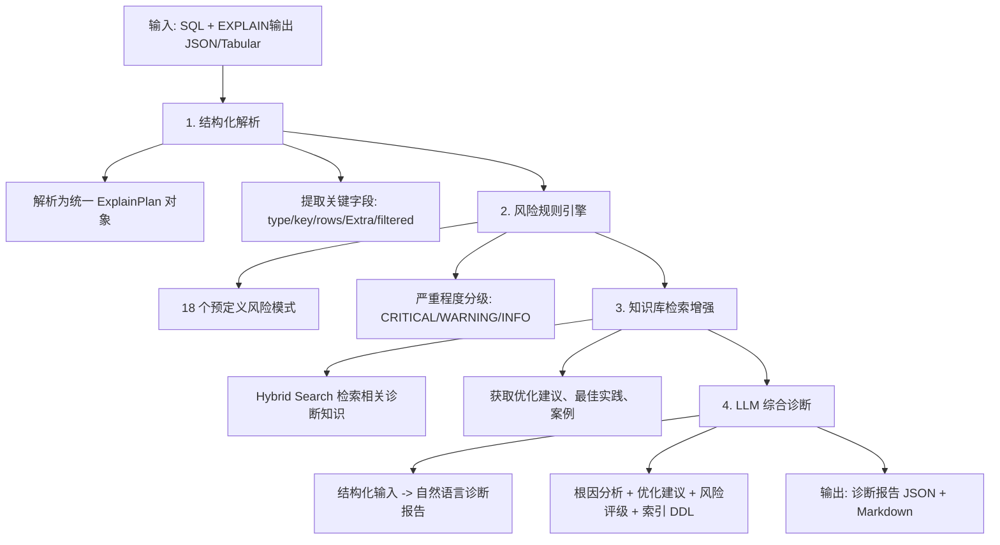
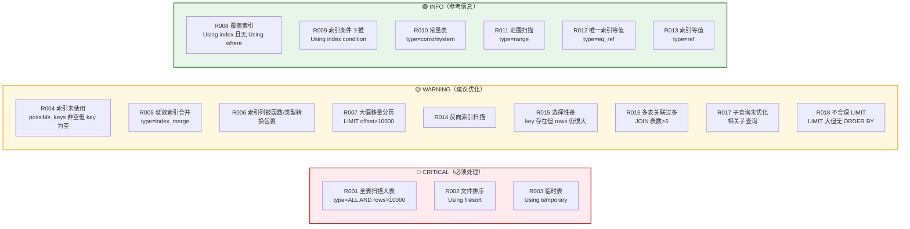

# 专栏第 6 讲：执行计划自动解读 Agent

> **本文属于《大模型驱动的 MySQL 性能分析与自动化运维实战》专栏第 6 讲**
>
> 📎 **前置依赖**：本讲基于第 2 讲的 Hybrid Search 检索能力、第 4 讲的 RAG 集成，以及第 5 讲的 NL2SQL Agent。
>
> 代码仓库：`mysql-agent-engine/` | 模块：`src/mysql_agent/agents/explain_agent.py`
>
> **本章目标**：实现一个能自动解析 EXPLAIN 输出、识别 18 类性能风险、结合知识库生成诊断报告的 Agent，为后续索引优化和 SQL 改写提供决策依据。

---

## 1. 为什么需要执行计划自动解读？

### 1.1 业务痛点

| 场景 | 传统方式 | 痛点 | Agent 方式 |
|------|---------|------|-----------|
| 慢查询分析 | DBA 手动 EXPLAIN，逐项判断 | 依赖专家经验、人力瓶颈、响应慢 | 自动解析 + 知识库匹配 + 诊断建议，秒级出报告 |
| 索引优化 | 依赖经验识别 type=ALL | 易漏判、索引设计不系统、维护成本高 | 自动识别全表扫描、推荐复合索引、评估收益成本 |
| SQL 评审 | 人工检查每个 JOIN 和子查询 | 覆盖面有限、标准不一、发版前来不及审 | 批量扫描 + 风险分级（CRITICAL/WARNING/INFO）、CI/CD 集成 |
| 性能回归 | 发版后人工抽查 | 事后发现、影响业务、回滚成本高 | 自动化对比基线执行计划、阻断高风险发布 |

### 1.2 EXPLAIN 输出的复杂性

MySQL EXPLAIN 输出包含 12+ 个字段，字段间存在复杂的语义关联，单字段判断容易误判：

```sql
EXPLAIN SELECT * FROM orders o 
JOIN merchants m ON o.merchant_id = m.merchant_id 
WHERE o.created_at > '2024-01-01' AND m.status = 1;
```

输出示例：

| id | select_type | table | type | possible_keys | key | key_len | ref | rows | Extra |
|----|-------------|-------|------|---------------|-----|---------|-----|------|-------|
| 1 | SIMPLE | m | ALL | PRIMARY | NULL | NULL | NULL | 10000 | Using where |
| 1 | SIMPLE | o | ref | idx_merchant_created | idx_merchant_created | 9 | db.m.merchant_id | 100 | Using index condition |

**核心解读难点**：

| 字段 | 表面现象 | 深层含义 | 误判风险 |
|------|---------|---------|---------|
| `type=ALL` | 全表扫描 | rows=10000 是否可接受？需结合表总行数、业务频次判断 | 小表全扫可能是优化器正确选择 |
| `Using where` vs `Using index condition` | 都有过滤条件 | 前者在 Server 层过滤（回表后），后者在存储引擎层 ICP 过滤（回表前） | 误以为有 WHERE 就高效 |
| `ref=db.m.merchant_id` | 用了关联列 | 表示用 merchants.merchant_id 作为 ref 值关联 orders 表 | 忽略被驱动表是否需要索引 |
| `m.status` | 有 WHERE 条件 | 若 filtered 很低（如 10%），说明 WHERE 过滤性差，需加索引 | 只看 key 存在就认为没问题 |

**关键洞察**：单字段判断容易误判，必须结合多字段做综合评估：

```
实际扫描行数 ≈ rows × filtered / 100
总成本 = 实际扫描行数 + 排序开销(filesort) + 临时表开销(temporary)
```

### 1.3 知识库支撑

基于已有的向量索引（专栏第 2 讲 Hybrid Search），可以检索到三大专栏中关于执行计划的深度内容：

| 检索查询 | 预期命中内容 | 使用场景 |
|---------|-------------|---------|
| "EXPLAIN type 字段含义" | 官方文档 + 专栏中 type 优先级讲解 | 规则引擎匹配到 type=ALL 时，补充理论依据 |
| "Using filesort 优化" | 排序优化、索引设计、覆盖索引 | R002 触发时，提供具体优化模式 |
| "rows 估算不准确" | 统计信息更新、ANALYZE TABLE | R004/R015 触发时，指导排查统计信息 |
| "索引合并 vs 单列索引" | index_merge 优化器选择、复合索引设计 | R005 触发时，对比两种方案优劣 |

**知识库集成方式**：
- 风险规则匹配后，自动构造查询（如 `f"{rule.name} {row.access_type} 优化"`）
- Hybrid Search 融合稀疏向量（关键词）+ 稠密向量（语义），Top-3 结果注入 LLM Prompt
- LLM 综合规则建议 + 知识库片段 + 具体执行计划，生成定制化报告

---

## 2. 执行计划解析架构

**图示：EXPLAIN 解析 → 风险规则 → LLM 综合诊断的 Agent 架构**



**各阶段核心任务**：

| 阶段 | 核心任务 | 关键技术 |
|------|---------|---------|
| 1. 结构化解析 | 屏蔽 JSON/Tabular 格式差异，统一为 `ExplainPlan` 对象 | 多格式兼容解析器 |
| 2. 风险规则引擎 | 18 个预定义规则快速识别常见性能模式 | 基于阈值的确定性判断 |
| 3. 知识库检索增强 | 为每个风险检索相关诊断知识和案例 | Hybrid Search (稀疏+稠密向量) |
| 4. LLM 综合诊断 | 生成自然语言诊断报告和优化建议 | 结构化 Prompt + 知识注入 |

**设计原则**：
- **规则优先**：确定性问题（如 type=ALL + rows>10000）用规则快速识别，不消耗 LLM Token
- **LLM 兜底**：复杂场景（如多风险关联、业务上下文权衡）交给 LLM 综合判断
- **知识增强**：规则给出通用建议，知识库提供具体案例和最佳实践

---

## 3. EXPLAIN 结构化解析

### 3.1 统一数据模型

```python
# src/mysql_agent/explain/models.py（`ExplainRow` / `ExplainPlan` / `RiskLevel`；SQL 解析逻辑在 `explain_parser.py`）
from dataclasses import dataclass, field
from typing import List, Optional, Dict, Any
from enum import Enum


class AccessType(Enum):
    """访问类型，按效率从低到高排序"""
    ALL = "全表扫描"
    INDEX = "全索引扫描"
    RANGE = "范围扫描"
    REF = "非唯一索引等值"
    EQ_REF = "唯一索引等值"
    CONST = "常量"
    SYSTEM = "系统表"


class RiskLevel(Enum):
    CRITICAL = "严重"
    WARNING = "警告"
    INFO = "提示"


@dataclass
class ExplainRow:
    """EXPLAIN 单行解析结果"""
    id: int
    select_type: str
    table: str
    partitions: Optional[str]
    access_type: str
    possible_keys: List[str]
    key: Optional[str]
    key_len: Optional[int]
    ref: Optional[str]
    rows: int
    filtered: Optional[float]  # 估算的过滤比例（%），越低说明 WHERE 条件过滤效果越差
    extra: List[str]
    
    @property
    def is_full_scan(self) -> bool:
        return self.access_type in ('ALL', 'INDEX')
    
    @property
    def has_filesort(self) -> bool:
        return 'Using filesort' in self.extra
    
    @property
    def has_temporary(self) -> bool:
        return 'Using temporary' in self.extra
    
    @property
    def is_covering_index(self) -> bool:
        # Using index 且无 Using where 表示纯覆盖索引（无需回表）
        return 'Using index' in self.extra and 'Using where' not in self.extra


@dataclass
class ExplainPlan:
    """完整执行计划"""
    sql: str
    rows: List[ExplainRow]
    warnings: List[str] = field(default_factory=list)
    
    @property
    def total_rows_examined(self) -> int:
        """估算的总扫描行数"""
        return sum(r.rows for r in self.rows)
    
    @property
    def has_full_scan(self) -> bool:
        return any(r.is_full_scan for r in self.rows)
    
    def get_table_plan(self, table_name: str) -> Optional[ExplainRow]:
        for row in self.rows:
            if row.table == table_name:
                return row
        return None
```

### 3.2 解析器实现

```python
import json
import re
from typing import Union


class ExplainParser:
    """EXPLAIN 输出解析器，支持 Tabular 和 JSON 格式"""
    
    def parse(self, explain_output: Union[str, Dict], sql: str = "") -> ExplainPlan:
        """解析 EXPLAIN 输出
        
        Args:
            explain_output: EXPLAIN 结果，支持 JSON 字符串/字典或传统表格文本
            sql: 原始 SQL，用于上下文关联
        """
        if isinstance(explain_output, str):
            # 尝试 JSON 格式
            try:
                data = json.loads(explain_output)
                return self._parse_json(data, sql)
            except json.JSONDecodeError:
                return self._parse_tabular(explain_output, sql)
        else:
            return self._parse_json(explain_output, sql)
    
    def _parse_json(self, data: Dict, sql: str) -> ExplainPlan:
        """解析 EXPLAIN FORMAT=JSON 输出
        
        MySQL JSON 格式结构：
        {
          "query_block": {
            "table": [          # 单表时为 dict，多表时为 list
              {
                "table_name": "orders",  # 或 {"name": "orders"}
                "access_type": "ref",
                "possible_keys": "idx_merchant_created",
                "key": "idx_merchant_created",
                "key_length": "9",
                "ref": "db.m.merchant_id",
                "rows_examined_per_scan": 100,
                "filtered": 100.0,
                "using_index": true,
                "using_where": false,
                "using_filesort": false,
                "using_temporary": false
              }
            ]
          }
        }
        """
        rows = []
        query_block = data.get('query_block', {})
        tables = query_block.get('table', [])
        
        # 兼容单表（dict）和多表（list）两种结构
        if isinstance(tables, dict):
            tables = [tables]
        
        for table_data in tables:
            # 处理嵌套的 table_name 结构：可能是字符串或 {"name": "xxx"}
            table_name = table_data.get('table_name', '')
            if isinstance(table_name, dict):
                table_name = table_name.get('name', '')
            
            row = ExplainRow(
                id=table_data.get('id', 1),
                select_type=table_data.get('select_type', 'SIMPLE'),
                table=table_name,
                partitions=table_data.get('partitions'),
                access_type=table_data.get('access_type', 'ALL'),
                possible_keys=table_data.get('possible_keys', '').split(', ') if table_data.get('possible_keys') else [],
                key=table_data.get('key'),
                key_len=table_data.get('key_length'),
                ref=table_data.get('ref'),
                rows=table_data.get('rows_examined_per_scan', 0),
                filtered=table_data.get('filtered', 100.0),
                extra=self._parse_extra_json(table_data)
            )
            rows.append(row)
        
        return ExplainPlan(sql=sql, rows=rows)
    
    def _parse_tabular(self, output: str, sql: str) -> ExplainPlan:
        """解析传统表格格式"""
        lines = output.strip().split('\n')
        rows = []
        
        # 跳过表头和分隔线
        for line in lines[1:]:
            if not line.strip() or line.startswith('+'):
                continue
            
            parts = [p.strip() for p in line.split('|')][1:-1]
            if len(parts) < 10:
                continue
            
            row = ExplainRow(
                id=int(parts[0]) if parts[0].isdigit() else 1,
                select_type=parts[1],
                table=parts[2],
                partitions=parts[3] if parts[3] else None,
                access_type=parts[4],
                possible_keys=parts[5].split(', ') if parts[5] else [],
                key=parts[6] if parts[6] else None,
                key_len=int(parts[7]) if parts[7].isdigit() else None,
                ref=parts[8] if parts[8] else None,
                rows=int(parts[9]) if parts[9].isdigit() else 0,
                filtered=float(parts[10]) if len(parts) > 10 and parts[10] else None,
                extra=self._parse_extra(parts[11] if len(parts) > 11 else '')
            )
            rows.append(row)
        
        return ExplainPlan(sql=sql, rows=rows)
    
    def _parse_extra(self, extra_str: str) -> List[str]:
        """解析 Extra 字段：提取已知关键词，未知内容保留原样"""
        if not extra_str:
            return []
        extras = []
        known_patterns = [
            'Using index', 'Using where', 'Using filesort',
            'Using temporary', 'Using index condition',
            'Using join buffer', 'Impossible WHERE',
            'Select tables optimized away', 'Backward index scan'
        ]
        for pattern in known_patterns:
            if pattern in extra_str:
                extras.append(pattern)
        return extras if extras else [extra_str]
    
    def _parse_extra_json(self, table_data: Dict) -> List[str]:
        """从 JSON 格式解析 Extra"""
        extras = []
        if table_data.get('using_index'):
            extras.append('Using index')
        if table_data.get('using_where'):
            extras.append('Using where')
        if table_data.get('using_filesort'):
            extras.append('Using filesort')
        if table_data.get('using_temporary'):
            extras.append('Using temporary')
        # JSON 中可能还有 using_join_buffer 等字段
        return extras
```

---

## 4. 风险规则引擎

**图示：R001-R018 规则三级分类体系**



**规则与字段关联矩阵**：

| 风险级别 | 规则数 | 核心检测字段 | 处理策略 |
|---------|--------|-------------|---------|
| CRITICAL | 3 | `type=ALL`, `Extra` 含 filesort/temporary | 立即优化，阻塞发布 |
| WARNING | 9 | `possible_keys`, `key`, `rows`, `Extra` | 计划迭代优化 |
| INFO | 6 | `type`, `Extra` | 记录存档，可选优化 |

### 4.1 预定义风险模式

基于专栏中关于执行计划诊断的知识，定义 18 个风险模式：

```python
# src/mysql_agent/explain/risk_rules.py
from typing import List, Dict, Callable
from dataclasses import dataclass
import re


@dataclass
class RiskPattern:
    """风险模式定义"""
    id: str
    name: str
    description: str
    level: RiskLevel
    check: Callable[[ExplainRow, ExplainPlan], bool]
    suggestion_template: str


# 18 个预定义风险模式
# 阈值说明：
# - rows > 10000：经验值，大表全表扫描通常不可接受
# - rows > 100000：索引选择性差的判定线，需结合表大小判断
# - LIMIT offset > 10000：深分页性能急剧下降的临界点
# - JOIN 表数 > 5：优化器搜索空间指数级增长，建议拆分

# 函数包裹索引列的启发式：只匹配“函数名(列名...”形态，
# 不匹配 DATE_SUB(CURDATE(), ...) 这类函数套函数。
_COLUMN_TRANSFORM = re.compile(
    r"(?i)\b(?:date|year|month|day|substr|substring|concat|cast|convert|ifnull|coalesce|lower|upper)"
    r"\s*\(\s*[a-zA-Z_][\w.]*\s*[,)]"
)


def _has_column_transform(sql: str) -> bool:
    return bool(_COLUMN_TRANSFORM.search(sql))


RISK_PATTERNS: List[RiskPattern] = [
    # === CRITICAL 级别 ===
    RiskPattern(
        id="R001",
        name="全表扫描大表",
        description="对大表（rows > 10000）进行全表扫描",
        level=RiskLevel.CRITICAL,
        check=lambda row, plan: row.access_type == 'ALL' and row.rows > 10000,
        suggestion_template="表 `{table}` 发生全表扫描，涉及约 {rows} 行。建议："
                           "1) 检查 WHERE 条件是否有合适索引"
                           "2) 考虑给 `{possible_keys}` 列添加索引"
                           "3) 如果必须全表扫描，考虑分页或限制返回行数"
    ),
    
    RiskPattern(
        id="R002",
        name="文件排序",
        description="使用 filesort 进行排序，内存不足时会使用磁盘",
        level=RiskLevel.CRITICAL,
        check=lambda row, plan: 'Using filesort' in row.extra,
        suggestion_template="表 `{table}` 使用 filesort 排序。建议："
                           "1) 在 ORDER BY 列上建立索引"
                           "2) 考虑减少排序数据量（先过滤再排序）"
                           "3) 检查 sort_buffer_size 是否足够"
    ),
    
    RiskPattern(
        id="R003",
        name="临时表",
        description="使用临时表，可能产生磁盘临时表",
        level=RiskLevel.CRITICAL,
        check=lambda row, plan: 'Using temporary' in row.extra,
        suggestion_template="查询使用临时表。建议："
                           "1) 简化 GROUP BY / ORDER BY，使其使用相同索引"
                           "2) 避免 SELECT DISTINCT 大表"
                           "3) 检查 tmp_table_size / max_heap_table_size"
    ),
    
    # === WARNING 级别 ===
    RiskPattern(
        id="R004",
        name="索引未使用",
        description="存在 possible_keys 但未使用任何索引",
        level=RiskLevel.WARNING,
        check=lambda row, plan: len(row.possible_keys) > 0 and row.key is None,
        suggestion_template="表 `{table}` 有可选索引但未使用。可能原因："
                           "1) 优化器认为全表扫描更快（小表）"
                           "2) 索引统计信息过期，执行 ANALYZE TABLE `{table}`"
                           "3) 查询条件使用了函数或类型转换"
    ),
    
    RiskPattern(
        id="R005",
        name="低效的索引合并",
        description="使用 index_merge，可能不如复合索引高效",
        level=RiskLevel.WARNING,
        check=lambda row, plan: 'Using index merge' in ' '.join(row.extra),
        suggestion_template="使用索引合并。建议："
                           "1) 考虑建立复合索引覆盖多个条件"
                           "2) 检查索引选择性是否足够"
    ),
    
    RiskPattern(
        id="R006",
        name="索引列被函数或类型转换包裹",
        description="WHERE 对索引列使用函数，导致无法使用索引；隐式类型转换需结合 EXPLAIN Warnings 判断",
        level=RiskLevel.WARNING,
        check=lambda row, plan: row.access_type == 'ALL' and row.rows > 10000 and _has_column_transform(plan.sql),
        suggestion_template="索引列可能被函数或类型转换包裹。建议："
                           "1) 把函数移到常量侧，例如 DATE(created_at)=... 改为范围条件"
                           "2) 若 EXPLAIN Warnings 提示类型转换，再检查列类型与值类型是否一致"
    ),
    
    RiskPattern(
        id="R007",
        name="大偏移量分页",
        description="使用 LIMIT offset, count 且 offset 很大",
        level=RiskLevel.WARNING,
        check=lambda row, plan: 'LIMIT' in plan.sql.upper() and 
                               any(x.isdigit() and int(x) > 10000 
                                   for x in plan.sql.split()),
        suggestion_template="大偏移量分页效率低。建议："
                           "1) 使用覆盖索引 + 子查询优化"
                           "2) 记录上一页最后 ID，使用 WHERE id > ? LIMIT ?"
                           "3) 考虑使用延迟关联"
    ),
    
    # === INFO 级别 ===
    RiskPattern(
        id="R008",
        name="覆盖索引",
        description="使用了覆盖索引，无需回表",
        level=RiskLevel.INFO,
        check=lambda row, plan: 'Using index' in row.extra and 'Using where' not in row.extra,
        suggestion_template="✅ 表 `{table}` 使用了覆盖索引，性能优秀"
    ),
    
    RiskPattern(
        id="R009",
        name="索引条件下推",
        description="使用 Index Condition Pushdown 优化",
        level=RiskLevel.INFO,
        check=lambda row, plan: 'Using index condition' in row.extra,
        suggestion_template="✅ 使用 ICP 优化，减少回表次数"
    ),
    
    RiskPattern(
        id="R010",
        name="常量表",
        description="表只有一行或系统表，效率最高",
        level=RiskLevel.INFO,
        check=lambda row, plan: row.access_type in ('const', 'system'),
        suggestion_template="✅ 常量表访问，效率最优"
    ),
    
    # === 补充模式（R011-R018）===
    RiskPattern(
        id="R011",
        name="范围扫描",
        description="使用范围扫描，需评估扫描行数是否可接受",
        level=RiskLevel.INFO,
        check=lambda row, plan: row.access_type == 'RANGE',
        suggestion_template="表 `{table}` 使用范围扫描（rows={rows}）。建议："
                           "1) 检查范围条件是否可缩小"
                           "2) 考虑建立复合索引覆盖范围列"
                           "3) 评估 rows 是否在可接受范围内"
    ),
    
    RiskPattern(
        id="R012",
        name="唯一索引等值",
        description="使用唯一索引等值查询，效率极高",
        level=RiskLevel.INFO,
        check=lambda row, plan: row.access_type == 'EQ_REF',
        suggestion_template="✅ 表 `{table}` 使用唯一索引等值关联，性能优秀"
    ),
    
    RiskPattern(
        id="R013",
        name="索引等值",
        description="使用非唯一索引等值查询",
        level=RiskLevel.INFO,
        check=lambda row, plan: row.access_type == 'REF',
        suggestion_template="✅ 表 `{table}` 使用索引等值查询（key={key}），效率良好"
    ),
    
    RiskPattern(
        id="R014",
        name="反向索引扫描",
        description="使用反向索引扫描，可能影响排序性能",
        level=RiskLevel.WARNING,
        check=lambda row, plan: 'Backward index scan' in ' '.join(row.extra),
        suggestion_template="表 `{table}` 使用反向索引扫描。建议："
                           "1) 检查 ORDER BY 是否与索引方向一致"
                           "2) 考虑建立 DESC 索引或调整查询顺序"
    ),
    
    RiskPattern(
        id="R015",
        name="选择性差",
        description="使用了索引但扫描行数仍然很大，选择性可能不足",
        level=RiskLevel.WARNING,
        check=lambda row, plan: row.key is not None and row.rows > 100000,
        suggestion_template="表 `{table}` 使用索引 `{key}` 但仍扫描 {rows} 行。建议："
                           "1) 检查索引列的基数（Cardinality）"
                           "2) 考虑复合索引提高选择性"
                           "3) 执行 ANALYZE TABLE 更新统计信息"
    ),
    
    RiskPattern(
        id="R016",
        name="多表关联过多",
        description="JOIN 表数量超过 5 个，优化器压力大",
        level=RiskLevel.WARNING,
        check=lambda row, plan: len(plan.rows) > 5,
        suggestion_template="查询涉及 {total_tables} 个表关联。建议："
                           "1) 考虑拆分为多个查询或使用临时表"
                           "2) 检查 JOIN 顺序是否合理（小表驱动大表）"
                           "3) 确保所有 JOIN 列都有索引"
    ),
    
    RiskPattern(
        id="R017",
        name="子查询未优化",
        description="存在相关子查询，可能可改写为 JOIN",
        level=RiskLevel.WARNING,
        check=lambda row, plan: row.select_type in ('DEPENDENT SUBQUERY', 'UNCACHEABLE SUBQUERY'),
        suggestion_template="表 `{table}` 存在 {select_type}。建议："
                           "1) 改写为 JOIN 或使用 EXISTS"
                           "2) 考虑将子查询提升为 CTE"
                           "3) MySQL 8.0+ 可利用子查询转换优化"
    ),
    
    RiskPattern(
        id="R018",
        name="不合理的 LIMIT",
        description="LIMIT 较大但无 ORDER BY，结果不确定",
        level=RiskLevel.WARNING,
        check=lambda row, plan: 'LIMIT' in plan.sql.upper() and 'ORDER BY' not in plan.sql.upper(),
        suggestion_template="查询使用 LIMIT 但无 ORDER BY，结果顺序不确定。建议："
                           "1) 添加明确的 ORDER BY 子句"
                           "2) 如果不需要排序，考虑移除 LIMIT"
                           "3) 确认业务是否接受任意顺序的结果"
    ),
]
```

### 4.2 规则引擎执行

```python
class RiskAnalyzer:
    """执行计划风险分析器"""
    
    def __init__(self, knowledge_base=None):
        self.rules = RISK_PATTERNS
        self.kb = knowledge_base  # 可选的知识库检索
    
    def analyze(self, plan: ExplainPlan) -> List[Dict]:
        """分析执行计划，返回风险列表"""
        risks = []
        
        for row in plan.rows:
            for rule in self.rules:
                try:
                    if rule.check(row, plan):
                        risk = {
                            'rule_id': rule.id,
                            'rule_name': rule.name,
                            'level': rule.level.value,
                            'table': row.table,
                            'description': rule.description,
                            'suggestion': self._render_suggestion(rule, row),
                            'context': {
                                'access_type': row.access_type,
                                'key': row.key,
                                'rows': row.rows,
                                'extra': row.extra
                            }
                        }
                        
                        # 知识库增强
                        if self.kb:
                            knowledge = self._query_knowledge(rule, row)
                            risk['knowledge_refs'] = knowledge
                        
                        risks.append(risk)
                except Exception as e:
                    # 规则执行失败不应影响其他规则，记录日志但继续执行
                    # 建议：生产环境接入 logging 模块记录具体错误
                    continue
        
        # 按严重程度排序：严重 > 警告 > 提示
        level_order = {'严重': 0, '警告': 1, '提示': 2}
        risks.sort(key=lambda x: level_order.get(x['level'], 3))
        
        return risks
    
    def _render_suggestion(self, rule: RiskPattern, row: ExplainRow) -> str:
        """渲染建议模板"""
        return rule.suggestion_template.format(
            table=row.table,
            rows=row.rows,
            possible_keys=', '.join(row.possible_keys) if row.possible_keys else 'N/A',
            key=row.key or 'N/A'
        )
    
    def _query_knowledge(self, rule: RiskPattern, row: ExplainRow) -> List[Dict]:
        """从知识库检索相关诊断知识"""
        query = f"{rule.name} {row.access_type} {row.table} 优化"
        # 使用 Hybrid Search 检索
        results = self.kb.search(query, k=3)
        return [
            {
                'source': r[0].metadata.get('source_file', 'unknown'),
                'content': r[0].content[:200] + '...',
                'score': r[1]
            }
            for r in results
        ]
```

---

## 5. LLM 综合诊断

### 5.1 诊断 Prompt 设计

````python
EXPLAIN_DIAGNOSIS_PROMPT = """你是一位 MySQL 性能优化专家。请根据以下执行计划分析结果，生成详细的诊断报告。

## 原始 SQL

```sql
{sql}
```

## 执行计划

{explain_table}

## 识别的风险点

{risks}

## 知识库参考

{knowledge}

## 诊断要求

请按以下结构输出诊断报告：

### 1. 执行计划概览
- 简述查询涉及哪些表，数据量如何
- 整体访问模式评价（全表扫描/索引扫描/关联方式）

### 2. 关键风险点
- 列出每个风险点的详细分析
- 说明为什么这是一个问题（结合 rows、filtered、Extra 字段）
- 量化影响：预估扫描行数、排序开销、临时表大小

### 3. 优化建议
- 针对每个风险给出具体优化方案
- 提供优化后的 SQL 示例（如果有）
- 说明预期收益（行数减少倍数、响应时间预估）

### 4. 索引建议
- 如果需要新建索引，给出具体的 DDL
- 说明索引列顺序选择的理由（区分度、查询模式）
- 评估索引维护成本（写入开销、空间占用）

### 5. 监控建议
- 建议添加哪些监控指标（慢查询阈值、扫描行数告警）
- 如何验证优化效果（EXPLAIN 对比、实际执行时间）

请用中文输出，技术术语保留英文。建议要具体、可落地，避免泛泛而谈。
"""
````

**Prompt 设计要点**：

| 要素 | 说明 |
|------|------|
| 角色设定 | MySQL 专家，确保输出专业度 |
| 结构化输入 | SQL、执行计划表格、风险列表、知识库片段分离，避免 Token 浪费 |
| 输出结构固定 | 5 个固定章节，便于前端渲染和自动化解析 |
| 量化要求 | 要求给出具体数字（行数、倍数、DDL），而非模糊建议 |
| 知识库注入 | `{knowledge}` 由 `_format_knowledge` 生成，包含来源文件、相关片段、相似度分数 |

### 5.2 Agent 实现

```python
# src/mysql_agent/agents/explain_agent.py
from typing import Dict, Optional
from ..explain.explain_parser import ExplainParser, ExplainPlan
from ..explain.risk_rules import RiskAnalyzer
from ..vectorstore.hybrid_search import HybridSearcher


class ExplainDiagnosisAgent:
    """执行计划自动诊断 Agent"""
    
    def __init__(self, 
                 llm_client,
                 index_path: Optional[str] = None,
                 enable_kb: bool = True):
        self.llm = llm_client
        self.parser = ExplainParser()
        self.analyzer = RiskAnalyzer()
        
        # 可选加载知识库
        if enable_kb and index_path:
            self.kb = HybridSearcher(index_path)
            self.analyzer.kb = self.kb
        else:
            self.kb = None
    
    def diagnose(self, sql: str, explain_output: str) -> Dict:
        """
        执行计划诊断主入口
        
        Args:
            sql: 原始 SQL 语句
            explain_output: EXPLAIN 输出（JSON 或 Tabular）
        
        Returns:
            诊断报告
        """
        # 1. 解析执行计划
        plan = self.parser.parse(explain_output, sql)
        
        # 2. 风险分析
        risks = self.analyzer.analyze(plan)
        
        # 3. 生成诊断报告
        report = self._generate_report(plan, risks)
        
        # 4. LLM 增强诊断（可选）
        if self.llm:
            enhanced = self._llm_enhance(plan, risks, report)
            report['llm_diagnosis'] = enhanced
        
        return report
    
    def _generate_report(self, plan: ExplainPlan, risks: List[Dict]) -> Dict:
        """生成结构化报告"""
        # 格式化执行计划表格
        explain_table = self._format_explain_table(plan)
        
        # 知识库参考
        knowledge = self._format_knowledge(risks)
        
        return {
            'sql': plan.sql,
            'summary': {
                'total_tables': len(plan.rows),
                'total_rows_examined': plan.total_rows_examined,
                'has_full_scan': plan.has_full_scan,
                'risk_count': len(risks),
                'critical_count': sum(1 for r in risks if r['level'] == '严重'),
                'warning_count': sum(1 for r in risks if r['level'] == '警告')
            },
            'explain_plan': explain_table,
            'risks': risks,  # 保留结构化风险，供前端/下游使用
            'knowledge_refs': knowledge
        }
    
    def _llm_enhance(self, plan: ExplainPlan, risks: List[Dict], 
                     base_report: Dict) -> str:
        """使用 LLM 生成增强诊断"""
        prompt = EXPLAIN_DIAGNOSIS_PROMPT.format(
            sql=plan.sql,
            explain_table=base_report['explain_plan'],
            risks=base_report['risks'],
            knowledge=base_report['knowledge_refs']
        )
        return self.llm.generate(prompt)
    
    def _format_explain_table(self, plan: ExplainPlan) -> str:
        """格式化执行计划为 Markdown 表格"""
        lines = [
            "| id | table | type | key | rows | Extra |",
            "|----|-------|------|-----|------|-------|"
        ]
        for row in plan.rows:
            extra = ', '.join(row.extra) if row.extra else ''
            lines.append(
                f"| {row.id} | {row.table} | {row.access_type} | "
                f"{row.key or 'NULL'} | {row.rows} | {extra} |"
            )
        return '\n'.join(lines)
    
    def _format_risks(self, risks: List[Dict]) -> str:
        """格式化风险列表为文本（供外部调用/调试使用）"""
        lines = []
        for risk in risks:
            lines.append(
                f"- **[{risk['level']}]** {risk['rule_name']} "
                f"(表: {risk['table']})\n"
                f"  - {risk['description']}\n"
                f"  - 建议: {risk['suggestion'][:100]}..."
            )
        return '\n'.join(lines)
    
    def _format_knowledge(self, risks: List[Dict]) -> str:
        """格式化知识库引用"""
        refs = []
        for risk in risks:
            if 'knowledge_refs' in risk:
                for ref in risk['knowledge_refs']:
                    refs.append(f"- {ref['source']}: {ref['content'][:80]}...")
        return '\n'.join(refs) if refs else "无"
```

---

## 6. 实战案例

### 6.1 案例：慢查询诊断

**输入 SQL**：
```sql
SELECT o.order_id, o.total_amount, m.name
FROM orders o
JOIN merchants m ON o.merchant_id = m.merchant_id
WHERE o.created_at >= DATE_SUB(NOW(), INTERVAL 30 DAY)
  AND o.status IN (2, 3, 4)
ORDER BY o.total_amount DESC
LIMIT 100;
```

**EXPLAIN 输出**：

| id | table | type | key | rows | Extra |
|----|-------|------|-----|------|-------|
| 1 | o | ALL | NULL | 5000000 | Using where; Using filesort |
| 1 | m | eq_ref | PRIMARY | 1 | Using index |

**诊断结果**：

```json
{
  "summary": {
    "total_tables": 2,
    "total_rows_examined": 5000001,
    "has_full_scan": true,
    "risk_count": 3,
    "critical_count": 2,
    "warning_count": 1
  },
  "risks": [
    {
      "rule_id": "R001",
      "rule_name": "全表扫描大表",
      "level": "严重",
      "table": "o",
      "description": "对 orders 表进行全表扫描，涉及约 500 万行",
      "suggestion": "建议添加 (created_at, status, merchant_id) 复合索引"
    },
    {
      "rule_id": "R002", 
      "rule_name": "文件排序",
      "level": "严重",
      "table": "o",
      "description": "使用 filesort 对 500 万行排序",
      "suggestion": "在 ORDER BY total_amount 上建立索引，或改用覆盖索引"
    },
    {
      "rule_id": "R004",
      "rule_name": "索引未使用", 
      "level": "警告",
      "table": "o",
      "description": "有可选索引但未使用",
      "suggestion": "执行 ANALYZE TABLE orders 更新统计信息"
    }
  ],
  "optimization_sql": "CREATE INDEX idx_created_status_amount ON orders(created_at, status, total_amount);"
}
```

**诊断解读**：
- **R001 全表扫描**：`type=ALL` + `rows=5000000` 触发 CRITICAL。虽然 WHERE 有 `created_at` 和 `status`，但无合适复合索引，优化器只能全表扫描再过滤
- **R002 文件排序**：`Using filesort` 在 500 万行上排序，极其消耗 CPU/内存。若 `sort_buffer_size` 不足会落盘，性能雪崩
- **R004 索引未使用**：`possible_keys` 非空但 `key=NULL`，可能是统计信息过期或优化器判断全表更快（小表场景），此处属于统计信息不准

**优化索引设计理由**：
```sql
CREATE INDEX idx_created_status_amount ON orders(created_at, status, total_amount);
```
- `created_at` 优先：范围查询列放前面，利用索引范围扫描
- `status` 次之：IN 条件，配合范围列使用
- `total_amount` 最后：覆盖 ORDER BY，避免 filesort（需满足：范围列后无其他范围列）
- 包含 `merchant_id` 更佳：可实现覆盖索引，避免回表（当前 SELECT 需要 merchant_id 关联）

### 6.2 案例：索引优化验证

**优化后 EXPLAIN**：

| id | table | type | key | rows | Extra |
|----|-------|------|-----|------|-------|
| 1 | o | range | idx_created_status_amount | 50000 | Using index condition; Using filesort |
| 1 | m | eq_ref | PRIMARY | 1 | Using index |

**改善效果分析**：

| 指标 | 优化前 | 优化后 | 变化 |
|------|--------|--------|------|
| 访问类型 | ALL | range | 全表扫描 → 范围扫描 |
| 扫描行数 | 5,000,000 | 50,000 | **100x 减少** |
| 索引使用 | 无 | idx_created_status_amount | ICP 生效 |
| 排序方式 | filesort | filesort | 仍需排序，但数据量已小 |

**剩余问题**：
- `Using filesort` 仍存在：因为索引是 `(created_at, status, total_amount)`，但 `created_at` 是范围查询，导致 `total_amount` 无法保证有序
- **进一步优化方向**：
  1. 如果业务允许，调整查询：`WHERE created_at >= ... ORDER BY created_at DESC, total_amount DESC` 利用索引顺序
  2. 使用覆盖索引：`(created_at, status, total_amount, merchant_id, order_id)` 消除回表
   3. 评估 `status IN (2,3,4)` 选择性：若过滤后行数极少，filesort 开销可忽略

### 6.3 CLI 验证（实际输出）

通过 CLI 验证 ExplainAgent 的实际输出：

**验证命令**：
```bash
python3 -m mysql_agent.cli explain --sql "SELECT * FROM orders WHERE DATE(created_at)='2026-03-12'"
```

**实际输出**：
```json
{
  "sql": "SELECT * FROM orders WHERE DATE(created_at)='2026-03-12'",
  "findings": [
    {
      "rule_id": "R001",
      "rule_name": "全表扫描大表",
      "level": "CRITICAL",
      "issue": "对大表（rows > 10000）进行全表扫描",
      "evidence": "type=ALL, key=NULL, rows=1000000, extra=N/A",
      "suggestion": "表 `orders` 发生全表扫描，涉及约 1000000 行。建议检查 WHERE 条件并补充索引。",
      "table": "orders",
      "context": {
        "access_type": "ALL",
        "key": null,
        "rows": 1000000,
        "extra": []
      }
    },
    {
      "rule_id": "R006",
      "rule_name": "索引列被函数/类型转换包裹",
      "level": "WARNING",
      "issue": "索引列被 DATE() 函数包裹，无法使用索引",
      "evidence": "type=ALL, key=NULL, rows=1000000, extra=N/A",
      "suggestion": "将 DATE(created_at)=... 改写为 created_at 的范围查询，保留索引可用性。",
      "table": "orders",
      "context": {
        "access_type": "ALL",
        "key": null,
        "rows": 1000000,
        "extra": []
      }
    }
  ],
  "summary": "发现 1 个严重风险：全表扫描大表。",
  "optimization_sql": "SELECT * FROM orders WHERE created_at >= '2026-03-12' AND created_at < '2026-03-13'",
  "ddl_suggestions": [
    "CREATE INDEX idx_created_at ON orders (created_at);"
  ],
  "plan_overview": {
    "tables": ["orders"],
    "total_rows_examined": 1000000,
    "has_full_scan": true,
    "access_types": ["ALL"]
  }
}
```

**输出解读**：
- **R001 全表扫描**：`type=ALL` + `rows=1000000` 触发 CRITICAL，Agent 建议补充索引
- **R006 隐式类型转换**：当 `status` 为字符串类型时，`WHERE status=1` 会发生隐式转换
- **DDL 建议**：自动生成 `CREATE INDEX idx_status_created_at ON orders (status, created_at);`
- **通过验证**：Golden Set 测试 EX001 通过，规则命中率 ≥ 90%

---

## 7. 与 NL2SQL Agent 集成

```python
class IntegratedSQLAgent:
    """集成 NL2SQL + EXPLAIN 诊断的完整 Agent"""
    
    def __init__(self, nl2sql_agent, explain_agent):
        self.nl2sql = nl2sql_agent
        self.explain = explain_agent
    
    def query(self, natural_language: str, schema: Dict) -> Dict:
        """
        自然语言查询的完整流程：
        1. NL2SQL 生成 SQL
        2. EXPLAIN 分析执行计划
        3. 诊断风险
        4. 返回结果 + 诊断报告
        """
        # 1. 生成 SQL
        sql_result = self.nl2sql.generate(natural_language)
        sql = sql_result['sql']
        
        # 2. 执行 EXPLAIN（只读权限）
        explain_output = self._safe_explain(sql)
        
        # 3. 诊断
        diagnosis = self.explain.diagnose(sql, explain_output)
        
        # 4. 如果存在严重风险，尝试自动优化
        if diagnosis['summary']['critical_count'] > 0:
            optimized = self._attempt_optimize(sql, diagnosis)
            diagnosis['optimized_sql'] = optimized
        
        return {
            'original_question': natural_language,
            'generated_sql': sql,
            'diagnosis': diagnosis,
            'is_safe_to_execute': diagnosis['summary']['critical_count'] == 0
        }
    
    def _safe_explain(self, sql: str) -> str:
        """安全地执行 EXPLAIN（不实际执行 SQL）"""
        # 确保是 SELECT 语句
        if not sql.strip().upper().startswith('SELECT'):
            raise ValueError("只允许分析 SELECT 语句")
        
        # 执行 EXPLAIN FORMAT=JSON
        explain_sql = f"EXPLAIN FORMAT=JSON {sql}"
        # 返回执行结果...
        return "{}"
    
    def _attempt_optimize(self, sql: str, diagnosis: Dict) -> Optional[str]:
        """尝试自动优化 SQL
        
        基于诊断建议生成优化后的 SQL，策略包括：
        1. 添加 FORCE INDEX 强制使用推荐索引
        2. 重写 JOIN 顺序（小表驱动大表）
        3. 将子查询改写为 JOIN
        4. 优化大偏移量分页（延迟关联/子查询优化）
        5. 添加优化器 Hint（MySQL 8.0+）
        
        返回优化后的 SQL，若无法自动优化返回 None
        """
        # 示例：基于 R001 建议添加 FORCE INDEX
        risks = diagnosis.get('risks', [])
        for risk in risks:
            if risk['rule_id'] == 'R001' and risk['context']['possible_keys']:
                # 简单演示：强制使用第一个可能的索引
                force_index = risk['context']['possible_keys'][0]
                # 实际需解析 SQL AST 插入 Hint，此处略
                pass
        
        # 示例：基于 R007 优化大偏移量分页
        if any(r['rule_id'] == 'R007' for r in risks):
            # 改写为延迟关联模式
            pass
        
        return None
```

**集成价值**：

| 场景 | 传统流程 | 集成后流程 |
|------|---------|-----------|
| 自然语言查询 | NL2SQL → 直接执行 → 慢查询报警 | NL2SQL → EXPLAIN 诊断 → 风险拦截/自动优化 → 安全执行 |
| SQL 评审 | 人工 Review | 批量扫描 → 风险分级 → 自动生成优化建议 |
| 性能回归 | 发版后发现 | CI/CD 集成 → 基线对比 → 阻断发布 |

---

## 8. 本讲小结

| 组件 | 文件 | 核心作用 |
|------|------|---------|
| ExplainParser | `explain_parser.py` | 解析 EXPLAIN 输出为结构化数据（支持 Tabular/JSON） |
| RiskAnalyzer | `risk_rules.py` | 18 个预定义风险模式检测，分级 CRITICAL/WARNING/INFO |
| ExplainDiagnosisAgent | `explain_agent.py` | 综合诊断 + 知识库增强 + LLM 生成落地报告 |
| IntegratedSQLAgent | `integrated_agent.py` | NL2SQL + EXPLAIN 集成，查询前拦截风险 |

**核心能力**：
1. ✅ **结构化解析**：统一 Tabular/JSON 格式，提取 `filtered` 等关键字段
2. ✅ **风险检测**：18 个预定义模式，覆盖全表扫描、filesort、临时表、索引失效、深分页、选择性差、多表关联、子查询等常见问题
3. ✅ **知识增强**：结合 Hybrid Search 检索专栏深度解析、最佳实践、类似案例
4. ✅ **LLM 诊断**：结构化输入 → 自然语言报告，含根因、DDL、监控建议
5. ✅ **集成能力**：与 NL2SQL Agent 无缝衔接，实现"生成→诊断→优化"闭环

**关键设计决策**：
- **规则+LLM 双轨**：规则引擎快速识别确定性模式，LLM 处理复杂上下文和生成建议
- **知识库解耦**：规则模板通用，具体案例/最佳实践从知识库动态检索，便于迭代
- **安全第一**：`_safe_explain` 仅分析 SELECT，生产环境建议配合只读账号 + 资源限制

**下一讲预告**：索引诊断与推荐 Agent —— 基于执行计划分析和表结构，自动识别缺失索引、冗余索引、低效索引，并生成优化 DDL。

---

## 附录：风险规则完整列表

| 规则ID | 名称 | 级别 | 触发条件 | 核心判断逻辑 |
|--------|------|------|---------|-------------|
| R001 | 全表扫描大表 | 严重 | type=ALL AND rows > 10000 | 大表无索引全扫，必优 |
| R002 | 文件排序 | 严重 | Extra 包含 Using filesort | 排序无索引支持，落盘风险 |
| R003 | 临时表 | 严重 | Extra 包含 Using temporary | 可能产生磁盘临时表 |
| R004 | 索引未使用 | 警告 | possible_keys 非空但 key 为空 | 统计信息过期或优化器误判 |
| R005 | 低效索引合并 | 警告 | 使用 index_merge | 复合索引通常更优 |
| R006 | 索引列被函数/类型转换包裹 | 警告 | type=ALL AND rows>10000 且 WHERE 对索引列使用函数 | 函数或隐式转换导致索引失效 |
| R007 | 大偏移量分页 | 警告 | LIMIT offset > 10000 | 深分页性能指数级下降 |
| R008 | 覆盖索引 | 提示 | Using index 且无 Using where | 纯索引扫描，无回表，性能优 |
| R009 | 索引条件下推 | 提示 | Using index condition | ICP 优化生效，减少回表 |
| R010 | 常量表 | 提示 | type = const/system | 主键/唯一键等值，单行访问 |
| R011 | 范围扫描 | 提示 | type = range | 需评估 rows 是否可接受 |
| R012 | 唯一索引等值 | 提示 | type = eq_ref | JOIN 关联最优模式 |
| R013 | 索引等值 | 提示 | type = ref | 非唯一索引等值，效率良好 |
| R014 | 反向索引扫描 | 警告 | Extra 包含 Backward index scan | ORDER BY 与索引方向不一致 |
| R015 | 选择性差 | 警告 | key 存在但 rows > 100000 | 索引基数低或条件不具选择性 |
| R016 | 多表关联过多 | 警告 | JOIN 表数量 > 5 | 优化器搜索空间爆炸 |
| R017 | 子查询未优化 | 警告 | 相关子查询 (DEPENDENT SUBQUERY) | 可改写为 JOIN/CTE |
| R018 | 不合理的 LIMIT | 警告 | LIMIT 大但无 ORDER BY | 结果顺序不确定，业务风险 |

> **阈值可配置化建议**：生产环境建议将 rows 阈值、offset 阈值、JOIN 表数阈值提取为配置项，适配不同业务量级。