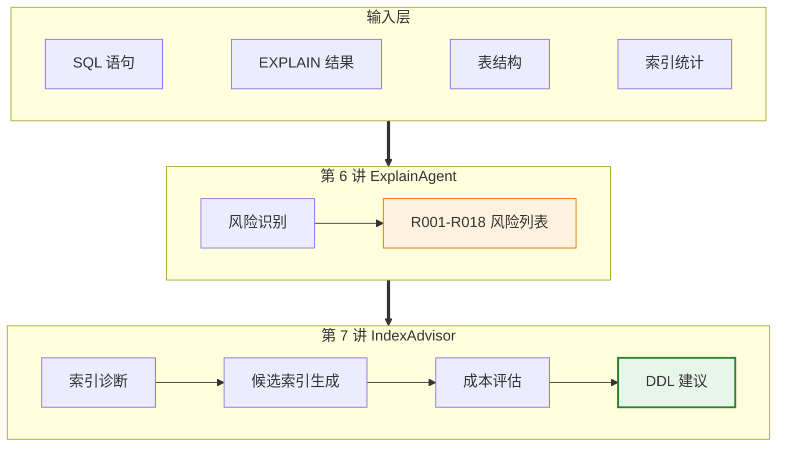
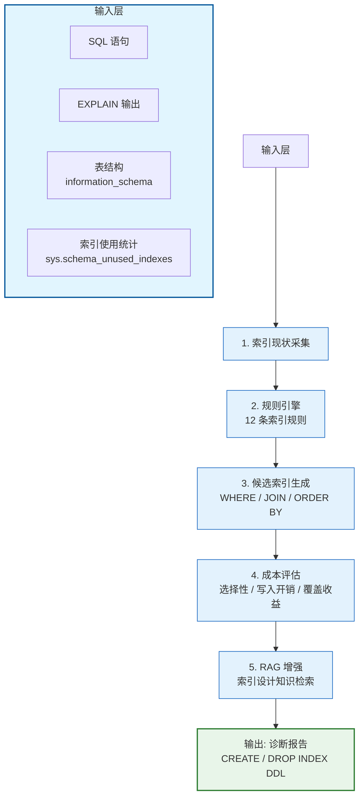
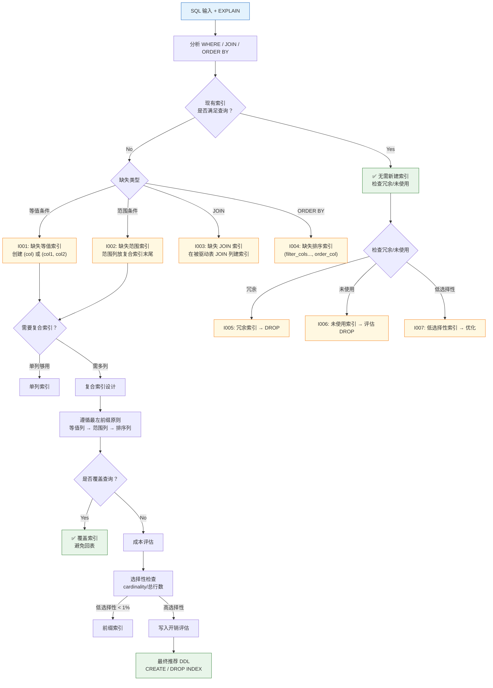

# 专栏第 7 讲：索引诊断与推荐 Agent

> **本文属于《大模型驱动的 MySQL 性能分析与自动化运维实战》专栏第 7 讲**
>
> 📎 **前置依赖**：第 6 讲执行计划解读 Agent（`explain_agent.py`）已能识别 type=ALL、索引未使用等风险。
>
> 代码仓库：`mysql-agent-engine/` | 模块：`src/mysql_agent/agents/index_agent.py`（候选 DDL：`index/index_advisor.py`）
>
> **实现说明**：引擎端到端入口为 `IndexAdvisorAgent`（`agents/index_agent.py`）；候选 DDL 辅助在 `index/index_advisor.py`（`suggest_indexes` 等）。文中教学伪代码若仍写 `IndexDiagnosisAgent` / `agents/index_advisor.py`，以本说明与仓库为准。
>
> **本章目标**：实现一个能自动诊断索引问题并生成 `CREATE INDEX` / `DROP INDEX` DDL 的 Agent，完成从"发现问题"到"解决问题"的闭环。

---

## 1. 为什么需要索引诊断 Agent？

### 1.1 业务痛点

| 场景 | 传统方式 | Agent 方式 |
|------|---------|-----------|
| 慢 SQL 优化 | DBA 手工 EXPLAIN + SHOW INDEX | 自动关联执行计划与表结构 |
| 索引冗余清理 | 定期人工审计 | 扫描未使用/重复索引 |
| 新表上线评审 | 依赖开发者经验 | 规则 + LLM 给出 DDL 建议 |
| 覆盖索引设计 | 反复试错 | 基于 WHERE/ORDER BY 自动推导 |

### 1.2 与第 6 讲的分工

**图示：第 6 讲识别风险，本讲生成可执行索引 DDL 的分工**



| 维度 | 第 6 讲 Explain Agent | 第 7 讲 Index Advisor |
|------|----------------------|----------------------|
| 输入 | SQL + EXPLAIN | SQL + EXPLAIN + 表结构 + 统计信息 |
| 输出 | 风险列表 (R001-R018) | 缺失/冗余/低效索引 + CREATE INDEX DDL |
| 能力 | "这里有问题" | "这样改索引" |
| 定位 | 诊断器 | 处方师 |

### 1.3 知识库映射

| 诊断场景 | 实战45讲 | 运维实战课 | SQL必知必会 |
|---------|---------|-----------|------------|
| 最左前缀 | 04-05 深入浅出索引 | 17-20 访问路径 | 24-26 索引原理 |
| 覆盖索引 | 05 索引下推 | 20 单表访问成本 | 26 索引使用原则 |
| 索引选择 | 09-10 选错索引 | 19 优化器成本模型 | 29 为什么没有理想索引 |
| 冗余索引 | 11 字符串索引 | 23-24 真实案例 | 34 答疑篇 |

---

## 2. 索引诊断架构

索引诊断 Agent 采用五步流程，从**现状采集**到**成本评估**再到**知识增强**，最终输出可执行的 DDL 建议：

**图示：采集 → 规则 → 候选索引 → 成本评估 → DDL 输出的五步流程**



**架构说明**：

| 阶段 | 模块 | 关键输入 | 输出 |
|------|------|---------|------|
| 1. 索引现状采集 | `IndexCollector` | `information_schema.STATISTICS` | `TableSchema` 对象 |
| 2. 规则引擎 | `IndexRuleEngine` | EXPLAIN + Schema | `IndexFinding` 列表 |
| 3. 候选索引生成 | `IndexAdvisor` | SQL 解析结果 | 候选 DDL 列表 |
| 4. 成本评估 | `CostEstimator` | 表行数、列选择性 | 优先级排序 |
| 5. RAG 增强 | `MySQLRAGAgent` | 向量库索引知识 | 设计模式引用 |

---

## 3. 索引现状采集

### 3.1 数据模型

```python
# src/mysql_agent/index/models.py
from dataclasses import dataclass, field
from typing import List, Optional, Dict


@dataclass
class IndexColumn:
    name: str
    seq_in_index: int
    cardinality: Optional[int]
    sub_part: Optional[int] = None


@dataclass
class TableIndex:
    table: str
    index_name: str
    columns: List[IndexColumn]
    is_unique: bool
    index_type: str = "BTREE"
    rows_examined_avg: Optional[float] = None  # 来自 sys 统计


@dataclass
class TableSchema:
    database: str
    table: str
    columns: Dict[str, str]          # column -> data_type
    indexes: List[TableIndex]
    row_count: int
    avg_row_length: int
```

### 3.2 采集 SQL

通过查询 `information_schema.STATISTICS` 和 `performance_schema` 获取索引详情和使用情况：

```python
INDEX_COLLECT_QUERIES = {
    "table_indexes": """
        SELECT TABLE_NAME, INDEX_NAME, NON_UNIQUE, INDEX_TYPE,
               SEQ_IN_INDEX, COLUMN_NAME, CARDINALITY, SUB_PART
        FROM information_schema.STATISTICS
        WHERE TABLE_SCHEMA = %(db)s AND TABLE_NAME = %(table)s
        ORDER BY INDEX_NAME, SEQ_IN_INDEX
    """,
    "unused_indexes": """
        SELECT object_schema, object_name, index_name
        FROM sys.schema_unused_indexes
        WHERE object_schema = %(db)s
    """,
    "redundant_indexes": """
        SELECT table_name, redundant_index_name, redundant_index_columns,
               dominant_index_name, dominant_index_columns
        FROM sys.schema_redundant_indexes
        WHERE table_schema = %(db)s
    """,
    "table_stats": """
        SELECT TABLE_ROWS, AVG_ROW_LENGTH, DATA_LENGTH
        FROM information_schema.TABLES
        WHERE TABLE_SCHEMA = %(db)s AND TABLE_NAME = %(table)s
    """,
}
```

---

## 4. 索引规则引擎（12 条）

**图示：索引设计与推荐决策树**



**I001-I013 规则快速查询表**：

| 规则ID | 名称 | 级别 | 触发条件 | 建议动作 |
|--------|------|------|---------|---------|
| I001 | 缺失等值索引 | 严重 | type=ALL, WHERE 含等值列 | 创建 (col) 或复合索引 |
| I002 | 缺失范围索引 | 严重 | type=ALL, WHERE 含范围列 | 范围列放复合索引末尾 |
| I003 | 缺失 JOIN 索引 | 严重 | JOIN 列无索引 | 在被驱动表 JOIN 列建索引 |
| I004 | 缺失排序索引 | 警告 | Using filesort + ORDER BY | 创建 (filter_cols..., order_col) |
| I005 | 冗余索引 | 警告 | sys.schema_redundant_indexes 命中 | DROP 冗余索引 |
| I006 | 未使用索引 | 提示 | sys.schema_unused_indexes 命中 | 评估后 DROP |
| I007 | 低选择性索引 | 警告 | cardinality/rows < 0.01 | 考虑前缀索引或删除 |
| I008 | 索引列顺序错误 | 警告 | 复合索引未遵循最左前缀 | 重建索引调整列序 |
| I009 | 隐式转换致索引失效 | 严重 | 字符串列与数字比较 | 修正 SQL 或改列类型 |
| I010 | 函数导致索引失效 | 严重 | WHERE 对列使用函数 | 改写 SQL 或生成列索引 |
| I011 | 覆盖索引机会 | 提示 | 回表行数大且 SELECT 列少 | 扩展索引覆盖查询列 |
| I012 | 前缀索引可优化 | 提示 | 长 VARCHAR 全列索引 | 改用 prefix index |
| I013 | 有可用索引但未使用 | 警告 | type=ALL, rows>1000 且 possible_keys 非空 | 检查统计信息或强制索引验证 |

### 4.1 规则实现示例

每条规则对应一个 `IndexRule` 类，实现 `detect()` 方法返回诊断结果：

```python
# src/mysql_agent/index/models.py（`IndexFinding` / `IndexRuleLevel`；规则判定在 `index_rules.py`）
from dataclasses import dataclass
from enum import Enum
from typing import List, Optional
from ..explain.explain_parser import ExplainPlan, ExplainRow


class IndexRuleLevel(Enum):
    CRITICAL = "严重"
    WARNING = "警告"
    INFO = "提示"


@dataclass
class IndexFinding:
    rule_id: str
    level: IndexRuleLevel
    table: str
    message: str
    suggested_ddl: Optional[str] = None
    evidence: dict = None


class IndexRuleEngine:
    """基于 EXPLAIN + Schema 的索引规则引擎"""

    def analyze(
        self,
        plan: ExplainPlan,
        schemas: dict,          # table_name -> TableSchema
        unused_indexes: list,
        redundant_indexes: list,
    ) -> List[IndexFinding]:
        findings = []

        for row in plan.rows:
            findings.extend(self._check_access_path(row, plan.sql))
            findings.extend(self._check_filesort(row, plan.sql))

        findings.extend(self._check_redundant(redundant_indexes))
        findings.extend(self._check_unused(unused_indexes))

        return self._dedupe(findings)

    def _check_access_path(self, row: ExplainRow, sql: str) -> List[IndexFinding]:
        findings = []
        if row.access_type == "ALL" and row.rows > 1000:
            if row.possible_keys:
                findings.append(IndexFinding(
                    rule_id="I013",
                    level=IndexRuleLevel.WARNING,
                    table=row.table,
                    message=f"表 {row.table} 有可选索引 {row.possible_keys} 但未使用",
                    evidence={"possible_keys": row.possible_keys, "rows": row.rows},
                ))
            else:
                findings.append(IndexFinding(
                    rule_id="I001",
                    level=IndexRuleLevel.CRITICAL,
                    table=row.table,
                    message=f"表 {row.table} 全表扫描 {row.rows} 行，建议创建索引",
                    suggested_ddl=f"-- 待 IndexAdvisor 生成: CREATE INDEX idx_{row.table}_... ON {row.table}(...);",
                    evidence={"rows": row.rows, "sql": sql[:200]},
                ))
        return findings

    def _check_filesort(self, row: ExplainRow, sql: str) -> List[IndexFinding]:
        if row.has_filesort:
            return [IndexFinding(
                rule_id="I004",
                level=IndexRuleLevel.WARNING,
                table=row.table,
                message=f"表 {row.table} 存在 filesort，考虑扩展索引覆盖 ORDER BY",
                evidence={"extra": row.extra},
            )]
        return []

    def _check_implicit_conversion(self, row: ExplainRow, sql: str) -> List[IndexFinding]:
        """检测隐式转换导致的索引失效 (I009)"""
        findings = []
        if row.access_type == "ALL" and row.rows > 100:
            # 简化检测：检查 SQL 中是否存在字符串列与数字比较
            # 实际实现需结合表结构判断列类型
            if re.search(r"WHERE\s+.*=\s*\d+", sql, re.IGNORECASE):
                findings.append(IndexFinding(
                    rule_id="I009",
                    level=IndexRuleLevel.CRITICAL,
                    table=row.table,
                    message=f"表 {row.table} 可能存在隐式转换导致索引失效",
                    evidence={"sql": sql[:200]},
                ))
        return findings

    def _check_function_on_column(self, row: ExplainRow, sql: str) -> List[IndexFinding]:
        """检测函数导致索引失效 (I010)"""
        findings = []
        if row.access_type == "ALL":
            # 检测 WHERE 中对列使用函数
            if re.search(r"WHERE\s+.*\b\w+\s*\([^)]*\b\w+\b", sql, re.IGNORECASE):
                findings.append(IndexFinding(
                    rule_id="I010",
                    level=IndexRuleLevel.CRITICAL,
                    table=row.table,
                    message=f"表 {row.table} WHERE 条件中对列使用函数，索引失效",
                    evidence={"sql": sql[:200]},
                ))
        return findings

    def _check_redundant(self, redundant: list) -> List[IndexFinding]:
        return [
            IndexFinding(
                rule_id="I005",
                level=IndexRuleLevel.WARNING,
                table=r["table_name"],
                message=f"冗余索引 {r['redundant_index_name']}，被 {r['dominant_index_name']} 覆盖",
                suggested_ddl=f"ALTER TABLE {r['table_name']} DROP INDEX {r['redundant_index_name']};",
            )
            for r in redundant
        ]

    def _check_unused(self, unused: list) -> List[IndexFinding]:
        return [
            IndexFinding(
                rule_id="I006",
                level=IndexRuleLevel.INFO,
                table=r["object_name"],
                message=f"索引 {r['index_name']} 长期未使用，建议评估后删除",
                suggested_ddl=f"ALTER TABLE {r['object_name']} DROP INDEX {r['index_name']};",
            )
            for r in unused
        ]

    def _dedupe(self, findings: List[IndexFinding]) -> List[IndexFinding]:
        seen = set()
        result = []
        for f in findings:
            key = (f.rule_id, f.table, f.message[:50])
            if key not in seen:
                seen.add(key)
                result.append(f)
        return result
```

---

## 5. 候选索引生成

在规则引擎检测出索引问题后，需要根据 SQL 语句生成候选索引。核心思路是**从 WHERE/JOIN/ORDER BY 子句提取列**，并推导最优索引结构。

### 5.1 从 SQL 提取索引列

```python
# src/mysql_agent/index/index_advisor.py（仓库以 `suggest_indexes()` 函数实现，无 `IndexAdvisor` 类）
import sqlparse
from sqlparse.sql import Identifier, Where, Comparison
from typing import List, Tuple


class IndexAdvisor:
    """基于 SQL 结构生成候选索引"""

    def suggest_index(
        self,
        sql: str,
        table: str,
        existing_indexes: List[TableIndex],
    ) -> List[str]:
        where_cols = self._extract_where_columns(sql, table)
        order_cols = self._extract_order_columns(sql, table)
        join_cols = self._extract_join_columns(sql, table)

        candidates = []

        # 复合索引：等值列在前，范围/排序列在后
        eq_cols = [c for c in where_cols if c[1] == "eq"]
        range_cols = [c for c in where_cols if c[1] == "range"]

        if eq_cols or range_cols:
            cols = [c[0] for c in eq_cols] + [c[0] for c in range_cols]
            if order_cols:
                cols += [c for c in order_cols if c not in cols]
            idx_name = f"idx_{table}_{'_'.join(cols[:3])}"
            ddl = f"CREATE INDEX {idx_name} ON {table}({', '.join(cols)});"
            candidates.append(ddl)

        if join_cols and not self._has_index_on(existing_indexes, join_cols[0]):
            ddl = f"CREATE INDEX idx_{table}_{join_cols[0]} ON {table}({join_cols[0]});"
            candidates.append(ddl)

        return candidates

    def _extract_where_columns(self, sql: str, table: str) -> List[Tuple[str, str]]:
        """提取 WHERE 列及类型 (eq/range)"""
        parsed = sqlparse.parse(sql)[0]
        cols = []
        for token in parsed.tokens:
            if isinstance(token, Where):
                for item in token.tokens:
                    if isinstance(item, Comparison):
                        col = str(item.left).strip().split(".")[-1]
                        op = str(item.token_next(0)[1])
                        kind = "range" if op in (">", "<", ">=", "<=", "BETWEEN", "LIKE") else "eq"
                        cols.append((col, kind))
        return cols

    def _extract_order_columns(self, sql: str, table: str) -> List[str]:
        """提取 ORDER BY 列"""
        parsed = sqlparse.parse(sql)[0]
        order_cols = []
        for token in parsed.tokens:
            if isinstance(token, Order):
                for item in token.tokens:
                    if isinstance(item, Identifier):
                        col = str(item).strip().split(".")[-1]
                        order_cols.append(col)
        return order_cols

    def _extract_join_columns(self, sql: str, table: str) -> List[str]:
        """提取 JOIN 条件中的列"""
        parsed = sqlparse.parse(sql)[0]
        join_cols = []
        for token in parsed.tokens:
            if isinstance(token, Join):
                for item in token.tokens:
                    if isinstance(item, Comparison):
                        left = str(item.left).strip().split(".")[-1]
                        right = str(item.right).strip().split(".")[-1]
                        # 判断哪一侧属于当前表
                        if table in str(item.left):
                            join_cols.append(left)
                        elif table in str(item.right):
                            join_cols.append(right)
        return join_cols

    def _has_index_on(self, indexes: List[TableIndex], column: str) -> bool:
        return any(
            any(c.name == column for c in idx.columns)
            for idx in indexes
        )
```

### 5.2 覆盖索引推导

当 EXPLAIN 出现 `Using index` 但仍有大量回表时，尝试扩展索引：

```python
def suggest_covering_index(
    self,
    sql: str,
    table: str,
    filter_cols: List[str],
    select_cols: List[str],
) -> str:
    """生成覆盖索引：过滤列 + 查询列"""
    all_cols = filter_cols + [c for c in select_cols if c not in filter_cols]
    idx_name = f"idx_{table}_cover_{hash(tuple(all_cols)) % 10000}"
    return f"CREATE INDEX {idx_name} ON {table}({', '.join(all_cols)});"
```

---

## 6. Index Advisor Agent 主流程

`IndexAdvisorAgent`（文件 `agents/index_agent.py`）整合索引采集、规则引擎、候选生成、RAG 增强，实现端到端索引诊断。下方为教学伪代码（仓库实现类名为 `IndexAdvisorAgent`）：

```python
# src/mysql_agent/agents/index_agent.py
from ..index.index_collector import IndexCollector
from ..index.index_rules import IndexRuleEngine
from ..index.index_advisor import IndexAdvisor
from ..agents.rag_agent import MySQLRAGAgent


class IndexAdvisorAgent:  # 仓库实现名；旧文偶称 IndexDiagnosisAgent
    """索引诊断与推荐 Agent"""

    def __init__(self, db_conn, rag_agent: MySQLRAGAgent):
        self.collector = IndexCollector(db_conn)
        self.rules = IndexRuleEngine()
        self.advisor = IndexAdvisor()
        self.rag = rag_agent

    def diagnose(self, sql: str, explain_plan, database: str) -> dict:
        """索引诊断主流程"""
        # 1. 采集涉及的表结构
        tables = {row.table for row in explain_plan.rows}
        schemas = {t: self.collector.get_table_schema(database, t) for t in tables}
        unused = self.collector.get_unused_indexes(database)
        redundant = self.collector.get_redundant_indexes(database)

        # 2. 规则检测
        findings = self.rules.analyze(explain_plan, schemas, unused, redundant)

        # 3. 生成候选 DDL
        ddl_suggestions = []
        for table in tables:
            ddl_suggestions.extend(
                self.advisor.suggest_index(sql, table, schemas[table].indexes)
            )

        # 4. 成本评估与优先级排序
        scored_suggestions = self._score_suggestions(ddl_suggestions, schemas, explain_plan)

        # 5. RAG 增强：检索索引设计知识
        context = self.rag.retrieve(f"索引优化 {sql[:100]}")
        knowledge = self.rag.format_context(context)

        # 6. 组装报告
        return {
            "sql": sql,
            "findings": [
                {
                    "rule_id": f.rule_id,
                    "level": f.level.value,
                    "table": f.table,
                    "message": f.message,
                    "suggested_ddl": f.suggested_ddl,
                }
                for f in findings
            ],
            "ddl_suggestions": scored_suggestions,
            "knowledge_refs": knowledge,
            "summary": {
                "critical": sum(1 for f in findings if f.level.value == "严重"),
                "warning": sum(1 for f in findings if f.level.value == "警告"),
                "info": sum(1 for f in findings if f.level.value == "提示"),
            },
        }

    def _score_suggestions(self, suggestions: List[str], schemas: dict, plan) -> List[dict]:
        """对候选索引进行成本评分"""
        scored = []
        for ddl in suggestions:
            score = 0.0
            # 基于表行数评估收益
            table_match = re.search(r"ON\s+(\w+)", ddl)
            if table_match:
                table = table_match.group(1)
                if table in schemas:
                    row_count = schemas[table].row_count
                    if row_count > 1000000:
                        score += 0.9  # 大表收益高
                    elif row_count > 100000:
                        score += 0.7
                    else:
                        score += 0.5

            # 基于 EXPLAIN 扫描行数评估
            max_rows = max((r.rows for r in plan.rows), default=0)
            if max_rows > 100000:
                score += 0.3

            scored.append({
                "ddl": ddl,
                "score": round(min(score, 1.0), 2),
                "priority": "高" if score >= 0.8 else "中" if score >= 0.6 else "低"
            })

        return sorted(scored, key=lambda x: x["score"], reverse=True)
```

---

## 7. 实战案例

### 7.1 案例：订单表慢查询

**原始 SQL**：

```sql
SELECT o.order_id, o.total_amount, m.name
FROM orders o
JOIN merchants m ON o.merchant_id = m.merchant_id
WHERE o.created_at >= '2024-01-01'
  AND o.status = 1
ORDER BY o.total_amount DESC
LIMIT 100;
```

**EXPLAIN 关键行**：

| table | type | key | rows | Extra |
|-------|------|-----|------|-------|
| o | ALL | NULL | 5000000 | Using where; Using filesort |
| m | eq_ref | PRIMARY | 1 | NULL |

**Agent 诊断输出**：

```json
{
  "findings": [
    {
      "rule_id": "I001",
      "level": "严重",
      "table": "orders",
      "message": "orders 全表扫描 500 万行",
      "suggested_ddl": "-- 待 IndexAdvisor 生成: CREATE INDEX idx_orders_... ON orders(...);"
    },
    {
      "rule_id": "I004",
      "level": "警告",
      "table": "orders",
      "message": "存在 filesort，ORDER BY total_amount 无索引支持"
    }
  ],
  "ddl_suggestions": [
    {
      "ddl": "CREATE INDEX idx_orders_status_created_amount ON orders(status, created_at, total_amount);",
      "score": 0.95,
      "priority": "高"
    },
    {
      "ddl": "CREATE INDEX idx_orders_merchant ON orders(merchant_id);",
      "score": 0.65,
      "priority": "中"
    }
  ],
  "summary": {
    "critical": 1,
    "warning": 1,
    "info": 0
  }
}
```

**优化后效果**：扫描行数 500 万 → 约 5 万，filesort 数据量大幅下降。

**索引设计解析**：

```
复合索引: (status, created_at, total_amount)
         │       │           └── ORDER BY 列，避免 filesort
         │       └── 范围查询列，放在等值列之后
         └── 等值查询列，放在最前面（最左前缀）

查询条件: status = 1 (等值) AND created_at >= '2024-01-01' (范围)
排序: ORDER BY total_amount DESC

索引覆盖: 不覆盖（SELECT 包含 m.name），但 JOIN 列 merchant_id 有主键索引
```

### 7.2 案例：冗余索引清理

```sql
-- sys.schema_redundant_indexes 发现
-- idx_orders_user (user_id)
-- idx_orders_user_status (user_id, status)  ← 主导索引

ALTER TABLE orders DROP INDEX idx_orders_user;
```

---

## 8. 评测指标与边界情况

### 8.1 核心评测指标

| 指标 | 定义 | 目标值 | 测试方法 |
|------|------|--------|---------|
| 缺失索引召回率 | 真实缺索引场景被 I001-I004 命中 | ≥ 90% | 构造 100 条慢 SQL，统计命中数 |
| DDL 可执行率 | 建议 DDL 语法正确且可执行 | ≥ 95% | 在测试库执行所有建议 DDL |
| 冗余索引识别率 | sys 冗余索引被 I005 命中 | 100% | 对比 sys.schema_redundant_indexes |
| 误报率 | 不建议建索引却给出 DDL | ≤ 10% | 人工审核建议合理性 |
| 索引收益预估准确率 | 预估扫描行数降低比例与实际偏差 | ≤ 30% | EXPLAIN 对比 |

### 8.2 常见边界情况

| 场景 | 问题 | 处理策略 |
|------|------|---------|
| 小表（< 1000 行） | 全表扫描比索引更快 | 行数阈值过滤，不建索引 |
| 写多读少表 | 索引维护成本高 | 评分时降低权重，提示风险 |
| 已有覆盖索引 | 新索引可能冗余 | 检查现有索引是否已覆盖 |
| 分区表 | 索引需考虑分区键 | 在分区键上优先建索引 |
| 联合主键 | 最左前缀已覆盖 | 避免重复创建前缀索引 |
| 全文/空间索引 | BTREE 不适用 | 根据列类型选择索引类型 |

---

## 9. 本讲小结

| 组件 | 文件 | 核心作用 |
|------|------|---------|
| IndexCollector | `index_collector.py` | 采集表结构、索引统计 |
| IndexRuleEngine | `index_rules.py` | 12 条索引诊断规则 |
| IndexAdvisor / suggest_indexes | `index/index_advisor.py` | 候选索引 DDL 生成 |
| IndexAdvisorAgent | `agents/index_agent.py` | 端到端诊断 Agent |

**核心能力**：
1. 关联 EXPLAIN 与表结构，从"发现问题"到"给出 DDL"
2. 12 条规则覆盖缺失/冗余/低效/覆盖索引场景
3. 结合 sys schema 做索引审计
4. RAG 增强索引设计知识引用
5. 成本评分机制，优先推荐高价值索引

**关键设计决策**：
- **规则优先，LLM 兜底**：先用 12 条规则做确定性诊断，再用 LLM 处理复杂场景
- **评分排序**：基于表行数和扫描行数量化索引收益，避免盲目建索引
- **边界防护**：小表过滤、写多读少提示、重复索引检测

**下一讲预告**：SQL 改写优化 Agent —— 规则引擎 + LLM 协同，自动改写关联子查询、OR 条件、大偏移分页等低效 SQL。