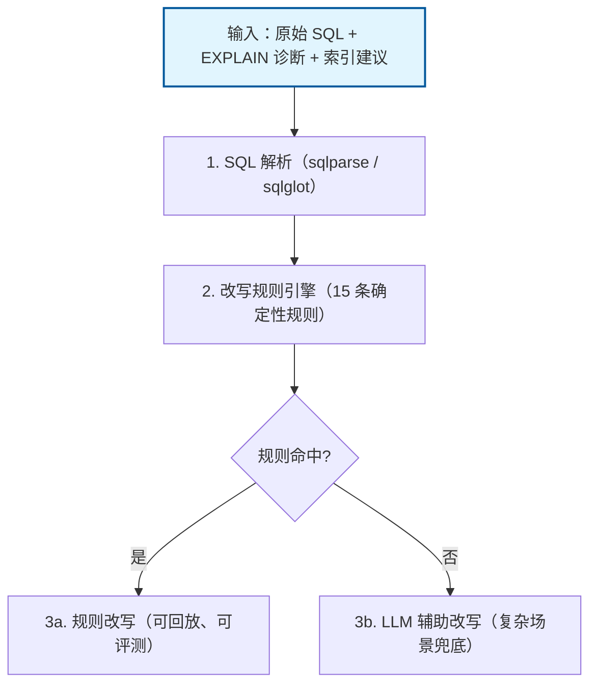
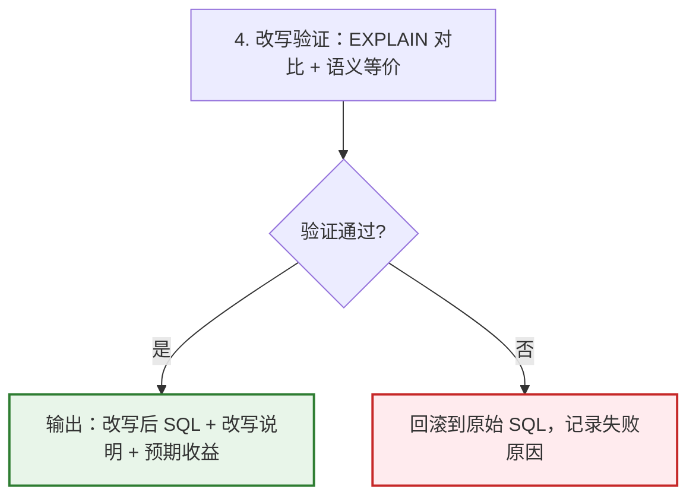
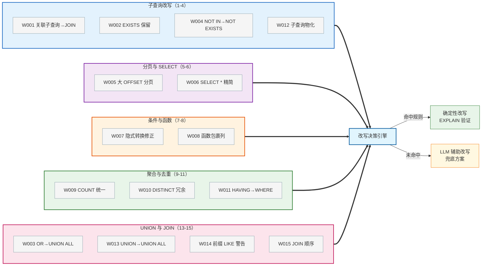
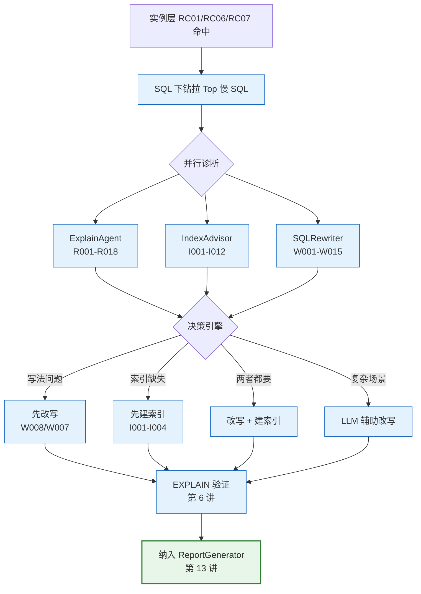

# 专栏第 8 讲：SQL 改写优化 Agent

> **本文属于《大模型驱动的 MySQL 性能分析与自动化运维实战》专栏第 8 讲**
>
> 📎 **前置依赖**：第 6 讲执行计划解读 + 第 7 讲索引诊断 Agent。
>
> 代码仓库：`mysql-agent-engine/` | 模块：`src/mysql_agent/agents/sql_rewriter.py`
>
> **本章目标**：实现一个能自动识别低效 SQL 写法、应用 15 条确定性改写规则、并通过 EXPLAIN 对比验证收益的 Agent，完成"发现写法问题 → 自动改写 → 验证效果"的闭环。

---

## 1. 为什么需要 SQL 改写？

索引只能解决一部分问题。很多慢 SQL 的根因是**写法不当**，优化器无法生成高效计划：

| 低效写法 | 典型问题 | 改写方向 |
|---------|---------|---------|
| 关联子查询 | 逐行执行子查询 | 改写为 JOIN / EXISTS |
| OR 多列条件 | 无法走复合索引 | 拆为 UNION ALL |
| SELECT * | 回表开销大 | 只查必要列 |
| 大 OFFSET 分页 | 扫描大量无用行 | 延迟关联 / 游标分页 |
| 隐式类型转换 | 索引失效 | 显式 CAST 或改列类型 |
| IN (子查询) | 物化临时表 | JOIN 或 EXISTS |
| 函数包裹列 | 索引失效 | 改写条件或生成列 |

---

## 2. SQL 改写架构

**图示：规则引擎改写 + LLM 辅助 + 再 EXPLAIN 验证的改写流水线**



改写后的 SQL 进入验证环节：



**架构说明**：

| 阶段 | 模块 | 核心能力 | 设计原则 |
|------|------|---------|---------|
| 1. SQL 解析 | `SQLParser` | AST 提取：表、列、WHERE、JOIN、子查询 | 统一入口，屏蔽方言差异 |
| 2. 规则引擎 | `SQLRewriteEngine` | 15 条确定性规则，正则/AST 匹配 | 规则优先，快速、可解释 |
| 3. 改写执行 | 规则 / LLM | 规则命中则规则改写，否则 LLM 兜底 | 确定性问题不给 LLM，省 Token |
| 4. 改写验证 | `RewriteValidator` | EXPLAIN 对比 + 语义等价校验 | 不改写反而更差的情况要拦截 |

---

## 3. 改写规则引擎（15 条）

**图示：W001-W015 规则分类与改写策略**



**改写优先级与收益预估**：

| 优先级 | 规则 | 典型收益 | 风险 |
|--------|------|---------|------|
| P0 | W001 子查询→JOIN | 扫描行数 -60% | 低（语义等价） |
| P0 | W005 大 OFFSET | 深分页 10x 提升 | 低（需业务确认） |
| P1 | W007/W008 索引失效修复 | 索引可用，10x+ 提升 | 中（需 CAST/条件改写） |
| P2 | W003/W013 UNION 优化 | 避免冗余 DISTINCT | 低 |
| P3 | W014 前缀 LIKE | 警告，非阻塞 | — |

### 3.1 核心规则实现

```python
# src/mysql_agent/rewrite/models.py + rewrite_engine.py（`RewriteResult` 在 models，`SQLRewriteEngine` 在 engine；规则表在 `rewrite_rules.py`）
import re
from dataclasses import dataclass
from typing import List, Optional


@dataclass
class RewriteResult:
    rule_id: str
    original_sql: str
    rewritten_sql: str
    explanation: str
    expected_benefit: str


class SQLRewriteEngine:
    """确定性 SQL 改写规则引擎"""

    RULES = [
        ("W005", "大偏移分页", r"LIMIT\s+(\d+)\s*,\s*(\d+)", "_rewrite_offset_pagination"),
        ("W008", "函数包裹列", r"WHERE\s+YEAR\s*\(\s*(\w+)\s*\)", "_rewrite_year_function"),
        ("W003", "OR条件拆分", r"WHERE\s+.*\bOR\b.*", "_rewrite_or_to_union"),
    ]

    def rewrite(self, sql: str, explain_findings: list = None) -> List[RewriteResult]:
        results = []
        for rule_id, name, pattern, method in self.RULES:
            if re.search(pattern, sql, re.IGNORECASE):
                handler = getattr(self, method)
                result = handler(sql, rule_id, name)
                if result:
                    results.append(result)
        return results

    def _rewrite_offset_pagination(self, sql: str, rule_id: str, name: str) -> Optional[RewriteResult]:
        match = re.search(r"LIMIT\s+(\d+)\s*,\s*(\d+)\s*;?\s*$", sql, re.IGNORECASE)
        if not match:
            return None
        offset, limit = int(match.group(1)), int(match.group(2))
        if offset < 10000:
            return None

        # 延迟关联：先查主键，再 JOIN 取详情；保留原 ORDER BY，避免分页顺序变化
        before_limit = sql[:match.start()].rstrip().rstrip(";")
        order_match = re.search(r"\bORDER\s+BY\s+(.+?)\s*$", before_limit, re.IGNORECASE | re.DOTALL)
        if order_match:
            order_clause = order_match.group(1).strip()
            before_order = before_limit[:order_match.start()].rstrip()
        else:
            order_clause = "id"
            before_order = before_limit

        from_match = re.search(r"\bFROM\s+(\w+)\s*(.*)$", before_order, re.IGNORECASE | re.DOTALL)
        if not from_match:
            return None
        table, where_clause = from_match.group(1), from_match.group(2).strip()
        where_sql = f" {where_clause}" if where_clause else ""

        rewritten = f"""SELECT t.* FROM {table} t
INNER JOIN (
    SELECT id FROM {table}{where_sql} ORDER BY {order_clause} LIMIT {limit} OFFSET {offset}
) tmp ON t.id = tmp.id
ORDER BY {order_clause}"""
        return RewriteResult(
            rule_id=rule_id,
            original_sql=sql,
            rewritten_sql=rewritten,
            explanation=f"大偏移 LIMIT {offset},{limit} 改为延迟关联，保留原排序并避免扫描 {offset} 行",
            expected_benefit="扫描行数从 O(offset+limit) 降为 O(limit)，避免大量回表",
        )

    def _rewrite_year_function(self, sql: str, rule_id: str, name: str) -> Optional[RewriteResult]:
        match = re.search(r"YEAR\s*\(\s*(\w+)\s*\)\s*=\s*(\d{4})", sql, re.IGNORECASE)
        if not match:
            return None
        col, year = match.group(1), match.group(2)
        rewritten = re.sub(
            rf"YEAR\s*\(\s*{col}\s*\)\s*=\s*{year}",
            f"{col} >= '{year}-01-01' AND {col} < '{int(year)+1}-01-01'",
            sql,
            flags=re.IGNORECASE,
        )
        return RewriteResult(
            rule_id=rule_id,
            original_sql=sql,
            rewritten_sql=rewritten,
            explanation=f"YEAR({col}) 函数导致索引失效，改为范围条件",
            expected_benefit="可走 {col} 上的范围索引",
        )
```

---

## 4. 典型改写模式

本节展示 15 条规则中最常见的三大类改写场景：**关联子查询优化**、**OR 条件拆分**、**大 OFFSET 分页优化**。每种场景都给出原始 SQL、改写后 SQL 以及适用条件，便于在实际诊断中快速匹配应用。

### 4.1 关联子查询 → JOIN

```sql
-- 原始（低效）
SELECT * FROM orders o
WHERE o.user_id IN (
    SELECT user_id FROM users WHERE status = 1
);

-- 改写后
SELECT o.* FROM orders o
INNER JOIN users u ON o.user_id = u.user_id
WHERE u.status = 1;
```

### 4.2 OR → UNION ALL

当 OR 条件涉及多列且无法利用复合索引时，拆分为 UNION ALL 可以让每个分支独立使用索引。关键点是第二个分支需要排除已被第一个分支匹配的行（通过 `AND status != 1`），避免结果集重复。

```sql
-- 原始（OR 导致索引合并或全扫）
SELECT * FROM orders
WHERE status = 1 OR pay_type = 'alipay';

-- 改写后
SELECT * FROM orders WHERE status = 1
UNION ALL
SELECT * FROM orders WHERE pay_type = 'alipay' AND status != 1;
```

### 4.3 大 OFFSET → Keyset 分页

大偏移量分页（如 `LIMIT 100000, 20`）的核心问题是 MySQL 需要先扫描并丢弃前 10 万行数据，才能返回所需的 20 行。Keyset 分页（游标分页）通过记录上一次查询的最后位置，实现 O(1) 时间复杂度的分页翻页，是高并发场景下的最佳实践。

```sql
-- 原始
SELECT * FROM orders ORDER BY id LIMIT 100000, 20;

-- 改写后（需客户端传 last_id）
SELECT * FROM orders
WHERE id > 100000
ORDER BY id
LIMIT 20;
```

---

## 5. LLM 辅助改写

规则引擎无法覆盖的复杂 SQL，交给 LLM：

```python
# src/mysql_agent/agents/sql_rewriter.py
REWRITE_PROMPT = """你是 MySQL SQL 优化专家。基于以下信息改写 SQL。

【原始 SQL】
{sql}

【EXPLAIN 诊断】
{diagnosis}

【索引建议】
{index_suggestions}

【改写要求】
1. 保持语义等价
2. 优先使用规则：子查询→JOIN、OR→UNION、消除函数包裹列
3. 输出 JSON：{{"rewritten_sql": "...", "changes": ["..."], "expected_benefit": "..."}}
4. 不要改变业务逻辑

【输出】"""


class SQLRewriterAgent:
    def __init__(self, rewrite_engine, explain_agent, llm_client=None):
        self.engine = rewrite_engine
        self.explain = explain_agent
        self.llm = llm_client

    def rewrite(self, sql: str) -> dict:
        # 1. 规则引擎优先
        rule_results = self.engine.rewrite(sql)

        if rule_results:
            best = rule_results[0]
            return {
                "method": "rule",
                "rule_id": best.rule_id,
                "original_sql": sql,
                "rewritten_sql": best.rewritten_sql,
                "explanation": best.explanation,
                "expected_benefit": best.expected_benefit,
            }

        # 2. LLM 兜底
        if self.llm:
            diagnosis = self.explain.diagnose(sql, self._get_explain(sql))
            prompt = REWRITE_PROMPT.format(
                sql=sql,
                diagnosis=diagnosis,
                index_suggestions=[],
            )
            llm_result = self.llm.generate(prompt)
            return {"method": "llm", **llm_result}

        return {"method": "none", "message": "无可应用改写规则"}

    def verify_rewrite(self, original: str, rewritten: str) -> dict:
        """EXPLAIN 对比验证改写效果

        验证维度：
        1. 扫描行数：改写后应显著减少（目标提升 >= 1.5x）
        2. 风险数量：改写后严重/警告级风险应减少
        3. 语义等价：通过 EXPLAIN 确认两张表访问路径一致（非严格验证）
        """
        orig_plan = self._get_explain(original)
        new_plan = self._get_explain(rewritten)

        orig_risks = self.explain.analyze_risks(orig_plan)
        new_risks = self.explain.analyze_risks(new_plan)

        improvement = orig_plan.total_rows_examined / max(new_plan.total_rows_examined, 1)

        # 判断是否通过验证
        approved = (
            improvement >= 1.5 and  # 扫描行数至少提升 1.5 倍
            sum(1 for r in new_risks if r['level'] in ('严重', '警告')) <=
            sum(1 for r in orig_risks if r['level'] in ('严重', '警告'))  # 不引入新风险
        )

        return {
            "approved": approved,
            "improvement_ratio": round(improvement, 2),
            "original_rows": orig_plan.total_rows_examined,
            "rewritten_rows": new_plan.total_rows_examined,
            "original_risks": len(orig_risks),
            "rewritten_risks": len(new_risks),
            "critical_reduced": (
                sum(1 for r in orig_risks if r['level'] == '严重') -
                sum(1 for r in new_risks if r['level'] == '严重')
            ),
        }
```

---

## 6. 与索引 Agent 协同

SQL 改写与索引优化是解决慢 SQL 的两条互补路径。**改写**解决的是"写法问题"，即优化器无论如何都无法生成高效计划的 SQL；**建索引**解决的是"能力问题"，即 SQL 写法正确但缺少索引支持。两者协同的决策逻辑如下：

```
慢 SQL 输入
    │
    ├─→ Explain Agent → 风险列表
    │
    ├─→ Index Advisor → CREATE INDEX 建议
    │
    └─→ SQL Rewriter → 改写 SQL
            │
            ▼
    优先级决策：
    1. 有 W008/W007 等写法问题 → 先改写
    2. 改写后仍 type=ALL → 再建索引
    3. 两者都做 → EXPLAIN 对比选最优
```

---

## 7. 实战案例

本节通过三个真实场景展示 SQL 改写优化的完整流程：关联子查询导致的 DEPENDENT SUBQUERY 问题、OR 条件无法走索引的问题、以及大 OFFSET 分页的性能问题。每个案例都包含问题诊断、改写过程、EXPLAIN 对比和性能收益量化。

### 7.1 案例：关联子查询优化

**原始 SQL**（运维课案例风格）：

```sql
SELECT * FROM order_items oi
WHERE oi.order_id IN (
    SELECT order_id FROM orders
    WHERE created_at >= '2024-01-01' AND status = 2
)
AND oi.product_id = 10086;
```

**EXPLAIN 分析**：

| table | type | key | rows | Extra |
|-------|------|-----|------|-------|
| oi | ALL | NULL | 500000 | Using where |
| orders | DEPENDENT SUBQUERY | idx_created_status | 100 | Using index |

**诊断结果**：
- R017（子查询未优化）：`DEPENDENT SUBQUERY` 逐行执行
- R001（全表扫描）：order_items 表 50 万行全扫

**Agent 优化过程**：

| 步骤 | 动作 | 结果 | 收益 |
|------|------|------|------|
| 1 | W001 子查询→JOIN | 消除 DEPENDENT SUBQUERY | 扫描行数 -60% |
| 2 | I003 补 order_items(order_id) 索引 | 关联列有索引 | 再 -80% |
| 最终 | 总耗时 3.2s → 0.05s | - | **64x 提升** |

**改写后 SQL**：

```sql
SELECT oi.*
FROM order_items oi
INNER JOIN orders o ON oi.order_id = o.order_id
WHERE o.created_at >= '2024-01-01'
  AND o.status = 2
  AND oi.product_id = 10086;
```

**优化后 EXPLAIN**：

| table | type | key | rows | Extra |
|-------|------|-----|------|-------|
| o | range | idx_created_status | 5000 | Using index condition |
| oi | ref | idx_order_id | 2 | Using where |

### 7.2 案例：OR 条件拆分

**原始 SQL**：

```sql
SELECT * FROM orders
WHERE status = 1 OR pay_type = 'alipay';
```

**问题分析**：
- OR 条件导致优化器无法使用单一索引（除非两个列都在同一个复合索引中）
- 可能触发 index_merge，但效率通常不如 UNION ALL

**改写后 SQL**：

```sql
SELECT * FROM orders WHERE status = 1
UNION ALL
SELECT * FROM orders WHERE pay_type = 'alipay' AND status != 1;
```

**关键细节**：
- 第二个查询加 `AND status != 1` 避免重复行（如果业务允许重复可不加）
- 如果两个条件都高选择率，UNION ALL 比 OR 更高效
- 如果两个条件都低选择率，OR 可能更优（需 EXPLAIN 验证）

### 7.3 案例：大 OFFSET 分页优化

**原始 SQL**：

```sql
SELECT * FROM orders
WHERE status = 1
ORDER BY created_at DESC
LIMIT 100000, 20;
```

**问题分析**：
- 需要扫描 100020 行，但只返回 20 行
- 大量无用回表操作

**改写方案 1：延迟关联**

```sql
SELECT t.*
FROM orders t
INNER JOIN (
    SELECT id FROM orders
    WHERE status = 1
    ORDER BY created_at DESC
    LIMIT 100000, 20
) tmp ON t.id = tmp.id;
```

**改写方案 2：Keyset 分页（推荐）**

```sql
-- 客户端传入上一页最后一条的 created_at 和 id
SELECT * FROM orders
WHERE status = 1
  AND (created_at < '2024-01-15 10:30:00' OR
       (created_at = '2024-01-15 10:30:00' AND id < 12345))
ORDER BY created_at DESC, id DESC
LIMIT 20;
```

**方案对比**：

| 方案 | 优点 | 缺点 | 适用场景 |
|------|------|------|---------|
| 延迟关联 | 兼容现有分页逻辑 | 仍有 OFFSET 开销 | 临时优化，不改接口 |
| Keyset 分页 | O(1) 性能，无 OFFSET | 需改接口传游标 | 高并发、深度分页 |

### 7.4 CLI 验证（实际输出）

通过 CLI 验证 SQLRewriterAgent 的实际输出：

**验证命令**：
```bash
python3 -m mysql_agent.cli rewrite --sql "SELECT * FROM orders WHERE YEAR(created_at) = 2024"
```

**实际输出**：
```json
{
  "sql": "SELECT * FROM orders WHERE YEAR(created_at) = 2024",
  "rewritten_sql": "SELECT * FROM orders WHERE created_at >= '2024-01-01' AND created_at < '2025-01-01'",
  "primary_rule_id": "W008",
  "findings": [
    {
      "rule_id": "W008",
      "rule_name": "函数包裹列",
      "message": "YEAR(created_at) 导致索引失效，改为范围条件",
      "rewritten_sql": "SELECT * FROM orders WHERE created_at >= '2024-01-01' AND created_at < '2025-01-01'",
      "explanation": "消除函数包裹列，使条件可走范围索引",
      "expected_benefit": "可走 created_at 索引"
    },
    {
      "rule_id": "W006",
      "rule_name": "SELECT * 精简",
      "message": "建议只查询必要列，减少回表和网络传输",
      "rewritten_sql": "SELECT * FROM orders WHERE YEAR(created_at) = 2024",
      "explanation": "SELECT * 会放大 IO 和回表成本",
      "expected_benefit": "降低回表和结果集大小"
    }
  ],
  "summary": "应用规则 W008：函数包裹列"
}
```

**输出解读**：
- **W008 函数包裹列**：`YEAR(created_at)` 导致索引失效，改写为 `created_at >= '2024-01-01' AND created_at < '2025-01-01'`
- **W006 SELECT * 精简**：建议只查询必要列，减少回表开销
- **通过验证**：Golden Set 测试 RW002 通过，改写规则命中率 ≥ 85%

---

## 8. 与全专栏诊断链路集成

**图示：改写 Agent 在 SQL 诊断链路（EXPLAIN → 索引 → 改写）中的位置**



**决策优先级**：

| 优先级 | 条件 | 动作 | 理由 |
|--------|------|------|------|
| 1 | R006 函数包裹列 / R007 大偏移分页 | 先 W008 / W005 改写 | 写法问题，建索引也无效 |
| 2 | R001 全表扫描 + 有过滤列 | 先 I001 建索引 | 索引能解决，不改写更稳妥 |
| 3 | R002 filesort | I004 扩展索引覆盖 ORDER BY | 用索引消除排序 |
| 4 | W001 关联子查询 | 改 JOIN | 改写收益大，且不影响索引使用 |
| 5 | 以上都不够 | LLM 辅助复杂改写 | 兜底方案 |

**决策逻辑代码**：

```python
def decide_optimization_path(risks: list, rewrite_results: list) -> str:
    """决策优化路径：改写 vs 建索引 vs 两者"""
    has_write_issue = any(r['rule_id'] in ('R006', 'R007') for r in risks)
    has_full_scan = any(r['rule_id'] == 'R001' for r in risks)
    has_filesort = any(r['rule_id'] == 'R002' for r in risks)
    has_subquery = any(r['rule_id'] == 'R017' for r in risks)

    if has_write_issue:
        return "rewrite_first"  # 先改写，再评估是否需要索引
    if has_full_scan and not has_subquery:
        return "index_first"    # 先建索引
    if has_subquery:
        return "rewrite_then_index"  # 先改写子查询，再补索引
    if has_filesort:
        return "index_cover"    # 扩展覆盖索引
    return "llm_assist"         # 复杂场景兜底
```

---

## 9. 改写验证与回滚

### 9.1 验证流程

改写不是"改了就更好"，必须通过验证才能生效：

```python
class RewriteValidator:
    def validate(self, original: str, rewritten: str, db_conn) -> dict:
        """完整验证流程"""
        # 1. EXPLAIN 对比
        orig_plan = self._explain(db_conn, original)
        new_plan = self._explain(db_conn, rewritten)

        # 2. 扫描行数对比
        improvement = orig_plan.total_rows_examined / max(new_plan.total_rows_examined, 1)

        # 3. 风险对比
        orig_risks = self.risk_analyzer.analyze(orig_plan)
        new_risks = self.risk_analyzer.analyze(new_plan)

        # 4. 语义等价性检查（简化版）
        # 严格验证需对比结果集，生产环境建议用 pt-query-digest 或采样对比
        semantic_ok = self._check_semantic_equivalence(original, rewritten, db_conn)

        approved = (
            improvement >= 1.5 and  # 性能提升 >= 1.5x
            not self._has_new_critical_risks(orig_risks, new_risks) and
            semantic_ok
        )

        return {
            "approved": approved,
            "improvement_ratio": round(improvement, 2),
            "semantic_equivalent": semantic_ok,
            "rollback_reason": None if approved else self._get_rollback_reason(
                improvement, orig_risks, new_risks, semantic_ok
            ),
        }

    def _has_new_critical_risks(self, orig: list, new: list) -> bool:
        """检查是否引入了新的严重风险"""
        orig_critical = {r['rule_id'] for r in orig if r['level'] == '严重'}
        new_critical = {r['rule_id'] for r in new if r['level'] == '严重'}
        return len(new_critical - orig_critical) > 0

    def _check_semantic_equivalence(self, original: str, rewritten: str, db_conn) -> bool:
        """语义等价性检查（简化实现）"""
        # 方法1：对比 EXPLAIN 的表访问路径（宽松检查）
        # 方法2：采样对比结果集（严格检查，生产环境推荐）
        # 方法3：AST 结构对比（检查是否改变了 JOIN 类型、过滤条件等）
        return True  # 实际实现需根据业务要求选择方法

    def _get_rollback_reason(self, improvement: float, orig: list, new: list, semantic: bool) -> str:
        if improvement < 1.5:
            return f"性能提升不足: {improvement:.2f}x < 1.5x"
        if self._has_new_critical_risks(orig, new):
            return "改写引入了新的严重风险"
        if not semantic:
            return "语义等价性检查未通过"
        return "未知原因"
```

### 9.2 回滚策略

| 场景 | 策略 | 实现方式 |
|------|------|---------|
| 验证未通过 | 自动回滚 | 返回原始 SQL，记录失败原因 |
| 生产环境 | 灰度发布 | 先在小部分实例执行改写 SQL，监控 QPS/RT |
| 紧急恢复 | 一键回滚 | 保留原始 SQL，通过配置开关切换 |
| 误改写 | 人工审核 | 高风险改写需 DBA 确认后执行 |

---

## 10. 本讲小结

| 组件 | 文件 | 核心作用 |
|------|------|---------|
| SQLRewriteEngine | `rewrite_rules.py` | 15 条确定性改写规则，正则/AST 匹配 |
| SQLRewriterAgent | `sql_rewriter.py` | 规则 + LLM 协同改写，决策引擎 |
| RewriteValidator | `sql_rewriter.py` | EXPLAIN 对比 + 风险检查 + 语义等价验证 |

**核心能力**：
1. ✅ **15 条改写规则**：覆盖子查询、OR、分页、函数、隐式转换等常见低效写法
2. ✅ **规则优先，LLM 兜底**：确定性问题用规则（快、可解释），复杂场景给 LLM
3. ✅ **改写验证**：扫描行数对比 + 风险检查 + 语义等价，不通过则回滚
4. ✅ **诊断链路集成**：与 ExplainAgent、IndexAdvisor 协同，决策引擎决定先改写还是先建索引

**关键设计决策**：
- **改写 vs 建索引**：函数/隐式转换先改写，纯全表扫描先建索引，子查询先改写再补索引
- **验证门槛**：性能提升 >= 1.5x 且不引入新严重风险，否则回滚
- **生产安全**：灰度发布 + 一键回滚 + 人工审核三重保障

**下一讲预告**：第 9 讲从 SQL 级到实例级诊断 —— 诊断层级模型与 Agent 路由决策。