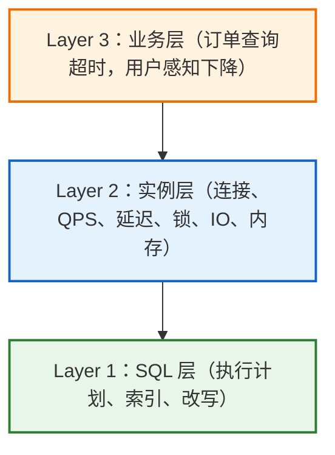
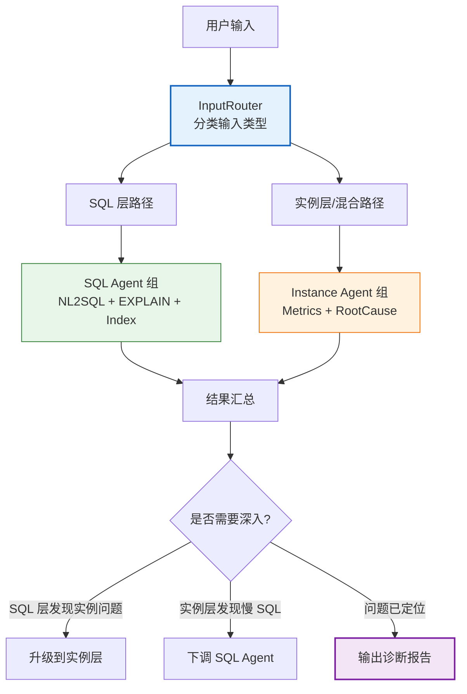
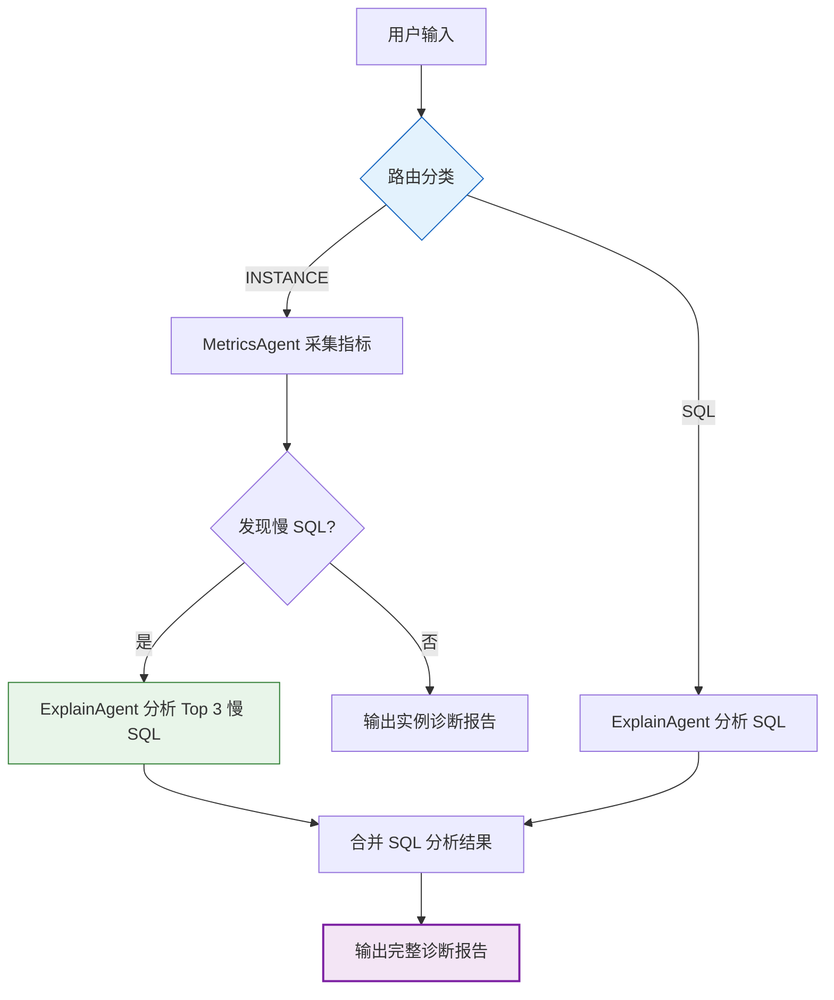
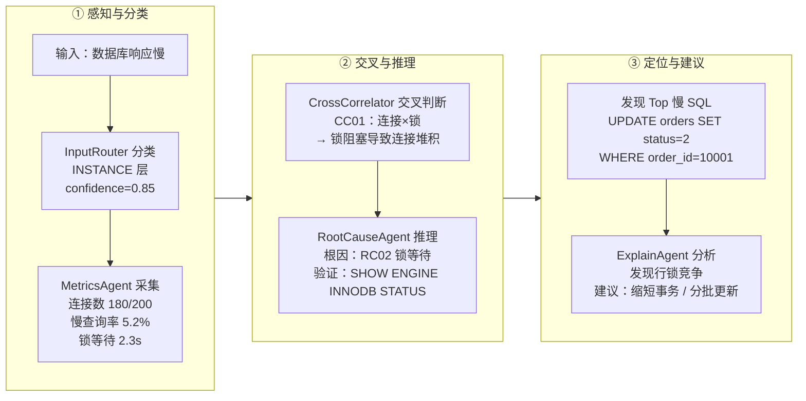
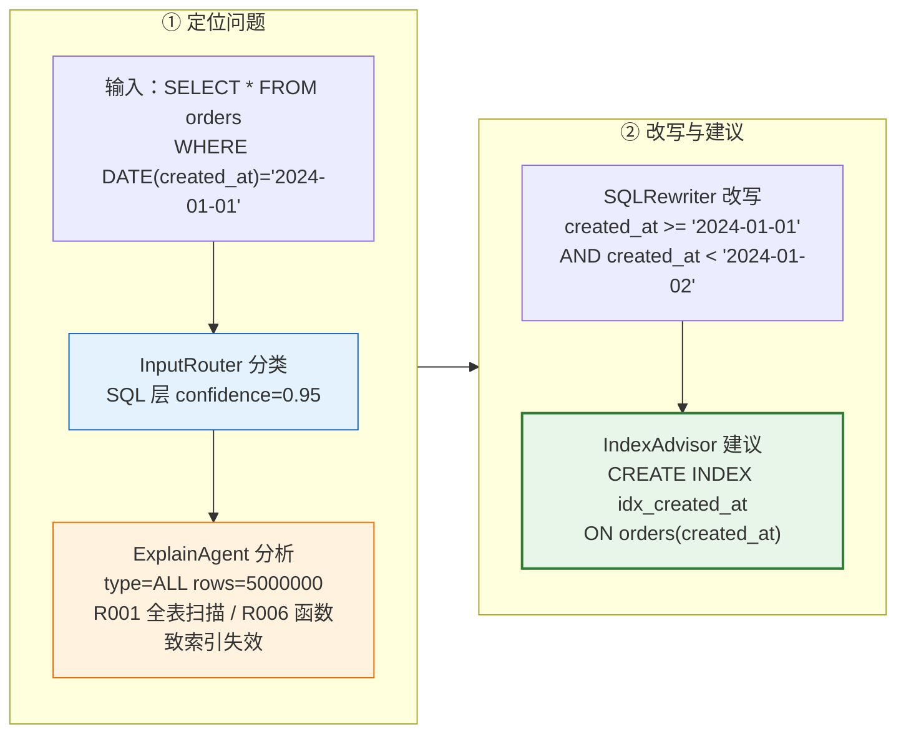
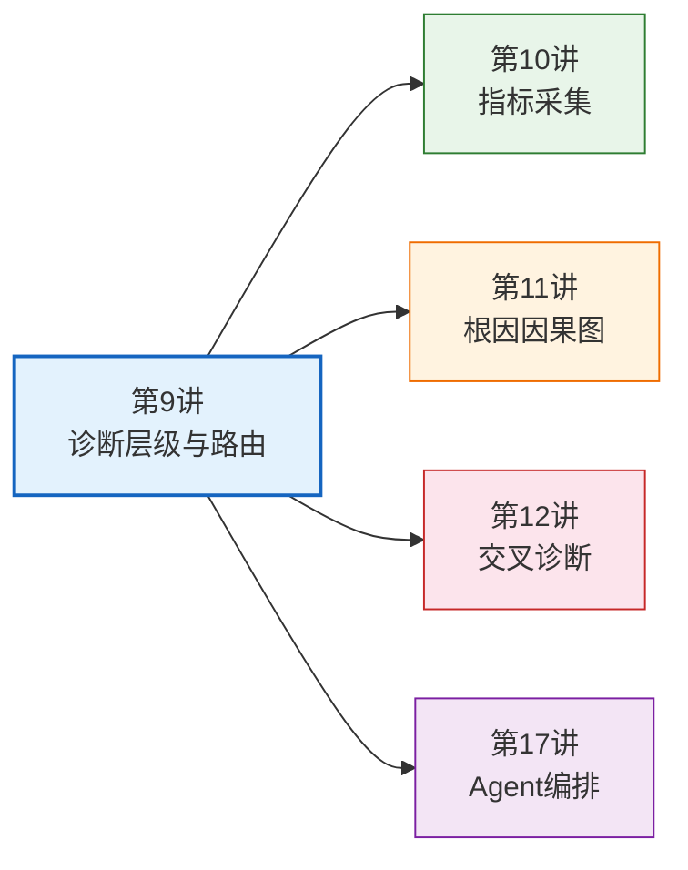
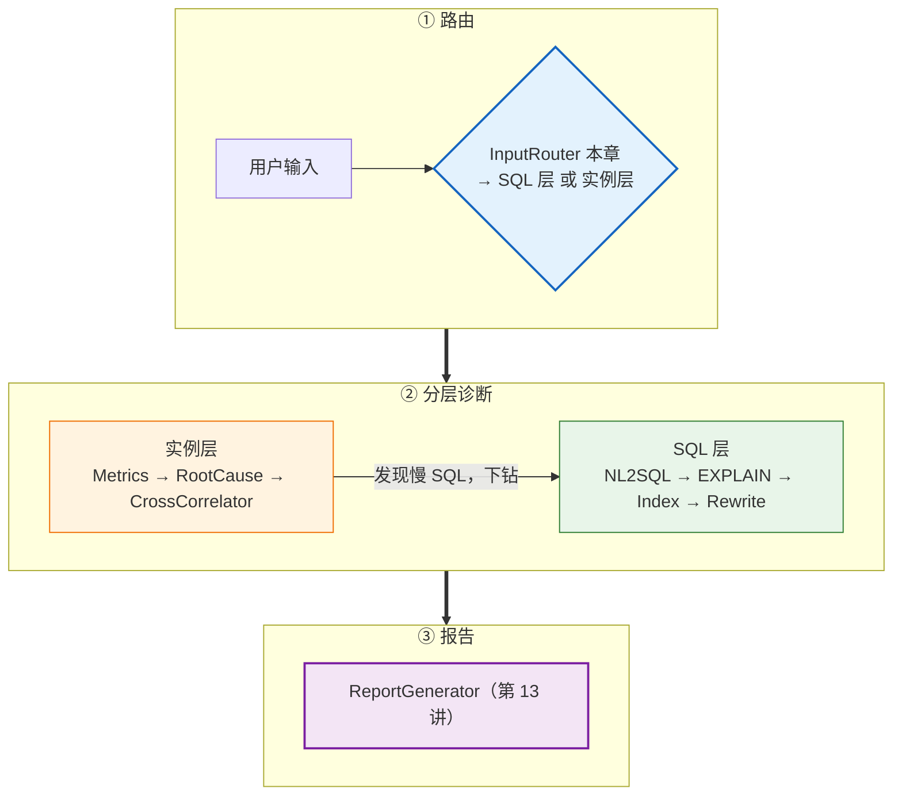

# 专栏第 9 讲：从 SQL 级到实例级诊断 —— 诊断层级与 Agent 选择

> **本文属于《大模型驱动的 MySQL 性能分析与自动化运维实战》专栏第 9 讲**
>
> 📎 **前置依赖**：第 5-8 讲 SQL 级 Agent（NL2SQL、EXPLAIN、索引、改写）。
>
> 代码仓库：`mysql-agent-engine/` | 模块：`src/mysql_agent/orchestrator/router.py`

---

## 1. 为什么需要诊断层级划分？

前 8 讲实现了完整的 SQL 级诊断能力，但生产环境的故障往往是**实例级**的：

```
用户: "数据库慢了，帮我查一下"
    │
    ├── 这不是单条 SQL 的问题
    ├── 可能是连接堆积、锁竞争、IO 瓶颈
    └── 需要从"SQL 视角"切换到"实例视角"
```

**核心问题**：
- 什么时候用 SQL Agent？什么时候用 Instance Agent？
- 两者如何协作？
- 如何自动决策诊断路径？

**为什么不能只用 SQL Agent？**

| 场景 | SQL Agent 的局限 | 需要实例层的原因 |
|------|-----------------|----------------|
| 连接池耗尽 | 单条 SQL 可能正常，但连接被占满 | 需要看连接数、线程池、锁等待 |
| 锁竞争 | EXPLAIN 看不出锁，只能看到慢 | 需要看 InnoDB 锁等待、死锁日志 |
| IO 瓶颈 | SQL 执行计划没问题 | 需要看磁盘 IO、buffer pool 命中率 |
| 主从延迟 | 单条 SQL 本地执行正常 | 需要看复制线程状态、GTID |

**为什么不能只用 Instance Agent？**

| 场景 | Instance Agent 的局限 | 需要 SQL 层的原因 |
|------|---------------------|----------------|
| 慢 SQL 定位 | 知道"有慢查询"但不知道怎么改 | 需要 EXPLAIN + 索引建议 + SQL 改写 |
| 索引优化 | 不知道哪些索引该建/该删 | 需要分析执行计划 + 表结构 |
| 查询改写 | 不知道 SQL 怎么写更好 | 需要 SQLRewriter 生成改写方案 |

---

## 2. 诊断层级模型

### 2.1 三层诊断体系

**图示：三层诊断自上而下 — 业务 → 实例 → SQL**



**层级职责说明**：

| 层级 | 关注点 | 典型问题 | 诊断工具 |
|------|--------|---------|---------|
| 业务层 | 用户可感知的异常 | 超时、报错、功能不可用 | Orchestrator 编排 |
| 实例层 | 数据库整体健康度 | 连接堆积、锁竞争、IO 瓶颈 | Metrics + RootCause |
| SQL 层 | 单条语句的执行效率 | 全表扫描、filesort、索引缺失 | EXPLAIN + Index + Rewrite |

### 2.2 各层对应 Agent

| 层级 | 输入特征 | 使用 Agent | 输出 |
|------|---------|-----------|------|
| SQL 层 | 具体 SQL、执行计划 | ExplainAgent、IndexAdvisor、SQLRewriter | 优化后的 SQL + DDL |
| 实例层 | "数据库慢了"、指标异常 | MetricsAgent、RootCauseAgent、CrossCorrelator | 根因 + 诊断报告 |
| 业务层 | 应用报错、用户投诉 | Orchestrator（编排所有 Agent） | 完整复盘报告 |

---

## 3. 智能路由决策

### 3.1 输入分类器

```python
# src/mysql_agent/orchestrator/router.py
import re
from enum import Enum
from typing import Dict, Any


class DiagnosisLayer(Enum):
    SQL = "sql"           # SQL 级诊断
    INSTANCE = "instance" # 实例级诊断
    HYBRID = "hybrid"     # 混合诊断


class InputRouter:
    """根据用户输入自动选择诊断层级"""

    # SQL 层关键词
    SQL_KEYWORDS = [
        r"SELECT\s+", r"INSERT\s+", r"UPDATE\s+", r"DELETE\s+",
        r"EXPLAIN", r"执行计划", r"索引", r"这条 SQL", r"慢查询",
        r"怎么优化", r"如何改写",
    ]

    # 实例层关键词
    INSTANCE_KEYWORDS = [
        r"数据库.*慢", r"连接.*满", r"CPU.*高", r"内存.*高",
        r"IO.*高", r"复制.*延迟", r"主从", r"死锁", r"宕机",
        r"报警", r"告警", r"故障", r"异常",
    ]

    def classify(self, user_input: str) -> Dict[str, Any]:
        """
        分类用户输入，决定诊断路径

        Returns:
            {
                "layer": DiagnosisLayer,
                "confidence": float,
                "reason": str,
                "suggested_agents": List[str]
            }
        """
        sql_score = self._score_keywords(user_input, self.SQL_KEYWORDS)
        instance_score = self._score_keywords(user_input, self.INSTANCE_KEYWORDS)

        if sql_score > 0.5 and instance_score < 0.3:
            return {
                "layer": DiagnosisLayer.SQL,
                "confidence": sql_score,
                "reason": "输入包含具体 SQL 或优化需求",
                "suggested_agents": ["nl2sql", "explain", "index_agent"]
            }
        elif instance_score > 0.5 and sql_score < 0.3:
            return {
                "layer": DiagnosisLayer.INSTANCE,
                "confidence": instance_score,
                "reason": "输入描述实例级异常现象",
                "suggested_agents": ["metrics", "root_cause", "cross_correlator"]
            }
        else:
            return {
                "layer": DiagnosisLayer.HYBRID,
                "confidence": max(sql_score, instance_score),
                "reason": "输入模糊，需要混合诊断",
                "suggested_agents": ["metrics", "nl2sql", "explain"]
            }

    def _score_keywords(self, text: str, patterns: list) -> float:
        """计算关键词匹配分数"""
        text_lower = text.lower()
        matches = sum(1 for p in patterns if re.search(p, text_lower))
        return min(matches / len(patterns) * 3, 1.0)  # 归一化到 0-1
```

**路由决策示例**：

| 用户输入 | SQL 分数 | 实例分数 | 路由结果 | 原因 |
|---------|---------|---------|---------|------|
| "这条 SQL 为什么慢 SELECT * FROM orders" | 0.9 | 0.1 | SQL 层 | 包含 SELECT 关键词 |
| "数据库连接满了，CPU 也高" | 0.2 | 0.8 | 实例层 | 命中连接、CPU 关键词 |
| "数据库慢了" | 0.3 | 0.4 | 混合 | 两者都不够明确 |
| "执行计划显示全表扫描" | 0.8 | 0.1 | SQL 层 | 包含执行计划关键词 |
| "主从延迟严重" | 0.1 | 0.7 | 实例层 | 命中复制关键词 |

### 3.2 决策流程图

**图示：路由后可升级到实例层、或下钻到 SQL 层的决策闭环**



**路由决策逻辑**：

| 条件 | 路径 | 说明 |
|------|------|------|
| SQL 关键词匹配 > 0.5 | SQL 层 | 直接进入 SQL Agent 分析 |
| 实例关键词匹配 > 0.5 | 实例层 | 先看整体指标，再下钻 SQL |
| 两者都匹配或都不匹配 | 混合 | 并行执行，交叉验证 |
| SQL 层发现锁/连接问题 | 升级 | SQL 只是表象，根因在实例层 |
| 实例层发现 Top 慢 SQL | 下钻 | 定位到具体 SQL 后交给 SQL Agent |

---

## 4. Agent 协作模式

### 4.1 顺序执行

适用于**输入明确、路径单一**的场景。按路由建议的 Agent 顺序依次执行，找到高置信度结果后提前终止。

```python
class SequentialDiagnosis:
    """顺序执行多个 Agent"""

    def diagnose(self, user_input: str) -> Dict:
        # 1. 路由决策
        route = self.router.classify(user_input)

        results = {"route": route, "steps": []}

        # 2. 按建议的 Agent 顺序执行
        for agent_name in route["suggested_agents"]:
            agent = self.get_agent(agent_name)
            step_result = agent.run(user_input)
            results["steps"].append({
                "agent": agent_name,
                "result": step_result
            })

            # 如果已找到明确根因，提前终止
            if step_result.get("confidence", 0) > 0.9:
                break

        return results
```

**执行流程**：用户输入 → 路由分类 → Agent1 → Agent2 → Agent3 → 结果汇总

**优点**：逻辑简单，易于调试和追踪
**缺点**：无法并行，后续 Agent 无法利用前序 Agent 的中间结果

### 4.2 条件触发

适用于**需要根据中间结果动态决策**的场景。实例层发现慢 SQL 后自动下钻到 SQL 层分析。

```python
class ConditionalDiagnosis:
    """基于条件触发不同 Agent"""

    def diagnose(self, user_input: str, context: Dict = None) -> Dict:
        route = self.router.classify(user_input)
        results = {"route": route, "metrics": None, "sql_analyses": []}

        # 实例层诊断发现慢 SQL → 调用 SQL Agent
        if route["layer"] == DiagnosisLayer.INSTANCE:
            metrics_result = self.metrics_agent.run(user_input)
            results["metrics"] = metrics_result

            if metrics_result.get("top_slow_queries"):
                # 对 Top 慢查询进行 SQL 级分析
                for sql in metrics_result["top_slow_queries"][:3]:
                    explain_result = self.explain_agent.diagnose(sql)
                    results["sql_analyses"].append({
                        "sql": sql,
                        "analysis": explain_result
                    })

        # SQL 层直接分析
        elif route["layer"] == DiagnosisLayer.SQL:
            explain_result = self.explain_agent.diagnose(user_input)
            results["sql_analyses"].append({
                "sql": user_input,
                "analysis": explain_result
            })

        return results
```

**执行流程**：



**优点**：支持动态下钻，实例层发现问题能自动追踪到 SQL 层
**缺点**：逻辑复杂，需要处理多层嵌套结果

---

## 5. 实战案例

### 5.1 案例："数据库响应慢"

**图示：实例路径案例 — 路由 → 指标 → 交叉/根因 → SQL 下钻**



**诊断路径解读**：

| 阶段 | Agent | 关键发现 | 决策 |
|------|-------|---------|------|
| 路由 | InputRouter | 置信度 0.85 命中实例层 | 进入实例层诊断 |
| 采集 | MetricsAgent | 连接 90%、慢查询 5.2%、锁 2.3s | 三项指标均异常 |
| 交叉 | CrossCorrelator | CC01: 连接 × 锁关联 | 锁是根因，连接堆积是果 |
| 根因 | RootCauseAgent | RC02 锁等待/死锁 | 需要下钻到具体 SQL |
| 下钻 | ExplainAgent | 行锁竞争 + 大事务 | 给出可执行优化方案 |

**关键洞察**：实例层诊断发现了根因（锁），但只有下钻到 SQL 层才给出了可执行方案（减少事务持有时间、分批更新）。这就是"实例层发现问题 → SQL 层解决问题"的协作模式。

### 5.2 案例："这条 SQL 怎么优化"

**图示：SQL 路径案例 — 路由 → EXPLAIN → 改写 → 索引建议**



**诊断路径解读**：

| 阶段 | Agent | 关键发现 | 优化动作 |
|------|-------|---------|---------|
| 路由 | InputRouter | 包含具体 SQL，置信度 0.95 | 直接进入 SQL 层 |
| 分析 | ExplainAgent | R001 全表扫描 + R006 函数致索引失效 | 识别两个风险点 |
| 改写 | SQLRewriter | `DATE(col)` 改为范围查询 | 消除函数，使索引可用 |
| 建议 | IndexAdvisor | 在 `created_at` 上建索引 | 配合改写后的 SQL 使用 |

**关键洞察**：这是一个纯 SQL 层问题，不需要实例层参与。`DATE(created_at)` 函数导致索引失效是根因，改写 SQL + 建索引即可解决。

---

## 6. 与后续模块的衔接

**图示：本讲路由如何接到第 10/11/12/17 讲**



**衔接说明**：

| 后续模块 | 与本讲的关系 | 核心职责 |
|---------|------------|---------|
| 第 10 讲 指标采集 | 为实例层诊断提供数据来源 | Prometheus + 异常检测算法 |
| 第 11 讲 根因因果图 | 实例层诊断的核心逻辑 | 从指标异常反向推导根因 |
| 第 12 讲 交叉诊断 | 增强实例层诊断准确性 | 多指标交叉验证 |
| 第 17 讲 Agent 编排 | 完整实现本讲的路由与调度 | 所有 Agent 的统一编排 |

---

## 7. 端到端诊断流水线（全专栏串联）

将第 5-13 讲串成一条可执行的流水线：



**流水线设计要点**：

| 路径 | 涉及讲次 | 输出 |
|------|---------|------|
| SQL 层 | 第 5-8 讲 | 优化后 SQL + DDL |
| 实例层 | 第 10-12 讲 | 根因 + 诊断报告 |
| 下钻回连 | 实例层 → SQL 层 | 根因定位到具体 SQL 的优化方案 |
| 报告生成 | 第 13 讲 | 完整复盘报告（含时间线、影响范围、修复建议） |

**关键设计**：实例层发现 RC01/RC06/RC07 时，必须回连 SQL 层，否则只有根因没有可执行方案。

---

## 8. 本讲小结

| 组件 | 文件 | 核心作用 |
|------|------|---------|
| InputRouter | `router.py` | 用户输入分类，自动选择诊断层级 |
| DiagnosisLayer | `router.py` | 诊断层级枚举（SQL/INSTANCE/HYBRID） |
| SequentialDiagnosis | `orchestrator.py` | 顺序执行模式，找到高置信度结果后提前终止 |
| ConditionalDiagnosis | `orchestrator.py` | 条件触发模式，支持实例层下钻到 SQL 层 |

**核心能力**：
1. ✅ **智能路由**：自动识别 SQL 级 vs 实例级问题，置信度评分
2. ✅ **分层诊断**：三层模型清晰划分职责（业务层/实例层/SQL 层）
3. ✅ **Agent 协作**：支持顺序执行（简单场景）和条件触发（复杂下钻）
4. ✅ **实战案例**：展示"数据库慢了"和"SQL 优化"两种典型路径
5. ✅ **全专栏串联**：诊断流水线到报告为第 5–13 讲；统一编排在第 17 讲落地

**关键设计决策**：
- **路由优先**：先分类再诊断，避免"拿着锤子找钉子"
- **双模式协作**：顺序执行处理简单场景，条件触发处理需要下钻的复杂场景
- **下钻回连**：实例层发现问题必须回连 SQL 层，确保输出可执行方案
- **置信度驱动**：每个 Agent 输出置信度，高置信度时提前终止节省资源

**下一讲预告**：指标采集与异常检测 —— Prometheus + MK/CUSUM/MAD 算法，构建实例级性能信号层。