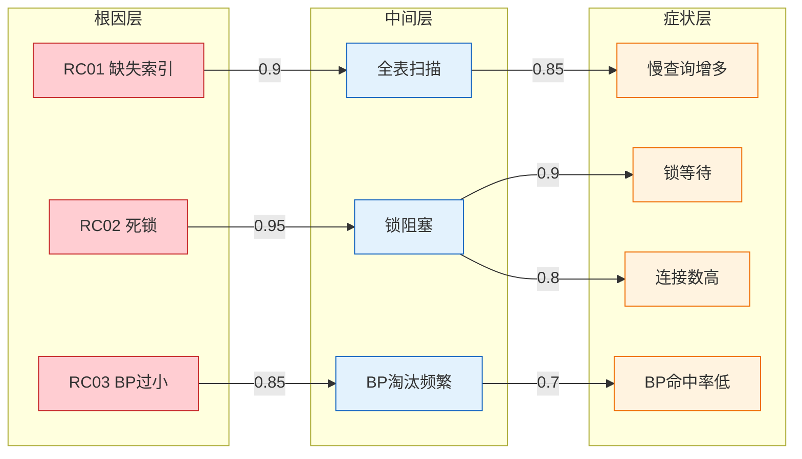
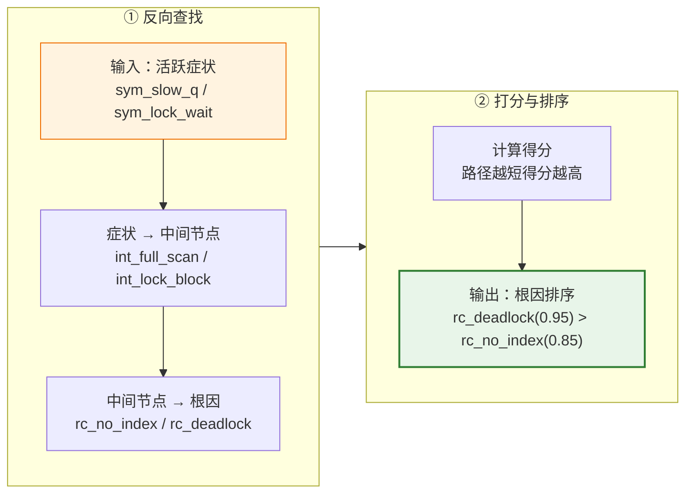
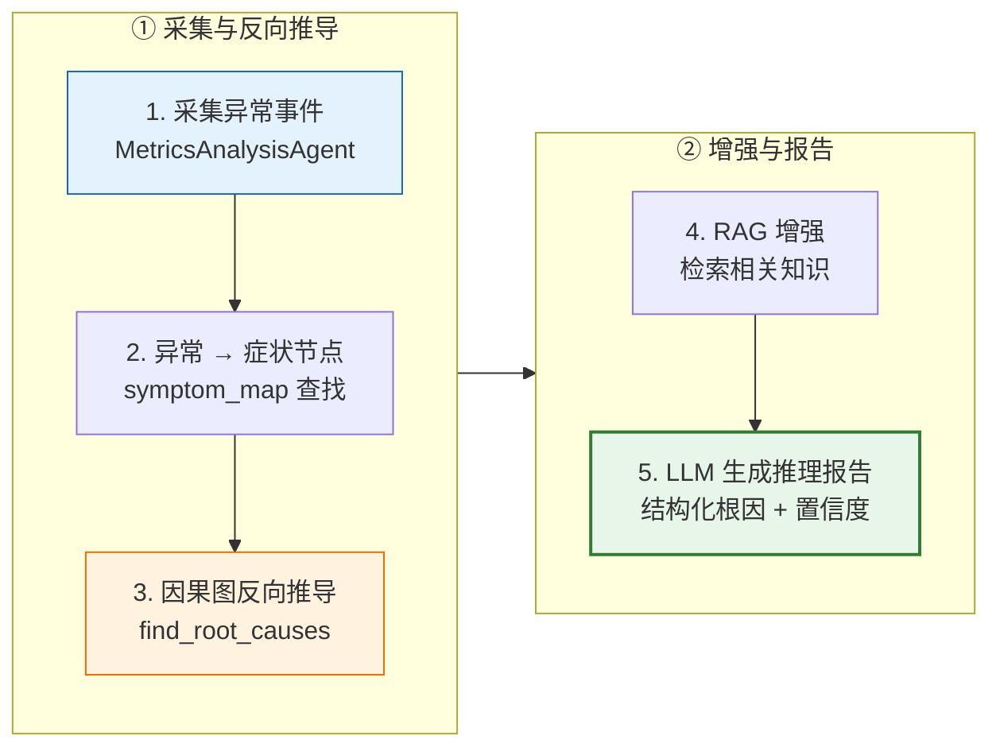
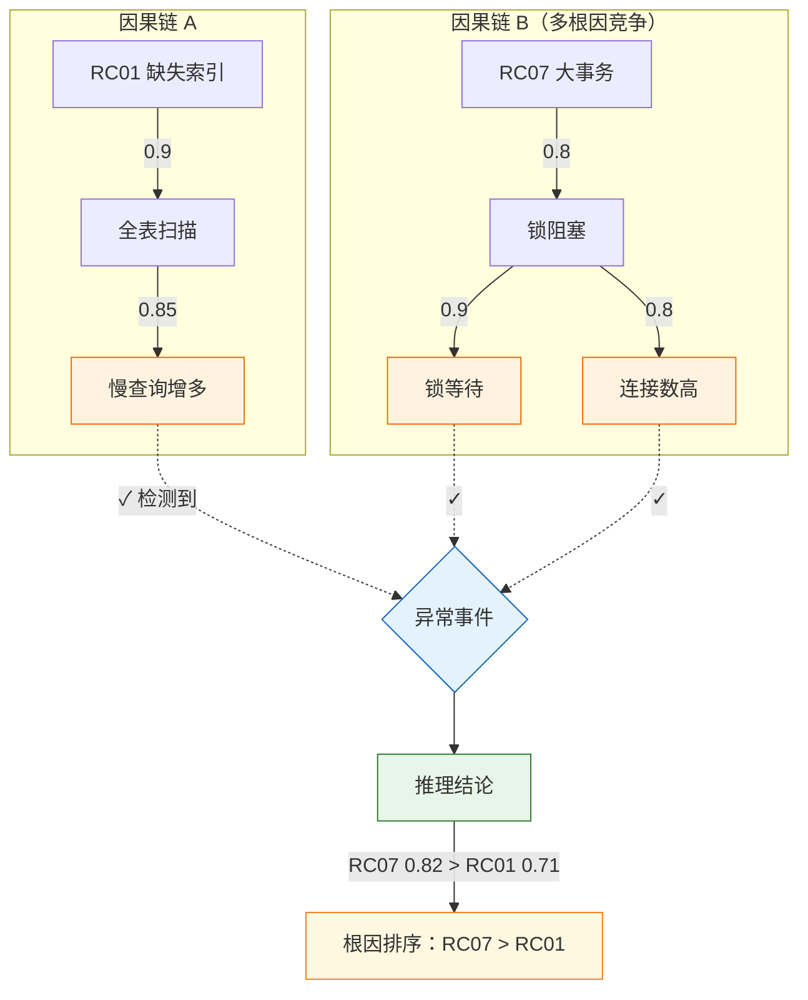
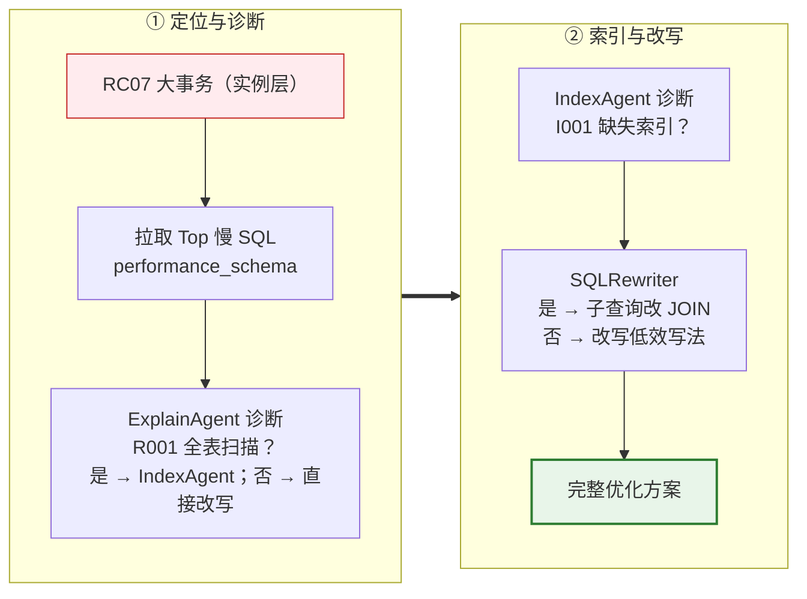
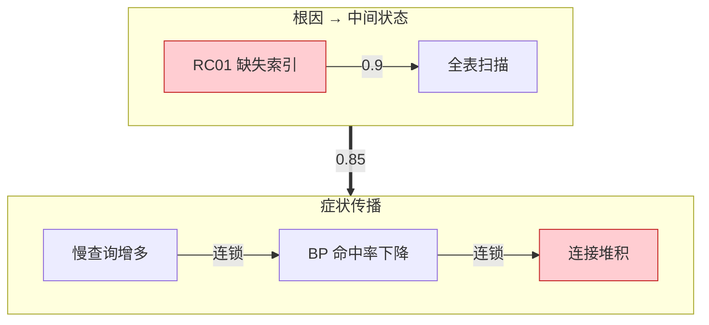
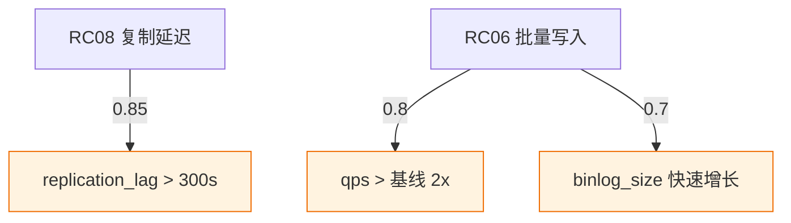

# 专栏第 11 讲：根因因果图与反向推导

> **本文属于《大模型驱动的 MySQL 性能分析与自动化运维实战》专栏第 11 讲**
>
> 📎 **前置依赖**：第 10 讲指标采集与异常检测；第 9 讲诊断路由；平台 `mysql_guide.json` 决策树。
>
> 代码仓库：`mysql-agent-engine/` | 模块：`src/mysql_agent/reasoning/`
>
> **本章目标**：实现一个能将异常信号形式化为因果推理图、通过反向链推理自动推导根因、并联动 SQL 级 Agent 做下钻诊断的 Agent，完成从"多个异常信号"到"根因列表 + 置信度排序"的自动化推理。
>
> **核心概念**：本讲交付的是 **因果图**（症状 / 中间态 / 根因三层节点）+ **反向推导**（从活跃症状沿边回溯并排序）；图上的一条证据路径可称为「推理链」，但构建对象是图与搜索，不是线性 CoT。
>
> **实现说明**：正文以 `MySQLCausalGraph` 描述因果图模型；当前代码仓库以 `reasoning/root_cause_rules.py` 规则表 + RootCauseAgent 落地（与附录对照表一致）。Phase 2 可将图结构抽成独立模块，与 `data/kg/mysql_kg.json` 对齐。

---

## 1. 从异常信号到根因

第 10 讲 `MetricsAnalysisAgent` 输出的是**异常事件列表**，但 DBA 需要的是**根因**：

```
异常: 连接数 92% ↑        ─┐
异常: 慢查询率 3.2% ↑      ─┼─→ 根因: 未索引的大表 UPDATE 导致锁等待
异常: 锁等待时间 2.3s ↑   ─┘
```

本讲将 MySQL 故障的**因果链**形式化为推理图，供 Agent 自动推导。

---

## 2. 18 个根因场景

基于专业知识与业界故障归纳，总结 18 个高频根因（可根据实际业务扩展）：

> **说明**：18 个根因仅为参考示例。实际生产环境中，可根据业务特点、历史故障记录、专家经验持续扩充根因库，构建更贴合实际的知识图谱。

| ID | 根因 | 典型信号 | 验证命令 |
|----|------|---------|---------|
| RC01 | 缺失索引导致全表扫描 | 慢查询↑, rows_examined 大 | `EXPLAIN` + `sys.statements_with_full_table_scans` |
| RC02 | 锁等待/死锁 | 锁时间↑, 连接堆积 | `SHOW ENGINE INNODB STATUS` |
| RC03 | Buffer Pool 不足 | BP 命中率↓, 磁盘读↑ | `SHOW STATUS LIKE 'Innodb_buffer_pool%'` |
| RC04 | 脏页刷盘压力 | 脏页比↑, IO 等待↑ | `innodb_buffer_pool_pages_dirty` |
| RC05 | 连接池耗尽 | 连接数→max_connections | `SHOW PROCESSLIST` |
| RC06 | 慢 SQL 拖垮实例 | 慢查询↑, QPS↓ | `performance_schema.events_statements_summary_by_digest` |
| RC07 | 大事务 | undo 膨胀, 锁持有时间长 | `information_schema.innodb_trx` |
| RC08 | 复制延迟 | Seconds_Behind_Master↑ | `SHOW SLAVE STATUS\G` |
| RC09 | 临时表落盘 | Created_tmp_disk_tables↑ | `SHOW STATUS LIKE 'Created_tmp%'` |
| RC10 | 统计信息过期 | 选错索引, 执行计划突变 | `SHOW INDEX` + `ANALYZE TABLE` |
| RC11 | 磁盘 IO 瓶颈 | iowait↑, 读延迟↑ | `iostat -x 1` |
| RC12 | 内存不足 OOM | swap 使用, OOM killer | `dmesg` + `free -m` |
| RC13 | 网络抖动 | 连接中断, 超时 | `netstat -s` |
| RC14 | 参数配置不当 | 特定指标偏离最佳实践 | `SHOW VARIABLES` |
| RC15 | 批量导入/删除 | 单表 DML 暴增 | `SHOW PROCESSLIST` |
| RC16 | 热点行竞争 | 单行锁等待 | `performance_schema.data_locks` |
| RC17 | Metadata Lock | DDL 阻塞 DML | `performance_schema.metadata_locks` |
| RC18 | 主从切换 | 复制中断, 只读错误 | `SHOW SLAVE STATUS\G` |

---

## 3. 因果推理图

> **本节代码为示例子集**：只含部分节点/边，用来讲清「症状 → 中间态 → 根因」的反向链与得分。RC01–RC18 的完整边关系见 **§6.1 对照表**。

**因果图结构**：



**三层节点说明**：

| 层级 | 节点类型 | 含义 | 示例 |
|------|---------|------|------|
| 根因层 | `root_cause` | 故障的根本原因 | 缺失索引、死锁、BP 过小 |
| 中间层 | `intermediate` | 根因导致的中间状态 | 全表扫描、锁阻塞、BP 淘汰 |
| 症状层 | `symptom` | 可观测的异常信号 | 慢查询↑、锁等待↑、连接数↑ |

**反向链推理过程**：



**得分计算逻辑**：`score += 1.0 / (depth + 1)`

| 路径深度 | 得分贡献 | 含义 |
|---------|---------|------|
| depth=0（症状→根因直接相连） | 1.0 | 因果关系最确定 |
| depth=1（隔一个中间节点） | 0.5 | 因果关系较确定 |
| depth=2（隔两个节点） | 0.33 | 因果关系需验证 |
| depth>5 | 停止搜索 | 避免过深推理 |

```python
# src/mysql_agent/reasoning/causal_graph.py（仓库实现类名 `MySQLCausalGraph`，节点/边未拆成独立类）
from dataclasses import dataclass, field
from typing import List, Dict, Optional


@dataclass
class CausalNode:
    id: str
    name: str
    node_type: str       # symptom / intermediate / root_cause
    metrics: List[str] = field(default_factory=list)
    verify_commands: List[str] = field(default_factory=list)


@dataclass
class CausalEdge:
    source: str
    target: str
    condition: str       # 触发条件描述
    weight: float = 1.0  # 因果强度


class MySQLCausalGraph:
    """MySQL 故障因果推理图"""

    NODES = [
        CausalNode("sym_slow_q", "慢查询增多", "symptom", metrics=["slow_query_rate"]),
        CausalNode("sym_conn_high", "连接数高", "symptom", metrics=["connections_pct"]),
        CausalNode("sym_lock_wait", "锁等待", "symptom", metrics=["row_lock_time_avg"]),
        CausalNode("sym_bp_miss", "BP 命中率低", "symptom", metrics=["bp_hit_rate"]),
        CausalNode("sym_repl_lag", "复制延迟", "symptom", metrics=["replication_lag"]),
        CausalNode("sym_qps_low", "QPS 下降", "symptom", metrics=["qps"]),
        CausalNode("sym_io_high", "IO 负载高", "symptom", metrics=["disk_read_rate", "iowait_pct"]),
        CausalNode("int_full_scan", "全表扫描", "intermediate", verify_commands=["EXPLAIN"]),
        CausalNode("int_lock_block", "锁阻塞", "intermediate", verify_commands=["SHOW ENGINE INNODB STATUS\\G"]),
        CausalNode("int_bp_evict", "BP 淘汰频繁", "intermediate", verify_commands=["SHOW ENGINE INNODB STATUS"]),
        CausalNode("int_repl_backlog", "复制 backlog", "intermediate", verify_commands=["SHOW SLAVE STATUS\\G"]),
        CausalNode("rc_no_index", "缺失索引", "root_cause", verify_commands=["sys.statements_with_full_table_scans"]),
        CausalNode("rc_deadlock", "死锁", "root_cause", verify_commands=["SHOW ENGINE INNODB STATUS\\G"]),
        CausalNode("rc_bp_small", "Buffer Pool 过小", "root_cause", verify_commands=["SHOW VARIABLES LIKE 'innodb_buffer_pool_size'"]),
        CausalNode("rc_big_trx", "大事务", "root_cause", verify_commands=["information_schema.innodb_trx"]),
        CausalNode("rc_repl_lag", "复制延迟", "root_cause", verify_commands=["SHOW SLAVE STATUS\\G"]),
        CausalNode("rc_io_bottleneck", "IO 瓶颈", "root_cause", verify_commands=["iostat -x 1 5"]),
        CausalNode("rc_mdl", "Metadata Lock", "root_cause", verify_commands=["performance_schema.metadata_locks"]),
    ]

    EDGES = [
        CausalEdge("rc_no_index", "int_full_scan", "无索引 → 全表扫描", 0.9),
        CausalEdge("int_full_scan", "sym_slow_q", "全表扫描 → 慢查询", 0.85),
        CausalEdge("rc_deadlock", "int_lock_block", "死锁 → 锁阻塞", 0.95),
        CausalEdge("int_lock_block", "sym_lock_wait", "锁阻塞 → 锁等待", 0.9),
        CausalEdge("int_lock_block", "sym_conn_high", "锁阻塞 → 连接堆积", 0.8),
        CausalEdge("rc_bp_small", "sym_bp_miss", "BP 过小 → 命中率低", 0.85),
        CausalEdge("sym_bp_miss", "sym_slow_q", "命中率低 → 慢查询", 0.7),
    ]

    def __init__(self):
        self.nodes = {n.id: n for n in self.NODES}
        self.edges = self.EDGES

    def find_root_causes(self, active_symptoms: List[str]) -> List[dict]:
        """从活跃症状反向推导根因"""
        candidates = {}

        for symptom in active_symptoms:
            self._backward_chain(symptom, candidates, depth=0, path=[])

        ranked = sorted(candidates.items(), key=lambda x: x[1]["score"], reverse=True)
        return [
            {
                "root_cause_id": rc_id,
                "name": self.nodes[rc_id].name,
                "score": info["score"],
                "evidence_path": info["path"],
                "verify_commands": self.nodes[rc_id].verify_commands,
            }
            for rc_id, info in ranked
        ]

    def _backward_chain(self, node_id: str, candidates: dict, depth: int, path: list):
        if depth > 5:
            return
        node = self.nodes.get(node_id)
        if not node:
            return

        path = path + [node_id]

        if node.node_type == "root_cause":
            if node_id not in candidates:
                candidates[node_id] = {"score": 0, "path": []}
            candidates[node_id]["score"] += 1.0 / (depth + 1)
            candidates[node_id]["path"] = path
            return

        for edge in self.edges:
            if edge.target == node_id:
                self._backward_chain(edge.source, candidates, depth + 1, path)
```

---

## 4. 反向推导 Agent

**5 步诊断流程**：



**流程说明**：

| 步骤 | 组件 | 输入 | 输出 |
|------|------|------|------|
| 1 | MetricsAnalysisAgent | 时间窗口 | 异常事件列表 |
| 2 | symptom_map | 异常指标名 | 活跃症状节点 ID |
| 3 | CausalGraph | 活跃症状 | 根因列表（含得分） |
| 4 | RAG Agent | 根因名称 | 知识库参考 |
| 5 | LLM Prompt | 异常+根因+知识 | 自然语言推理报告 |

```python
# src/mysql_agent/agents/root_cause_agent.py
from typing import List, Dict


class RootCauseAgent:
    """根因推理 Agent

    将异常信号形式化为因果推理图，通过反向链推理自动推导根因。
    """

    # 异常指标 → 症状节点映射
    SYMPTOM_MAP = {
        "slow_query_rate": "sym_slow_q",
        "connections_pct": "sym_conn_high",
        "row_lock_time_avg": "sym_lock_wait",
        "bp_hit_rate": "sym_bp_miss",
        "replication_lag": "sym_repl_lag",
    }

    def __init__(self, causal_graph, metrics_agent, rag_agent, prompt_builder):
        self.graph = causal_graph
        self.metrics = metrics_agent
        self.rag = rag_agent
        self.prompts = prompt_builder

    def diagnose(self, duration_minutes: int = 60) -> dict:
        """执行根因推理诊断

        Args:
            duration_minutes: 分析时间窗口，默认 60 分钟

        Returns:
            结构化诊断报告，包含 anomalies、root_causes、summary
        """
        # 1. 采集异常事件
        metrics_result = self.metrics.run(duration_minutes)
        anomalies = metrics_result["anomalies"]

        # 2. 映射异常 → 症状节点
        active_symptoms = []
        for a in anomalies:
            node = self.SYMPTOM_MAP.get(a["metric"])
            if node:
                active_symptoms.append(node)

        # 3. 因果图反向推导
        root_causes = self.graph.find_root_causes(active_symptoms)

        # 4. RAG 增强
        for rc in root_causes:
            context = self.rag.retrieve(rc["name"])
            rc["knowledge"] = self.rag.format_context(context)

        # 5. LLM 生成推理报告
        prompt = self.prompts.build(
            "instance_diagnosis",
            {
                "anomalies": anomalies,
                "root_causes": root_causes,
            },
            rag_context="",
        )

        # 安全获取 top 根因
        top_rc = root_causes[0] if root_causes else None

        return {
            "anomalies": anomalies,
            "root_causes": root_causes,
            "reasoning_prompt": prompt,
            "summary": {
                "top_root_cause": top_rc["name"] if top_rc else "未确定",
                "confidence": top_rc["score"] if top_rc else 0,
            },
        }
```

---

## 5. 推导路径可视化

**图示：一次反向推导路径的可视化读法（症状 → 中间态 → 根因）**



**可视化说明**：
- **节点类型**：症状节点（橙色）、中间节点（蓝色）、根因节点（绿色）
- **边权重**：表示因果强度，0-1 之间，越接近 1 表示因果关系越强
- **检测标记**：✓ 表示该症状被 MetricsAnalysisAgent 检测到
- **根因排序**：根据反向链推理得分排序，得分高者优先

**推理输出示例**：

```json
{
  "root_causes": [
    {
      "root_cause_id": "RC07",
      "name": "大事务",
      "score": 0.82,
      "evidence_path": ["rc_big_trx", "int_lock_block", "sym_lock_wait"],
      "verify_commands": ["SELECT * FROM information_schema.innodb_trx"]
    },
    {
      "root_cause_id": "RC01",
      "name": "缺失索引",
      "score": 0.71,
      "evidence_path": ["rc_no_index", "int_full_scan", "sym_slow_q"],
      "verify_commands": ["sys.statements_with_full_table_scans"]
    }
  ]
}
```

---

## 6. 18 根因边关系清单（生产扩展对照）

> **口径说明（避免「全覆盖」夸大）**：
> - **§3 代码**：最小可运行**示例子集**（若干节点 + 边），用来讲清反向链算法，不是生产全量图。
> - **§6.1 本表**：与 §2 的 RC01–RC18 **一一对应的边关系对照清单**，供实现/评测时按表扩展，不等于仓库里已有完整 `causal_graph.py`。
> - **代码落地**：当前以 `reasoning/root_cause_rules.py` + RootCauseAgent 为主；图结构可按本表渐进补齐。

### 6.1 边关系对照表（RC01–RC18）

| 根因节点 | 中间节点 | 症状节点 | 边权重 | 说明 |
|---------|---------|---------|--------|------|
| RC01 缺失索引 | int_full_scan | sym_slow_q | 0.85 | 无索引导致全表扫描 |
| RC02 锁等待/死锁 | int_lock_block | sym_lock_wait, sym_conn_high | 0.90 | 锁竞争导致等待 |
| RC03 BP 不足 | int_bp_evict | sym_bp_miss → sym_slow_q | 0.80 | BP 打穿导致磁盘读 |
| RC04 脏页刷盘 | int_flush_pressure | sym_io_high | 0.75 | 刷新压力导致 IO 负载 |
| RC05 连接池耗尽 | int_conn_block | sym_conn_high | 0.85 | 连接打满 |
| RC06 慢 SQL | int_full_scan / int_lock_block | sym_slow_q, sym_qps_low | 0.80 | 慢 SQL 拖垮实例 |
| RC07 大事务 | int_lock_block | sym_lock_wait, sym_slow_q | 0.90 | 长事务持有锁 |
| RC08 复制延迟 | int_repl_backlog | sym_repl_lag | 0.85 | 复制追赶不上写入 |
| RC09 临时表落盘 | int_disk_tmp | sym_slow_q | 0.70 | 磁盘排序慢 |
| RC10 统计过期 | int_wrong_plan | sym_slow_q | 0.75 | 选错索引 |
| RC11 IO 瓶颈 | int_io_wait | sym_slow_q, sym_bp_miss | 0.80 | IO 无法支撑读写 |
| RC12 OOM | int_swap | sym_conn_high | 0.90 | 内存不足触发 swap |
| RC13 网络抖动 | int_net_flap | sym_conn_high, sym_qps_low | 0.70 | 连接中断 / 超时增多 |
| RC14 参数配置不当 | int_misconfig | 由参数族映射（见下） | 0.65 | 偏离最佳实践导致容量不足 |
| RC15 批量导入/删除 | int_bulk_dml | sym_qps_low, sym_repl_lag, sym_io_high | 0.80 | 单表大批量 DML 打满写入 |
| RC16 热点行 | int_lock_block | sym_lock_wait | 0.85 | 同一行并发更新 |
| RC17 MDL | int_lock_block | sym_lock_wait, sym_conn_high | 0.90 | DDL 阻塞 DML |
| RC18 主从切换 | int_failover | sym_repl_lag, sym_qps_low | 0.85 | 切换窗口内复制中断 / 只读 |

**RC14 参数族 → 症状映射（实现时按变量分支，不建一条万能边）**：

| 参数族示例 | 典型症状 | 说明 |
|-----------|---------|------|
| `max_connections` / 连接相关 | sym_conn_high | 上限过小或连接泄漏叠加 |
| `innodb_buffer_pool_size` | sym_bp_miss | BP 配置不足 |
| `innodb_io_capacity` / 刷脏相关 | sym_io_high | 刷盘能力配错 |
| `sync_binlog` / 复制相关 | sym_repl_lag | 复制持久化策略过激 |

### 6.2 症状 → 指标映射（与第 10 讲对齐）

```python
SYMPTOM_METRIC_MAP = {
    "sym_slow_q":        ["slow_query_rate", "avg_query_time"],
    "sym_conn_high":     ["connections_pct", "threads_running"],
    "sym_lock_wait":     ["row_lock_time_avg", "innodb_row_lock_waits"],
    "sym_bp_miss":       ["bp_hit_rate"],           # 低于阈值触发
    "sym_repl_lag":      ["replication_lag"],
    "sym_qps_low":       ["qps"],                   # 低于基线触发
    "sym_io_high":       ["disk_read_rate", "iowait_pct"],
}

METRIC_SYMPTOM_REVERSE_MAP = {v: k for k, vs in SYMPTOM_METRIC_MAP.items() for v in vs}
```

### 6.3 根因验证 Playbook（高频优先子集）

> 下表覆盖最常自动化验证的 RC；其余 RC（如 RC13/14/15/18）以人工核对 + 第 14/15 讲专用 Agent 为主，不必强行写满 18 条才能上线。

每个 RC 命中后，Agent 自动执行验证命令并回填证据：

| RC | 自动验证 SQL/命令 | 通过条件 | 预期结果 |
|----|------------------|---------|---------|
| RC01 | `SELECT * FROM sys.statements_with_full_table_scans ORDER BY full_scans DESC LIMIT 5` | 存在高频全表扫描 SQL | rows_examined >> rows_sent |
| RC02 | `SHOW ENGINE INNODB STATUS\G` | 存在 lock wait 或 deadlock | lock wait time > 0 |
| RC03 | `SHOW VARIABLES LIKE 'innodb_buffer_pool_size'` | BP 大小 < 推荐值 | < 建议值(≈服务器内存*0.75) |
| RC07 | `SELECT trx_id, trx_started, trx_rows_locked FROM information_schema.innodb_trx` | 存在运行 >60s 的事务 | trx_started < NOW() - 60s |
| RC08 | `SHOW SLAVE STATUS\G` | Seconds_Behind_Master > 0 | Slave_IO_Running=Yes, Slave_SQL_Running=Yes |
| RC10 | `SELECT UPDATE_TIME FROM information_schema.TABLES WHERE TABLE_NAME=...` | 统计信息 >7 天未更新 | UPDATE_TIME < NOW() - 7d |
| RC13 | `SHOW GLOBAL STATUS LIKE 'Aborted_connects'` + 应用超时日志 | 中断/超时与网络抖动同期 | Aborted_connects 跳变 |
| RC14 | `SHOW VARIABLES` 对照最佳实践清单 | 关键参数偏离推荐区间 | 命中具体变量 diff |
| RC15 | `SHOW PROCESSLIST` / binlog 增长速率 | 存在大批量 DML 或 binlog 暴增 | 单会话 rows_affected 极大 |
| RC17 | `SELECT * FROM performance_schema.metadata_locks WHERE LOCK_STATUS='PENDING'` | 存在等待中的 MDL | 存在 PENDING 状态的锁 |
| RC18 | `SHOW SLAVE STATUS\G` + 切换窗口运维日志 | 切换前后复制中断/只读错误 | 与 failover 时间线对齐 |

---

## 7. 与 SQL 级 Agent 的联动（第 6-8 讲）

根因推理不能停留在实例层。当 RC01/RC06/RC07 命中时，自动触发 SQL 链路：

```python
class RootCauseWithSQLDrilldown(RootCauseAgent):
    """根因推理 + SQL 下钻"""

    SQL_RELATED_RCS = {"RC01", "RC06", "RC07", "RC09", "RC10", "RC16", "RC17"}

    def diagnose_with_drilldown(self, duration_minutes: int = 60) -> dict:
        """增强诊断：根因推理 + SQL 级下钻

        联动流程：
        1. 基础推理（同 RootCauseAgent.diagnose）
        2. 筛选 SQL 相关根因
        3. 对每个 SQL 相关根因，拉取 Top 慢 SQL
        4. 调用 ExplainAgent → IndexAgent → SQLRewriter
        5. 组装完整诊断报告
        """
        base = self.diagnose(duration_minutes)
        drilldown = []

        for rc in base["root_causes"]:
            rc_id = rc.get("root_cause_id", "")
            # 筛选 SQL 相关根因
            if not any(rc_id.startswith(x) for x in self.SQL_RELATED_RCS):
                continue

            # 拉 Top 慢 SQL
            slow_sqls = self._fetch_top_slow_queries(
                limit=3,
                related_rc=rc_id
            )
            for sql in slow_sqls:
                try:
                    explain_result = self.explain_agent.diagnose(sql["digest_text"])
                    index_result = self.index_agent.diagnose(
                        sql["digest_text"],
                        explain_result,
                        database=sql.get("database", "default")
                    )
                    drilldown.append({
                        "sql": sql["digest_text"],
                        "avg_ms": sql["avg_ms"],
                        "exec_count": sql.get("exec_count", 0),
                        "explain": explain_result,
                        "index": index_result,
                        "linked_rc": rc_id,
                        "linked_rc_name": rc["name"],
                    })
                except Exception as e:
                    # 单条 SQL 分析失败不影响其他 SQL
                    drilldown.append({
                        "sql": sql["digest_text"],
                        "error": str(e),
                        "linked_rc": rc_id,
                    })

        base["sql_drilldown"] = drilldown
        base["summary"]["sql_issues_found"] = len(drilldown)
        return base

    def _fetch_top_slow_queries(self, limit: int = 3, related_rc: str = None) -> list:
        """根据根因类型拉取相关慢 SQL

        根因 → SQL 特征映射：
        - RC01: 全表扫描 → rows_examined 大的 SQL
        - RC07: 锁等待 → 涉及 innodb_trx 中长事务的 SQL
        - RC09: 临时表 → Last_seen 在临时表相关的 SQL
        """
        query = """
            SELECT digest_text, avg_ms, digest,
                   last_seen, rows_examined, rows_sent
            FROM performance_schema.events_statements_summary_by_digest
            WHERE avg_ms > 1000  -- 慢 SQL 阈值
            ORDER BY avg_ms DESC
            LIMIT :limit
        """
        try:
            return self.db.query(query, {"limit": limit})
        except Exception as e:
            # 数据库查询失败返回空列表，不影响整体诊断
            return []
```

**典型联动路径**：



**联动决策矩阵**：

| 根因类型 | 下钻目标 | 优先诊断 | 次优先诊断 |
|---------|---------|---------|---------|
| RC01 缺失索引 | Top 慢 SQL | ExplainAgent → R001 | IndexAgent → I001 |
| RC06 慢 SQL | Top 慢 SQL | ExplainAgent → R001-R018 | IndexAgent / SQLRewriter |
| RC07 大事务 | 长时间运行 SQL | ExplainAgent | SQLRewriter → W001 |
| RC09 临时表 | 排序/聚合 SQL | ExplainAgent → R015 | SQLRewriter → 索引优化 |
| RC10 统计过期 | 索引扫描异常 SQL | ExplainAgent → R003 | ANALYZE TABLE |
| RC16 热点行 | 并发更新 SQL | ExplainAgent → R002 | SQLRewriter → 业务层优化 |
| RC17 MDL | DDL 阻塞 SQL | ExplainAgent → R016 | 等待 DDL 完成 |

---

## 8. 实战案例

### 8.1 案例 A：索引缺失引发连锁反应

**时间线**：

| 时间 | 事件 | 指标变化 |
|------|------|---------|
| T+0 | 某批次任务启动 | 慢查询率 0.1% → 2.8% |
| T+5min | 全表扫描打爆 BP | BP 命中率 99% → 94% |
| T+10min | 连接开始堆积 | 连接数 50% → 85% |

**因果链追溯**：



**验证结果**：
```sql
SELECT * FROM sys.statements_with_full_table_scans
WHERE schema_name = 'orders_db'
ORDER BY full_scans DESC LIMIT 5;

-- 命中 SQL:
-- UPDATE orders SET status=2 WHERE created_at < '2024-01-01'
-- rows_examined: 5,000,000 | rows_sent: 2
```

**处置方案**：
1. 紧急：`CREATE INDEX idx_orders_created_at ON orders(created_at, status)`
2. 短期：SQLRewriter 改写批量更新为分批提交
3. 长期：`ANALYZE TABLE orders` 更新统计信息

### 8.2 案例 B：大事务 vs 缺失索引（多根因竞争）

**场景**：同一组异常信号可能对应多个根因，需要分数排序 + 交叉判断

**异常信号**：
- 锁等待时间 2.3s ↑
- 慢查询率 3.2% ↑
- 连接数 85% ↑

**根因竞争分析**：

| 根因 | 因果图分数 | CC 加权 | 最终得分 | 判断 |
|------|-----------|---------|---------|------|
| RC07 大事务 | 0.71 | +0.30 (RC06) | **1.01** | ✓ 优先 |
| RC01 缺失索引 | 0.65 | +0.0 | 0.65 | 次优先 |
| RC02 锁死锁 | 0.50 | +0.0 | 0.50 | 排除 |

**决策**：RC07 大事务得分最高，但需要验证：
```sql
SELECT trx_id, trx_started, trx_rows_locked,
       TIMESTAMPDIFF(SECOND, trx_started, NOW()) as duration
FROM information_schema.innodb_trx
WHERE trx_state = 'RUNNING'
ORDER BY duration DESC LIMIT 5;

-- 验证结果：
-- trx_id=38291, duration=847s (> 60s 阈值)
-- SQL: BEGIN; UPDATE orders SET status=1; ... (未提交)
```

**结论**：大事务确认，执行 `KILL <trx_id>` 后，锁等待恢复正常。

### 8.3 案例 C：复制延迟根因定位

**场景**：主从延迟 > 300s，但从库 IO 和 CPU 正常

**症状链**：



**根因分析**：
1. 复制延迟 + 写入 QPS 翻倍 → 可能是主库写入过大
2. 验证：`SHOW SLAVE STATUS\G` 确认 `Slave_IO_Running=Yes, Slave_SQL_Running=Yes`
3. 排除网络和 IO 问题：`SHOW SLAVE STATUS` 的 `Slave_IO_Running` 和 `Slave_SQL_Running` 都是 Yes

**最终根因**：RC06 批量导入 + RC08 复制延迟，需要：
1. 降低批量导入的 binlog 写入速度
2. 考虑并行复制（`slave_parallel_workers`）

---

## 9. 本讲小结

| 组件 | 文件（仓库现状） | 核心作用 |
|------|----------------|---------|
| RC 规则 / 根因表 | `reasoning/root_cause_rules.py` | RC01–RC18 场景与验证入口（主落地） |
| 因果图模型（文章） | 设计见本文 §3 / §6.1 | 节点 + 边权重 + 反向链；可抽成独立模块 |
| RootCauseAgent | `root_cause_agent.py` | 异常→症状→根因反向链推理 |
| RootCauseWithSQLDrilldown | `root_cause_agent.py` | 增强版：根因 + SQL 级下钻联动 |
| SymptomMetricMap | 与第 10 讲指标对齐 | 症状节点 ↔ 指标双向映射 |

**核心能力**：
1. ✅ **18 个根因场景清单**：§2 定义 + §6.1 边关系对照，覆盖索引、锁、BP、复制、网络、参数、批量、切换等
2. ✅ **因果推理方法**：示例子集讲清算法；生产按 §6.1 扩展边，不必一次写满图代码
3. ✅ **根因置信度排序**：基于路径深度和边权重的得分计算
4. ✅ **验证 Playbook**：高频 RC 可自动验证；RC13/14/15/18 可与第 14/15 讲 Agent 协作
5. ✅ **SQL 级下钻联动**：SQL 相关根因自动触发第 6-8 讲 Agent

**关键设计决策**：

| 决策 | 量化依据 | 备选方案 | 为什么选这个 |
|------|---------|---------|------------|
| 反向链优于正向推理 | 正向推理搜索空间 O(n^k)，反向链 O(m*d) | 正向推理 | 从症状反向追溯，避免爆炸式推理 |
| 边权重量化因果强度 | 权重 0-1，越接近 1 因果越确定 | 无权重 | 区分"确定因果"和"可能因果" |
| 深度惩罚 1/(depth+1) | depth=0 得分 1.0，depth=5 得分 0.17 | 无惩罚 | 路径越长越不确定，避免误判 |
| SQL 联动边界 | 只对 7/18 个根因触发 SQL 下钻 | 全部触发 | 减少不必要的 Agent 调用 |
| 最大深度限制 depth<=5 | 超过 5 层的推理准确率 < 20% | 无限制 | 避免过深推理导致误判 |
| 清单与代码分层 | 表全量、代码可渐进 | 标题写「代码已全覆盖」 | 避免实现未跟上时的虚假承诺 |

**与前后讲关系**：
- **前序**：第 10 讲 MetricsAnalysisAgent 提供异常事件作为症状输入
- **后续**：第 12 讲多维度关联诊断，对多根因竞争场景做 CC 加权

**下一讲预告**：多维度关联诊断 —— 14 种指标交叉判断模式，提升根因定位准确率。