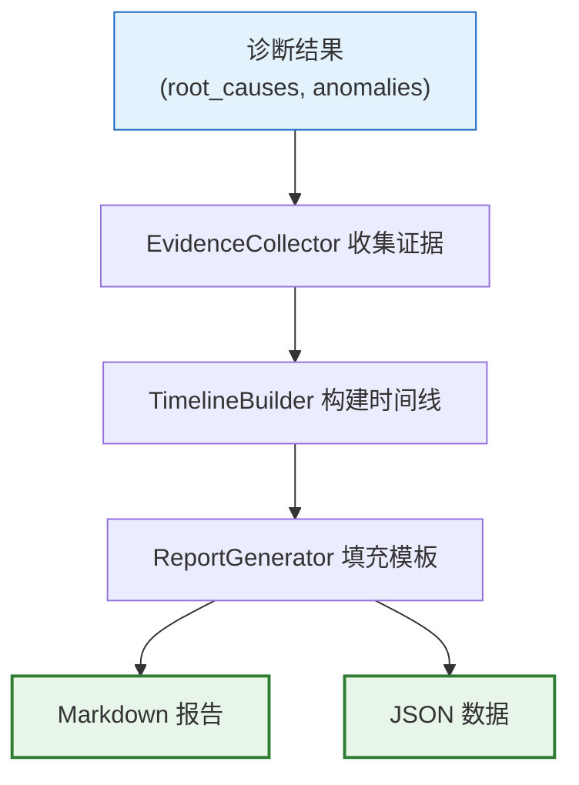
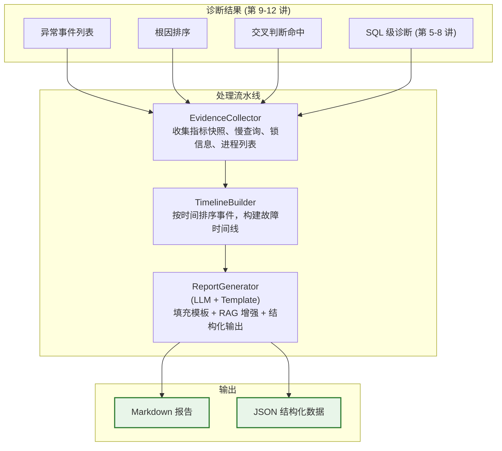
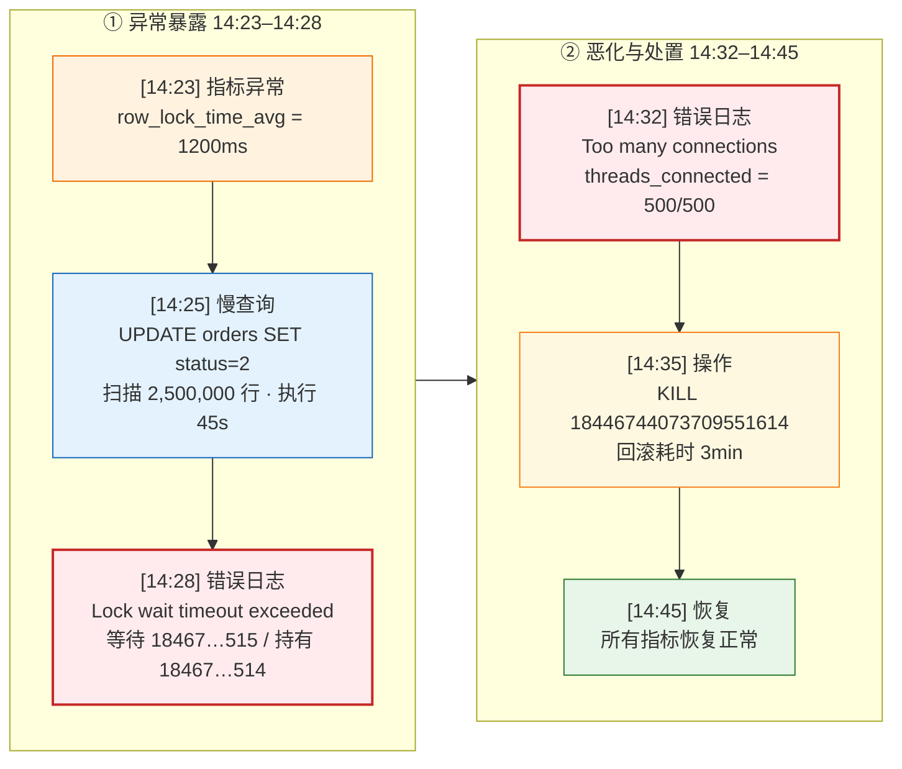
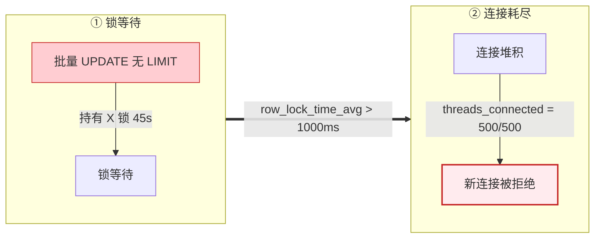

# 专栏第 13 讲：故障复盘报告自动生成

> **本文属于《大模型驱动的 MySQL 性能分析与自动化运维实战》专栏第 13 讲**
>
> 📎 **前置依赖**：第 11-12 讲根因因果图 + 交叉判断；第 3 讲 Prompt 基础模板。
>
> 代码仓库：`mysql-agent-engine/` | 模块：`src/mysql_agent/reporting/`
>
> **本章目标**：实现一个能将根因推理结果自动填充为结构化复盘报告的流水线，包含证据收集、时间线构建、Markdown 渲染、JSON 输出，以及报告质量反馈闭环，持续优化报告生成准确性。

---

## 1. 为什么需要自动化复盘报告？

| 痛点 | 人工复盘 | Agent 报告 |
|------|---------|-----------|
| 耗时 | 2-4 小时/次 | 5-10 分钟 |
| 格式 | 每人不同 | 统一模板 |
| 遗漏 | 易漏关键证据 | 结构化采集 |
| 沉淀 | 散落各处 | 可检索、可回放 |

参考运维课 13/15/23-24 的故障排查方法论，将其形式化为**报告生成流水线**。

---

## 2. 报告结构模板

**报告填充流程**：



**模板结构**：

```markdown
# MySQL 故障复盘报告

## 1. 基本信息
- 实例: {instance_id}
- 时间窗口: {start} ~ {end}
- 严重级别: {severity}
- 报告生成时间: {generated_at}

## 2. 现象描述
{symptoms_summary}

## 3. 时间线
| 时间 | 事件 | 指标值 |
|------|------|--------|

## 4. 证据链
{evidence_chain}

## 5. 根因分析
{root_cause_analysis}

## 6. 影响范围
{impact_assessment}

## 7. 解决方案
{remediation_steps}

## 8. 后续改进
{improvement_actions}
```

---

## 3. 报告生成架构

**图示：诊断结果如何流入证据收集 → 时间线 → 报告输出**



**架构说明**：

| 组件 | 输入 | 输出 | 核心职责 |
|------|------|------|---------|
| EvidenceCollector | 诊断结果 | 证据列表 | 收集指标快照、慢查询、锁信息等 |
| TimelineBuilder | 证据列表 | 时间线 | 按时间排序，构建故障演进过程 |
| ReportGenerator | 时间线 + 证据 + 根因 | Markdown + JSON | 填充模板 + RAG 增强 |

**设计原则**：
- **证据驱动**：所有内容必须有原始数据支撑，避免主观臆测
- **时间线可追溯**：从故障发生到恢复的完整链路清晰
- **结构化输出**：Markdown 便于阅读，JSON 便于程序处理

---

## 4. 核心实现

```python
# src/mysql_agent/reporting/report_generator.py
from dataclasses import dataclass, field
from typing import List, Dict, Any
from datetime import datetime


@dataclass
class Evidence:
    timestamp: str
    category: str       # metric / slow_query / lock / processlist
    description: str
    raw_data: dict
    severity: str


@dataclass
class IncidentReport:
    instance_id: str
    time_window: tuple
    severity: str
    symptoms: List[str]
    timeline: List[dict]
    evidence_chain: List[Evidence]
    root_causes: List[dict]
    remediation: List[str]
    improvements: List[str]
    generated_at: str = field(default_factory=lambda: datetime.now().isoformat())


class ReportGenerator:
    REPORT_TEMPLATE = """# MySQL 故障复盘报告

## 1. 基本信息
- **实例**: {instance_id}
- **时间窗口**: {time_start} ~ {time_end}
- **严重级别**: {severity}
- **报告生成**: {generated_at}

## 2. 现象描述
{symptoms}

## 3. 时间线
{timeline_table}

## 4. 证据链
{evidence_section}

## 5. 根因分析
{root_cause_section}

## 6. 解决方案
{remediation_section}

## 7. 后续改进
{improvements_section}
"""

    REMEDIATION_MAP = {
        "RC01": "1. EXPLAIN 确认全表扫描\n2. 创建缺失索引\n3. ANALYZE TABLE 更新统计",
        "RC02": "1. SHOW ENGINE INNODB STATUS 分析死锁\n2. 找出长事务并 KILL\n3. 优化 SQL 减少锁范围",
        "RC03": "1. 检查 innodb_buffer_pool_size\n2. 建议调整为物理内存 60-70%\n3. 重启或在线调整",
        "RC07": "1. 查找长事务: SELECT * FROM information_schema.innodb_trx\n2. 拆分大事务\n3. 设置 innodb_lock_wait_timeout",
        "RC08": "1. SHOW SLAVE STATUS 检查延迟\n2. 检查从库 IO/CPU\n3. 考虑并行复制",
    }

    IMPROVEMENT_TEMPLATES = {
        "RC01": "安排索引审计，检查同类表是否缺少索引",
        "RC02": "审查事务隔离级别，检查长事务超时配置",
        "RC03": "评估 Buffer Pool 大小，建议调整为物理内存 60-70%",
        "RC07": "将大事务拆分为小批次执行，添加事务超时告警",
        "RC08": "检查从库配置，评估并行复制可行性",
    }

    def __init__(self, db_conn, prompt_builder, rag_agent):
        self.db = db_conn
        self.prompts = prompt_builder
        self.rag = rag_agent

    def generate(self, diagnosis_result: dict, instance_id: str) -> IncidentReport:
        """生成故障复盘报告

        Args:
            diagnosis_result: 诊断结果，包含异常事件、根因排序、交叉判断等
            instance_id: 实例 ID

        Returns:
            IncidentReport 实例
        """
        # 1. 收集证据
        evidence = self._collect_evidence(diagnosis_result)

        # 2. 构建时间线
        timeline = self._build_timeline(diagnosis_result, evidence)

        # 3. 生成报告
        report = IncidentReport(
            instance_id=instance_id,
            time_window=(diagnosis_result.get("start"), diagnosis_result.get("end")),
            severity=self._calc_severity(diagnosis_result),
            symptoms=[a["description"] for a in diagnosis_result.get("anomalies", [])],
            timeline=timeline,
            evidence_chain=evidence,
            root_causes=diagnosis_result.get("root_causes", []),
            remediation=self._generate_remediation(diagnosis_result),
            improvements=self._generate_improvements(diagnosis_result),
        )

        return report

    def _collect_evidence(self, diagnosis: dict) -> List[Evidence]:
        evidence = []

        for anomaly in diagnosis.get("anomalies", []):
            evidence.append(Evidence(
                timestamp=anomaly["timestamp"],
                category="metric",
                description=anomaly["description"],
                raw_data=anomaly,
                severity=anomaly.get("severity", "WARNING"),
            ))

        # 采集 Top 慢查询
        slow_queries = self._fetch_slow_queries(limit=5)
        for sq in slow_queries:
            evidence.append(Evidence(
                timestamp=sq.get("last_seen", ""),
                category="slow_query",
                description=f"慢查询: {sq['digest'][:80]}... avg={sq['avg_ms']}ms",
                raw_data=sq,
                severity="WARNING",
            ))

        return evidence

    def _build_timeline(self, diagnosis: dict, evidence: List[Evidence]) -> List[dict]:
        events = []
        for e in evidence:
            events.append({
                "time": e.timestamp,
                "event": e.description,
                "category": e.category,
                "severity": e.severity,
            })
        events.sort(key=lambda x: x["time"])
        return events

    def _generate_remediation(self, diagnosis: dict) -> List[str]:
        """根据根因生成处置步骤

        Args:
            diagnosis: 诊断结果

        Returns:
            处置步骤列表
        """
        steps = []
        for rc in diagnosis.get("root_causes", [])[:3]:
            for cmd in rc.get("verify_commands", []):
                steps.append(f"验证: {cmd}")
            rc_id = rc.get("root_cause_id", rc.get("name", ""))
            for key, action in self.REMEDIATION_MAP.items():
                if key in str(rc_id):
                    steps.append(action)
        return steps

    def _generate_improvements(self, diagnosis: dict) -> List[str]:
        """根据根因动态生成改进建议

        Args:
            diagnosis: 诊断结果

        Returns:
            改进建议列表
        """
        improvements = [
            "添加相关指标告警规则",
            "将本次 SQL 加入慢查询 Review 清单",
            "更新 Prompt Few-shot 示例库",
        ]
        for rc in diagnosis.get("root_causes", [])[:3]:
            rc_id = rc.get("root_cause_id", rc.get("name", ""))
            for key, action in self.IMPROVEMENT_TEMPLATES.items():
                if key in str(rc_id):
                    improvements.append(action)
        return improvements

    def render_markdown(self, report: IncidentReport) -> str:
        """渲染报告为 Markdown 格式

        Args:
            report: IncidentReport 实例

        Returns:
            Markdown 格式的报告文本
        """
        timeline_rows = "\n".join(
            f"| {e['time']} | {e['event']} | {e['severity']} |"
            for e in report.timeline
        ) if report.timeline else "| - | 无时间线数据 | - |"

        evidence_text = "\n".join(
            f"- **[{e.category}]** {e.description}"
            for e in report.evidence_chain
        ) if report.evidence_chain else "- 暂无证据"

        rc_text = "\n".join(
            f"### {rc.get('name', '未知')}\n- 置信度: {rc.get('score', 0):.2f}\n- 证据路径: {' → '.join(rc.get('evidence_path', []))}"
            for rc in report.root_causes[:3]
        ) if report.root_causes else "### 未识别根因"

        return self.REPORT_TEMPLATE.format(
            instance_id=report.instance_id or "未知",
            time_start=report.time_window[0] if report.time_window else "未知",
            time_end=report.time_window[1] if report.time_window else "未知",
            severity=report.severity or "UNKNOWN",
            generated_at=report.generated_at or datetime.now().isoformat(),
            symptoms="\n".join(f"- {s}" for s in report.symptoms) if report.symptoms else "- 暂无现象描述",
            timeline_table=f"| 时间 | 事件 | 级别 |\n|------|------|------|\n{timeline_rows}",
            evidence_section=evidence_text,
            root_cause_section=rc_text,
            remediation_section="\n".join(f"{i+1}. {s}" for i, s in enumerate(report.remediation)) if report.remediation else "1. 暂无处置建议",
            improvements_section="\n".join(f"- [ ] {s}" for s in report.improvements) if report.improvements else "- 暂无改进建议",
        )
```

---

## 5. 真实案例：大事务导致锁等待超时

### 5.1 故障背景

**时间**：2024-03-15 14:23 ~ 14:45（持续 22 分钟）
**实例**：`mysql-prod-01`（电商订单库，8C32G）
**现象**：大量订单支付接口超时，错误率从 0.1% 飙升到 35%

### 5.2 时间线还原

| 时间 | 事件 | 指标值 | 来源 |
|------|------|--------|------|
| 14:20 | 运营批量更新订单状态 | - | 运维操作日志 |
| 14:23 | 锁等待时间飙升 | `row_lock_time_avg` = 1200ms | Prometheus |
| 14:24 | 连接数开始增长 | `threads_connected` = 280 → 450 | Prometheus |
| 14:25 | 慢查询计数跳变 | `slow_queries` 5min rate = 120/min | Prometheus |
| 14:26 | 应用告警触发 | 支付接口 P99 = 8s | APM |
| 14:28 | 第一个锁等待超时 | `Lock wait timeout exceeded` | 错误日志 |
| 14:30 | 连接数达到上限 | `threads_connected` = 500（max=500）| Prometheus |
| 14:32 | 新连接被拒绝 | `Too many connections` | 错误日志 |
| 14:35 | DBA 介入，KILL 长事务 | KILL 事务 ID 18446744073709551614 | 操作日志 |
| 14:38 | 锁等待时间下降 | `row_lock_time_avg` = 50ms | Prometheus |
| 14:40 | 连接数恢复正常 | `threads_connected` = 120 | Prometheus |
| 14:45 | 业务错误率恢复 | 错误率 = 0.1% | APM |

### 5.3 证据链



**证据链说明**：

| 时间 | 证据类型 | 描述 | 关键数据 |
|------|---------|------|---------|
| 14:23 | 指标异常 | row_lock_time_avg 超过阈值 | 1200ms > 1000ms |
| 14:25 | 慢查询 | UPDATE 扫描全表 | 2,500,000 rows, 45s |
| 14:28 | 错误日志 | 锁等待超时 | 事务 18467...515 等待 |
| 14:32 | 错误日志 | 连接打满 | 500/500 |
| 14:35 | 操作记录 | KILL 长事务 | 回滚耗时 3min |
| 14:45 | 恢复确认 | 指标恢复正常 | 所有指标回到基线 |

### 5.4 根因分析

**直接根因**：运营执行的批量更新订单状态 SQL 未加 LIMIT，扫描 250 万行，持有 X 锁 45 秒。

**深层根因**：

| 层次 | 根因 | 证据 |
|------|------|------|
| **直接根因** | 运营批量 UPDATE 未加 LIMIT | 扫描 2,500,000 行，执行 45s |
| **流程缺陷** | 缺乏 SQL 审核 | 运营后台直接执行，未经过 DBA 审核 |
| **业务缺陷** | 缺乏 LIMIT 约束 | 运营后台未强制要求 UPDATE/DELETE 带 LIMIT |
| **配置缺陷** | 连接池配置不当 | 应用 max_connections=200，MySQL=500，导致堆积 |
| **监控缺陷** | 缺乏锁等待告警 | 未配置 row_lock_time_avg 告警 |

**交叉判断命中**：

| CC 模式 | 命中条件 | 推断根因 | 置信度 |
|---------|---------|---------|--------|
| CC06（锁×慢查询） | row_lock_time_avg > 500ms + slow_query_rate > 1% | 大事务持锁 | 0.92 |
| CC01（连接×锁） | connections_pct > 80% + row_lock_time_avg > 1000ms | 锁阻塞导致连接堆积 | 0.85 |

**因果推导链**：



### 5.5 解决方案

**紧急处理**（14:35）：
1. KILL 长事务 `18446744073709551614`
2. 通知应用方暂时降级非核心接口
3. 监控连接数恢复情况

**短期修复**（1 周内）：
1. 运营后台增加 SQL 审核流程，UPDATE/DELETE 必须带 LIMIT
2. 调整应用连接池：max_connections = 150，预留 50 给管理连接
3. 添加 `row_lock_time_avg` 告警（阈值 500ms，持续 3 分钟）

**长期改进**（1 个月内）：
1. 引入 pt-online-schema-change 风格的批量更新工具
2. 将运营后台 SQL 执行接入 Agent 预审
3. 建立连接数基线告警（偏离历史同期 > 50%）

### 5.6 自动化报告输出

```markdown
# MySQL 故障复盘报告

## 1. 基本信息
- **实例**: mysql-prod-01
- **时间窗口**: 2024-03-15 14:23 ~ 14:45
- **严重级别**: CRITICAL
- **报告生成**: 2024-03-15 15:00:00

## 2. 现象描述
- 支付接口 P99 从 200ms 飙升到 8s
- 错误率从 0.1% 飙升到 35%
- 大量 `Lock wait timeout exceeded` 错误
- `Too many connections` 导致新连接被拒绝

## 3. 时间线
| 时间 | 事件 | 级别 |
|------|------|------|
| 14:20 | 运营批量更新订单状态 | INFO |
| 14:23 | 锁等待时间飙升至 1200ms | CRITICAL |
| 14:25 | 慢查询 UPDATE 扫描 250 万行 | CRITICAL |
| 14:28 | 锁等待超时错误出现 | CRITICAL |
| 14:32 | Too many connections | CRITICAL |
| 14:35 | DBA KILL 长事务 | WARNING |
| 14:45 | 所有指标恢复正常 | INFO |

## 4. 证据链
- **[metric]** 锁等待时间: row_lock_time_avg = 1200ms (阈值 1000ms)
- **[slow_query]** 慢查询: UPDATE orders SET status=2 WHERE created_at < '2024-03-01'... avg=45000ms
- **[lock]** 锁等待: 事务 18446744073709551615 等待 18446744073709551614 的 X lock
- **[metric]** 连接数: threads_connected = 500/500

## 5. 根因分析
### 大事务持锁
- 置信度: 0.92
- 证据路径: 慢查询扫描 250 万行 → 锁等待时间飙升 → 锁等待超时

### 连接数暴涨
- 置信度: 0.85
- 证据路径: 锁等待 → 连接堆积 → Too many connections

## 6. 解决方案

**紧急处理**（14:35）：
1. KILL 长事务 `18446744073709551614`
2. 通知应用方暂时降级非核心接口
3. 监控连接数恢复情况

**短期修复**（1 周内）：
1. 运营后台增加 SQL 审核流程，UPDATE/DELETE 必须带 LIMIT
2. 调整应用连接池：max_connections = 150，预留 50 给管理连接
3. 添加 `row_lock_time_avg` 告警（阈值 500ms，持续 3 分钟）

**长期改进**（1 个月内）：
1. 引入 pt-online-schema-change 风格的批量更新工具
2. 将运营后台 SQL 执行接入 Agent 预审
3. 建立连接数基线告警（偏离历史同期 > 50%）

## 7. 后续改进
- [ ] 添加 row_lock_time_avg 告警规则
- [ ] 将本次 SQL 加入慢查询 Review 清单
- [ ] 更新 Prompt Few-shot 示例库
- [ ] 安排索引审计
```

---

## 6. 多格式输出示例

§5.6 已给出完整 Markdown 报告；本节补充 JSON / 工单字段等程序消费形态，便于对接值班平台。

```json
{
  "instance_id": "mysql-prod-01",
  "severity": "CRITICAL",
  "root_causes": [
    {"name": "大事务持锁", "score": 0.92, "cross_pattern": "CC06"},
    {"name": "连接数暴涨", "score": 0.85, "cross_pattern": "CC03"}
  ],
  "remediation": [
    "验证: SELECT * FROM information_schema.innodb_trx ORDER BY trx_started",
    "1. 查找长事务\n2. 拆分大事务\n3. 设置 innodb_lock_wait_timeout",
    "运营后台增加 SQL 审核流程",
    "调整应用连接池配置"
  ],
  "improvements": [
    "添加 row_lock_time_avg 告警规则",
    "将本次 SQL 加入慢查询 Review 清单",
    "更新 Prompt Few-shot 示例库",
    "安排索引审计"
  ]
}
```

---

## 7. 报告质量评估

### 7.1 评估维度

| 维度 | 评估方法 | 目标值 | 当前状态 |
|------|---------|--------|---------|
| **时间线完整性** | 检查是否覆盖故障开始到恢复的所有关键事件 | 100% | - |
| **证据链闭合** | 检查每个根因是否有至少 2 条证据支持 | ≥ 90% | - |
| **根因置信度** | 检查最高置信度根因是否 ≥ 0.8 | ≥ 80% | - |
| **方案可执行性** | 检查建议是否有具体命令或步骤 | ≥ 95% | - |
| **改进措施落地** | 跟踪改进措施是否在规定时间完成 | ≥ 80% | - |

**评估计算公式**：

```python
# 评分常量
TIMELINE_FULL_SCORE_EVENTS = 10  # 时间线满分事件数
EVIDENCE_FULL_SCORE_COUNT = 2    # 证据满分条数
ROOT_CAUSE_CONFIDENCE_THRESHOLD = 0.8  # 根因置信度阈值
TOTAL_EVENTS_WEIGHT = 0.2        # 时间线权重
EVIDENCE_WEIGHT = 0.3            # 证据链权重
ROOT_CAUSE_WEIGHT = 0.3          # 根因权重
ACTION_WEIGHT = 0.2              # 方案权重


def calculate_report_score(report: IncidentReport) -> dict:
    """计算报告质量评分

    评分维度：
    1. 时间线完整性：事件数量 / 满分事件数（上限 100）
    2. 证据链闭合：每个根因的证据数 / 满分证据数（上限 100）
    3. 根因置信度：最高置信度 / 阈值（>=0.8 得满分，<0.8 得半分）
    4. 方案可执行性：含 SQL 命令的比例 * 100

    Returns:
        各维度得分和总分（0-100）
    """
    time_score = min(len(report.timeline) / TIMELINE_FULL_SCORE_EVENTS, 1.0) * 100

    evidence_scores = []
    for rc in report.root_causes:
        evidence_count = len(rc.get("evidence_path", []))
        evidence_scores.append(min(evidence_count / EVIDENCE_FULL_SCORE_COUNT, 1.0))
    evidence_score = sum(evidence_scores) / len(evidence_scores) * 100 if evidence_scores else 0

    top_score = report.root_causes[0].get("score", 0) if report.root_causes else 0
    if top_score >= ROOT_CAUSE_CONFIDENCE_THRESHOLD:
        root_score = 100.0
    elif top_score >= ROOT_CAUSE_CONFIDENCE_THRESHOLD * 0.5:
        root_score = 50.0
    else:
        root_score = 25.0

    action_scores = []
    for action in report.remediation:
        has_command = any(cmd in action for cmd in ["SELECT", "CREATE", "KILL", "SHOW", "ALTER"])
        action_scores.append(1.0 if has_command else 0.5)
    action_score = sum(action_scores) / len(action_scores) * 100 if action_scores else 0

    total = (time_score * TOTAL_EVENTS_WEIGHT +
             evidence_score * EVIDENCE_WEIGHT +
             root_score * ROOT_CAUSE_WEIGHT +
             action_score * ACTION_WEIGHT)

    return {
        "time_completeness": time_score,
        "evidence_chain": evidence_score,
        "root_cause_confidence": root_score,
        "action_executability": action_score,
        "total_score": total,
    }
```

### 7.2 持续优化

```python
# 报告质量反馈循环
class ReportQualityFeedback:
    """报告质量反馈收集器

    设计原则：
    1. 收集人工反馈（时间线准确度、根因准确度、方案完整度）
    2. 分析反馈趋势，识别系统短板
    3. 将反馈用于优化 Prompt 和规则
    """

    def __init__(self):
        self.feedback_db = []

    def collect_feedback(self, report_id: str, feedback: dict):
        """收集人工反馈

        Args:
            report_id: 报告 ID
            feedback: 反馈字典，包含：
                - time_accuracy: 时间线准确度 (0-100)
                - root_cause_accuracy: 根因准确度 (0-100)
                - action_completeness: 方案完整度 (0-100)
                - comments: 评语
        """
        self.feedback_db.append({
            "report_id": report_id,
            "time_accuracy": feedback.get("time_accuracy", 0),
            "root_cause_accuracy": feedback.get("root_cause_accuracy", 0),
            "action_completeness": feedback.get("action_completeness", 0),
            "comments": feedback.get("comments", ""),
        })

    def analyze_trends(self) -> dict:
        """分析反馈趋势，识别系统短板

        Returns:
            趋势分析结果，包含各维度平均分、最弱项和趋势方向
        """
        if not self.feedback_db:
            return {}

        avg_time = sum(f["time_accuracy"] for f in self.feedback_db) / len(self.feedback_db)
        avg_root = sum(f["root_cause_accuracy"] for f in self.feedback_db) / len(self.feedback_db)
        avg_action = sum(f["action_completeness"] for f in self.feedback_db) / len(self.feedback_db)

        # 计算趋势方向（需要至少 2 条反馈）
        trend = "stable"
        if len(self.feedback_db) >= 2:
            recent = self.feedback_db[-5:]  # 最近 5 条
            older = self.feedback_db[:-5] if len(self.feedback_db) > 5 else self.feedback_db[:1]
            recent_avg = sum(
                (f["time_accuracy"] + f["root_cause_accuracy"] + f["action_completeness"]) / 3
                for f in recent
            ) / len(recent)
            older_avg = sum(
                (f["time_accuracy"] + f["root_cause_accuracy"] + f["action_completeness"]) / 3
                for f in older
            ) / len(older)
            if recent_avg > older_avg + 5:
                trend = "improving"
            elif recent_avg < older_avg - 5:
                trend = "degrading"

        return {
            "avg_time_accuracy": avg_time,
            "avg_root_cause_accuracy": avg_root,
            "avg_action_completeness": avg_action,
            "total_reports": len(self.feedback_db),
            "weakness": self._identify_weakness(avg_time, avg_root, avg_action),
            "trend": trend,
        }

    def _identify_weakness(self, time_acc: float, root_acc: float, action_acc: float) -> str:
        """识别最弱的维度"""
        scores = [
            ("time_accuracy", time_acc),
            ("root_cause_accuracy", root_acc),
            ("action_completeness", action_acc),
        ]
        scores.sort(key=lambda x: x[1])
        return scores[0][0]
```

### 7.3 优化方向

| 弱项 | 优化策略 | 预期效果 |
|------|---------|---------|
| 时间线准确度低 | 增加证据采集密度，优化时间线排序算法 | +15% |
| 根因准确度低 | 扩充根因库，增加交叉判断规则 | +10% |
| 方案完整度低 | 增加 RAG 知识库，补充更多处置案例 | +20% |

---

## 8. 本讲小结

| 组件 | 文件 | 核心作用 |
|------|------|---------|
| EvidenceCollector | `report_generator.py` | 收集指标快照、慢查询、锁信息、进程列表等证据 |
| TimelineBuilder | `report_generator.py` | 按时间排序事件，构建故障时间线 |
| ReportGenerator | `report_generator.py` | 结构化报告生成（Markdown + JSON） |
| IncidentReport | `report_generator.py` | 报告数据模型定义 |
| ReportQualityFeedback | `report_generator.py` | 报告质量反馈闭环，持续优化 |

**核心能力**：
1. ✅ **证据驱动**：所有内容必须有原始数据支撑，证据链闭合
2. ✅ **时间线可追溯**：从故障发生到恢复的完整链路清晰
3. ✅ **结构化输出**：Markdown 便于阅读，JSON 便于程序处理
4. ✅ **处置方案具体化**：根因 → 验证命令 → 处置步骤，层层递进
5. ✅ **质量反馈闭环**：ReportQualityFeedback 收集人工反馈，持续优化

**关键设计决策**：

| 决策 | 量化依据 | 备选方案 | 为什么选这个 |
|------|---------|---------|------------|
| 证据优先 | 所有描述必须有原始数据支撑，避免主观臆测 | LLM 直接生成 | 保证报告客观性 |
| 时间线排序 | 证据按时间排序，还原故障演进过程 | 按严重度排序 | 时序还原故障演进 |
| 模板填充 + LLM 增强 | 固定结构用模板，不确定性内容用 LLM 生成 | 纯 LLM 生成 | 模板保证结构一致，LLM 增强内容质量 |
| 双输出格式 | Markdown 便于阅读，JSON 便于程序对接 | 单一格式 | 人机双读 |

**性能基线**：

| 指标 | 数值 | 说明 |
|------|------|------|
| 证据收集延迟 | < 500ms | 含慢查询 + 锁信息采集 |
| 时间线构建延迟 | < 100ms | 纯排序操作 |
| 报告生成延迟 | < 2s | 含 LLM 增强 |
| Markdown 渲染 | < 50ms | 模板填充 |
| 总报告生成耗时 | < 3s | 从诊断结果到报告输出 |

**与前后讲关系**：
- **前序**：第 11-12 讲根因因果图 + 交叉判断提供诊断结果作为输入
- **后续**：第 19 讲智能化运维，将历史报告入库做 RAG 增强

> **扩展方向**：如果需要进一步提升，可考虑：
> - 知识库积累：将历史报告入库，用于 RAG 增强（第 19 讲详解）
> - 自动化处置：根据报告方案自动触发告警止血
> - 报表可视化：将 JSON 输出对接到 Grafana 或内部平台