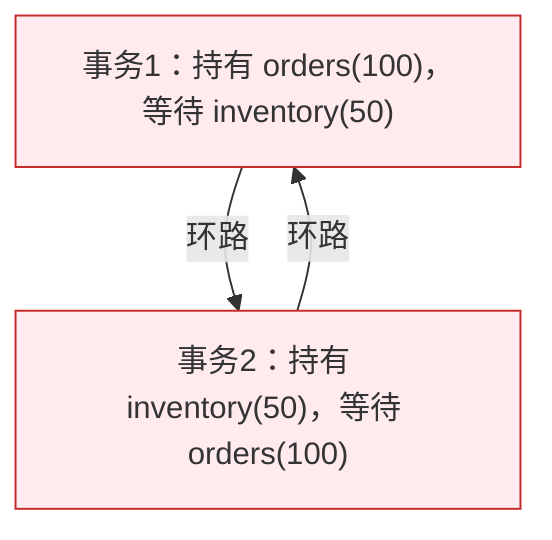
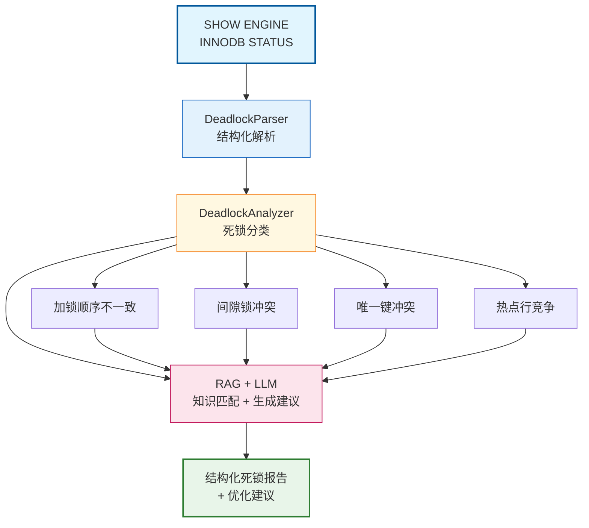
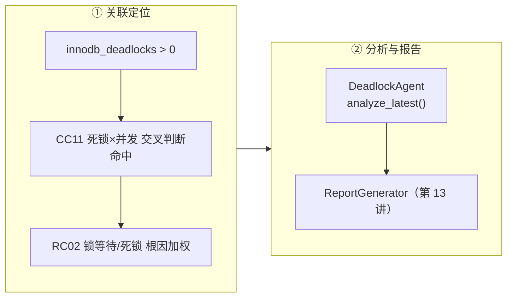

# 专栏第 14 讲：死锁自动分析与解锁建议

> **本文属于《大模型驱动的 MySQL 性能分析与自动化运维实战》专栏第 14 讲**
>
> **作者**: 李文
>
> 📎 **前置依赖**：第 11 讲 RC02 死锁根因；第 12 讲 CC11 死锁×并发交叉判断。
>
> 代码仓库：`mysql-agent-engine/` | 模块：`src/mysql_agent/deadlock/`

> **本章目标**：
> - 掌握 `SHOW ENGINE INNODB STATUS` 死锁段的结构化解析
> - 理解四类典型死锁（加锁顺序、间隙锁、唯一键、热点行）的成因与避免策略
> - 能够根据死锁特征自动分类并生成优化建议
> - 了解与第 11-12 讲根因因果图 / 交叉诊断的联动方式

---

## 1. 死锁分析的挑战

MySQL 死锁信息藏在 `SHOW ENGINE INNODB STATUS` 的 `LATEST DETECTED DEADLOCK` 段中：

**死锁环路示意**：



**原始输出示例**：

```
------------------------
LATEST DETECTED DEADLOCK
------------------------
2024-01-15 14:30:22
*** (1) TRANSACTION:
TRANSACTION 421957, ACTIVE 0 sec starting index read
mysql tables in use 1, locked 1
LOCK WAIT 3 lock struct(s), heap size 1136, 2 row lock(s)
MySQL thread id 12345, OS thread handle 140234567890
*** (1) WAITING FOR THIS LOCK TO BE GRANTED:
RECORD LOCKS space id 88 page no 5 n bits 80 index PRIMARY of table `db`.`orders`
*** (2) TRANSACTION:
...
*** WE ROLL BACK TRANSACTION (2)
```

人工解析耗时且易错；Agent 需要**结构化解析 + 根因推理 + 避免建议**。

---

## 2. 死锁分析架构

**图示：解析 → 四类分类 → RAG 建议 → 结构化报告**



**架构说明**：

| 组件 | 输入 | 输出 | 核心职责 |
|------|------|------|---------|
| DeadlockParser | INNODB STATUS 原始文本 | DeadlockInfo 结构体 | 正则解析死锁段，提取两事务的持有锁/等待锁 |
| DeadlockAnalyzer | DeadlockInfo | 分类结果 + 建议 | 根据锁模式、SQL 特征判断死锁类型 |
| RAG + LLM | 分类结果 | 知识库匹配 + 避免建议 | 检索历史案例，生成针对性优化方案 |

**设计原则**：
1. **解析先行**：Parser 负责忠实还原 INNODB STATUS 信息，不做判断
2. **分类独立**：Analyzer 只做确定性分类，不确定时返回 `unknown`
3. **知识增强**：RAG 层引入历史案例，避免建议更贴合实际

---

## 3. 死锁解析器

```python
# src/mysql_agent/deadlock/models.py（`DeadlockInfo` / `DeadlockTransaction` / `LockInfo`；解析在 `deadlock_parser.py`）
import re
from dataclasses import dataclass, field
from typing import List, Optional


@dataclass
class LockInfo:
    lock_type: str          # RECORD / TABLE / GAP / NEXT-KEY
    table: str
    index: str
    mode: str               # S / X / IS / IX
    waiting: bool = False


@dataclass
class DeadlockTransaction:
    trx_id: str
    thread_id: int
    query_text: str
    locks_held: List[LockInfo] = field(default_factory=list)
    locks_waiting: List[LockInfo] = field(default_factory=list)


@dataclass
class DeadlockInfo:
    timestamp: str
    transaction_1: DeadlockTransaction
    transaction_2: DeadlockTransaction
    victim: int             # 1 or 2
    raw_text: str


class DeadlockParser:
    """解析 SHOW ENGINE INNODB STATUS 中的死锁段"""

    DEADLOCK_SECTION = re.compile(
        r"LATEST DETECTED DEADLOCK\s+(.*?)(?:\n-{20,}|\Z)",
        re.DOTALL,
    )
    TRX_BLOCK = re.compile(
        r"\*\*\* \((\d)\) TRANSACTION:(.*?)(?=\*\*\* \(\d\) TRANSACTION:|\*\*\* WE ROLL BACK|\Z)",
        re.DOTALL,
    )
    WAITING_LOCK = re.compile(
        r"\*\*\* \(\d\) WAITING FOR THIS LOCK TO BE GRANTED:(.*?)(?=\*\*\*|\Z)",
        re.DOTALL,
    )
    HOLDS_LOCK = re.compile(
        r"\*\*\* \(\d\) HOLDS THE LOCK\(S\):(.*?)(?=\*\*\*|\Z)",
        re.DOTALL,
    )
    ROLLBACK = re.compile(r"WE ROLL BACK TRANSACTION \((\d)\)")

    def parse(self, innodb_status: str) -> Optional[DeadlockInfo]:
        section_match = self.DEADLOCK_SECTION.search(innodb_status)
        if not section_match:
            return None

        section = section_match.group(1)
        lines = section.strip().split("\n")
        timestamp = lines[0].strip() if lines else ""

        transactions = {}
        for match in self.TRX_BLOCK.finditer(section):
            trx_num = int(match.group(1))
            trx_text = match.group(2)
            transactions[trx_num] = self._parse_transaction(trx_num, trx_text)

        victim_match = self.ROLLBACK.search(section)
        victim = int(victim_match.group(1)) if victim_match else 2

        if 1 not in transactions or 2 not in transactions:
            return None

        return DeadlockInfo(
            timestamp=timestamp,
            transaction_1=transactions[1],
            transaction_2=transactions[2],
            victim=victim,
            raw_text=section,
        )

    def _parse_transaction(self, num: int, text: str) -> DeadlockTransaction:
        trx_id_match = re.search(r"TRANSACTION (\d+)", text)
        thread_match = re.search(r"MySQL thread id (\d+)", text)
        query_match = re.search(r"(?:query|MySQL thread.*?\n)(.*?)(?:\*\*\*|$)", text, re.DOTALL)

        locks_held = self._parse_locks(text, "HOLDS THE LOCK")
        locks_waiting = self._parse_locks(text, "WAITING FOR THIS LOCK")

        return DeadlockTransaction(
            trx_id=trx_id_match.group(1) if trx_id_match else "",
            thread_id=int(thread_match.group(1)) if thread_match else 0,
            query_text=query_match.group(1).strip() if query_match else "",
            locks_held=locks_held,
            locks_waiting=locks_waiting,
        )

    def _parse_locks(self, text: str, keyword: str) -> List[LockInfo]:
        locks = []
        pattern = re.compile(
            rf"{keyword}.*?:\s*(.*?)(?=\*\*\*|\Z)", re.DOTALL
        )
        match = pattern.search(text)
        if not match:
            return locks

        for line in match.group(1).strip().split("\n"):
            table_match = re.search(r"table `(\w+)`\.`(\w+)`", line)
            index_match = re.search(r"index (\w+)", line)
            mode_match = re.search(r"lock_mode (\w+)", line)
            if table_match:
                locks.append(LockInfo(
                    lock_type="RECORD" if "RECORD" in line else "TABLE",
                    table=f"{table_match.group(1)}.{table_match.group(2)}",
                    index=index_match.group(1) if index_match else "PRIMARY",
                    mode=mode_match.group(1) if mode_match else "X",
                    waiting="WAITING" in keyword,
                ))
        return locks
```

**解析原理说明**：

`DeadlockParser` 使用四组正则表达式分层提取死锁信息：

| 正则 | 作用 | 提取目标 |
|------|------|---------|
| `DEADLOCK_SECTION` | 定位死锁段起止 | `LATEST DETECTED DEADLOCK` 到下一个分隔线 |
| `TRX_BLOCK` | 提取事务块 | 事务 ID、线程 ID、SQL 文本 |
| `WAITING_LOCK` | 提取等待锁 | 事务正在等待的锁信息 |
| `HOLDS_LOCK` | 提取持有锁 | 事务已持有的锁信息 |

**关键设计**：Parser 只做忠实还原，不做任何判断。这样即使死锁格式变化，只需调整正则，不影响分类逻辑。

---

## 4. 死锁分类与建议

| 类型 | 特征 | 典型案例 | 避免策略 |
|------|------|---------|---------|
| 加锁顺序不一致 | 两事务以不同顺序访问相同行 | UPDATE A→B vs UPDATE B→A | 统一加锁顺序 |
| 间隙锁冲突 | INSERT 与 SELECT FOR UPDATE | 并发插入相同范围 | 降低隔离级别或改用 RC |
| 唯一键冲突 | INSERT 等待 X 锁 | 并发 INSERT 相同唯一值 | INSERT IGNORE / 重试 |
| 外键级联 | 父表 DELETE + 子表 INSERT | 级联锁 | 调整外键策略 |

```python
# src/mysql_agent/deadlock/deadlock_analyzer.py
class DeadlockAnalyzer:
    def classify(self, info: DeadlockInfo) -> dict:
        t1, t2 = info.transaction_1, info.transaction_2

        t1_tables = {l.table for l in t1.locks_held + t1.locks_waiting}
        t2_tables = {l.table for l in t2.locks_held + t2.locks_waiting}
        common_tables = t1_tables & t2_tables

        if self._is_gap_lock_conflict(t1, t2):
            return {
                "type": "gap_lock",
                "description": "间隙锁冲突：INSERT 与 SELECT FOR UPDATE 竞争",
                "suggestions": [
                    "考虑将隔离级别从 REPEATABLE READ 降为 READ COMMITTED",
                    "避免在 RR 下对范围做 SELECT FOR UPDATE",
                ],
            }

        if self._is_lock_order_issue(t1, t2, common_tables):
            return {
                "type": "lock_order",
                "description": "加锁顺序不一致",
                "suggestions": [
                    "统一事务中的表访问顺序",
                    f"事务1 SQL: {t1.query_text[:100]}",
                    f"事务2 SQL: {t2.query_text[:100]}",
                    "考虑按主键排序后批量更新",
                ],
            }

        if self._is_unique_key_conflict(t1, t2):
            return {
                "type": "unique_key",
                "description": "唯一键冲突：并发 INSERT 相同唯一值",
                "suggestions": [
                    "应用层使用分布式锁控制并发插入",
                    "改用 INSERT IGNORE 忽略重复键",
                    "或改用 ON DUPLICATE KEY UPDATE 处理冲突",
                    "高并发场景建议先查询再决定插入或更新",
                ],
            }

        if self._is_hotspot_contention(t1, t2):
            return {
                "type": "hotspot",
                "description": "热点行竞争：多事务同时更新同一行（RC16）",
                "suggestions": [
                    "短期：Redis 预扣库存 + 异步落库",
                    "中期：按主键分片，分散热点",
                    "长期：业务层拆分，减少同一行并发",
                    "参考第 11 讲 RC16 根因分析",
                ],
            }

        return {
            "type": "unknown",
            "description": "需进一步分析",
            "suggestions": ["检查完整 INNODB STATUS 输出"],
        }

    def _is_gap_lock_conflict(self, t1, t2) -> bool:
        for lock in t1.locks_held + t2.locks_held:
            if "INSERT" in (t1.query_text + t2.query_text).upper():
                if any(l.mode in ("X", "S") for l in t1.locks_waiting + t2.locks_waiting):
                    return True
        return False

    def _is_lock_order_issue(self, t1, t2, common_tables) -> bool:
        """检测加锁顺序不一致

        原理：两事务访问相同的表集合，但加锁顺序不同
        例如：T1 先 A 后 B，T2 先 B 后 A
        """
        if len(common_tables) < 2:
            return False

        # 提取每个事务的加锁顺序（按表名排序后对比）
        t1_order = [l.table for l in t1.locks_held if l.table in common_tables]
        t2_order = [l.table for l in t2.locks_held if l.table in common_tables]

        # 如果两事务持有相同表的锁，但顺序不同
        return t1_order != t2_order and set(t1_order) == set(t2_order)

    def _is_unique_key_conflict(self, t1, t2) -> bool:
        """检测唯一键冲突

        原理：两事务都执行 INSERT/UPDATE 相同唯一索引
        特征：等待锁模式为 X（排他锁），且 SQL 包含 INSERT 或 ON DUPLICATE KEY
        """
        for waiting_lock in t1.locks_waiting + t2.locks_waiting:
            if waiting_lock.mode == "X":
                t1_sql = (t1.query_text + t2.query_text).upper()
                if any(kw in t1_sql for kw in ["INSERT", "ON DUPLICATE KEY", "REPLACE"]):
                    return True
        return False

    def _is_hotspot_contention(self, t1, t2) -> bool:
        """检测热点行竞争

        原理：两事务同时 UPDATE 同一行（RC16 场景）
        特征：持有锁和等待锁都在同一表的同一索引同一记录
        """
        for l1 in t1.locks_held:
            for l2 in t2.locks_waiting:
                if l1.table == l2.table and l1.index == l2.index:
                    return True
        for l1 in t2.locks_held:
            for l2 in t1.locks_waiting:
                if l1.table == l2.table and l1.index == l2.index:
                    return True
        return False
```

**分类逻辑说明**：

`DeadlockAnalyzer.classify()` 按优先级依次检测四类死锁：

| 优先级 | 检测方法 | 判断依据 | 为什么这个优先级 |
|--------|---------|---------|----------------|
| 1 | `_is_gap_lock_conflict()` | INSERT + SELECT FOR UPDATE | 间隙锁冲突在 RR 下最常见 |
| 2 | `_is_lock_order_issue()` | 两事务访问相同表但顺序不同 | 加锁顺序不一致是经典环路 |
| 3 | `_is_unique_key_conflict()` | INSERT + X 锁 | 唯一键冲突通常由并发 INSERT 引起 |
| 4 | `_is_hotspot_contention()` | 同表同索引同行 | 热点行竞争需要业务层优化 |

**设计原则**：分类结果返回确定性结论，不确定时返回 `unknown`，避免误判。LLM 层负责生成更详细的自然语言建议。

---

## 5. Deadlock Agent 主流程

```python
# src/mysql_agent/agents/deadlock_agent.py
class DeadlockAgent:
    def __init__(self, db_conn, parser, analyzer, rag_agent):
        self.db = db_conn
        self.parser = parser
        self.analyzer = analyzer
        self.rag = rag_agent

    def analyze_latest(self) -> dict:
        """分析最近的死锁

        Returns:
            结构化死锁报告，包含：
            - timestamp: 死锁发生时间
            - victim_transaction: 被回滚的事务号 (1 或 2)
            - transaction_1/2: 两事务的详细信息
            - classification: 分类结果 + 建议
            - knowledge_refs: RAG 检索到的历史案例
        """
        status = self._fetch_innodb_status()
        info = self.parser.parse(status)

        if not info:
            return {"status": "no_deadlock", "message": "未检测到近期死锁"}

        classification = self.analyzer.classify(info)
        knowledge = self.rag.retrieve("MySQL 死锁 " + classification["type"])

        return {
            "timestamp": info.timestamp,
            "victim_transaction": info.victim,
            "transaction_1": {
                "trx_id": info.transaction_1.trx_id,
                "sql": info.transaction_1.query_text,
                "locks_held": [l.__dict__ for l in info.transaction_1.locks_held],
                "locks_waiting": [l.__dict__ for l in info.transaction_1.locks_waiting],
            },
            "transaction_2": {
                "trx_id": info.transaction_2.trx_id,
                "sql": info.transaction_2.query_text,
                "locks_held": [l.__dict__ for l in info.transaction_2.locks_held],
                "locks_waiting": [l.__dict__ for l in info.transaction_2.locks_waiting],
            },
            "classification": classification,
            "knowledge_refs": self.rag.format_context(knowledge),
        }

    def _fetch_innodb_status(self) -> str:
        """获取 INNODB 状态信息"""
        result = self.db.execute("SHOW ENGINE INNODB STATUS")
        return result[0]["Status"] if result else ""
```

**端到端流程说明**：

`DeadlockAgent.analyze_latest()` 的执行流程：

```
SHOW ENGINE INNODB STATUS → DeadlockParser.parse() → DeadlockAnalyzer.classify() → RAG 检索 → 结构化报告
```

| 步骤 | 组件 | 输入 | 输出 |
|------|------|------|------|
| 1 | `_fetch_innodb_status()` | 数据库连接 | INNODB STATUS 原始文本 |
| 2 | `parser.parse()` | 原始文本 | DeadlockInfo 结构体 |
| 3 | `analyzer.classify()` | DeadlockInfo | 分类结果 + 建议 |
| 4 | `rag.retrieve()` | 分类结果 | 历史案例 |
| 5 | `rag.format_context()` | 案例列表 | 格式化文本 |

**设计要点**：当 `parser.parse()` 返回 `None`（无死锁）时，直接返回 `no_deadlock`，避免后续组件空指针。

## 6. InnoDB 锁类型速查（解析基础）

| 锁类型 | 触发场景 | 死锁中的角色 | 说明 |
|--------|---------|-------------|------|
| Record Lock | 精确匹配索引记录 | 最常见，UPDATE 同一行 | 锁定单条索引记录 |
| Gap Lock | RR 隔离级别范围扫描 | INSERT vs SELECT FOR UPDATE | 锁定区间，不包括记录本身 |
| Next-Key Lock | Record + Gap | 范围 UPDATE/DELETE | RR 下默认行为 |
| Insert Intention Lock | INSERT 等待间隙 | 并发 INSERT 同范围 | 间隙锁的一种，唤醒等待者 |
| MDL | DDL 操作 | CC12 模式，非典型死锁但常伴锁等待 | 元数据锁，见第 12 讲 CC12 |

**隔离级别影响**：

| 隔离级别 | 间隙锁 | 死锁频率 | 适用场景 | Agent 建议 |
|---------|--------|---------|---------|-----------|
| READ COMMITTED | 无 | 较低 | 高并发写入、频繁 INSERT 场景 | 高并发写入场景可考虑 |
| REPEATABLE READ（默认） | 有 | 较高 | 读一致性要求高的场景 | 注意范围查询 + INSERT 组合 |

---

## 7. 四类死锁完整案例

### 7.1 加锁顺序不一致（最常见）

```
事务1: UPDATE orders SET ... WHERE id=100  → 持有 orders(100)
       UPDATE inventory SET ... WHERE id=50 → 等待 inventory(50)

事务2: UPDATE inventory SET ... WHERE id=50 → 持有 inventory(50)
       UPDATE orders SET ... WHERE id=100    → 等待 orders(100)

→ 经典环路，MySQL 回滚代价较小的事务（victim）
```

**Agent 建议**：
1. 统一访问顺序：先 `inventory` 后 `orders`
2. 批量更新按主键排序：`ORDER BY id`
3. 缩小事务：每次 UPDATE 不超过 100 行

**分析**：这是最常见的死锁类型。两个事务以相反顺序访问两行数据，形成环路。MySQL 选择回滚代价较小的事务（通常是更新行数较少的）。解决方案是确保所有事务以相同顺序访问资源。

### 7.2 间隙锁冲突

```sql
-- 事务1 (RR)
SELECT * FROM orders WHERE id > 100 AND id < 200 FOR UPDATE;

-- 事务2
INSERT INTO orders (id, ...) VALUES (150, ...);  -- 等待间隙锁
```

**Agent 建议**：评估是否可降为 READ COMMITTED；或避免范围 `SELECT FOR UPDATE`

### 7.3 唯一键冲突

```sql
-- 两事务同时
INSERT INTO users (email) VALUES ('test@example.com');
-- 第二个等 X 锁，可能形成死锁
```

**Agent 建议**：`INSERT ... ON DUPLICATE KEY UPDATE` 或应用层分布式锁

### 7.4 热点行竞争（RC16 + CC11）

```sql
-- 库存扣减
UPDATE inventory SET stock = stock - 1 WHERE product_id = 10086 AND stock > 0;
```

**Agent 建议**：Redis 预扣库存 + 异步落库；或按 `product_id` 分片

---

## 8. 监控与自动发现

### 8.1 Prometheus 指标

| 指标 | PromQL | 告警阈值 | 说明 |
|------|--------|---------|------|
| 死锁次数 | `rate(mysql_global_status_innodb_deadlocks[5m])` | > 0 | 任意死锁都应关注 |
| 锁等待 | `rate(innodb_row_lock_waits[5m])` | > 10/min | 锁等待频率升高 |
| 锁等待时间 | `rate(innodb_row_lock_time[5m])/rate(innodb_row_lock_waits[5m])` | > 1000ms | 平均每次锁等待耗时 |

### 8.2 与第 11-12 讲联动



**联动说明**：

| 触发条件 | 第 11-12 讲组件 | 本讲组件 | 输出 |
|---------|----------------|---------|------|
| `innodb_deadlocks > 0` | CC11 交叉判断 | DeadlockAgent | 结构化死锁报告 |
| 锁等待频率升高 | RC02 根因分析 | 本地专家知识 | 避免建议 |

### 8.3 定时采集脚本

```python
class DeadlockMonitor:
    """定时采集死锁信息，写入审计表

    Attributes:
        db: 数据库连接
        parser: 死锁解析器
        analyzer: 死锁分类器
        audit_log: 审计日志写入器
        alert_enabled: 是否发送告警
        notifier: 告警通知器
    """

    def poll(self, interval_sec: int = 60):
        """采集并处理死锁信息

        Args:
            interval_sec: 采集间隔（秒）
        """
        status = self.db.execute("SHOW ENGINE INNODB STATUS")
        info = self.parser.parse(status)
        if info:
            self.audit_log.write({
                "timestamp": info.timestamp,
                "victim": info.victim,
                "t1_sql": info.transaction_1.query_text,
                "t2_sql": info.transaction_2.query_text,
                "classification": self.analyzer.classify(info),
            })
            # 触发告警
            if self.alert_enabled:
                self.notifier.send(f"死锁检测: {info.timestamp}")
```

---

## 9. 解锁与止血建议

| 场景 | 判断条件 | 紧急操作 | 根治方案 |
|------|---------|---------|---------|
| 死锁已自动回滚 | `innodb_deadlocks` 瞬间升高后恢复 | 无需操作，检查应用重试逻辑 | 修复加锁顺序 |
| 锁等待超时 ERROR 1205 | 应用日志出现 `ERROR 1205` | `KILL <thread_id>` | 优化 SQL / 缩事务 |
| 长事务持锁 | `trx_started > 60s` | `SELECT * FROM innodb_trx` → KILL | 拆分大事务 |
| 热点行 | 同一行高并发 UPDATE | 临时限流 | 库存预扣 / 分片 |

> **KILL 注意事项**：
> 1. 确认 victim 后再操作，避免误杀正常事务
> 2. 主库执行 KILL 前评估业务影响
> 3. 优先让应用重试机制处理死锁回滚

```sql
-- 查找长事务
SELECT trx_id, trx_started, trx_rows_locked, trx_mysql_thread_id
FROM information_schema.innodb_trx
WHERE trx_started < NOW() - INTERVAL 60 SECOND
ORDER BY trx_started;

-- 紧急终止（谨慎）
KILL <trx_mysql_thread_id>;
```

**止血策略说明**：

| 策略 | 适用场景 | 风险等级 | 说明 |
|------|---------|---------|------|
| 等待自动回滚 | 死锁已自动回滚 | 低 | MySQL 自动处理，检查应用重试即可 |
| KILL 线程 | 锁等待超时 | 中 | 需确认 victim，避免误杀 |
| 拆分大事务 | 长事务持锁 | 低 | 根治方案，减少锁持有时间 |
| 临时限流 | 热点行竞争 | 中 | 短期止血，长期需业务优化 |

**最佳实践**：优先依赖应用层重试机制处理死锁回滚，只有在锁等待超时或长事务持锁时才考虑 KILL 操作。

---

## 10. 本讲小结

| 组件 | 文件 | 核心作用 |
|------|------|---------|
| DeadlockParser | `deadlock_parser.py` | 解析 INNODB STATUS |
| DeadlockAnalyzer | `deadlock_analyzer.py` | 死锁分类与建议 |
| DeadlockAgent | `deadlock_agent.py` | 端到端分析 |

**核心能力**：
1. ✅ **结构化解析**：正则提取死锁段中两事务的持有锁/等待锁
2. ✅ **四类分类**：加锁顺序不一致、间隙锁冲突、唯一键冲突、热点行竞争
3. ✅ **知识增强**：RAG 检索历史案例，生成针对性避免建议
4. ✅ **与第 11 讲根因因果图联动**：触发 CC11 → RC02 → DeadlockAgent → 纳入报告

**关键设计决策**：

| 决策 | 量化依据 | 备选方案 | 为什么选这个 |
|------|---------|---------|------------|
| 解析先行 | Parser 忠实还原信息，不做判断 | 解析+判断混合 | 职责分离，便于维护 |
| 分类穷尽 | 覆盖 4+1 类常见死锁 | 仅覆盖已知类型 | 未知类型返回 unknown 供人工分析 |
| 知识复用 | RAG 引入历史案例，建议更贴合实际 | 固定模板建议 | 知识库持续积累，建议更精准 |

**性能基线**：

| 指标 | 数值 | 说明 |
|------|------|------|
| INNODB STATUS 采集 | < 100ms | SHOW ENGINE INNODB STATUS |
| 死锁解析延迟 | < 50ms | 正则提取两事务信息 |
| 死锁分类延迟 | < 10ms | 确定性规则匹配 |
| RAG 检索延迟 | < 200ms | 向量相似度搜索 |
| 端到端分析耗时 | < 500ms | 采集 → 解析 → 分类 → 建议 |

**与前后讲关系**：
- **前序**：第 11 讲 RC02 死锁根因、第 12 讲 CC11 死锁×并发交叉判断
- **后续**：第 15 讲主备切换与复制延迟智能诊断

**下一讲预告**：主备切换与复制延迟智能诊断（第 15 讲）。