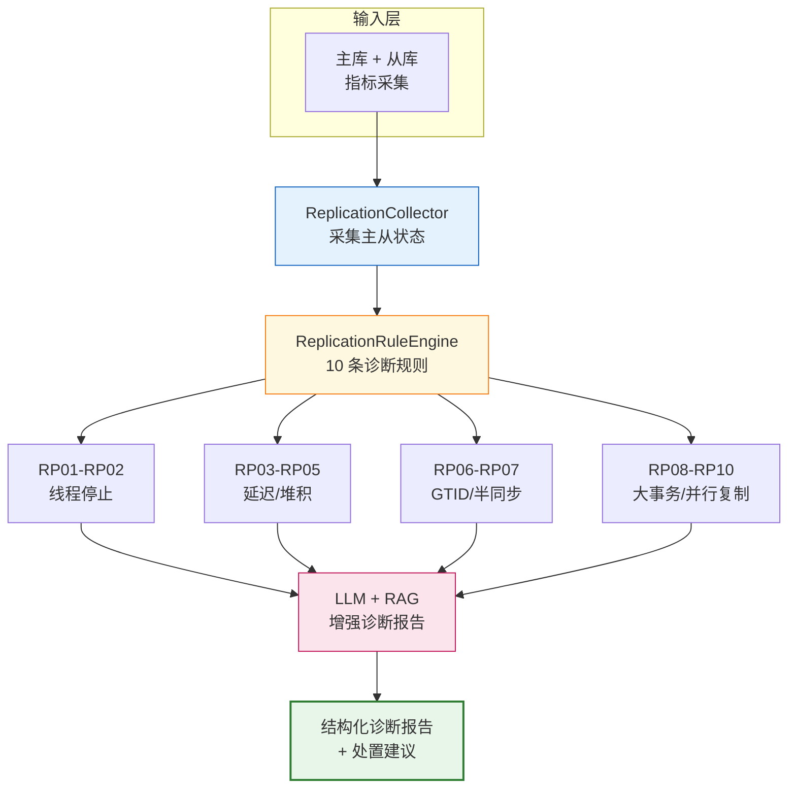
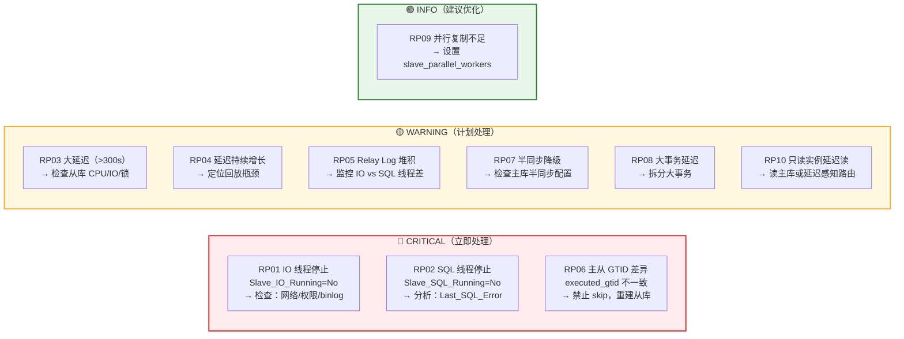
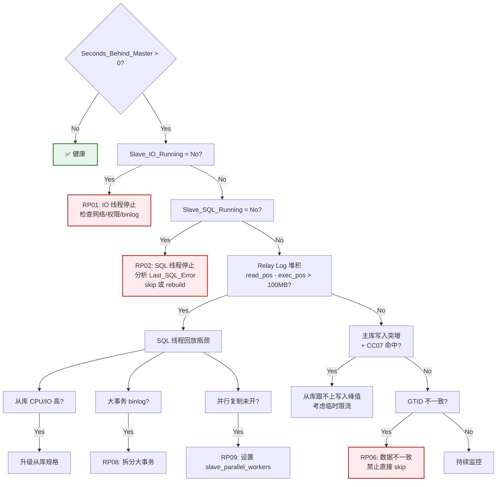

# 专栏第 15 讲：主备切换/复制延迟智能诊断

> **本文属于《大模型驱动的 MySQL 性能分析与自动化运维实战》专栏第 15 讲**
>
> 📎 **前置依赖**：第 10 讲复制延迟指标采集；第 11 讲 RC08 复制延迟根因；第 12 讲 CC07 复制×写入交叉判断。
>
> 代码仓库：`mysql-agent-engine/` | 模块：`src/mysql_agent/replication/`

> **本章目标**：
> - 掌握 `SHOW SLAVE STATUS` 与 `SHOW MASTER STATUS` 的结构化采集
> - 理解 10 条复制诊断规则（RP01-RP10）的触发条件与处置建议
> - 能够根据复制延迟决策树进行分层诊断
> - 了解 GTID 差异检测与半同步降级的诊断方法
> - 掌握主备切换的标准检查清单

---

## 1. 复制故障的复杂性

MySQL 复制涉及多层链路，故障表现多样：

| 现象 | 可能原因 | 诊断层级 |
|------|---------|---------|
| Seconds_Behind_Master 持续增大 | 从库回放慢 | 从库性能 |
| 复制中断 (IO/SQL 线程停止) | 网络/权限/数据不一致 | 复制链路 |
| 主从数据不一致 | 非确定性 SQL / 误操作 | 数据层 |
| 切换后应用报错 | 读写分离配置 / 延迟读 | 应用层 |

---

## 2. 复制诊断架构

**图示：主从状态采集 → RP 规则分层匹配 → LLM/RAG 增强报告**



**架构说明**：

| 组件 | 输入 | 输出 | 核心职责 |
|------|------|------|---------|
| ReplicationCollector | SHOW SLAVE/MASTER STATUS | SlaveStatus / MasterStatus | 结构化采集复制链路状态 |
| ReplicationRuleEngine | SlaveStatus / MasterStatus | Findings 列表 | 10 条规则匹配，生成诊断结果 |
| LLM + RAG | Findings + 规则ID | 增强诊断报告 | 知识库检索 + 自然语言建议 |

**设计原则**：
1. **规则优先**：先用确定性规则快速识别已知问题
2. **分层诊断**：线程状态 → 延迟指标 → GTID/半同步 → 大事务/并行
3. **知识增强**：RAG 层引入历史案例，提供更具体的处置建议

---

## 3. 复制状态采集

```python
# src/mysql_agent/replication/models.py（仓库实现为 `SlaveStatus` / `ReplicationFinding` / `ReplicationResult`；本文 `MasterStatus` / `ReplicationCollector` 为设计稿类名）
from dataclasses import dataclass
from typing import Optional, List


@dataclass
class SlaveStatus:
    master_host: str
    master_port: int
    slave_io_running: str       # Yes/No
    slave_sql_running: str
    seconds_behind_master: Optional[int]
    last_io_error: str
    last_sql_error: str
    relay_log_space: int
    exec_master_log_pos: int
    read_master_log_pos: int
    gtid_executed: str = ""
    retrieved_gtid_set: str = ""


@dataclass
class MasterStatus:
    file: str
    position: int
    binlog_do_db: str
    binlog_ignore_db: str
    executed_gtid_set: str = ""


class ReplicationCollector:
    def get_slave_status(self, conn) -> Optional[SlaveStatus]:
        cursor = conn.cursor(dictionary=True)
        cursor.execute("SHOW SLAVE STATUS")
        row = cursor.fetchone()
        if not row:
            return None
        return SlaveStatus(
            master_host=row["Master_Host"],
            master_port=row["Master_Port"],
            slave_io_running=row["Slave_IO_Running"],
            slave_sql_running=row["Slave_SQL_Running"],
            seconds_behind_master=row["Seconds_Behind_Master"],
            last_io_error=row.get("Last_IO_Error", ""),
            last_sql_error=row.get("Last_SQL_Error", ""),
            relay_log_space=row.get("Relay_Log_Space", 0),
            exec_master_log_pos=row["Exec_Master_Log_Pos"],
            read_master_log_pos=row["Read_Master_Log_Pos"],
            gtid_executed=row.get("Executed_Gtid_Set", ""),
            retrieved_gtid_set=row.get("Retrieved_Gtid_Set", ""),
        )

    def get_master_status(self, conn) -> MasterStatus:
        cursor = conn.cursor(dictionary=True)
        cursor.execute("SHOW MASTER STATUS")
        row = cursor.fetchone()
        return MasterStatus(
            file=row["File"],
            position=row["Position"],
            binlog_do_db=row.get("Binlog_Do_DB", ""),
            binlog_ignore_db=row.get("Binlog_Ignore_DB", ""),
            executed_gtid_set=row.get("Executed_Gtid_Set", ""),
        )
```

**关键字段说明**：

| 字段 | 含义 | 正常值 | 异常判断 |
|------|------|--------|---------|
| `slave_io_running` | IO 线程状态 | Yes | No = 网络/权限问题 |
| `slave_sql_running` | SQL 线程状态 | Yes | No = 数据不一致/语法错误 |
| `seconds_behind_master` | 复制延迟秒数 | 0-5s | > 300s = 大延迟 |
| `read_master_log_pos` | IO 线程读取位置 | 持续增长 | 不增长 = IO 线程卡住 |
| `exec_master_log_pos` | SQL 线程执行位置 | 持续增长 | 落后 = SQL 线程瓶颈 |
| `gtid_executed` | 已执行 GTID 集合 | 与主库一致 | 差异 = 数据不一致 |

**设计要点**：`ReplicationCollector` 将 SHOW SLAVE STATUS 的文本输出结构化为 `SlaveStatus` 数据模型，便于后续规则引擎判断。

---

## 4. 复制诊断规则（10 条）

**图示：RP01-RP10 规则分类体系**



**规则优先级**：CRITICAL > WARNING > INFO，CRITICAL 问题需要立即处理

```python
# src/mysql_agent/replication/replication_rules.py
class ReplicationRuleEngine:
    """复制诊断规则引擎

    诊断 10 类复制问题：线程停止、延迟增长、GTID 差异、半同步降级等
    """

    def analyze(self, slave: SlaveStatus, master: MasterStatus = None) -> list:
        """分析复制状态，生成诊断结果

        Args:
            slave: 从库状态
            master: 主库状态（可选）

        Returns:
            Findings 列表，每项包含 rule_id, level, message, action
        """
        findings = []

        # RP01: IO 线程停止
        if slave.slave_io_running != "Yes":
            findings.append({
                "rule_id": "RP01", "level": "CRITICAL",
                "message": f"IO 线程停止: {slave.last_io_error or '未知错误'}",
                "action": "检查主库连接、网络连通性、binlog 权限",
            })

        # RP02: SQL 线程停止
        if slave.slave_sql_running != "Yes":
            findings.append({
                "rule_id": "RP02", "level": "CRITICAL",
                "message": f"SQL 线程停止: {slave.last_sql_error or '未知错误'}",
                "action": "分析错误 SQL，决定 skip 或 rebuild 从库",
            })

        # RP03: 大延迟
        if slave.seconds_behind_master and slave.seconds_behind_master > 300:
            findings.append({
                "rule_id": "RP03", "level": "WARNING",
                "message": f"复制延迟 {slave.seconds_behind_master}s",
                "action": "检查从库 CPU/IO/锁等待，考虑开启并行复制",
            })

        # RP04: 延迟持续增长（需历史数据对比，本规则为简化版）
        if slave.seconds_behind_master and slave.seconds_behind_master > 60:
            findings.append({
                "rule_id": "RP04", "level": "WARNING",
                "message": "延迟 > 60s，需观察是否持续增长",
                "action": "检查从库回放瓶颈（大事务、锁等待、CPU 高）",
            })

        # RP05: Relay Log 堆积
        lag = slave.read_master_log_pos - slave.exec_master_log_pos
        if lag > 100 * 1024 * 1024:  # 100MB
            findings.append({
                "rule_id": "RP05", "level": "WARNING",
                "message": f"Relay Log 堆积 {lag / 1024 / 1024:.1f}MB",
                "action": "SQL 线程回放速度不足，检查从库负载",
            })

        # RP06: GTID 差异（需主库状态）
        if master and master.executed_gtid_set and slave.gtid_executed:
            gtid_drift = self._check_gtid_drift(master, slave)
            if gtid_drift["drift_detected"]:
                findings.append({
                    "rule_id": "RP06", "level": "CRITICAL",
                    "message": f"GTID 不一致: {gtid_drift['missing_on_slave']}",
                    "action": "数据不一致，禁止直接 skip，需修复数据",
                })

        # RP07: 半同步降级（需额外查询，本规则为提示）
        findings.append({
            "rule_id": "RP07", "level": "INFO",
            "message": "检查半同步复制配置是否开启",
            "action": "建议开启半同步复制保证数据一致性",
        })

        # RP08: 大事务延迟（需监控 binlog 大小）
        if lag > 1024 * 1024 * 1024:  # 1GB
            findings.append({
                "rule_id": "RP08", "level": "WARNING",
                "message": f"Relay Log 堆积 {lag / 1024 / 1024 / 1024:.1f}GB（可能大事务）",
                "action": "排查主库大事务，建议拆分",
            })

        # RP09: 并行复制不足
        # 实际检查需要 slave_parallel_workers 参数，本规则为提示
        findings.append({
            "rule_id": "RP09", "level": "INFO",
            "message": "高并发场景建议开启并行复制",
            "action": "设置 slave_parallel_workers > 0",
        })

        return findings

    @staticmethod
    def _parse_gtid_set(gtid_set: str) -> set:
        """把 uuid:1-5:7 解析成 (uuid, seq) 集合"""
        result = set()
        for item in gtid_set.replace("\n", "").split(","):
            item = item.strip()
            if not item or ":" not in item:
                continue
            uuid, ranges = item.split(":", 1)
            for part in ranges.split(":"):
                if "-" in part:
                    start, end = part.split("-", 1)
                    result.update((uuid, i) for i in range(int(start), int(end) + 1))
                elif part.isdigit():
                    result.add((uuid, int(part)))
        return result

    def _check_gtid_drift(self, master: MasterStatus, slave: SlaveStatus) -> dict:
        """检测主从 GTID 集合差异：区分正常回放延迟与真实漂移"""
        master_gtids = self._parse_gtid_set(master.executed_gtid_set)
        slave_gtids = self._parse_gtid_set(slave.gtid_executed)
        retrieved = self._parse_gtid_set(slave.retrieved_gtid_set or slave.gtid_executed)

        # 从库已拉取但主库没有 → 真实漂移；主库有但从库没拉全 → 先看延迟
        extra_on_slave = slave_gtids - master_gtids
        missing_on_slave = master_gtids - retrieved
        drift = bool(extra_on_slave) or (bool(missing_on_slave) and slave.seconds_behind_master == 0)
        return {
            "drift_detected": drift,
            "missing_on_slave": [f"{u}:{s}" for u, s in sorted(missing_on_slave)[:5]],
            "extra_on_slave": [f"{u}:{s}" for u, s in sorted(extra_on_slave)[:5]],
        }
```

**规则判断逻辑说明**：

`ReplicationRuleEngine.analyze()` 按优先级依次检查 10 条规则：

| 优先级 | 规则组 | 检查逻辑 | 说明 |
|--------|--------|---------|------|
| 1 | RP01-RP02 | 线程状态检查 | IO/SQL 线程停止是最严重的复制故障 |
| 2 | RP03-RP05 | 延迟与堆积检查 | 秒数和 Relay Log 堆积反映回放瓶颈 |
| 3 | RP06-RP07 | GTID 与半同步检查 | 数据一致性和高可用保障 |
| 4 | RP08-RP10 | 大事务与并行复制检查 | 性能优化建议 |

**设计原则**：规则引擎只做确定性判断，不确定时返回 INFO 级别提示，由 RAG 层提供增强建议。

---

## 5. Replication Agent

```python
# src/mysql_agent/agents/replication_agent.py
class ReplicationAgent:
    """复制诊断 Agent

    端到端复制诊断：采集状态 → 规则匹配 → RAG 增强 → 输出报告
    """

    def __init__(self, slave_conn, master_conn, rule_engine, rag_agent):
        """初始化

        Args:
            slave_conn: 从库数据库连接
            master_conn: 主库数据库连接（可选）
            rule_engine: 复制规则引擎
            rag_agent: RAG 检索 Agent
        """
        self.collector = ReplicationCollector()
        self.rules = rule_engine
        self.rag = rag_agent
        self.slave_conn = slave_conn
        self.master_conn = master_conn

    def diagnose(self) -> dict:
        """执行复制诊断

        Returns:
            诊断报告，包含：
            - slave_status: 从库状态摘要
            - findings: 规则匹配结果
            - knowledge_refs: RAG 检索到的历史案例
            - summary: 健康状态汇总
        """
        slave = self.collector.get_slave_status(self.slave_conn)
        master = None
        if self.master_conn:
            master = self.collector.get_master_status(self.master_conn)

        if not slave:
            return {"status": "not_replica", "message": "当前实例非从库"}

        findings = self.rules.analyze(slave, master)
        knowledge = self.rag.retrieve("MySQL 复制延迟 " + (findings[0]["rule_id"] if findings else ""))

        return {
            "slave_status": {
                "io_running": slave.slave_io_running,
                "sql_running": slave.slave_sql_running,
                "lag_seconds": slave.seconds_behind_master,
                "master": f"{slave.master_host}:{slave.master_port}",
            },
            "findings": findings,
            "knowledge_refs": self.rag.format_context(knowledge),
            "summary": {
                "healthy": len(findings) == 0,
                "critical": sum(1 for f in findings if f["level"] == "CRITICAL"),
            },
        }
```

**端到端流程说明**：

`ReplicationAgent.diagnose()` 的执行流程：

```
SHOW SLAVE STATUS → ReplicationCollector → ReplicationRuleEngine.analyze() → RAG 检索 → 结构化报告
```

| 步骤 | 组件 | 输入 | 输出 |
|------|------|------|------|
| 1 | `collector.get_slave_status()` | 从库连接 | SlaveStatus 结构体 |
| 2 | `collector.get_master_status()` | 主库连接（可选） | MasterStatus 结构体 |
| 3 | `rules.analyze()` | SlaveStatus + MasterStatus | Findings 列表 |
| 4 | `rag.retrieve()` | 规则 ID | 历史案例 |
| 5 | `rag.format_context()` | 案例列表 | 格式化文本 |

**设计要点**：当 `get_slave_status()` 返回 `None`（非从库）时，直接返回 `not_replica`，避免后续组件空指针。主库连接可选，用于 GTID 差异检测。

---

## 6. 复制延迟诊断决策树

**图示：从线程状态到延迟根因的分层决策读法**



**决策流程说明**：

| 判断节点 | 检查条件 | 命中规则 | 后续动作 |
|---------|---------|---------|---------|
| 1 | Seconds_Behind_Master = 0 | 健康 | 无需处理 |
| 2 | Slave_IO_Running = No | RP01 | 检查网络、权限、binlog 是否存在 |
| 3 | Slave_SQL_Running = No | RP02 | 分析 SQL 错误，决定 skip 或 rebuild |
| 4 | read_pos - exec_pos > 100MB | RP05 | 检查从库瓶颈（CPU/大事务/并行复制） |
| 5 | 主库写入峰值 + CC07 | 写入冲击 | 临时限流，等待从库追平 |
| 6 | GTID 不一致 | RP06 | 禁止 skip，需数据修复 |

---

## 7. 主备切换检查清单

> 先用 §6 决策树定位延迟/中断根因，再进入切换。切主前必须确认延迟已追平或可接受。

| 步骤 | 检查项 | 命令 |
|------|--------|------|
| 1 | 确认延迟 | `SHOW SLAVE STATUS\G` |
| 2 | 停止写入 | 应用层流量切换 |
| 3 | 等待追平 | `Seconds_Behind_Master=0` |
| 4 | 提升从库 | `STOP SLAVE; RESET SLAVE ALL; SET GLOBAL super_read_only=OFF; SET GLOBAL read_only=OFF;` |
| 5 | 切换 VIP/DNS | 运维操作 |
| 6 | 验证 | `SELECT @@read_only, @@super_read_only;` + 应用读写测试 |

---

## 8. GTID 与半同步场景

### 8.1 GTID 差异检测

GTID 差异是严重问题（RP06），表示主从数据不一致：

```sql
-- 主库执行
SELECT @@global.gtid_executed AS master_gtid;

-- 从库执行
SHOW SLAVE STATUS\G
-- 关注 Retrieved_Gtid_Set（已拉取）与 Executed_Gtid_Set（已回放）
```

**判断方法**：对比主库 `Executed_Gtid_Set` 与从库 `Retrieved_Gtid_Set`。从库 `Executed` 落后 `Retrieved` 是回放延迟；`Retrieved` 落后主库是 IO 未拉全；两者追平后仍缺才判数据不一致。

> **注意**：GTID 模式下禁止使用 `sql_slave_skip_counter` skip 错误，可能导致数据不一致！正确做法是评估缺失事务影响后重建从库或手动补数。

### 8.2 半同步降级诊断（RP07）

| 状态 | 含义 | Agent 建议 |
|------|------|-----------|
| `rpl_semi_sync_master_enabled=ON` 且 `rpl_semi_sync_master_status=OFF` | 半同步已降级为异步 | 检查从库 ACK 超时、网络 |
| 主库 `rpl_semi_sync_master_timeout` 过短 | 频繁降级 | 建议 1000-10000ms |
| 无从库开启 `rpl_semi_sync_slave_enabled` | 半同步无效 | 从库开启半同步插件 |

**诊断 SQL**：
```sql
-- 检查半同步状态
SHOW VARIABLES LIKE 'rpl_semi_sync%';
```

---

## 9. 实战案例

### 9.1 案例：大促期间复制延迟 2 小时

| 指标 | 值 | 命中规则 |
|------|-----|---------|
| Seconds_Behind_Master | 7200s | RP03 |
| Relay Log 堆积 | 3.2GB | RP05 |
| 主库 write_qps | 均值×3 | CC07 |
| slave_parallel_workers | 0 | RP09 |

**根因**：大促写入峰值 + 从库未开并行复制 + 单线程回放

**处置**：
```sql
-- 从库执行
SET GLOBAL slave_parallel_workers = 8;
SET GLOBAL slave_parallel_type = 'LOGICAL_CLOCK';
-- 观察 Seconds_Behind_Master 是否下降
```

### 9.2 案例：SQL 线程停止

```
Last_SQL_Error: Error 'Duplicate entry' for key 'orders.PRIMARY'
```

**Agent 诊断**：RP02 + 给出选项
1. `STOP SLAVE; SET GLOBAL sql_slave_skip_counter=1; START SLAVE;`（仅非 GTID）
2. GTID 模式：评估是否 `inject empty transaction` 或 rebuild slave
3. 根查主库重复写入来源

### 9.3 案例：主备切换（与第 9 讲路由联动）

切换触发词："主库挂了" / "failover" → `InputRouter` 路由到 `ReplicationAgent` + `ReportGenerator`

---

## 10. 与全专栏的衔接

| 讲次 | 衔接点 |
|------|--------|
| 第 10 讲 | `replication_lag` 指标采集 |
| 第 11 讲 | RC08 复制延迟根因 |
| 第 12 讲 | CC07 复制×写入交叉判断 |
| 第 13 讲 | 复制故障纳入复盘报告 |
| 第 17 讲 | `check_replication` 工具注册 |

---

## 11. 本讲小结

| 组件 | 文件 | 核心作用 |
|------|------|---------|
| ReplicationCollector | `replication_collector.py` | 采集 SHOW SLAVE/MASTER STATUS |
| ReplicationRuleEngine | `replication_rules.py` | 10 条复制规则匹配 |
| ReplicationAgent | `replication_agent.py` | 端到端诊断 |

**核心能力**：
1. ✅ **结构化采集**：SlaveStatus / MasterStatus 数据模型
2. ✅ **10 条规则覆盖**：RP01-RP10 覆盖线程停止、延迟、GTID、半同步等场景
3. ✅ **决策树诊断**：分层判断，快速定位根因
4. ✅ **与第 11 讲根因因果图联动**：触发 CC07 → RC08 → ReplicationAgent → 纳入报告

**关键设计决策**：

| 决策 | 量化依据 | 备选方案 | 为什么选这个 |
|------|---------|---------|------------|
| 规则优先 | 确定性规则识别已知问题，RAG 增强建议 | 纯 LLM 诊断 | 规则快速准确，LLM 补充建议 |
| 分层决策 | 线程状态 → 延迟 → GTID → 大事务 | 单层判断 | 逐层缩小范围，避免误判 |
| GTID 禁止 skip | RP06 命中时强制人工处理 | 自动 skip | 避免数据不一致 |

**性能基线**：

| 指标 | 数值 | 说明 |
|------|------|------|
| SHOW SLAVE STATUS 采集 | < 100ms | 单次查询 |
| SHOW MASTER STATUS 采集 | < 100ms | 单次查询 |
| 10 条规则匹配 | < 10ms | 确定性规则 |
| GTID 差异检测 | < 50ms | 集合运算 |
| RAG 检索延迟 | < 200ms | 向量相似度搜索 |
| 端到端诊断耗时 | < 500ms | 采集 → 规则 → 建议 |

**与前后讲关系**：

- **前序**：第 10 讲 replication_lag 指标采集；第 11 讲 RC08 复制延迟根因；第 12 讲 CC07 交叉判断
- **后续**：第 16 讲 Prompt 高级技巧与动态优化 —— 动态 Few-shot、ReAct、A/B 测试、多轮对话