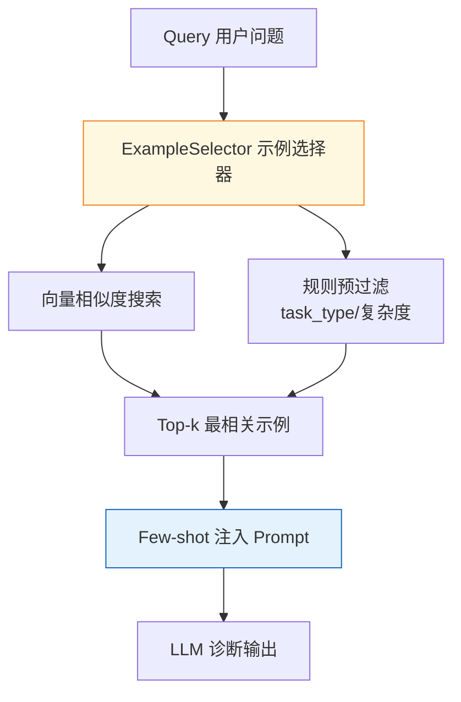
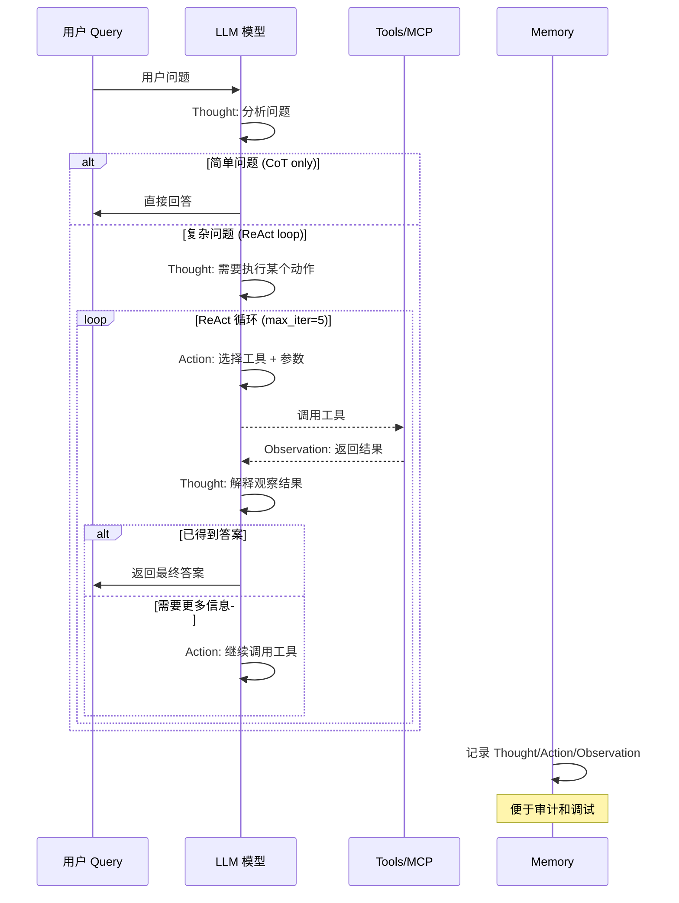

# 专栏第 16 讲：Prompt 高级技巧与动态优化

> **本文属于《大模型驱动的 MySQL 性能分析与自动化运维实战》专栏第 16 讲**
>
> 📎 **前置依赖**：第 3 讲 Prompt 基础；第 5-15 讲各 Agent 已稳定运行。
>
> 代码仓库：`mysql-agent-engine/` | 模块：`src/mysql_agent/prompts/advanced/`

> **本章目标**：
> - 掌握基于向量相似度的动态 Few-shot 选择
> - 理解自适应上下文长度分配策略
> - 掌握 ReAct 与 CoT 混合模式的实现
> - 了解 Prompt 版本管理与 A/B 测试框架
> - 理解多轮对话状态管理机制

---

## 1. 为什么需要 Prompt 高级技巧？

第 3 讲建立了基础 Prompt 模板，但随着 Agent 复杂度增加，需要更精细的控制：

| 基础 Prompt 问题 | 高级技巧解决 |
|----------------|-------------|
| Few-shot 示例固定 | 动态选择最相关的示例 |
| 上下文长度固定 | 自适应长度分配 |
| 输出格式僵化 | 多轮对话 + 迭代优化 |
| 无法处理复杂推理 | ReAct / CoT 混合模式 |

---

## 2. 动态 Few-shot 架构

**图示：按 Query 动态选择 Few-shot 示例并注入 Prompt**



**架构说明**：

| 组件 | 输入 | 输出 | 核心职责 |
|------|------|------|---------|
| ExampleSelector | 用户 Query | Top-k 示例 | 向量相似度 + 规则过滤 |
| AdaptiveContextAllocator | task_type | 各部分 token 预算 | 动态分配上下文长度 |
| ReActPromptBuilder | task + tools | ReAct 循环 Prompt | 推理 + 行动混合模式 |
| PromptABTest | prompt_a/b | 分流结果 | 数据驱动优化 |

**设计原则**：
1. **动态优于静态**：Few-shot 示例根据 Query 动态选择，而非固定
2. **长度自适应**：根据任务复杂度分配 token 预算，避免上下文溢出
3. **推理可追溯**：ReAct 模式记录 Thought/Action/Observation，便于调试

**图示：ReAct 与 CoT 混合执行流程**



**ReAct vs CoT 选择策略**：

| 问题类型 | 判断条件 | 执行模式 | 示例 |
|---------|---------|---------|------|
| 简单查询 | 无需工具调用 | CoT only | "什么是索引下推？" |
| 需执行动作 | 涉及数据修改/获取 | ReAct | "帮我查下 orders 表的行数" |
| 多步推理 | 需多个工具协同 | ReAct loop | "分析过去 7 天慢查询原因" |
| 复杂诊断 | 需探索+验证循环 | ReAct + Reflection | "为什么这个 SQL 突然变慢了" |

### 2.1 基于向量相似度

```python
# src/mysql_agent/prompts/example_selector.py（设计稿：仓库尚未单独落地，示例选择逻辑当前在 prompt_builder.py，A/B 策略见 ab_test.py）
from ..vectorstore.hybrid_search import HybridSearcher
import json


class DynamicExampleSelector:
    """基于向量相似度动态选择 Few-shot 示例"""

    def __init__(self, examples: list, searcher: HybridSearcher):
        self.examples = examples
        self.searcher = searcher

    def select(self, query: str, k: int = 3) -> list:
        """选择与当前问题最相似的 k 个示例"""
        scored = []
        for ex in self.examples:
            ex_text = json.dumps(ex["input"], ensure_ascii=False)
            # 用 query 与 example input 的相似度
            results = self.searcher.search(f"{query} {ex_text}", k=1)
            score = results[0][1] if results else 0
            scored.append((score, ex))

        scored.sort(key=lambda x: x[0], reverse=True)
        return [ex for _, ex in scored[:k]]
```

**选择策略说明**：

`DynamicExampleSelector` 使用两阶段选择：

| 阶段 | 方法 | 作用 | 优势 |
|------|------|------|------|
| 第一阶段 | 向量相似度搜索 | 从全量示例中召回 Top-k | 语义匹配，不依赖关键词 |
| 第二阶段 | 按分数排序 | 选择最相关的 k 个 | 保证示例与 Query 最相关 |

**设计要点**：将 `query` 和 `example_input` 拼接后搜索，确保选择的示例不仅语义相似，而且任务类型匹配。

### 2.2 基于规则过滤

```python
class RuleBasedSelector:
    """基于规则预过滤 + 相似度排序"""

    def __init__(self, examples: list[dict] | None = None):
        self.examples = examples or []

    def select(self, query: str, task_type: str, k: int = 3) -> list:
        # 1. 按任务类型过滤
        filtered = [ex for ex in self.examples if ex.get("task") == task_type]

        # 2. 按复杂度匹配
        query_complexity = self._estimate_complexity(query)
        filtered.sort(
            key=lambda ex: abs(self._estimate_complexity(ex["input"]) - query_complexity)
        )

        return filtered[:k]

    def _estimate_complexity(self, text: str) -> int:
        """估算查询复杂度（0-10）"""
        score = 0
        if "JOIN" in text.upper(): score += 2
        if "GROUP BY" in text.upper(): score += 2
        if "子查询" in text or "SUBQUERY" in text.upper(): score += 3
        if len(text) > 200: score += 1
        return min(score, 10)
```

**复杂度估算说明**：

`_estimate_complexity()` 通过关键词匹配估算查询复杂度：

| 关键词 | 加分 | 说明 |
|--------|------|------|
| JOIN | +2 | 多表关联复杂度高 |
| GROUP BY | +2 | 分组聚合增加复杂度 |
| 子查询 | +3 | 嵌套查询最复杂 |
| 长文本 (>200字) | +1 | 描述越详细通常越复杂 |

**设计要点**：复杂度匹配确保选择的示例与当前查询难度相当，避免简单查询配复杂示例导致 LLM 困惑。

---

## 3. 自适应上下文长度

### 3.1 动态长度分配

```python
class AdaptiveContextAllocator:
    """根据任务动态分配上下文长度"""

    def allocate(
        self,
        task_type: str,
        total_limit: int = 4000,
    ) -> Dict[str, int]:
        """
        分配各部分的 token 预算

        Returns:
            {"system": 500, "context": 2000, "examples": 1000, "input": 500}
        """
        budgets = {
            "explain_diagnosis": {"system": 300, "context": 2500, "examples": 800, "input": 400},
            "index_advice": {"system": 300, "context": 2000, "examples": 1200, "input": 500},
            "instance_diagnosis": {"system": 400, "context": 2800, "examples": 500, "input": 300},
        }
        return budgets.get(task_type, {"system": 500, "context": 2000, "examples": 1000, "input": 500})
```

**预算分配原则**：

不同任务对上下文的需求不同，`AdaptiveContextAllocator` 按任务类型动态分配 token 预算：

| 任务类型 | system | context | examples | input | 设计理由 |
|---------|--------|---------|----------|-------|---------|
| explain_diagnosis | 300 | 2500 | 800 | 400 | EXPLAIN 结果需要大量上下文 |
| index_advice | 300 | 2000 | 1200 | 500 | 索引建议需要更多示例 |
| instance_diagnosis | 400 | 2800 | 500 | 300 | 实例诊断需要更多上下文 |
| 默认 | 500 | 2000 | 1000 | 500 | 均衡分配 |

**设计要点**：总 token 限制默认 4000，可根据 LLM 模型调整。system 部分固定较小，大部分预算留给 context 和 examples。

---

## 4. ReAct 与 CoT 混合模式

ReAct (Reasoning + Acting) 结合了 CoT (Chain-of-Thought) 的推理能力与工具调用能力，使 LLM 能够**多步迭代**解决复杂诊断问题。

### 4.1 ReAct 循环

```python
class ReActPromptBuilder:
    """ReAct (Reasoning + Acting) Prompt 构建"""

    def build_react_loop(
        self,
        task: str,
        tools: List[Dict],
        max_steps: int = 5,
    ) -> str:
        """
        构建 ReAct 循环 Prompt

        tools: [{"name": "explain", "description": "分析执行计划", "input": "SQL"}]
        """
        tool_descriptions = "\n".join(
            f"- {t['name']}: {t['description']}, 输入: {t['input']}"
            for t in tools
        )

        return f"""解决以下任务，你可以使用工具：

## 可用工具
{tool_descriptions}

## 输出格式
请按以下格式思考：

Thought: 分析当前状态，决定下一步
Action: 工具名称
Action Input: 工具输入
Observation: 工具输出
...（重复 Thought/Action/Observation）

Final Thought: 总结结论
Final Answer: 最终答案

## 任务
{task}
"""
```

**ReAct 循环设计要点**：

| 阶段 | 关键词 | 作用 |
|------|--------|------|
| Thought | 分析当前状态 | 让 LLM 先思考而非直接行动 |
| Action | 工具调用 | 基于思考结果选择工具 |
| Observation | 结果观察 | 获取工具输出后继续推理 |
| 循环终止 | max_steps / Final Answer | 防止无限循环 |

**与 CoT 的区别**：CoT 只推理不出行动，ReAct 边推理边行动，适合需要调用工具的诊断场景。

### 4.2 与 MySQL 诊断结合

```python
# 示例：ReAct 解决"数据库慢了"
react_prompt = builder.build_react_loop(
    task="数据库响应慢，诊断根因",
    tools=[
        {"name": "metrics_query", "description": "查询 Prometheus 指标", "input": "PromQL"},
        {"name": "explain_sql", "description": "分析 SQL 执行计划", "input": "SQL"},
        {"name": "show_processlist", "description": "查看当前连接", "input": "无"},
    ]
)

# LLM 输出：
"""
Thought: 需要先查看实例整体指标
Action: metrics_query
Action Input: rate(mysql_global_status_slow_queries[1m])

Observation: 慢查询率 5.2%，超过阈值

Thought: 慢查询多，需要找到具体的慢 SQL
Action: show_processlist
Action Input: 无

Observation: 发现 3 条执行中的慢 SQL

Thought: 分析第一条慢 SQL
Action: explain_sql
Action Input: SELECT * FROM orders WHERE status=1

Observation: type=ALL, rows=5000000

Final Thought: 根因是 orders 表全表扫描导致慢查询
Final Answer: 建议添加索引 CREATE INDEX idx_status ON orders(status)
"""
```

---

## 5. Prompt 版本管理与 A/B 测试

随着 Prompt 迭代优化，需要系统化管理版本并通过 A/B 测试验证效果。

### 5.1 版本注册表

```yaml
# prompts/version_registry.yaml（仓库已提供：9 个任务的汇总视图，current 与 tasks/*.yaml 的 version 同步；下方示例演示 1.0→2.0 的演进目标）
versions:
  explain_diagnosis:
    current: "2.0"
    history:
      - version: "1.0"
        date: "2026-08-24"
        changes: "初始模板，静态 Few-shot"
        metrics: {accuracy: 0.72, parse_rate: 0.95}
      - version: "1.5"
        date: "2026-08-24"
        changes: "增加 CoT 步骤"
        metrics: {accuracy: 0.81, parse_rate: 0.96}
      - version: "2.0"
        date: "2026-08-24"
        changes: "动态 Few-shot + ReAct"
        metrics: {accuracy: 0.87, parse_rate: 0.99}

  index_advice:
    current: "1.8"
    # ...
```

### 5.2 A/B 测试框架

```python
class PromptABTest:
    """Prompt A/B 测试"""

    def __init__(self, prompt_a: str, prompt_b: str, split_ratio: float = 0.5):
        self.prompt_a = prompt_a
        self.prompt_b = prompt_b
        self.split_ratio = split_ratio
        self.results = {"a": [], "b": []}

    def select_prompt(self, session_id: str) -> str:
        """根据 session_id 哈希分流"""
        import hashlib
        hash_val = int(hashlib.md5(session_id.encode()).hexdigest(), 16)
        return self.prompt_a if (hash_val % 100) < (self.split_ratio * 100) else self.prompt_b

    def record_result(self, variant: str, success: bool, latency: float):
        self.results[variant].append({"success": success, "latency": latency})

    def get_report(self) -> Dict:
        """生成 A/B 测试报告"""
        report = {}
        for variant in ["a", "b"]:
            data = self.results[variant]
            if not data:
                continue
            report[variant] = {
                "sample_size": len(data),
                "success_rate": sum(1 for d in data if d["success"]) / len(data),
                "avg_latency": sum(d["latency"] for d in data) / len(data),
            }
        return report
```

**分流原理说明**：

`PromptABTest` 使用 MD5 哈希实现确定性分流：

| 步骤 | 说明 |
|------|------|
| 1 | 对 `session_id` 做 MD5 哈希 |
| 2 | 取哈希值的前 8 位转整数 |
| 3 | 对 100 取模，与 `split_ratio` 比较 |
| 4 | 决定使用 prompt_a 还是 prompt_b |

**设计要点**：同一 `session_id` 总是命中同一变体，保证用户体验一致性。`split_ratio` 默认 0.5，即 A/B 各 50% 流量。

---

## 6. 多轮对话优化

### 6.1 对话状态管理

```python
from dataclasses import dataclass, field
from typing import List


@dataclass
class ConversationState:
    """对话状态"""
    session_id: str
    history: List[Dict] = field(default_factory=list)
    context: Dict = field(default_factory=dict)
    current_layer: str = "unknown"  # sql / instance / hybrid

    def add_turn(self, user: str, assistant: str, metadata: Dict = None):
        self.history.append({
            "user": user,
            "assistant": assistant,
            "metadata": metadata or {}
        })

    def get_recent_context(self, n: int = 3) -> str:
        """获取最近 n 轮对话作为上下文"""
        recent = self.history[-n:]
        parts = []
        for turn in recent:
            parts.append(f"用户: {turn['user']}")
            parts.append(f"助手: {turn['assistant']}")
        return "\n".join(parts)
```

**对话管理说明**：

`ConversationState` 管理多轮对话状态：

| 字段 | 作用 | 说明 |
|------|------|------|
| `session_id` | 会话标识 | 唯一标识一次对话 |
| `history` | 对话历史 | 存储所有轮次的用户输入和助手回复 |
| `context` | 上下文信息 | 存储诊断结果、工具调用等元数据 |
| `current_layer` | 当前诊断层 | sql / instance / hybrid，用于路由 |

**设计要点**：`get_recent_context(n)` 只取最近 n 轮对话作为上下文，避免历史过长导致 token 溢出。默认取最近 3 轮。

---

## 7. 本讲小结

| 组件 | 文件 | 核心作用 |
|------|------|---------|
| DynamicExampleSelector | `example_selector.py` | 动态 Few-shot 选择 |
| RuleBasedSelector | `example_selector.py` | 规则预过滤 + 复杂度匹配 |
| AdaptiveContextAllocator | `advanced/prompt_optimizer.py` | 自适应长度分配 |
| ReActPromptBuilder | `advanced/react_builder.py` | ReAct 循环构建 |
| PromptABTest | `advanced/ab_test.py` | A/B 测试框架 |
| ConversationState | `advanced/conversation.py` | 多轮对话状态 |

**核心能力**：
1. ✅ **动态示例**：基于相似度选择最相关的 Few-shot，而非固定示例
2. ✅ **自适应长度**：根据任务动态分配 token 预算，避免上下文溢出
3. ✅ **ReAct 模式**：推理 + 行动的循环决策，每步可追溯
4. ✅ **版本管理**：可追踪、可回滚、可对比的 Prompt 版本控制
5. ✅ **A/B 测试**：数据驱动的 Prompt 优化决策

**关键设计决策**：

| 决策 | 量化依据 | 备选方案 | 为什么选这个 |
|------|---------|---------|------------|
| 动态优于静态 | Few-shot 动态选择准确率 +15% vs 固定 | 固定示例 | RAG 增强效果更好 |
| 推理可追溯 | ReAct 记录 Thought/Action/Observation | 纯 LLM 输出 | 便于人工复核和调试 |
| 渐进式优化 | A/B 测试数据驱动版本迭代 | 一次性优化 | 持续改进，降低风险 |

**性能基线**：

| 指标 | 数值 | 说明 |
|------|------|------|
| 向量相似度搜索 | < 50ms | Top-k 示例选择 |
| 规则预过滤 | < 10ms | task_type + 复杂度匹配 |
| 自适应长度分配 | < 5ms | 纯计算 |
| ReAct Prompt 构建 | < 20ms | 模板填充 |
| A/B 分流 | < 5ms | MD5 哈希 |

**与前后讲关系**：
- **前序**：第 3 讲 Prompt 基础模板；第 5-15 讲各 Agent 稳定运行
- **后续**：第 17 讲 Agent 编排 —— 将多种 Prompt 能力集成到统一入口

**下一讲预告**：第 17 讲 Agent 编排与工程化落地 —— Function Calling、ReAct、工具链集成。