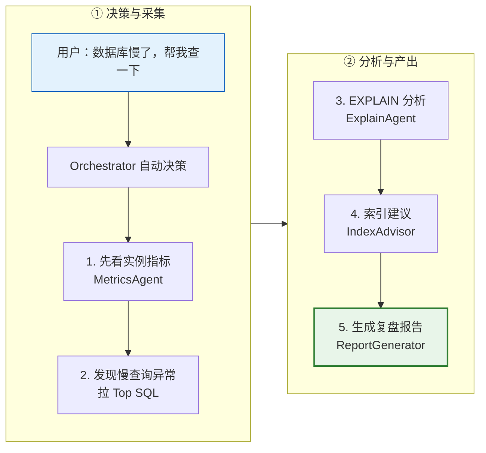
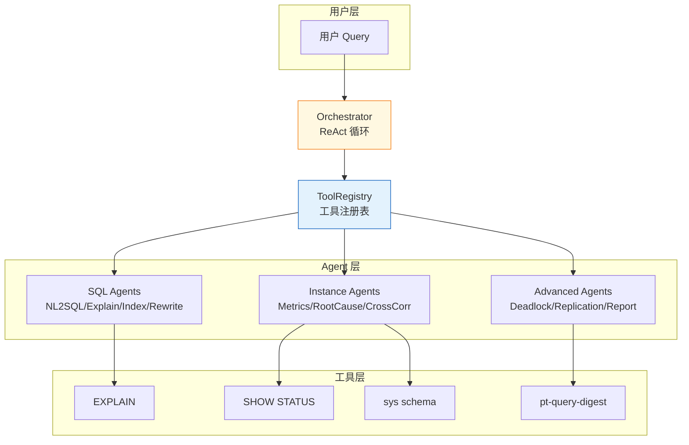
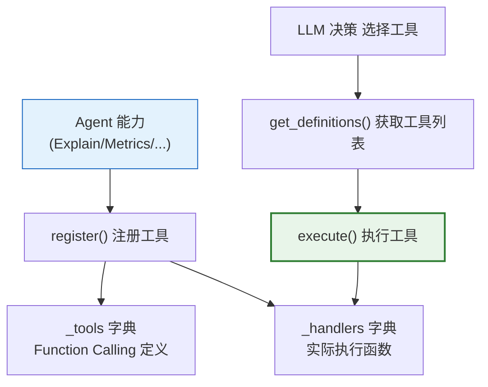
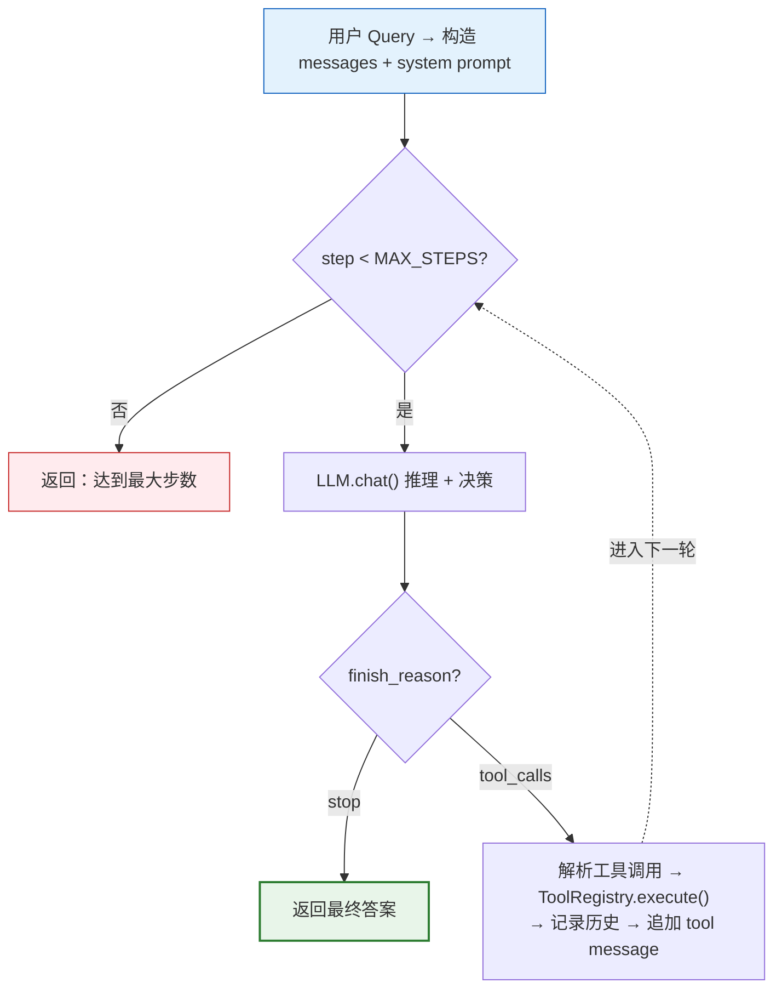
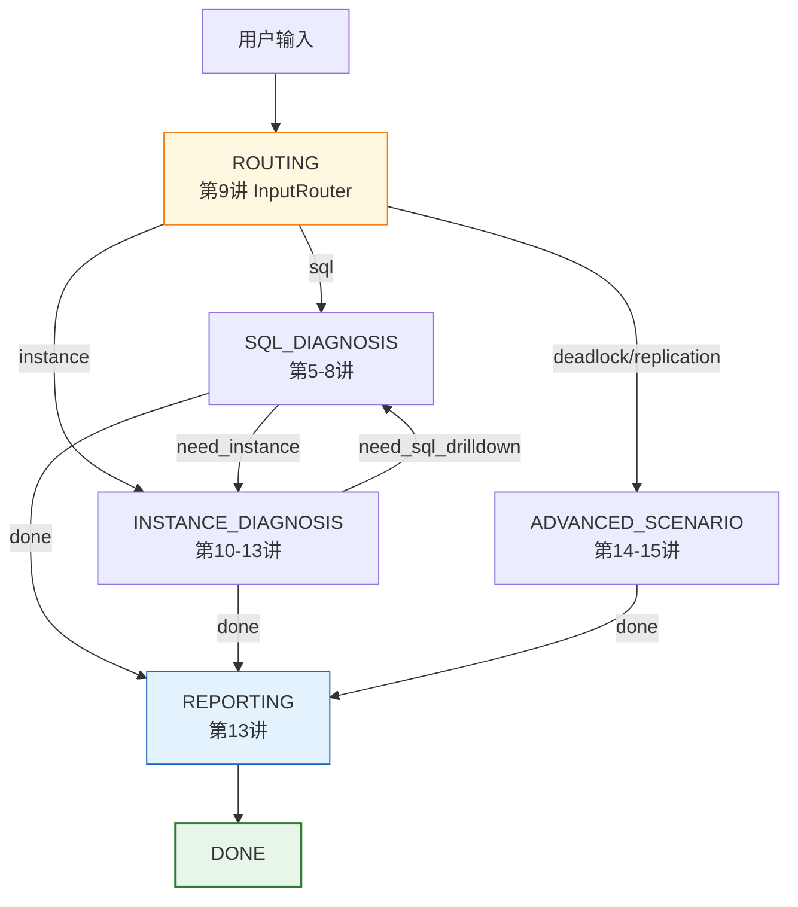

# 专栏第 17 讲：Agent 编排与工程化落地

> **本文属于《大模型驱动的 MySQL 性能分析与自动化运维实战》专栏第 17 讲**
>
> 📎 **前置依赖**：第 1-16 讲全部 Agent 模块。
>
> 代码仓库：`mysql-agent-engine/` | 模块：`src/mysql_agent/orchestrator/`

> **本章目标**：
> - 掌握 ToolRegistry 实现 Function Calling 工具注册
> - 理解 ReAct 编排循环的原理与实现
> - 掌握基于状态机的编排器设计
> - 了解安全权限控制与工具包装
> - 理解 CLI 入口与运行依赖 / 监控要点
> - 完整 Docker 生产部署见第 20 讲
---

## 1. 为什么需要 Agent 编排？

前 16 讲实现了多个独立 Agent，但生产环境需要**统一入口**：



---

## 2. 编排架构

**图示：Orchestrator 如何通过 ToolRegistry 挂接 SQL / 实例 / 高级三类 Agent**



**架构说明**：

| 组件 | 输入 | 输出 | 核心职责 |
|------|------|------|---------|
| Orchestrator | 用户 Query | 诊断报告 | ReAct 循环决策 |
| ToolRegistry | 各 Agent 能力 | Function Calling 定义 | 统一工具注册 |
| SQL Agents | SQL 语句 | EXPLAIN/索引/改写建议 | SQL 级诊断 |
| Instance Agents | 指标/异常 | 根因/交叉判断 | 实例级诊断 |
| Advanced Agents | 特定场景 | 死锁/复制/报告 | 高级场景处理 |

**设计原则**：
1. **统一入口**：用户只需描述问题，Orchestrator 自动分发
2. **工具标准化**：所有 Agent 能力通过 Function Calling 暴露
3. **可观测**：每步决策记录日志，便于问题追溯

---

## 3. 工具注册 (Function Calling)

**工具注册流程**：



**注册的工具清单**：

| 工具名 | 描述 | 所需参数 | 对应 Agent |
|--------|------|---------|-----------|
| `explain_sql` | EXPLAIN 分析 | sql | ExplainAgent |
| `check_instance_metrics` | 实例指标检查 | duration_minutes | MetricsAgent |
| `analyze_deadlock` | 死锁分析 | 无 | DeadlockAgent |
| `check_replication` | 复制状态检查 | 无 | ReplicationAgent |
| `suggest_index` | 索引建议 | sql, database | IndexAdvisor |
| `search_knowledge` | 知识库搜索 | query | RAGAgent |
| `generate_report` | 复盘报告生成 | instance_id | ReportGenerator |

```python
# src/mysql_agent/orchestrator/tools.py（仓库实现函数名 `build_tool_registry`）
from typing import Callable, Dict, Any
import json
import logging

logger = logging.getLogger(__name__)


class ToolRegistry:
    """Agent 工具注册表，兼容 OpenAI Function Calling 格式"""

    def __init__(self):
        self._tools: Dict[str, dict] = {}
        self._handlers: Dict[str, Callable] = {}

    def register(self, name: str, description: str, parameters: dict, handler: Callable):
        """注册工具

        Args:
            name: 工具名称
            description: 工具描述（供 LLM 理解）
            parameters: JSON Schema 格式的参数定义
            handler: 实际执行函数
        """
        self._tools[name] = {
            "type": "function",
            "function": {
                "name": name,
                "description": description,
                "parameters": parameters,
            },
        }
        self._handlers[name] = handler
        logger.info(f"Tool registered: {name}")

    def get_definitions(self) -> list:
        """获取所有工具的 Function Calling 定义"""
        return list(self._tools.values())

    def execute(self, name: str, arguments: dict) -> Any:
        """执行工具

        Args:
            name: 工具名称
            arguments: 工具参数

        Returns:
            工具执行结果

        Raises:
            ValueError: 工具不存在
            TypeError: 参数不匹配
            Exception: 工具执行异常
        """
        if name not in self._handlers:
            logger.error(f"Unknown tool: {name}")
            raise ValueError(f"Unknown tool: {name}")
        try:
            logger.info(f"Executing tool: {name} with args: {arguments}")
            result = self._handlers[name](**arguments)
            logger.info(f"Tool {name} executed successfully")
            return result
        except TypeError as e:
            logger.error(f"Tool {name} argument error: {e}")
            raise ValueError(f"Tool {name} parameter mismatch: {e}")
        except Exception as e:
            logger.error(f"Tool {name} execution failed: {e}")
            raise


def build_mysql_tool_registry(db_conn, agents: dict) -> ToolRegistry:
    registry = ToolRegistry()

    registry.register(
        name="explain_sql",
        description="对 SQL 执行 EXPLAIN 并返回诊断结果",
        parameters={
            "type": "object",
            "properties": {
                "sql": {"type": "string", "description": "要分析的 SELECT 语句"},
            },
            "required": ["sql"],
        },
        handler=lambda sql: agents["explain"].diagnose(sql, agents["explain"]._get_explain(sql)),
    )

    registry.register(
        name="check_instance_metrics",
        description="检查 MySQL 实例级性能指标异常",
        parameters={
            "type": "object",
            "properties": {
                "duration_minutes": {"type": "integer", "default": 30},
            },
        },
        handler=lambda duration_minutes=30: agents["metrics"].run(duration_minutes),
    )

    registry.register(
        name="analyze_deadlock",
        description="分析最近一次死锁",
        parameters={"type": "object", "properties": {}},
        handler=lambda: agents["deadlock"].analyze_latest(),
    )

    registry.register(
        name="check_replication",
        description="检查主从复制状态",
        parameters={"type": "object", "properties": {}},
        handler=lambda: agents["replication"].diagnose(),
    )

    registry.register(
        name="suggest_index",
        description="对 SQL 给出索引建议",
        parameters={
            "type": "object",
            "properties": {
                "sql": {"type": "string"},
                "database": {"type": "string"},
            },
            "required": ["sql", "database"],
        },
        handler=lambda sql, database: agents["index"].diagnose(
            sql, agents["explain"]._get_explain_plan(sql), database
        ),
    )

    registry.register(
        name="search_knowledge",
        description="搜索 MySQL 知识库",
        parameters={
            "type": "object",
            "properties": {
                "query": {"type": "string"},
            },
            "required": ["query"],
        },
        handler=lambda query: agents["rag"].query(query),
    )

    registry.register(
        name="generate_report",
        description="生成故障复盘报告",
        parameters={
            "type": "object",
            "properties": {
                "instance_id": {"type": "string"},
                "duration_minutes": {"type": "integer", "default": 60},
            },
            "required": ["instance_id"],
        },
        handler=lambda instance_id, duration_minutes=60: agents["report"].generate(
            agents["root_cause"].diagnose(duration_minutes), instance_id
        ),
    )

    return registry
```

---

## 4. ReAct 编排循环

**ReAct 循环流程**：



**设计要点**：

| 要点 | 说明 |
|------|------|
| 单步执行 | 每次只调用一个工具，根据结果决定下一步 |
| 历史记录 | 每步的工具调用和结果都记录到 history |
| 最大步数 | 防止 LLM 无限循环，默认 10 步 |
| 结果摘要 | 工具结果截断到 500 字符，避免 token 溢出 |

```python
# src/mysql_agent/orchestrator/react_orchestrator.py
import json
import logging
from typing import Optional

logger = logging.getLogger(__name__)


class ReActOrchestrator:
    """ReAct (Reasoning + Acting) 编排器"""

    MAX_STEPS = 10
    MAX_RESULT_LENGTH = 500

    SYSTEM_PROMPT = """你是 MySQL 智能运维 Agent。根据用户问题，选择合适的工具进行诊断。

可用工具已通过 Function Calling 注册。遵循以下策略：
1. 实例级问题 → 先 check_instance_metrics
2. SQL 问题 → explain_sql + suggest_index
3. 死锁 → analyze_deadlock
4. 复制 → check_replication
5. 需要知识 → search_knowledge
6. 最终 → generate_report

每次只调用一个工具，根据结果决定下一步。"""

    def __init__(self, llm_client, tool_registry: 'ToolRegistry'):
        self.llm = llm_client
        self.tools = tool_registry
        self.history = []

    def run(self, user_query: str) -> dict:
        """执行 ReAct 循环

        Args:
            user_query: 用户输入的问题

        Returns:
            包含 answer、steps、total_steps 的字典
        """
        messages = [
            {"role": "system", "content": self.SYSTEM_PROMPT},
            {"role": "user", "content": user_query},
        ]
        self.history = []

        for step in range(self.MAX_STEPS):
            try:
                response = self.llm.chat(
                    messages=messages,
                    tools=self.tools.get_definitions(),
                )
            except Exception as e:
                logger.error(f"LLM call failed at step {step + 1}: {e}")
                return {
                    "answer": f"LLM 调用失败: {e}",
                    "steps": self.history,
                    "total_steps": step + 1,
                    "error": str(e),
                }

            if response.get("finish_reason") == "stop":
                return {
                    "answer": response.get("content", ""),
                    "steps": self.history,
                    "total_steps": step + 1,
                }

            if response.get("tool_calls"):
                for tool_call in response["tool_calls"]:
                    fn_name = tool_call["function"]["name"]
                    try:
                        fn_args = json.loads(tool_call["function"]["arguments"])
                    except json.JSONDecodeError as e:
                        logger.error(f"JSON parse error: {e}")
                        continue

                    try:
                        result = self.tools.execute(fn_name, fn_args)
                    except Exception as e:
                        result = {"error": str(e)}
                        logger.error(f"Tool {fn_name} failed: {e}")

                    self.history.append({
                        "step": step + 1,
                        "tool": fn_name,
                        "args": fn_args,
                        "result_summary": str(result)[:self.MAX_RESULT_LENGTH],
                    })

                    messages.append({
                        "role": "assistant",
                        "content": None,
                        "tool_calls": [tool_call],
                    })
                    messages.append({
                        "role": "tool",
                        "tool_call_id": tool_call["id"],
                        "content": json.dumps(result, ensure_ascii=False, default=str),
                    })

        logger.warning(f"Max steps ({self.MAX_STEPS}) reached")
        return {
            "answer": "达到最大步数，请缩小问题范围",
            "steps": self.history,
            "total_steps": self.MAX_STEPS,
        }
```

---

## 5. CLI 入口

```python
# src/mysql_agent/cli.py（仓库以 `cmd_explain` / `cmd_index` / `cmd_nl2sql` 等子命令实现，无 `interactive_mode`）
import argparse
import sys
import logging

logger = logging.getLogger(__name__)


def main():
    parser = argparse.ArgumentParser(description="MySQL Agent CLI")
    parser.add_argument("--verbose", "-v", action="store_true", help="开启详细日志")
    sub = parser.add_subparsers(dest="command")

    sub.add_parser("metrics", help="实例指标扫描")
    explain_parser = sub.add_parser("explain", help="SQL 执行计划分析")
    explain_parser.add_argument("--sql", required=True)
    index_parser = sub.add_parser("index", help="索引诊断")
    index_parser.add_argument("--sql", required=True)
    sub.add_parser("deadlock", help="死锁分析")
    sub.add_parser("replication", help="复制诊断")
    chat_parser = sub.add_parser("chat", help="交互式 Agent")
    chat_parser.add_argument("--query", default=None)

    args = parser.parse_args()

    if args.verbose:
        logging.basicConfig(level=logging.DEBUG)
    else:
        logging.basicConfig(level=logging.INFO)

    if not args.command:
        parser.print_help()
        sys.exit(1)

    try:
        agents = build_all_agents()
        db = get_db_connection()
        llm_client = get_llm_client()
    except Exception as e:
        logger.error(f"初始化失败: {e}")
        sys.exit(1)

    if args.command == "chat":
        orchestrator = ReActOrchestrator(llm_client, build_mysql_tool_registry(db, agents))
        if args.query:
            result = orchestrator.run(args.query)
            print(result["answer"])
        else:
            interactive_mode(orchestrator)
    elif args.command == "explain":
        result = agents["explain"].diagnose(args.sql)
        print(result)
    elif args.command == "index":
        result = agents["index"].diagnose(args.sql)
        print(result)
    elif args.command == "deadlock":
        result = agents["deadlock"].analyze_latest()
        print(result)
    elif args.command == "replication":
        result = agents["replication"].diagnose()
        print(result)
    elif args.command == "metrics":
        result = agents["metrics"].run()
        print(result)


def interactive_mode(orchestrator: 'ReActOrchestrator'):
    """交互式对话模式"""
    print("MySQL Agent 交互模式 (输入 'exit' 退出)")
    print("-" * 50)
    while True:
        try:
            query = input("\n> ").strip()
            if query.lower() in ("exit", "quit", "q"):
                print("再见!")
                break
            if not query:
                continue
            result = orchestrator.run(query)
            print(f"\n{result['answer']}")
        except KeyboardInterrupt:
            print("\n再见!")
            break
        except Exception as e:
            logger.error(f"执行失败: {e}")
            print(f"\n错误: {e}")


if __name__ == "__main__":
    main()
```

---

## 6. 运行依赖与监控要点

> 完整 Docker / Compose / 密钥与灾备见第 20 讲。本节只列出编排器上线前必须对齐的运行依赖与监控阈值。

| 组件 | 部署方式 | 说明 |
|------|---------|------|
| mysql-agent-engine | Docker / systemd | Python 服务 |
| 向量索引 | 本地 FAISS 文件 | 挂载 volume |
| Prometheus | 已有监控栈 | 复用 |
| LLM | API (OpenAI/本地) | 环境变量配置 |
| 权限 | 只读 MySQL 账号 | 安全最小化 |

**监控告警配置**：

| 监控指标 | 阈值 | 告警级别 | 说明 |
|---------|------|---------|------|
| LLM 调用延迟 | > 5s | WARNING | LLM API 响应慢 |
| LLM 调用失败率 | > 5% | CRITICAL | LLM API 异常 |
| 工具执行失败率 | > 10% | WARNING | Agent 执行异常 |
| ReAct 步数 | >= MAX_STEPS * 80% | WARNING | 可能达到最大步数 |
| 内存使用 | > 80% | WARNING | 服务内存压力 |

---

## 7. 编排状态机（生产级）

将 ReAct 循环形式化为有限状态机，避免 LLM 无限循环：



**状态转换说明**：

| 当前状态 | 触发事件 | 下一状态 | 说明 |
|---------|---------|---------|------|
| ROUTING | sql | SQL_DIAGNOSIS | SQL 相关问题 |
| ROUTING | instance | INSTANCE_DIAGNOSIS | 实例指标问题 |
| ROUTING | deadlock/replication | ADVANCED_SCENARIO | 高级场景 |
| SQL_DIAGNOSIS | need_instance | INSTANCE_DIAGNOSIS | SQL 诊断需要实例信息 |
| SQL_DIAGNOSIS | done | REPORTING | SQL 诊断完成 |
| INSTANCE_DIAGNOSIS | need_sql_drilldown | SQL_DIAGNOSIS | 实例诊断需要 SQL 下钻 |
| INSTANCE_DIAGNOSIS | done | REPORTING | 实例诊断完成 |
| ADVANCED_SCENARIO | done | REPORTING | 高级场景完成 |
| REPORTING | done | DONE | 报告生成完成 |

```python
import time
import logging
from enum import Enum, auto

logger = logging.getLogger(__name__)

MAX_STATE_TRANSITIONS = 20
STATE_TIMEOUT_SECONDS = 120


class OrchestratorState(Enum):
    ROUTING = auto()
    SQL_DIAGNOSIS = auto()
    INSTANCE_DIAGNOSIS = auto()
    ADVANCED_SCENARIO = auto()
    REPORTING = auto()
    DONE = auto()


class StateMachineOrchestrator:
    """基于状态机的编排器，比纯 ReAct 更可控"""

    def __init__(self, agents: dict | None = None):
        # agents 形如 {"sql": ..., "instance": ..., "deadlock": ...,
        #              "replication": ..., "report": ...}
        self.agents = agents or {}

    TRANSITIONS = {
        OrchestratorState.ROUTING: {
            "sql": OrchestratorState.SQL_DIAGNOSIS,
            "instance": OrchestratorState.INSTANCE_DIAGNOSIS,
            "deadlock": OrchestratorState.ADVANCED_SCENARIO,
            "replication": OrchestratorState.ADVANCED_SCENARIO,
        },
        OrchestratorState.SQL_DIAGNOSIS: {
            "need_instance": OrchestratorState.INSTANCE_DIAGNOSIS,
            "done": OrchestratorState.REPORTING,
        },
        OrchestratorState.INSTANCE_DIAGNOSIS: {
            "need_sql_drilldown": OrchestratorState.SQL_DIAGNOSIS,
            "done": OrchestratorState.REPORTING,
        },
        OrchestratorState.ADVANCED_SCENARIO: {
            "done": OrchestratorState.REPORTING,
        },
        OrchestratorState.REPORTING: {
            "done": OrchestratorState.DONE,
        },
    }

    def run(self, user_query: str) -> dict:
        """执行状态机编排

        Args:
            user_query: 用户输入的问题

        Returns:
            包含 query、results、total_states、elapsed_time 的字典
        """
        state = OrchestratorState.ROUTING
        context = {"query": user_query, "results": []}
        start_time = time.time()

        for transition_count in range(MAX_STATE_TRANSITIONS):
            if state == OrchestratorState.DONE:
                break

            elapsed = time.time() - start_time
            if elapsed > STATE_TIMEOUT_SECONDS:
                logger.warning(f"State machine timeout after {elapsed:.1f}s")
                context["error"] = f"状态机超时 ({STATE_TIMEOUT_SECONDS}s)"
                break

            handler_name = f"_handle_{state.name.lower()}"
            if handler_name not in dir(self):
                logger.error(f"No handler for state: {state.name}")
                context["error"] = f"未知状态: {state.name}"
                break

            handler = getattr(self, handler_name)
            try:
                next_event, partial = handler(context)
            except Exception as e:
                logger.error(f"State {state.name} handler failed: {e}")
                context["error"] = f"状态 {state.name} 执行失败: {e}"
                break

            context["results"].append(partial)

            if next_event not in self.TRANSITIONS.get(state, {}):
                logger.error(f"Invalid transition: {state.name} -> {next_event}")
                context["error"] = f"无效的状态转换: {state.name} -> {next_event}"
                break

            state = self.TRANSITIONS[state][next_event]
            logger.info(f"State transition: {state.name} (step {transition_count + 1})")

        context["total_states"] = transition_count + 1
        context["elapsed_time"] = time.time() - start_time
        return context

    def _handle_routing(self, context: dict) -> tuple[str, dict]:
        """用关键词做入口路由；生产环境可替换为第 9 讲的 InputRouter"""
        query = context["query"].lower()
        if any(k in query for k in ("死锁", "deadlock", "锁等待")):
            route = "deadlock"
        elif any(k in query for k in ("复制", "主从", "replication", "slave")):
            route = "replication"
        elif any(k in query for k in ("连接数", "慢查询", "指标", "instance")):
            route = "instance"
        else:
            route = "sql"
        context["route"] = route
        return route, {"state": "ROUTING", "route": route}

    def _handle_sql_diagnosis(self, context: dict) -> tuple[str, dict]:
        agent = self.agents.get("sql")
        result = (
            agent.diagnose(context["query"])
            if agent
            else {"status": "skipped", "reason": "未注入 SQL Agent"}
        )
        return "done", {"state": "SQL_DIAGNOSIS", "result": result}

    def _handle_instance_diagnosis(self, context: dict) -> tuple[str, dict]:
        agent = self.agents.get("instance")
        result = (
            agent.diagnose(context["query"])
            if agent
            else {"status": "skipped", "reason": "未注入 Instance Agent"}
        )
        return "done", {"state": "INSTANCE_DIAGNOSIS", "result": result}

    def _handle_advanced_scenario(self, context: dict) -> tuple[str, dict]:
        route = context.get("route", "deadlock")
        agent = self.agents.get(route)
        result = (
            agent.diagnose(context["query"])
            if agent
            else {"status": "skipped", "reason": f"未注入 {route} Agent"}
        )
        return "done", {"state": "ADVANCED_SCENARIO", "result": result}

    def _handle_reporting(self, context: dict) -> tuple[str, dict]:
        agent = self.agents.get("report")
        result = (
            agent.generate(context["results"])
            if agent
            else {"status": "summarized", "steps": len(context["results"])}
        )
        return "done", {"state": "REPORTING", "result": result}
```

---

## 8. 完整诊断会话示例

**用户**："数据库响应慢，连接数也很高"

```
Step 1 [ROUTING]
  InputRouter → INSTANCE 层 (confidence: 0.88)

Step 2 [INSTANCE_DIAGNOSIS]
  Tool: check_instance_metrics
  → 连接数 91%, 慢查询率 3.2%, 锁等待 2.1s

Step 3 [INSTANCE_DIAGNOSIS]
  RootCause + CrossCorrelator
  → RC07 大事务 (CC06 锁×慢查询)

Step 4 [SQL_DIAGNOSIS]  ← 自动下钻
  Tool: explain_sql (Top 慢 SQL)
  → UPDATE orders SET status=2 WHERE order_id IN (...)  -- 大事务

Step 5 [SQL_DIAGNOSIS]
  Tool: suggest_index
  → I001 缺失索引

Step 6 [REPORTING]
  Tool: generate_report
  → 输出完整复盘 Markdown
```

**异常分支说明**：

| 异常场景 | 触发条件 | 处理方式 |
|---------|---------|---------|
| LLM 调用失败 | API 超时/限流 | 返回错误信息，记录日志 |
| 工具执行异常 | SQL 语法错误/连接超时 | 返回 error 字典，继续后续步骤 |
| 达到最大步数 | step >= MAX_STEPS | 返回已执行步骤的部分结果 |
| 无效状态转换 | 状态机未定义的事件 | 终止执行，返回当前结果 |
| 超时 | elapsed > STATE_TIMEOUT_SECONDS | 终止执行，返回超时错误 |

---

## 9. 安全与权限控制

| 工具 | 所需权限 | 安全约束 |
|------|---------|---------|
| explain_sql | SELECT | 仅允许 SELECT 语句 |
| check_instance_metrics | 无（Prometheus） | 只读 PromQL |
| analyze_deadlock | PROCESS | 只读 INNODB STATUS |
| suggest_index | SELECT + SHOW | 只输出 DDL，不自动执行 |
| generate_report | 无 | 不暴露敏感数据 |

```python
import time
import logging
from collections import defaultdict
from typing import Dict

logger = logging.getLogger(__name__)
audit_logger = logging.getLogger("mysql_agent.audit")


class SafeToolWrapper:
    """工具安全包装：防止 LLM 执行危险操作"""

    FORBIDDEN_SQL = ["DROP", "DELETE", "TRUNCATE", "ALTER", "GRANT", "REVOKE"]

    def __init__(self, rate_limit_per_minute: int = 30):
        self._call_counts: Dict[str, list] = defaultdict(list)
        self._rate_limit = rate_limit_per_minute

    def _check_rate_limit(self, tool_name: str):
        """检查速率限制"""
        now = time.time()
        self._call_counts[tool_name] = [
            t for t in self._call_counts[tool_name] if now - t < 60
        ]
        if len(self._call_counts[tool_name]) >= self._rate_limit:
            raise RuntimeError(f"工具 {tool_name} 调用频率超限 ({self._rate_limit}/min)")
        self._call_counts[tool_name].append(now)

    def _audit_log(self, tool_name: str, sql: str, result: dict, error: str = None):
        """审计日志"""
        audit_logger.info(
            f"tool={tool_name} sql={sql[:100]} error={error} result_keys={list(result.keys()) if result else []}"
        )

    def safe_explain(self, sql: str) -> dict:
        """安全的 EXPLAIN 执行"""
        self._check_rate_limit("explain_sql")

        upper = sql.strip().upper()
        if not upper.startswith("SELECT"):
            self._audit_log("explain_sql", sql, None, "非 SELECT 语句")
            raise ValueError("explain_sql 仅允许 SELECT 语句")
        if any(kw in upper for kw in self.FORBIDDEN_SQL):
            self._audit_log("explain_sql", sql, None, "禁止的关键字")
            raise ValueError(f"禁止的 SQL 关键字: {sql[:50]}")

        try:
            result = self.explain_agent.diagnose(sql, self._get_explain(sql))
            self._audit_log("explain_sql", sql, result)
            return result
        except Exception as e:
            self._audit_log("explain_sql", sql, None, str(e))
            raise
```

---

## 10. 本讲小结

| 组件 | 文件 | 核心作用 |
|------|------|---------|
| ToolRegistry | `tools.py` | Function Calling 工具注册，统一工具管理 |
| ReActOrchestrator | `react_orchestrator.py` | ReAct 编排循环，LLM 决策 + 工具执行 |
| StateMachineOrchestrator | `state_machine_orchestrator.py` | 状态机编排，避免 LLM 无限循环 |
| SafeToolWrapper | `security.py` | 安全包装，防止危险操作 |
| CLI | `cli.py` | 命令行入口，支持单次和交互模式 |

**核心能力**：
1. ✅ **统一入口**：用户只需描述问题，Orchestrator 自动分发到对应 Agent
2. ✅ **Function Calling**：所有 Agent 能力通过标准接口暴露，兼容 OpenAI 格式
3. ✅ **ReAct 循环**：推理 + 行动交替执行，每步记录日志，可追溯
4. ✅ **状态机编排**：生产级编排器，状态转换明确，避免 LLM 无限循环
5. ✅ **安全控制**：工具执行前校验 SQL 类型，防止 DROP/DELETE 等危险操作

**关键设计决策**：

| 决策 | 量化依据 | 备选方案 | 为什么选这个 |
|------|---------|---------|------------|
| ReAct 单步执行 | 每次只调一个工具，避免并发冲突 | 多工具并行 | 保证执行顺序可控 |
| 最大步数限制 MAX_STEPS=10 | 超过 10 步的诊断通常已偏离主题 | 无限制 | 防止 LLM 无限循环 |
| 结果截断 500 字符 | 工具结果过长导致 token 溢出 | 不截断 | 保护 token 预算 |
| 状态机 + ReAct 双模式 | 简单问题用状态机，复杂问题用 ReAct | 单一模式 | 平衡效率和灵活性 |

**性能基线**：

| 指标 | 数值 | 说明 |
|------|------|------|
| 工具注册延迟 | < 10ms / 工具 | 初始化时一次性注册 |
| 工具执行延迟 | < 100ms / 工具 | 不含 LLM 调用 |
| ReAct 单步延迟 | 1-3s | 含 LLM 推理 + 工具执行 |
| 完整诊断耗时 | 10-30s | 典型场景 3-5 步 |
| 状态机路由延迟 | < 100ms | 纯规则匹配 |

**与前后讲关系**：
- **前序**：第 1-16 讲的各个 Agent 模块，通过 ToolRegistry 统一注册
- **后续**：第 18 讲评测体系，对编排器的诊断准确性进行评测

**下一讲预告**：评测体系与持续迭代 —— Golden Set 构建与回放评测。