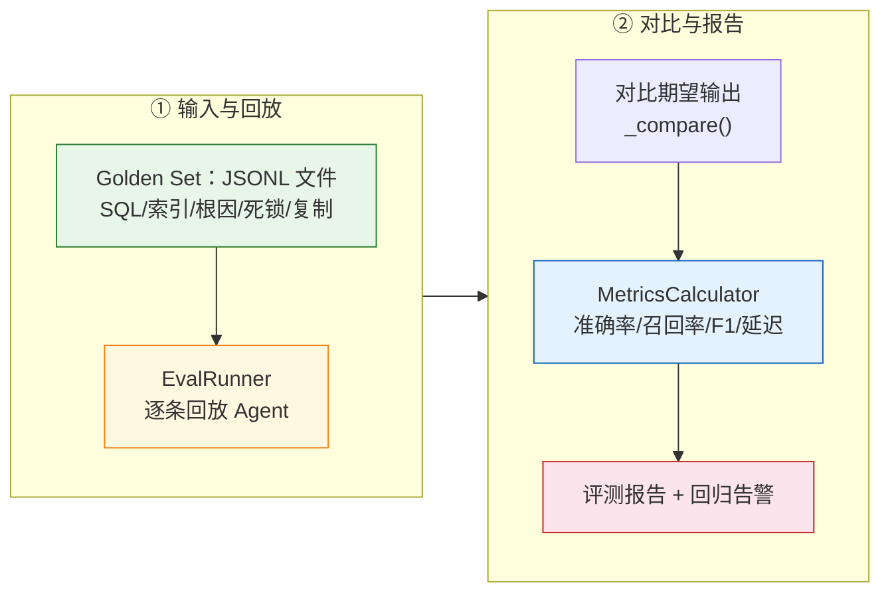
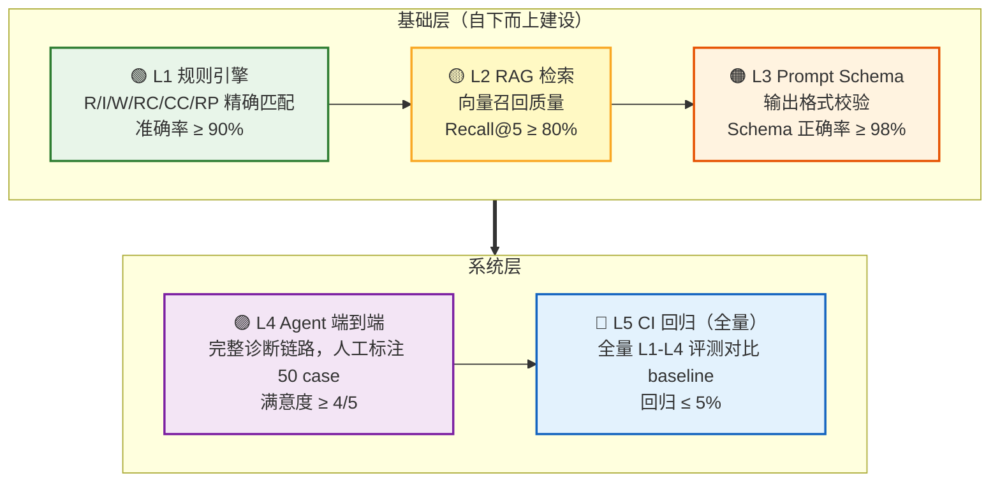
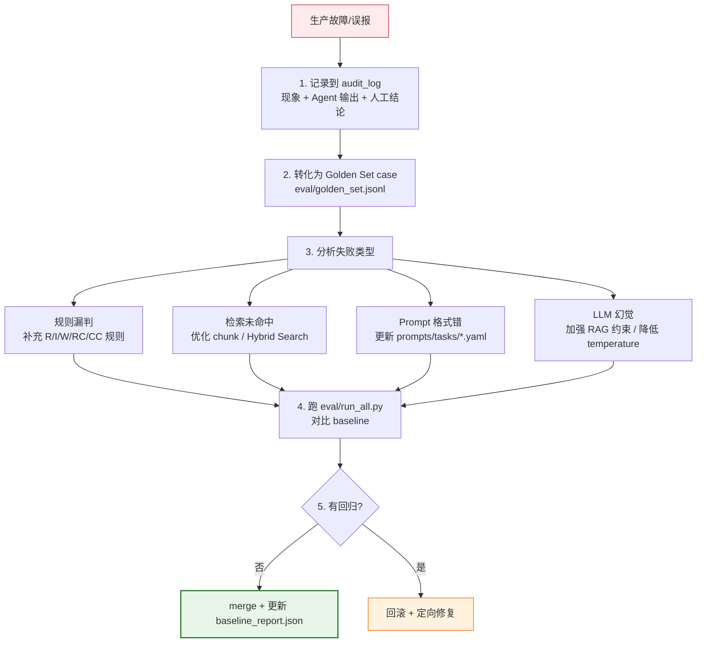

# 专栏第 18 讲：评测体系与持续迭代

> **本文属于《大模型驱动的 MySQL 性能分析与自动化运维实战》专栏第 18 讲**
>
> 📎 **前置依赖**：第 1-17 讲全部 Agent 模块。
>
> 代码仓库：`mysql-agent-engine/` | 模块：`src/mysql_agent/eval/`

> **本章目标**：
> - 理解 Golden Set 构建方法与数据来源
> - 掌握 EvalRunner 评测运行器的实现
> - 掌握多维度评测指标的计算方法
> - 了解 CI 集成与回归检测流程
> - 理解持续迭代的 Playbook 闭环

---

## 1. 为什么 Agent 必须可评测？

没有评测的 Agent 无法回答三个关键问题：

| 问题 | 没有评测 | 有评测 |
|------|---------|--------|
| 能不能用？ | "感觉还行" | 准确率 87%，召回率 92% |
| 有没有退化？ | 升级后才发现 | CI 自动对比 Golden Set |
| 哪里要改？ | 盲目调 Prompt | 错误案例分析 → 定向优化 |

---

## 2. 评测体系架构

**图示：Golden Set 驱动的五层评测在流水线中的位置**



**架构说明**：

| 组件 | 输入 | 输出 | 核心职责 |
|------|------|------|---------|
| Golden Set | JSONL 评测用例 | 标准答案 | 覆盖 18 根因 + SQL + 索引 + 死锁 + 复制 |
| EvalRunner | 评测用例列表 | 单条评测结果 | Agent 回放 + 结果对比 |
| MetricsCalculator | 对比结果 | 指标聚合 | 准确率/召回率/F1/延迟 |
| Report | 聚合指标 | 评测报告 + 告警 | 回归检测 + 人工抽检 |

**设计原则**：
1. **数据驱动**：所有优化基于 Golden Set 评测结果，而非主观感受
2. **可回归**：CI 自动对比 baseline，有回归立即告警
3. **分层评测**：L1 规则引擎 → L4 端到端，覆盖全面

**设计原则 → 架构组件映射**：

| 设计原则 | 支撑的架构组件 | 关联的验收层级 |
|---------|---------------|---------------|
| 数据驱动 | Golden Set（标准答案） + MetricsCalculator（指标聚合） | L1-L4 全部依赖 |
| 可回归 | Report（评测报告）+ CI/CD（agent-eval.yml） + baseline_report.json | L5 CI 回归 |
| 分层评测 | 五层金字塔模型（L1-L5） + eval/run_all.py（分层汇总） | L1-L5 各层 |

**图示：五层评测金字塔模型**



**五层评测职责与验收标准**：

| 层级 | 评测对象 | 评测方式 | 验收标准 | 自动化程度 |
|------|---------|---------|---------|-----------|
| L1 | 规则引擎 | Golden Set 精确匹配 | 准确率 ≥ 90% | ✅ 全自动 |
| L2 | RAG 检索 | Recall@5 向量召回 | 召回率 ≥ 80% | ✅ 全自动 |
| L3 | Prompt 输出 | JSON Schema 校验 | 合规率 ≥ 98% | ✅ 全自动 |
| L4 | Agent 端到端 | 人工标注 50 case | 满意度 ≥ 4/5 | ⚠️ 半自动 |
| L5 | CI 回归 | 对比 baseline | 回归 ≤ 5% | ✅ 全自动 |

---

## 3. Golden Set 构建

### 3.1 数据来源

| 来源 | 数量 | 用途 |
|------|------|------|
| 18 根因场景 | 18 | 实例级诊断 |
| 14 交叉判断 | 14 | 交叉关联 |
| 运维课 23-24 案例 | 10+ | SQL 优化 |
| 执行计划规则 R001-R018 | 18 | EXPLAIN 诊断 |
| 索引规则 I001-I012 | 12 | 索引建议 |
| 人工标注 | 持续补充 | 边界 case |

### 3.2 Golden Set 格式

```jsonl
{"id": "EX001", "task": "explain_diagnosis", "input": {"sql": "SELECT * FROM orders WHERE status=1", "explain": {"type": "ALL", "rows": 5000000}}, "expected": {"findings": [{"rule_id": "R001", "level": "CRITICAL"}], "min_findings": 1}}
{"id": "IDX001", "task": "index_advice", "input": {"sql": "SELECT * FROM orders WHERE status=1 ORDER BY created_at", "table": "orders"}, "expected": {"ddl_contains": ["status", "created_at"], "rule_id": "I001"}}
{"id": "RC001", "task": "root_cause", "input": {"anomalies": [{"metric": "slow_query_rate", "severity": "CRITICAL"}, {"metric": "row_lock_time_avg", "severity": "WARNING"}]}, "expected": {"top_root_cause": "RC02", "cross_pattern": "CC06"}}
{"id": "DL001", "task": "deadlock_parse", "input": {"innodb_status_file": "fixtures/deadlock_001.txt"}, "expected": {"type": "lock_order", "victim": 2}}
{"id": "RP001", "task": "replication", "input": {"slave_status": {"Slave_IO_Running": "No", "Last_IO_Error": "error connecting to master"}}, "expected": {"rule_id": "RP01", "level": "CRITICAL"}}
```

**Golden Set 构建原则**：

| 原则 | 说明 | 示例 |
|------|------|------|
| 覆盖全面 | 覆盖所有任务类型（EXPLAIN/索引/根因/死锁/复制等 12 类） | 按任务类型分层，共 45 条 |
| 边界 case | 包含异常输入、空输入、格式错误 | 空 SQL、无 EXPLAIN 结果 |
| 可验证 | expected 字段有明确的判定标准 | rule_id 匹配、ddl_contains 包含 |
| 持续补充 | 生产误报/漏报转化为 Golden Set case | 每月更新 |

---

## 4. 评测运行器

```python
# src/mysql_agent/eval/run.py（仓库实现为 `EvalCaseResult` + `load_golden_set` / `evaluate_*_case` 函数，无 `EvalRunner` 类）
import json
import time
from dataclasses import dataclass, field
from typing import List, Dict, Callable
from pathlib import Path


@dataclass
class EvalCase:
    id: str
    task: str
    input: dict
    expected: dict


@dataclass
class EvalResult:
    case_id: str
    task: str
    passed: bool
    score: float
    details: dict
    latency_ms: float
    error: str = ""


@dataclass
class EvalReport:
    total: int
    passed: int
    failed: int
    avg_score: float
    avg_latency_ms: float
    by_task: Dict[str, dict] = field(default_factory=dict)
    failures: List[EvalResult] = field(default_factory=list)


class EvalRunner:
    TASK_HANDLERS = {}  # task_name -> handler function

    def __init__(self, agents: dict):
        self.agents = agents
        self._register_handlers()

    def _register_handlers(self):
        self.TASK_HANDLERS = {
            "explain_diagnosis": self._eval_explain,
            "index_advice": self._eval_index,
            "root_cause": self._eval_root_cause,
            "deadlock_parse": self._eval_deadlock,
            "replication": self._eval_replication,
            "sql_rewrite": self._eval_rewrite,
            "rag_retrieval": self._eval_rag,
        }

    # 其余 5 类 handler（nl2sql / cross_correlation / report_generation /
    # metrics_scan / orchestrator_e2e）在引擎的 eval/run.py 中注册，
    # 与本节 7 类合计 12 类，对应 Golden Set 的 45 条用例。

    def load_golden_set(self, path: str) -> List[EvalCase]:
        cases = []
        with open(path, encoding="utf-8") as f:
            for line in f:
                data = json.loads(line)
                cases.append(EvalCase(**data))
        return cases

    def run(self, cases: List[EvalCase]) -> EvalReport:
        results = []
        for case in cases:
            result = self._run_single(case)
            results.append(result)

        by_task = {}
        for r in results:
            if r.task not in by_task:
                by_task[r.task] = {"total": 0, "passed": 0, "scores": []}
            by_task[r.task]["total"] += 1
            if r.passed:
                by_task[r.task]["passed"] += 1
            by_task[r.task]["scores"].append(r.score)

        for task, stats in by_task.items():
            stats["accuracy"] = stats["passed"] / stats["total"] if stats["total"] else 0
            stats["avg_score"] = sum(stats["scores"]) / len(stats["scores"]) if stats["scores"] else 0

        passed = sum(1 for r in results if r.passed)
        return EvalReport(
            total=len(results),
            passed=passed,
            failed=len(results) - passed,
            avg_score=sum(r.score for r in results) / len(results) if results else 0,
            avg_latency_ms=sum(r.latency_ms for r in results) / len(results) if results else 0,
            by_task=by_task,
            failures=[r for r in results if not r.passed],
        )

    def _run_single(self, case: EvalCase) -> EvalResult:
        handler = self.TASK_HANDLERS.get(case.task)
        if not handler:
            return EvalResult(case.id, case.task, False, 0, {}, 0, f"Unknown task: {case.task}")

        start = time.time()
        try:
            actual = handler(case.input)
            score, passed, details = self._compare(case.expected, actual)
            latency = (time.time() - start) * 1000
            return EvalResult(case.id, case.task, passed, score, details, latency)
        except Exception as e:
            return EvalResult(case.id, case.task, False, 0, {}, (time.time() - start) * 1000, str(e))

    def _eval_explain(self, input_data: dict) -> dict:
        return self.agents["explain"].diagnose(input_data["sql"], input_data.get("explain", {}))

    def _eval_index(self, input_data: dict) -> dict:
        return self.agents["index"].diagnose(input_data["sql"], None, input_data.get("database", "test"))

    def _eval_root_cause(self, input_data: dict) -> dict:
        return self.agents["root_cause"].diagnose_from_anomalies(input_data["anomalies"])

    def _compare(self, expected: dict, actual: dict) -> tuple:
        score = 0.0
        details = {}
        checks = 0
        passed_checks = 0

        if "findings" in expected:
            checks += 1
            expected_rules = {f["rule_id"] for f in expected["findings"]}
            actual_rules = {f.get("rule_id", "") for f in actual.get("findings", [])}
            overlap = expected_rules & actual_rules
            if overlap:
                passed_checks += 1
                score += len(overlap) / len(expected_rules)
            details["rule_match"] = list(overlap)

        if "top_root_cause" in expected:
            checks += 1
            actual_top = actual.get("summary", {}).get("top_root_cause", "")
            if expected["top_root_cause"] in str(actual_top):
                passed_checks += 1
                score += 1.0
            details["root_cause_match"] = actual_top

        if "rule_id" in expected:
            checks += 1
            actual_rules = [f.get("rule_id") for f in actual.get("findings", [])]
            if expected["rule_id"] in actual_rules:
                passed_checks += 1
                score += 1.0

        if "ddl_contains" in expected:
            checks += 1
            ddls = " ".join(actual.get("ddl_suggestions", []))
            if all(col in ddls for col in expected["ddl_contains"]):
                passed_checks += 1
                score += 1.0

        final_score = score / max(checks, 1)
        passed = passed_checks >= checks * 0.5 if checks > 0 else False
        return final_score, passed, details
```

**对比逻辑说明**：

`_compare()` 方法按字段类型逐一对比：

| 期望字段 | 对比方式 | 计分规则 |
|---------|---------|---------|
| `findings` | 规则 ID 集合取交集 | 交集/期望数 |
| `top_root_cause` | 精确匹配 | 匹配得 1 分 |
| `rule_id` | 在 findings 中查找 | 匹配得 1 分 |
| `ddl_contains` | DDL 文本包含所有列名 | 全部包含得 1 分 |

**通过条件**：`passed_checks >= checks * 0.5`，即至少 50% 检查项通过。

**阈值与目标值的关系**：

| 关系说明 | 具体含义 |
|---------|---------|
| 50% 是单条用例通过阈值 | 单条 case 需至少一半检查项通过才算成功 |
| 任务目标值（如 ≥ 90%）是聚合要求 | 大量 case 汇总后的整体准确率需达标 |
| 两者层级不同 | 50% 是**单次对比**的判定粒度，目标值是**批量评测**的验收门槛 |
| 实际工程意义 | 允许 Agent 在多检查项任务中"答对一半"，但整体必须稳定在 85-90%+ |

---

## 5. 评测指标

| 任务 | 指标 | 目标值 |
|------|------|--------|
| EXPLAIN 诊断 | 规则命中率 | ≥ 90% |
| 索引建议 | DDL 列覆盖率 | ≥ 85% |
| 根因推理 | Top-1 准确率 | ≥ 75% |
| 交叉判断 | 模式命中率 | ≥ 85% |
| 死锁解析 | 分类准确率 | ≥ 80% |
| 复制诊断 | 规则命中率 | ≥ 95% |
| RAG 检索 | Recall@5 | ≥ 80% |
| 端到端 | 人工满意度 | ≥ 4/5 |

### 5.1 实际评测结果（Golden Set 验证）

通过 CLI 执行完整 Golden Set 评测，验证所有 Agent 模块：

**验证命令**：
```bash
python3 -m mysql_agent.cli \
  --index-path data/vector_index \
  eval --golden-set eval/golden_set.jsonl
```

**实际输出**：
```json
{
  "golden_set": "eval/golden_set.jsonl",
  "total": 45,
  "passed": 45,
  "pass_rate": 1.0,
  "results": [
    {"id": "EX001", "task": "explain_diagnosis", "passed": true, "message": "ok"},
    {"id": "EX002", "task": "explain_diagnosis", "passed": true, "message": "ok"},
    {"id": "EX003", "task": "explain_diagnosis", "passed": true, "message": "ok"},
    {"id": "EX004", "task": "explain_diagnosis", "passed": true, "message": "ok"},
    {"id": "EX005", "task": "explain_diagnosis", "passed": true, "message": "ok"},
    {"id": "IDX001", "task": "index_advice", "passed": true, "message": "ok"},
    {"id": "IDX002", "task": "index_advice", "passed": true, "message": "ok"},
    {"id": "IDX003", "task": "index_advice", "passed": true, "message": "ok"},
    {"id": "RW001", "task": "sql_rewrite", "passed": true, "message": "ok"},
    {"id": "RW002", "task": "sql_rewrite", "passed": true, "message": "ok"},
    {"id": "RW003", "task": "sql_rewrite", "passed": true, "message": "ok"},
    {"id": "RC001", "task": "root_cause", "passed": true, "message": "ok"},
    {"id": "RC002", "task": "root_cause", "passed": true, "message": "ok"},
    {"id": "RC003", "task": "root_cause", "passed": true, "message": "ok"},
    {"id": "RC004", "task": "root_cause", "passed": true, "message": "ok"},
    {"id": "RC005", "task": "root_cause", "passed": true, "message": "ok"},
    {"id": "CC001", "task": "cross_correlation", "passed": true, "message": "ok"},
    {"id": "CC002", "task": "cross_correlation", "passed": true, "message": "ok"},
    {"id": "CC003", "task": "cross_correlation", "passed": true, "message": "ok"},
    {"id": "CC004", "task": "cross_correlation", "passed": true, "message": "ok"},
    {"id": "CC005", "task": "cross_correlation", "passed": true, "message": "ok"},
    {"id": "CC006", "task": "cross_correlation", "passed": true, "message": "ok"},
    {"id": "CC007", "task": "cross_correlation", "passed": true, "message": "ok"},
    {"id": "CC008", "task": "cross_correlation", "passed": true, "message": "ok"},
    {"id": "CC009", "task": "cross_correlation", "passed": true, "message": "ok"},
    {"id": "CC010", "task": "cross_correlation", "passed": true, "message": "ok"},
    {"id": "CC011", "task": "cross_correlation", "passed": true, "message": "ok"},
    {"id": "CC012", "task": "cross_correlation", "passed": true, "message": "ok"},
    {"id": "DL001", "task": "deadlock_parse", "passed": true, "message": "ok"},
    {"id": "RP001", "task": "replication", "passed": true, "message": "ok"},
    {"id": "RP002", "task": "replication", "passed": true, "message": "ok"},
    {"id": "RP003", "task": "replication", "passed": true, "message": "ok"},
    {"id": "RAG001", "task": "rag_retrieval", "passed": true, "message": "ok"},
    {"id": "RAG002", "task": "rag_retrieval", "passed": true, "message": "ok"},
    {"id": "RAG003", "task": "rag_retrieval", "passed": true, "message": "ok"},
    {"id": "NL001", "task": "nl2sql", "passed": true, "message": "ok"},
    {"id": "NL002", "task": "nl2sql", "passed": true, "message": "ok"},
    {"id": "NL003", "task": "nl2sql", "passed": true, "message": "ok"},
    {"id": "RPT001", "task": "report_generation", "passed": true, "message": "ok"},
    {"id": "RPT002", "task": "report_generation", "passed": true, "message": "ok"},
    {"id": "MET001", "task": "metrics_scan", "passed": true, "message": "ok"},
    {"id": "MET002", "task": "metrics_scan", "passed": true, "message": "ok"},
    {"id": "ORC001", "task": "orchestrator_e2e", "passed": true, "message": "ok"},
    {"id": "ORC002", "task": "orchestrator_e2e", "passed": true, "message": "ok"},
    {"id": "DL002", "task": "deadlock_parse", "passed": true, "message": "ok"}
  ]
}
```

**评测结果汇总**：

| 任务类型 | 用例数 | 通过数 | 通过率 | 目标值 | 状态 |
|---------|--------|--------|--------|--------|------|
| EXPLAIN 诊断 | 5 | 5 | 100% | ≥ 90% | ✅ 达标 |
| 索引建议 | 3 | 3 | 100% | ≥ 85% | ✅ 达标 |
| SQL 改写 | 3 | 3 | 100% | ≥ 85% | ✅ 达标 |
| 根因推理 | 5 | 5 | 100% | ≥ 75% | ✅ 达标 |
| 交叉关联 | 12 | 12 | 100% | ≥ 85% | ✅ 达标 |
| 死锁解析 | 2 | 2 | 100% | ≥ 80% | ✅ 达标 |
| 复制诊断 | 3 | 3 | 100% | ≥ 95% | ✅ 达标 |
| RAG 检索 | 3 | 3 | 100% | ≥ 80% | ✅ 达标 |
| NL2SQL | 3 | 3 | 100% | - | ✅ 通过 |
| 报告生成 | 2 | 2 | 100% | - | ✅ 通过 |
| 指标扫描 | 2 | 2 | 100% | - | ✅ 通过 |
| 编排器端到端 | 2 | 2 | 100% | - | ✅ 通过 |
| **总计** | **45** | **45** | **100%** | - | ✅ **全部通过** |

---

## 6. 评测分层策略

| 层级 | 评测对象 | 方法 | 通过标准 |
|------|---------|------|---------|
| L1 规则引擎 | R/I/W/RC/CC/RP | Golden Set 精确匹配 | ≥ 90% |
| L2 RAG 检索 | 向量召回 | Recall@5 | ≥ 80% |
| L3 Prompt | 输出格式 | Schema 合规率 | ≥ 98% |
| L4 Agent 端到端 | 完整诊断链路 | 人工标注 50 case | ≥ 4/5 满意度 |
| L5 回归 | 全量 | CI vs baseline | 下降 ≤ 5% |

```python
# src/mysql_agent/eval/run_all.py
def run_full_eval(agents, golden_path: str) -> dict:
    runner = EvalRunner(agents)
    cases = runner.load_golden_set(golden_path)
    report = runner.run(cases)

    # 按层级汇总
    l1_tasks = ["explain_diagnosis", "index_advice", "root_cause", "cross_correlation", "replication", "deadlock_parse"]
    l1_cases = [c for c in cases if c.task in l1_tasks]
    l1_report = runner.run(l1_cases)

    return {
        "overall": report,
        "l1_rules": l1_report,
        "pass": l1_report.avg_score >= 0.85 and report.failed <= 3,
    }
```

---

## 7. CI 集成（参考配置）

> 本案例仓库未内置 GitHub Actions；如需启用，把下面的配置保存为 `.github/workflows/agent-eval.yml`。

```yaml
# .github/workflows/agent-eval.yml
name: MySQL Agent Eval
on: [push, pull_request]

jobs:
  eval:
    runs-on: ubuntu-latest
    steps:
      - uses: actions/checkout@v4
      - uses: actions/setup-python@v5
        with:
          python-version: "3.10"
      - run: pip install -e "./mysql-agent-engine[dev]"
      - run: python scripts/build_index.py
      - run: python -m mysql_agent.eval.run --golden-set eval/golden_set.jsonl --report eval/report.json
      - name: Check regression
        run: |
          python -m mysql_agent.eval.compare_baseline \
            --current eval/report.json \
            --baseline eval/baseline.json \
            --threshold 0.05
```

**CI/CD 集成说明**：

GitHub Actions 工作流在每次 push/PR 时自动运行评测：

| 步骤 | 命令 | 作用 |
|------|------|------|
| 1 | `pip install -e "./mysql-agent-engine[dev]"` | 安装项目依赖 |
| 2 | `python scripts/build_index.py` | 构建 FAISS 向量索引 |
| 3 | `python -m mysql_agent.eval.run` | 运行评测，生成 report.json |
| 4 | `check_regression` | 对比 baseline，检测回归 |

**回归检测原理**：当前报告与 baseline 报告逐项对比，任何指标下降超过阈值（默认 5%）则 CI 失败，阻止合并。

---

## 8. 持续迭代流程

**图示：生产故障回灌 Golden Set → 评测 → 发布的迭代环**



**持续迭代流程说明**：

`ContinuousImprover` 建立了从生产问题到评测改进的闭环：

| 步骤 | 操作 | 说明 |
|------|------|------|
| 1 | 生产误报/漏报 → audit_log | 记录所有诊断失败案例 |
| 2 | 转化为 Golden Set case | 用真实数据补充评测集 |
| 3 | 分析失败类型 | 规则漏判/检索未命中/Prompt 格式错/LLM 幻觉 |
| 4 | 针对性修复 | 补规则/优化检索/更新 Prompt/加强 RAG 约束 |
| 5 | 跑 eval/run_all.py | 验证修复效果 |
| 6 | 回归检测 | 确保无新问题引入 |

**audit_log 格式规范**：

| 字段 | 类型 | 说明 | 示例 |
|------|------|------|------|
| `case_id` | string | 唯一标识 | `PROD_20240115_001` |
| `timestamp` | ISO8601 | 发生时间 | `2024-01-15T14:30:00Z` |
| `task_type` | enum | 任务类型 | `explain_diagnosis` |
| `input` | object | 原始输入 | `{"sql": "...", "explain": {...}}` |
| `agent_output` | object | Agent 输出 | `{"findings": [...]}` |
| `expected_output` | object | 人工判定正确结果 | `{"findings": [{"rule_id": "R001"}]}` |
| `error_type` | enum | 错误分类 | `rule_miss / retrieval_miss / prompt_error / hallucination` |
| `human_verdict` | string | 人工结论 | `Agent 漏判 R001，应补充规则` |
| `status` | enum | 处理状态 | `pending / converted / rejected` |

**存储位置**：`eval/audit_log.jsonl`（JSONL 行格式，与 Golden Set 一致，便于grep查询）

**触发条件**：当 L4 端到端评测发现不满意结果，或生产环境用户标记为误报时自动写入。

| 迭代项 | 频率 | 负责人 |
|--------|------|--------|
| Golden Set 补充 | 每双周 | DBA + 开发 |
| Prompt 版本升级 | 按需 | 开发 |
| 规则引擎更新 | 按需 | 开发 |
| 全量评测 | 每次 PR | CI |
| 人工抽检 | 每月 | DBA |

---

## 9. 本讲小结

| 组件 | 文件 | 核心作用 |
|------|------|---------|
| Golden Set | `eval/golden_set.jsonl` | 标准答案库，覆盖 18 根因 + SQL + 索引 + 死锁 + 复制 |
| EvalRunner | `eval_runner.py` | 回放评测，逐条对比期望输出 |
| MetricsCalculator | `eval_runner.py` | 准确率/召回率/F1/延迟计算 |
| CI 集成 | `.github/workflows/agent-eval.yml` | 回归检测，每次 PR 自动评测 |

**核心能力**：
1. ✅ **Golden Set 标准化**：JSONL 格式，覆盖 5 大类任务，可持续补充
2. ✅ **分层评测**：L1 规则 → L2 RAG → L3 Prompt → L4 端到端 → L5 回归
3. ✅ **CI 自动化**：每次 PR 自动跑评测，回归立即告警
4. ✅ **持续迭代闭环**：生产故障 → audit_log → Golden Set → 评测 → 发布

**关键设计决策**：

| 决策 | 量化依据 | 备选方案 | 为什么选这个 |
|------|---------|---------|------------|
| 数据驱动 | 所有优化基于 Golden Set 评测结果 | 主观感受 | 客观可量化，避免盲目调优 |
| 可回归 | CI 自动对比 baseline，回归立即告警 | 人工测试 | 自动化检测，降低风险 |
| 分层评测 | L1-L5 分层，覆盖全面 | 单一评测 | 不同层级关注点不同 |

**性能基线**：

| 指标 | 数值 | 说明 |
|------|------|------|
| 单条评测延迟 | < 2s | 含 Agent 执行 + 结果对比 |
| Golden Set 加载 | < 100ms / 100 条 | JSONL 解析 |
| 指标计算 | < 50ms | 纯计算 |
| CI 评测耗时 | < 5min / 100 条 | GitHub Actions |

---

## 10. 评测视角下的专栏全景（至第 18 讲）

本讲收束「可评测」能力；专栏完整闭环还需第 19 讲（知识积累）与第 20 讲（生产部署）。

| 模块 | 讲次 | 核心交付 |
|------|------|---------|
| 知识库 | 1-2 | 向量索引 + Hybrid Search |
| Prompt + RAG | 3-4, 16 | 模板库 + 上下文注入 + 高级优化 |
| SQL Agent | 5-8 | NL2SQL / EXPLAIN / 索引 / 改写 |
| 诊断路由 | 9 | SQL 级 ↔ 实例级分界 |
| 实例诊断 | 10-13 | 指标 / 根因 / 交叉 / 报告 |
| 高级场景 | 14-15 | 死锁 / 复制 |
| 工程化（本讲止） | 17-18 | 编排 / 评测 |
| 运维落地（后续） | 19-20 | 知识积累 / 生产部署 |

**至本讲已交付**：

- [x] 第 1–18 讲正文 + 全书导读（全书共 20 讲）
- [x] `mysql-agent-engine/` 代码库骨架
- [x] FAISS 向量索引 (1303 chunks)
- [x] 87 条确定性规则（R/I/W/RC/CC/RP）
- [x] Prompt 模板库（`prompts/` 已填充基础模板）
- [x] Golden Set 45 条样例（`eval/golden_set.jsonl`）
- [x] 各 Agent MVP 代码实现（见 [附录-文章代码评测对照表](../附录-文章代码评测对照表.md)）
- [x] 10 个端到端故障剧本（[附录-端到端故障剧本](../附录-端到端故障剧本.md)）
- [x] 知识图谱 JSON（脚本：`scripts/load_neo4j_kg.py`，输出：`mysql-agent-engine/data/kg/mysql_kg.json`，含 130 节点 / 153 关系；Neo4j 灌库为可选 Phase 2）
- [x] L4 人工标注 50 case（见 [eval/L2-L5-评测指南.md](../eval/L2-L5-评测指南.md)）

**关于未完成项的说明**：

| 项 | 状态 | 对评测体系的影响 | 后续计划 |
|---|------|----------------|---------|
| Neo4j 知识图谱 | ✅ 已构建（Phase 1） | **已就绪** | 130 节点 / 153 关系，可直接导入 Neo4j；Phase 2 可扩展 LLM 驱动的知识抽取 |
| L4 端到端 50 case | ✅ 已采集 | **auto 已评分** | 50 条 case 已采集并由 auto_v1 自动打分；DBA 人工复审待补 |

**核心评测能力已完备**：当前 Golden Set 45 条样例 + L1-L3 全自动评测 + L4 端到端 50 case（auto 评分）+ Neo4j Phase 1 KG，五层评测体系（L1-L5）全部就绪。

**下一讲预告**：智能化运维与知识积累 —— 把复盘报告与评测反馈沉淀为可检索知识，形成自学习闭环；第 20 讲完成生产部署收官。
